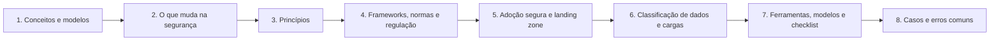

# 01 Fundamentos de Segurança em Nuvem

## Objetivo

Estabelecer a base conceitual e prática do framework: compreender os modelos de computação em nuvem e seus atores, o que muda na segurança quando a infraestrutura passa a ser software acessível por API, os princípios que orientam as decisões de segurança, os referenciais normativos e regulatórios aplicáveis (incluindo o contexto brasileiro), como adotar a nuvem de forma segura desde a landing zone, como classificar dados e cargas de trabalho antes de decidir onde e como hospedá-los, e como verificar os fundamentos com checklists e modelos reutilizáveis.

## Trilha de estudo recomendada

## Conteúdo da pasta

| Ordem | Arquivo | Objetivo |
|---|---|---|
| 1 | [conceitos-e-modelos-de-computacao-em-nuvem.md](conceitos-e-modelos-de-computacao-em-nuvem.md) | Definição NIST, características, modelos de serviço e de implantação, atores e planos de controle e de dados |
| 2 | [por-que-a-nuvem-muda-a-seguranca-ameacas-e-desafios.md](por-que-a-nuvem-muda-a-seguranca-ameacas-e-desafios.md) | Propriedades da nuvem, ameaças principais e superfície de ataque |
| 3 | [principios-de-seguranca-em-nuvem.md](principios-de-seguranca-em-nuvem.md) | CIA, defesa em profundidade, privilégio mínimo e demais princípios, com domínios do CCM |
| 4 | [frameworks-normas-e-regulacao-de-referencia.md](frameworks-normas-e-regulacao-de-referencia.md) | NIST, ISO, CSA, CIS, regulação brasileira e como combinar referenciais |
| 5 | [adocao-segura-de-nuvem-e-landing-zone.md](adocao-segura-de-nuvem-e-landing-zone.md) | Jornada de adoção, estratégias de migração, landing zone e guardrails |
| 6 | [classificacao-de-dados-e-de-cargas-de-trabalho.md](classificacao-de-dados-e-de-cargas-de-trabalho.md) | Classificação, criticidade, residência de dados e decisão de implantação |
| 7 | [ferramentas-fluxo-modelos-e-checklist-de-fundamentos.md](ferramentas-fluxo-modelos-e-checklist-de-fundamentos.md) | Verificações iniciais nos três provedores, modelos e checklist |
| 8 | [casos-de-uso-e-erros-comuns-em-fundamentos.md](casos-de-uso-e-erros-comuns-em-fundamentos.md) | Casos fictícios, erros comuns, exercícios e perguntas de revisão |

## Princípios da pasta

- A nuvem muda **quem opera** a infraestrutura, mas não elimina a responsabilidade pela segurança dos dados, das identidades e das configurações
- Identidade e configuração são os dois pontos de falha mais frequentes
- Segurança desde o desenho (secure by design) e por padrão, com automação
- Decisões baseadas em classificação de dados, criticidade e requisitos regulatórios
- Governança e guardrails antes da escala: a landing zone é o alicerce
- Referenciais combinados de forma coerente, e não empilhados sem critério

## Relação com outras pastas

- 02: modelo de responsabilidade compartilhada em detalhe
- 03 e 04: governança e gestão de riscos
- 05 a 10: arquitetura, identidade, zero trust, rede, dados e criptografia
- 11 e 12: conformidade e controles
- 13 a 18: monitoramento, ameaças, vulnerabilidades, avaliações e postura
- 19 a 21: cargas de trabalho, contêineres, Kubernetes e DevSecOps
- 22 e 23: resposta a incidentes e forense
- 24 a 26: Azure, AWS e Google Cloud
- 27 a 30: métricas, roteiro, auditorias e estudos de caso

## Referências

- Mell, P.; Grance, T. NIST SP 800-145: The NIST Definition of Cloud Computing. 2011.
- Jansen, W.; Grance, T. NIST SP 800-144: Guidelines on Security and Privacy in Public Cloud Computing. 2011.
- ISO/IEC 17788:2014 e ISO/IEC 17789:2014; ISO/IEC 27017:2015 e ISO/IEC 27018:2019
- Cloud Security Alliance. Security Guidance for Critical Areas of Focus in Cloud Computing v4.0 (2017); Cloud Controls Matrix v4 (2021)
- Cloud Security Alliance. Top Threats to Cloud Computing: Pandemic Eleven (2022)
- Brasil. Lei nº 13.709/2018 (LGPD); Resolução CMN nº 4.893/2021
