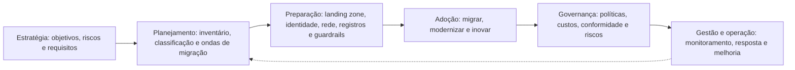
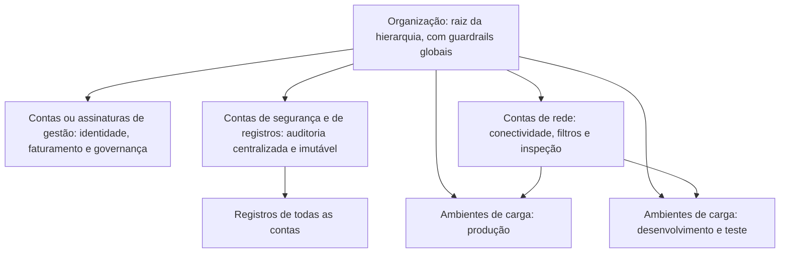

# Adoção Segura de Nuvem e Landing Zone

> **Objetivo pedagógico:** planejar a adoção segura de nuvem ao longo de sua jornada (estratégia, planejamento, preparação, adoção, governança e gestão), conhecer os frameworks de adoção dos principais provedores, escolher estratégias de migração com seus riscos de segurança, projetar uma landing zone (estrutura de contas, de assinaturas ou de projetos, com identidade, rede, registros e guardrails) e definir portões de segurança em cada fase.

## 1. A jornada de adoção



| Fase | Atividades de segurança |
|---|---|
| Estratégia | Alinhar objetivos de negócio e apetite de risco; definir princípios de segurança e requisitos regulatórios |
| Planejamento | Inventariar aplicações e dados; classificar (arquivo 6); definir ondas de migração e requisitos de segurança por onda |
| Preparação | Construir a landing zone com identidade, rede, registros e guardrails antes de migrar cargas |
| Adoção | Migrar com revisões de arquitetura, testes de segurança e validação de controles |
| Governança | Políticas como código, gestão de custos, conformidade contínua e revisão de riscos |
| Gestão | Monitoramento, resposta a incidentes, gestão de vulnerabilidades e melhoria contínua |

## 2. Frameworks de adoção dos provedores

| Framework | Estrutura resumida |
|---|---|
| Microsoft Cloud Adoption Framework | Estratégia, planejamento, preparação, adoção (migração e inovação), governança e gestão, com metodologias de segurança e de organização |
| AWS Cloud Adoption Framework | Perspectivas de negócios, de pessoas, de governança, de plataforma, de segurança e de operações |
| Google Cloud Adoption Framework | Temas de aprendizado, de liderança, de escala e de segurança, com fases de adoção |

Os frameworks são complementares; use-os como referência para a organização do programa, e não como substituto da avaliação de riscos própria.

## 3. Estratégias de migração e implicações de segurança

| Estratégia | Descrição | Implicação de segurança |
|---|---|---|
| Rehost (*lift and shift*) | Mover sem alterar | Leva vulnerabilidades e más configurações; exige hardening, segmentação e inventário |
| Replatform | Pequenas otimizações (por exemplo, banco gerenciado) | Reduz carga operacional; revisar a configuração dos serviços gerenciados |
| Refactor (*re-architect*) | Reprojetar para a nuvem | Oportunidade de segurança desde o desenho; exige revisão de arquitetura e testes |
| Repurchase | Substituir por SaaS | Avaliar o fornecedor, os dados, a identidade e as integrações |
| Relocate | Mover infraestrutura de virtualização em bloco | Preservar controles de rede e de acesso; atenção à conectividade |
| Retain | Manter no local | Integração híbrida segura e visibilidade unificada |
| Retire | Desativar | Descarte seguro de dados e revogação de acessos |

## 4. Landing zone

A **landing zone** é o ambiente de base, preparado e governado, em que as cargas de trabalho serão implantadas. Ela define a estrutura de contas, a identidade, a rede, os registros e os guardrails **antes** da migração.

### 4.1 Estrutura de isolamento

| Provedor | Hierarquia de gestão | Unidade de isolamento e de cobrança |
|---|---|---|
| AWS | Organização, unidades organizacionais e políticas de controle de serviços | Contas |
| Azure | Locatário do Entra ID, grupos de gerenciamento e Azure Policy | Assinaturas e grupos de recursos |
| Google Cloud | Organização, pastas e políticas de organização | Projetos |

### 4.2 Componentes de uma landing zone

| Componente | Descrição |
|---|---|
| Estrutura de contas, assinaturas ou projetos | Separação por ambiente (produção, desenvolvimento e teste), por criticidade e por função (rede, segurança e registros) |
| Identidade e acesso | Provedor de identidade central, MFA, acesso condicional, funções padronizadas, acesso temporário e contas de emergência protegidas |
| Rede | Rede central (hub), segmentação (spokes), conectividade híbrida, filtros e exposição mínima |
| Registro e monitoramento | Trilhas de auditoria organizacionais, centralização em conta de segurança, retenção e imutabilidade |
| Segurança e conformidade | Serviços de detecção, gestão de postura e linhas de base |
| Guardrails | Políticas preventivas e detectivas aplicadas de forma central |
| Gestão de custos | Orçamentos, alertas e etiquetas |
| Automação | Infraestrutura como código, pipelines e padrões reutilizáveis |
| Catálogo de serviços aprovados | Serviços e configurações permitidos |



### 4.3 Guardrails: exemplos

| Guardrail | Tipo | Exemplo |
|---|---|---|
| Restringir regiões | Preventivo | Negar criação de recursos fora de regiões aprovadas |
| Bloquear acesso público a armazenamentos | Preventivo | Política da organização que impede configurações públicas |
| Exigir criptografia | Preventivo e detectivo | Negar a criação de recursos sem criptografia; alertar nos existentes |
| Proibir o uso da conta raiz no dia a dia | Preventivo e detectivo | Alerta de qualquer uso; MFA e cofre |
| Impedir a desativação de registros | Preventivo | Negar a alteração das trilhas de auditoria |
| Exigir etiquetas de proprietário e de classificação | Preventivo | Negar recursos sem etiquetas obrigatórias |
| Limitar serviços e tipos de recursos | Preventivo | Lista de serviços aprovados |

```json
{
  "Version": "2012-10-17",
  "Statement": [
    {
      "Sid": "NegarRegioesNaoAutorizadas",
      "Effect": "Deny",
      "NotAction": ["iam:*", "organizations:*", "sts:*", "support:*", "cloudfront:*", "route53:*"],
      "Resource": "*",
      "Condition": {
        "StringNotEquals": { "aws:RequestedRegion": ["sa-east-1", "us-east-1"] }
      }
    }
  ]
}
```

O exemplo ilustra uma política de controle de serviços na AWS que nega ações fora de regiões aprovadas, com exceção de serviços globais. As exceções e as regiões devem refletir as necessidades da organização; teste antes de aplicar em produção.

## 5. Portões de segurança por fase

| Fase | Portão | Critérios de passagem |
|---|---|---|
| Estratégia | Aprovação de princípios e de requisitos | Requisitos regulatórios e apetite de risco documentados |
| Preparação | Aprovação da landing zone | Identidade, rede, registros e guardrails implementados e testados; contas de emergência protegidas |
| Antes de cada onda | Revisão de arquitetura e de riscos | Classificação concluída; modelo de ameaças; controles definidos; proprietário nomeado |
| Antes da produção | Teste de segurança e de recuperação | Varreduras, testes de configuração, backups e restauração, registros e alertas funcionando |
| Após a migração | Validação pós-implantação | Postura verificada; custos; desativação segura do ambiente anterior |
| Operação | Revisões periódicas | Conformidade, vulnerabilidades, acessos e incidentes |

## 6. Exemplo prático: requisitos de segurança por onda de migração

| Onda | Cargas | Estratégia | Requisitos de segurança principais |
|---|---|---|---|
| 1 | Sites institucionais e ambientes de desenvolvimento | Rehost e replatform | Landing zone validada; sem dados sensíveis; registros e alertas básicos |
| 2 | Aplicações internas com dados confidenciais | Replatform | Criptografia com chaves gerenciadas pela organização; acesso por identidade centralizada; backups testados |
| 3 | Sistemas com dados pessoais de clientes | Refactor | Modelo de ameaças; revisão de privacidade e RIPD; residência de dados; monitoramento reforçado |
| 4 | Sistemas críticos regulados | Refactor e retain (partes) | Requisitos regulatórios; resiliência multirregião; testes de recuperação e auditoria |

## 7. Casos de uso corporativos

- Construção da landing zone padrão da organização, com guardrails e infraestrutura como código.
- Definição do processo de aprovação de novas contas e de serviços.
- Planejamento de ondas de migração com requisitos de segurança verificáveis.

## 8. Normas e frameworks relevantes

- Microsoft Cloud Adoption Framework (incluindo as orientações de zonas de aterrissagem); AWS Cloud Adoption Framework e orientações de ambientes multicontas; Google Cloud Adoption Framework e hierarquia de recursos
- CSA Security Guidance v4.0; NIST CSF 2.0 (Governar); ISO/IEC 27001:2022; ISO/IEC 27017:2015
- CIS Foundations Benchmarks; CISA Cloud Security Technical Reference Architecture

## 9. Checklist operacional: preparação da landing zone

- [ ] Estrutura de contas, assinaturas ou projetos definida por ambiente e por função
- [ ] Provedor de identidade central com MFA resistente a phishing para administradores
- [ ] Contas de emergência protegidas, monitoradas e testadas
- [ ] Conta raiz sem uso rotineiro, com MFA e alertas de uso
- [ ] Trilhas de auditoria organizacionais habilitadas, centralizadas e imutáveis
- [ ] Guardrails de regiões, de acesso público, de criptografia e de registros aplicados
- [ ] Rede base com segmentação e sem exposição administrativa à internet
- [ ] Etiquetas obrigatórias (proprietário, classificação e ambiente) definidas
- [ ] Orçamentos e alertas de custo configurados
- [ ] Infraestrutura como código versionada e revisada
- [ ] Portões de segurança definidos para cada onda de migração

## 10. Referências

- Microsoft. Cloud Adoption Framework for Azure. Documentação vigente.
- Amazon Web Services. AWS Cloud Adoption Framework (versão 3.0, 2021 e atualizações) e AWS Prescriptive Guidance.
- Google Cloud. Cloud Adoption Framework e Security Foundations Blueprint. Documentação vigente.
- Cloud Security Alliance. Security Guidance for Critical Areas of Focus in Cloud Computing v4.0. 2017.
- CISA. Cloud Security Technical Reference Architecture. 2022.
