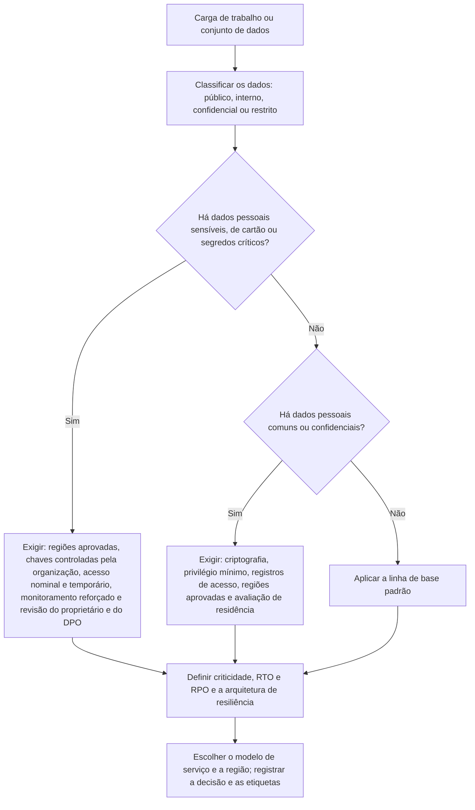

# Classificação de Dados e de Cargas de Trabalho

> **Objetivo pedagógico:** classificar dados e cargas de trabalho como base das decisões de segurança em nuvem: definir níveis de classificação e tratamentos correspondentes, avaliar a criticidade (impacto nos negócios, tempos de recuperação) e os requisitos legais (dados pessoais e sensíveis, residência e transferência internacional), registrar a classificação por meio de etiquetas e de metadados, e decidir o modelo de serviço, a região e os controles exigidos por meio de uma matriz de decisão.

## 1. Por que classificar

Sem classificação, todos os dados recebem o mesmo tratamento: ou **controle excessivo** (custo e atrito) ou **controle insuficiente** (risco). A classificação orienta onde hospedar, que criptografia usar, quem pode acessar, quanto reter, que monitoramento aplicar e que evidências produzir.

## 2. Níveis de classificação de dados (modelo de referência)

| Nível | Descrição | Exemplos | Tratamento mínimo em nuvem |
|---|---|---|---|
| Público | Informação destinada à divulgação | Materiais de marketing publicados | Integridade; controle de alterações |
| Interno | Uso interno; impacto baixo se divulgado | Comunicados internos, procedimentos gerais | Acesso autenticado; criptografia padrão |
| Confidencial | Impacto significativo se divulgado | Contratos, dados financeiros, dados pessoais comuns, código-fonte | Criptografia, acesso por função com privilégio mínimo, registro de acesso, regiões aprovadas |
| Restrito | Impacto grave se divulgado | Dados pessoais sensíveis, segredos industriais críticos, dados de cartão, credenciais | Criptografia com chaves controladas pela organização, acesso nominal e temporário, monitoramento reforçado, isolamento e aprovação do proprietário |

Adapte os níveis e os nomes à política da organização. O essencial é que cada nível tenha **requisitos objetivos**.

## 3. Dados pessoais e sensíveis (LGPD)

| Categoria | Definição (resumo) | Observações |
|---|---|---|
| Dado pessoal | Informação relacionada a pessoa natural identificada ou identificável | Exige base legal, finalidade e segurança |
| Dado pessoal sensível | Origem racial ou étnica, convicção religiosa, opinião política, filiação sindical, saúde, vida sexual, dado genético ou biométrico, quando vinculado a uma pessoa | Tratamento com hipóteses legais mais restritas (LGPD, art. 11) |
| Dado anonimizado | Dado que não permite a identificação | Fora da LGPD, se a anonimização for efetiva |
| Dado de crianças e adolescentes | Proteção específica | Melhor interesse (art. 14) |
| Dados de cartão (PCI) | Número do cartão, código de segurança | PCI DSS; classificar como restrito |

Para esses dados, a nuvem exige atenção à **residência**, à **transferência internacional** (arts. 33 a 36 e regulamentação da ANPD), ao **contrato com o operador** e à **comunicação de incidentes** (art. 48).

## 4. Criticidade das cargas de trabalho

| Critério | Pergunta | Exemplo de escala |
|---|---|---|
| Impacto no negócio | Qual o efeito da indisponibilidade? | Baixo, médio, alto ou crítico |
| Tempo de recuperação (RTO) | Em quanto tempo precisa voltar? | Minutos, horas ou dias |
| Ponto de recuperação (RPO) | Quanta perda de dados é tolerável? | Zero, minutos, horas ou dias |
| Dependências | Quais serviços dependem desta carga? | Número e criticidade |
| Exposição | Está na internet ou é interna? | Pública, parceiros ou interna |
| Conformidade | Há requisitos regulatórios específicos? | LGPD, setorial, PCI |
| Impacto financeiro e reputacional | Que perdas decorrem de falhas? | Faixas de valor |

A análise de impacto nos negócios (BIA) fornece RTO e RPO, que determinam a **arquitetura de resiliência** (zonas, regiões, backups e testes de recuperação).

## 5. Residência, soberania e transferência de dados

| Tema | Orientação |
|---|---|
| Residência de dados | Verifique em que regiões os dados são armazenados, replicados, processados e copiados (backups, suporte e telemetria) |
| Soberania | Alguns setores e contratos exigem armazenamento no Brasil ou controle local das chaves |
| Transferência internacional | Mecanismos previstos na LGPD e na regulamentação da ANPD (cláusulas-padrão, decisão de adequação e outros) |
| Acesso por governos estrangeiros | Avalie o risco jurídico e técnico (por exemplo, controle de chaves e criptografia) |
| Serviços globais | Alguns serviços processam dados fora da região escolhida: leia a documentação do serviço |
| Contratos | Cláusulas sobre localização, subprocessadores, auditoria e notificação |

## 6. Registro da classificação: etiquetas e metadados

Uma classificação só é útil se estiver **associada ao recurso**. Padronize as etiquetas obrigatórias:

```json
{
  "Etiquetas-obrigatorias": {
    "proprietario": "financeiro-contas-a-pagar",
    "classificacao": "confidencial",
    "dados-pessoais": "sim",
    "dados-sensiveis": "nao",
    "criticidade": "alta",
    "ambiente": "producao",
    "centro-de-custo": "CC-1042",
    "regulacao": "lgpd"
  }
}
```

| Ferramenta (categoria) | Uso |
|---|---|
| Etiquetas e metadados dos recursos | Classificação, proprietário e ambiente; aplicação por políticas |
| Rótulos de sensibilidade de dados em serviços de produtividade e de proteção de informações | Classificação de documentos e de e-mails |
| Descoberta e classificação automática de dados em armazenamentos (serviços dos provedores e de terceiros) | Localizar dados sensíveis em buckets e bancos |
| Catálogos de dados | Inventário e linhagem |

Os nomes dos serviços variam entre provedores e mudam com o tempo; consulte a documentação vigente (pasta 09).

## 7. Matriz de decisão de implantação



### Exemplo de regra de decisão em código (ilustrativo)

```python
# Matriz simplificada: classificação -> requisitos mínimos (exemplo didático; adapte à política da organização)
REQUISITOS = {
    "publico":      {"criptografia": "padrao", "chaves": "provedor", "acesso": "autenticado", "regioes": "qualquer aprovada"},
    "interno":      {"criptografia": "padrao", "chaves": "provedor", "acesso": "por funcao", "regioes": "aprovadas"},
    "confidencial": {"criptografia": "obrigatoria", "chaves": "gerenciadas pelo cliente (recomendado)", "acesso": "privilegio minimo + registro", "regioes": "aprovadas"},
    "restrito":     {"criptografia": "obrigatoria", "chaves": "controladas pela organização", "acesso": "nominal e temporario + monitoramento reforcado", "regioes": "Brasil ou aprovadas pelo DPO"},
}

def requisitos_de_implantacao(classificacao: str, dados_pessoais: bool, dados_sensiveis: bool, criticidade: str) -> dict:
    base = dict(REQUISITOS[classificacao])
    extras = []
    if dados_pessoais:
        extras.append("Avaliar base legal, RIPD, residência e transferência internacional (LGPD)")
    if dados_sensiveis:
        extras.append("Revisão do DPO e do proprietário; acesso nominal; retenção mínima")
    if criticidade in ("alta", "critica"):
        extras.append("Arquitetura multi-zona; backups imutáveis; teste de recuperação semestral")
    base["requisitos_adicionais"] = extras
    return base

print(requisitos_de_implantacao("confidencial", dados_pessoais=True, dados_sensiveis=False, criticidade="alta"))
```

O código é **didático**: a decisão real depende da política, da regulação e da análise de riscos da organização.

## 8. Exemplo prático: classificação de cinco conjuntos de dados

| Conjunto | Classificação | Dados pessoais | Criticidade | Decisões principais |
|---|---|---|---|---|
| Site institucional | Público | Não | Média | Hospedagem em região aprovada; controle de alterações; proteção de integridade |
| Intranet | Interno | Parcial (nomes) | Média | Acesso por identidade central; criptografia padrão |
| Contratos de clientes | Confidencial | Sim | Alta | Chaves gerenciadas pela organização; acesso por função; registro de acesso; retenção |
| Prontuários de saúde | Restrito | Sim (sensíveis) | Crítica | Residência no Brasil; chaves da organização; acesso nominal; monitoramento reforçado; revisão do DPO |
| Código-fonte proprietário | Restrito | Não | Alta | Repositório com acesso por função e por dispositivo; varredura de segredos; auditoria |

## 9. Casos de uso corporativos

- Política de classificação de dados orientada para a nuvem, com requisitos objetivos por nível.
- Definição das etiquetas obrigatórias e de políticas que impeçam recursos sem classificação.
- Avaliação de serviços novos (SaaS e PaaS) conforme a classificação dos dados que receberão.

## 10. Normas e frameworks relevantes

- ISO/IEC 27002:2022 (5.9 inventário de ativos, 5.12 classificação, 5.13 rotulagem e 5.14 transferência de informações)
- ISO/IEC 27018:2019; ISO/IEC 27701:2019; NIST SP 800-60 (categorização); FIPS 199; CSA CCM v4 (DSP)
- LGPD, arts. 5º, 6º, 11, 14, 33 a 36, 38 e 46; Resolução CD/ANPD sobre transferência internacional (2024)
- CIS Controls v8.1 (controle 3, proteção de dados); PCI DSS v4.0

## 11. Checklist operacional: classificação antes de implantar

- [ ] Dados classificados em um nível da política, com proprietário nomeado
- [ ] Presença de dados pessoais, sensíveis, de cartão ou de segredos identificada
- [ ] Criticidade, RTO e RPO definidos e refletidos na arquitetura de resiliência
- [ ] Residência, regiões e transferência internacional avaliadas (e aprovadas pelo DPO quando necessário)
- [ ] Etiquetas obrigatórias aplicadas e verificadas por política
- [ ] Controles mínimos do nível implementados (criptografia, acesso, registros e monitoramento)
- [ ] Decisão de implantação registrada (arquivo 7)
- [ ] Revisão periódica da classificação

## 12. Referências

- Stine, K. et al. NIST SP 800-60 Vol. 1: Guide for Mapping Types of Information and Information Systems to Security Categories. 2008.
- NIST. FIPS 199: Standards for Security Categorization of Federal Information and Information Systems. 2004.
- ISO/IEC 27002:2022. Controles de segurança da informação; ISO/IEC 27018:2019.
- Brasil. Lei nº 13.709/2018 (LGPD).
- ANPD. Regulamento de transferência internacional de dados pessoais e cláusulas-padrão (2024).
- Cloud Security Alliance. CCM v4, domínio DSP. 2021.
