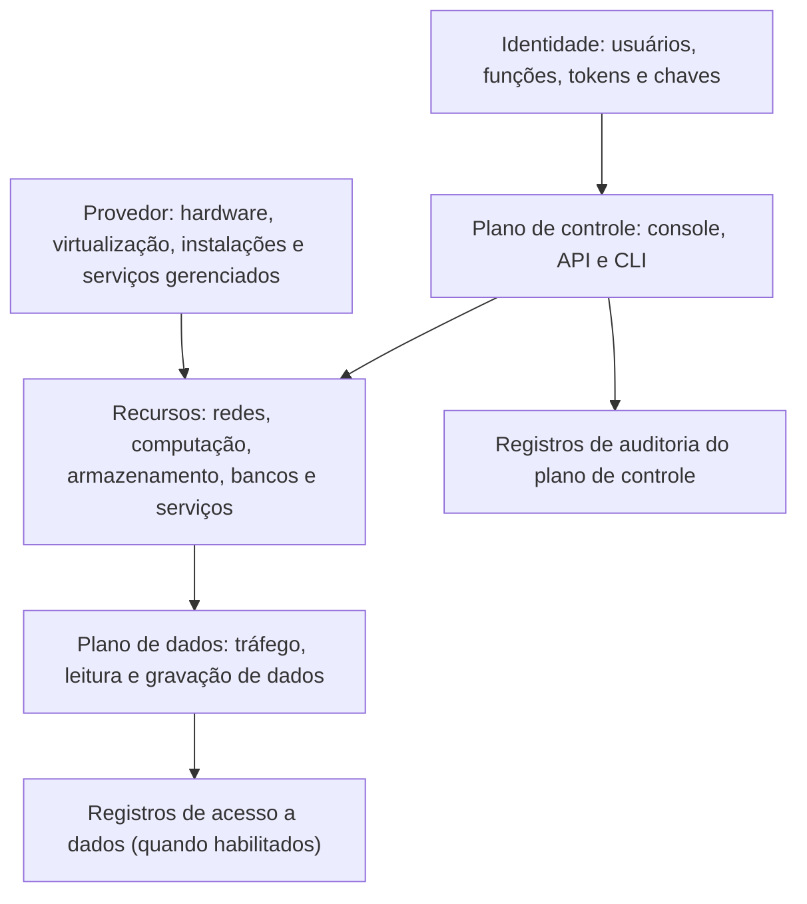

# Conceitos e Modelos de Computação em Nuvem

> **Objetivo pedagógico:** compreender a definição de computação em nuvem do NIST, suas cinco características essenciais, os modelos de serviço (IaaS, PaaS e SaaS) e de implantação (privada, comunitária, pública e híbrida), os modelos derivados (contêineres, funções e multicloud), os atores definidos pelas normas (consumidor, provedor, parceiro, auditor, intermediário e transportador) e a distinção entre plano de controle e plano de dados, relacionando cada conceito às suas implicações de segurança.

## 1. Definição

O NIST define computação em nuvem como um modelo que permite **acesso por rede, de forma conveniente e sob demanda, a um conjunto compartilhado de recursos computacionais configuráveis** (redes, servidores, armazenamento, aplicações e serviços), que podem ser rapidamente provisionados e liberados com mínimo esforço de gestão ou de interação com o provedor (NIST SP 800-145).

Do ponto de vista de segurança, a definição tem uma consequência central: **a infraestrutura passa a ser controlada por interfaces programáveis (APIs)**. Quem controla as credenciais e as permissões dessas interfaces controla a infraestrutura.

## 2. As cinco características essenciais e suas implicações de segurança

| Característica | Descrição | Implicação de segurança |
|---|---|---|
| Autoatendimento sob demanda | O consumidor provisiona recursos sem interação humana com o provedor | Qualquer pessoa com permissão pode criar recursos: é preciso governança, guardrails e inventário |
| Amplo acesso pela rede | Os serviços são acessados por mecanismos padronizados (internet e redes privadas) | A superfície de ataque inclui a internet; identidade e criptografia em trânsito tornam-se essenciais |
| Agrupamento de recursos (multilocação) | Os recursos do provedor atendem vários consumidores, de forma dinâmica | Isolamento entre locatários é responsabilidade do provedor; a configuração correta de cada locatário é do consumidor |
| Elasticidade rápida | Capacidade aumenta e diminui com a demanda | Recursos efêmeros dificultam inventário, monitoramento e forense; segurança deve ser automatizada |
| Serviço mensurado | O uso é medido e faturado | O consumo é um sinal de segurança (abuso, mineração e vazamentos); custos exigem alertas |

## 3. Modelos de serviço

| Modelo | O que o provedor entrega | O que o consumidor gerencia | Exemplos de serviços | Foco de segurança do consumidor |
|---|---|---|---|---|
| IaaS (infraestrutura como serviço) | Computação, armazenamento e rede virtualizados | Sistema operacional, aplicações, dados, configuração de rede e identidades | Máquinas virtuais, discos, redes virtuais e balanceadores | Hardening, patches, rede, identidades, dados e registros |
| PaaS (plataforma como serviço) | Plataforma de execução e de gerenciamento de aplicações, bancos de dados e filas | Aplicações, dados, configuração do serviço e identidades | Serviços de aplicações web, bancos de dados gerenciados e plataformas de contêineres gerenciadas | Código seguro, configuração do serviço, dados, identidades e integrações |
| SaaS (software como serviço) | Aplicação completa | Dados, usuários, configuração e integrações | Suítes de produtividade, CRM e sistemas de RH | Identidade, permissões, configuração, compartilhamento externo, integrações e retenção |

### Modelos derivados e termos frequentes

| Termo | Descrição | Observação de segurança |
|---|---|---|
| Contêineres como serviço (CaaS) e Kubernetes gerenciado | Orquestração de contêineres operada pelo provedor | Segurança de imagens, de configuração do cluster e de identidades de carga de trabalho (pastas 19 e 20) |
| Funções como serviço (FaaS) e *serverless* | Execução de código por evento, sem gerenciar servidores | Permissões da função, entradas de eventos, dependências e registros |
| Banco de dados como serviço (DBaaS) | Banco gerenciado | Rede, criptografia, backups e controle de acesso |
| Identidade como serviço (IDaaS) | Provedor de identidade em nuvem | Ponto central de confiança; proteção reforçada |
| Segurança como serviço (SECaaS) | Serviços de segurança entregues pela nuvem | Dependência e integração de dados de segurança |
| XaaS | Qualquer capacidade entregue como serviço | Aplicar o mesmo raciocínio de responsabilidades |

## 4. Modelos de implantação

| Modelo | Descrição | Considerações de segurança |
|---|---|---|
| Nuvem privada | Infraestrutura para uma única organização, interna ou hospedada | Maior controle, mas a organização assume a operação e o ciclo de vida |
| Nuvem comunitária | Infraestrutura compartilhada por organizações com interesses comuns (por exemplo, setor regulado) | Governança compartilhada e requisitos comuns |
| Nuvem pública | Infraestrutura de um provedor, aberta a vários clientes | Isolamento lógico, modelo de responsabilidade compartilhada e dependência do provedor |
| Nuvem híbrida | Composição de duas ou mais infraestruturas (por exemplo, local e pública) | Conectividade segura, identidade unificada, políticas consistentes e visibilidade integrada |
| Multicloud | Uso de mais de um provedor de nuvem pública | Complexidade de identidade, de políticas e de monitoramento; competências distintas; risco de inconsistência |

## 5. Atores

A arquitetura de referência do NIST (SP 500-292) define cinco atores, e a norma ISO/IEC 17789 define papéis equivalentes:

| Ator | Descrição | Relevância para a segurança |
|---|---|---|
| Consumidor (cliente do serviço) | Organização ou pessoa que usa os serviços | Responsável pela configuração e pelos dados |
| Provedor | Entidade que disponibiliza os serviços | Responsável pela segurança "da" nuvem e pelo cumprimento dos compromissos contratuais |
| Auditor | Avalia serviços, operações e segurança de forma independente | Fonte de garantia (relatórios e certificações) |
| Intermediário (broker) | Gerencia o uso, a entrega e a integração de serviços | Ponto adicional de confiança |
| Transportador (carrier) | Fornece conectividade entre consumidores e provedores | Disponibilidade e proteção do trânsito |
| Parceiro de serviço (ISO/IEC 17789) | Terceiro que apoia atividades do provedor ou do cliente | Cadeia de suprimentos |

## 6. Plano de controle e plano de dados

| Plano | Descrição | Exemplos | Importância |
|---|---|---|---|
| Plano de controle (gerenciamento) | Interfaces e serviços que criam, configuram e gerenciam recursos | Console, API, linha de comando, ferramentas de infraestrutura como código | Quem o controla controla a infraestrutura; é o alvo principal de ataques de identidade |
| Plano de dados | Fluxos que processam e armazenam dados dos clientes | Leitura e gravação de objetos, tráfego de aplicações, consultas a bancos | Exige controles de acesso, criptografia e registros específicos |

## 7. Termos técnicos essenciais

| Termo | Descrição |
|---|---|
| Região e zona de disponibilidade | Localização geográfica e domínios de falha independentes dentro de uma região |
| Virtualização | Abstração de hardware que permite múltiplas máquinas virtuais compartilharem o mesmo servidor |
| Contêiner | Unidade de empacotamento que compartilha o núcleo do sistema operacional, com isolamento por processo |
| Orquestração | Automação da implantação, do escalonamento e da gestão de contêineres |
| Infraestrutura como código (IaC) | Definição da infraestrutura em arquivos versionados e executáveis |
| Conta, assinatura e projeto | Unidades de isolamento e de cobrança dos provedores (conta na AWS, assinatura no Azure e projeto no Google Cloud) |
| Função, identidade gerenciada e conta de serviço | Identidades atribuídas a cargas de trabalho |
| Serviço gerenciado | Serviço cuja operação é do provedor, com configuração do cliente |
| Locatário (tenant) | Instância isolada de um cliente em um serviço multilocação |

## 8. Exemplo prático: escolha do modelo de serviço para cinco cargas

| Carga | Modelo possível | Justificativa de segurança |
|---|---|---|
| Sistema legado com requisitos específicos de sistema operacional | IaaS | Controle total, com responsabilidade de hardening e de patches |
| Nova aplicação web com banco de dados | PaaS | Reduz a gestão do sistema operacional e de patches; foco em código e configuração |
| E-mail e colaboração | SaaS | Foco em identidade, em compartilhamento externo e em retenção |
| Processamento de eventos de curta duração | FaaS | Permissões mínimas por função e proteção das entradas |
| Plataforma de microsserviços | CaaS (Kubernetes gerenciado) | Segurança de imagens, de políticas e de identidades de cargas (pastas 19 e 20) |

## 9. Casos de uso corporativos

- Padronização da linguagem sobre nuvem entre segurança, arquitetura, jurídico e negócio.
- Definição de requisitos de segurança por modelo de serviço em processos de aquisição.
- Treinamento de equipes de segurança que vêm de ambientes locais.

## 10. Normas e frameworks relevantes

- NIST SP 800-145 (definição); NIST SP 500-292 (arquitetura de referência); NIST SP 800-146 (síntese)
- ISO/IEC 17788:2014 (visão geral e vocabulário); ISO/IEC 17789:2014 (arquitetura de referência)
- CSA Security Guidance v4.0, domínio de conceitos e arquitetura

## 11. Checklist operacional: ao adotar um serviço de nuvem

- [ ] Modelo de serviço identificado (IaaS, PaaS, SaaS, CaaS ou FaaS)
- [ ] Modelo de implantação definido (pública, privada, híbrida ou multicloud)
- [ ] Responsabilidades do provedor e do cliente identificadas para este serviço (pasta 02)
- [ ] Plano de controle protegido: identidades, MFA e registros de auditoria
- [ ] Plano de dados: controle de acesso, criptografia e registros definidos
- [ ] Região, residência de dados e requisitos regulatórios verificados
- [ ] Inventário e proprietário do recurso definidos

## 12. Referências

- Mell, P.; Grance, T. NIST SP 800-145: The NIST Definition of Cloud Computing. 2011.
- Liu, F. et al. NIST SP 500-292: NIST Cloud Computing Reference Architecture. 2011.
- ISO/IEC 17788:2014. Cloud computing: Overview and vocabulary; ISO/IEC 17789:2014. Cloud computing: Reference architecture.
- Cloud Security Alliance. Security Guidance for Critical Areas of Focus in Cloud Computing v4.0. 2017.
- Krutz, R.; Vines, R. Cloud Security: A Comprehensive Guide to Secure Cloud Computing. Wiley, 2010.
