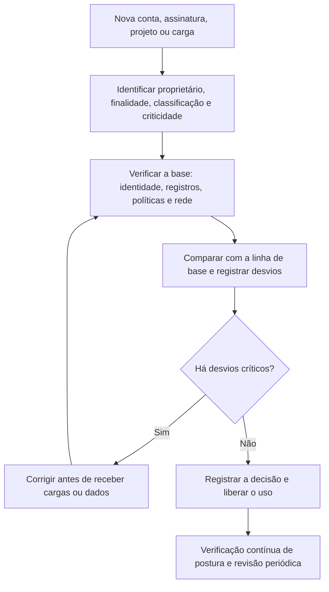

# Ferramentas, Fluxo, Modelos e Checklist de Fundamentos

> **Objetivo pedagógico:** executar verificações iniciais de fundamentos nos três principais provedores com comandos de **somente leitura**, padronizar o fluxo de avaliação de uma carga ou de uma conta, usar modelos de registro (ficha de carga, registro de decisão de segurança e inventário de responsabilidades) e aplicar um checklist de fundamentos para os primeiros 30 dias de uma nova conta, assinatura ou projeto.

> **Segurança:** os comandos abaixo apenas **consultam** configurações. Execute-os com uma identidade de leitura, em contas autorizadas, e registre os resultados como evidência. Nomes de recursos e identificadores são fictícios; adapte os parâmetros. As opções dos comandos mudam entre versões das ferramentas: confirme na documentação.

## 1. Ferramentas por finalidade

| Finalidade | Ferramentas |
|---|---|
| Interface de linha de comando dos provedores | AWS CLI, Azure CLI e PowerShell (Az), Google Cloud CLI |
| Infraestrutura como código | Terraform, OpenTofu, CloudFormation, Bicep e Pulumi |
| Políticas como código | Políticas de controle de serviços e do AWS Config, Azure Policy, políticas de organização do Google Cloud, Open Policy Agent |
| Verificação de postura (CSPM) | Serviços nativos dos provedores e ferramentas de terceiros (pasta 17) |
| Linhas de base e auditoria técnica | CIS Benchmarks e ferramentas de verificação de código aberto |
| Inventário e etiquetas | Serviços de inventário dos provedores e catálogos de ativos |
| Documentação e decisões | Markdown, registros de decisão de arquitetura (ADR) e repositório Git |

## 2. Fluxo de avaliação de fundamentos



## 3. Verificações de somente leitura: AWS

```bash
# Identidade atual (confirme a conta e o perfil usados)
aws sts get-caller-identity

# A conta raiz tem MFA habilitado? (1 = sim)
aws iam get-account-summary --query "SummaryMap.AccountMFAEnabled"

# Trilhas de auditoria: existência, abrangência multirregião e validação de integridade dos logs
aws cloudtrail describe-trails --query "trailList[].[Name,IsMultiRegionTrail,LogFileValidationEnabled,S3BucketName]" --output table

# Bloqueio de acesso público no nível da conta (substitua o identificador da conta)
aws s3control get-public-access-block --account-id 111122223333

# Grupos de segurança com SSH aberto para a internet
aws ec2 describe-security-groups \
  --filters Name=ip-permission.cidr,Values=0.0.0.0/0 Name=ip-permission.from-port,Values=22 \
  --query "SecurityGroups[].[GroupId,GroupName]" --output table

# Usuários IAM com chaves de acesso (candidatos a revisão)
aws iam generate-credential-report >/dev/null && aws iam get-credential-report --query Content --output text | base64 -d | head -n 5
```

## 4. Verificações de somente leitura: Azure

```bash
# Assinaturas acessíveis e contexto atual
az account list --output table

# Atribuições de política na assinatura (guardrails existentes)
az policy assignment list --output table

# Configurações de diagnóstico no nível da assinatura (log de atividade enviado a um destino?)
az monitor diagnostic-settings subscription list --subscription "<ID-DA-ASSINATURA>" --output table

# Atribuições de função com papel de Proprietário (revisar a necessidade)
az role assignment list --all --query "[?roleDefinitionName=='Owner'].{principal:principalName, escopo:scope}" --output table
```

## 5. Verificações de somente leitura: Google Cloud

```bash
# Projetos acessíveis e organização
gcloud organizations list
gcloud projects list --format="table(projectId,name,parent.id)"

# Destinos de exportação de logs (sinks) em um projeto
gcloud logging sinks list --project=ID-DO-PROJETO

# Contas de serviço do projeto (revisar necessidade e chaves)
gcloud iam service-accounts list --project=ID-DO-PROJETO

# Política IAM do projeto (identificar papéis amplos, como Owner e Editor)
gcloud projects get-iam-policy ID-DO-PROJETO --format="table(bindings.role,bindings.members)"
```

Registre cada saída com data e hora (UTC), conta e comando, e armazene os resultados como evidência do estado inicial.

## 6. Modelos

### 6.1 Ficha de carga de trabalho

| Campo | Preenchimento |
|---|---|
| Nome e identificador | |
| Proprietário (pessoa e área) | |
| Finalidade | |
| Modelo de serviço e provedor | |
| Região e residência de dados | |
| Classificação dos dados | |
| Dados pessoais, sensíveis ou de cartão | |
| Criticidade, RTO e RPO | |
| Exposição (internet, parceiros ou interna) | |
| Dependências | |
| Requisitos regulatórios e contratuais | |
| Controles exigidos (referência à linha de base) | |
| Data da última revisão | |

### 6.2 Registro de decisão de segurança (ADR)

| Campo | Preenchimento |
|---|---|
| Identificador e data | |
| Contexto (necessidade e restrições) | |
| Alternativas consideradas | |
| Decisão | |
| Justificativa (riscos e controles) | |
| Riscos residuais e responsável pela aceitação | |
| Consequências e ações | |
| Referências (normas e documentação) | |

### 6.3 Inventário de responsabilidades por serviço (resumo; detalhado na pasta 02)

| Serviço | Responsabilidade do provedor | Responsabilidade do cliente | Controle do cliente aplicado? | Evidência |
|---|---|---|---|---|
| | | | | |

### 6.4 Registro de desvios da linha de base

| ID | Controle | Recurso | Desvio observado | Risco | Ação e responsável | Prazo | Aceite de risco? |
|---|---|---|---|---|---|---|---|
| D-001 | | | | | | | |

## 7. Checklist: fundamentos nos primeiros 30 dias de uma nova conta, assinatura ou projeto

**Ambiente:** ____________________
**Responsável:** ____________________
**Data:** ____________________

### 7.1 Identidade e acesso

- [ ] Conta raiz ou administrador global com MFA resistente a phishing, sem uso rotineiro e com alerta de uso
- [ ] Provedor de identidade central integrado; usuários individuais (sem contas compartilhadas)
- [ ] Contas de emergência criadas, protegidas, monitoradas e testadas
- [ ] Funções administrativas mínimas; revisão de papéis amplos (Proprietário, Owner e Editor)
- [ ] Sem chaves de acesso de longa duração onde houver alternativa (funções e identidades gerenciadas)

### 7.2 Registro e monitoramento

- [ ] Trilhas de auditoria do plano de controle habilitadas em todas as regiões
- [ ] Logs centralizados em conta ou projeto de segurança, com retenção definida e proteção contra alteração
- [ ] Alertas para atividades críticas (uso da conta raiz, alteração de registros e criação de administradores)
- [ ] Alertas de orçamento e de anomalia de custos

### 7.3 Rede e exposição

- [ ] Nenhuma porta de administração (SSH e RDP) aberta à internet
- [ ] Bloqueio de acesso público habilitado para armazenamentos
- [ ] Segmentação básica entre ambientes
- [ ] Inventário de recursos expostos à internet

### 7.4 Dados e criptografia

- [ ] Classificação e etiquetas obrigatórias definidas
- [ ] Criptografia em repouso e em trânsito exigidas por política
- [ ] Backups configurados e restauração testada
- [ ] Regiões aprovadas e residência avaliadas

### 7.5 Governança e conformidade

- [ ] Guardrails de regiões, de acesso público e de criptografia aplicados
- [ ] Linha de base técnica (CIS Benchmark) definida e verificação inicial executada
- [ ] Proprietário, centro de custo e ambiente informados em todos os recursos
- [ ] Infraestrutura como código e revisão de mudanças estabelecidas
- [ ] Responsabilidades do provedor e do cliente documentadas (pasta 02)

## 8. Resultado da verificação

| Resultado | Condição |
|---|---|
| Conforme | Todos os itens aplicáveis marcados |
| Conforme com ressalvas | Pendências sem exposição de dados nem de acesso privilegiado, com plano de ação e prazo |
| Não conforme | MFA ausente em contas privilegiadas, auditoria desabilitada, portas administrativas expostas, acesso público a dados ou ausência de proprietário; corrigir antes de receber dados |

**Assinatura do responsável:** ____________________
**Assinatura do revisor:** ____________________

## 9. Exemplo prático: avaliação de uma nova conta de desenvolvimento

| Verificação | Resultado | Ação |
|---|---|---|
| MFA da conta raiz | Desabilitado | Habilitar MFA, guardar o dispositivo em cofre e criar alerta de uso |
| Trilhas de auditoria | Uma trilha em uma única região | Criar trilha multirregião com validação e envio à conta de logs |
| Bloqueio de acesso público | Não habilitado | Habilitar no nível da conta e verificar buckets existentes |
| Grupos de segurança com SSH aberto | 2 grupos | Restringir a intervalos de administração ou usar acesso por sessão gerenciada |
| Papéis amplos | 4 usuários com administrador | Reduzir para 1 conta de emergência e funções específicas |
| Orçamento | Sem alerta | Criar orçamento com alertas em 50%, 80% e 100% |

## 10. Casos de uso corporativos

- Verificação de linha de base na criação de novas contas, assinaturas e projetos.
- Padronização do inventário e das decisões de segurança de cargas em nuvem.
- Evidências do estado inicial para auditorias e para investigações futuras.

## 11. Normas e frameworks relevantes

- CIS Foundations Benchmarks (AWS, Azure e Google Cloud); CIS Controls v8.1 (controles 1 a 8)
- CSA CCM v4 (IAM, LOG, IVS, DSP, CCC); NIST CSF 2.0; ISO/IEC 27017:2015
- ISO/IEC 27002:2022 (5.15 controle de acesso, 8.15 registro, 8.9 gestão de configuração)

## 12. Referências

- Amazon Web Services. AWS CLI Command Reference; AWS Security Reference Architecture.
- Microsoft. Azure CLI Reference; Cloud Adoption Framework: landing zone.
- Google Cloud. gcloud CLI Reference; Security Foundations Blueprint.
- Center for Internet Security. CIS Foundations Benchmarks (versões vigentes).
- Nygard, M. Documenting Architecture Decisions. 2011 (registros de decisão de arquitetura).
