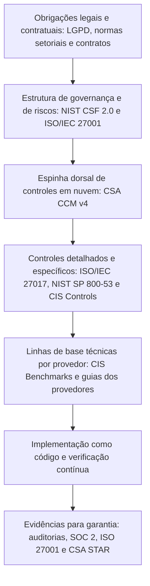

# Frameworks, Normas e Regulação de Referência

> **Objetivo pedagógico:** conhecer os principais referenciais de segurança em nuvem (NIST, ISO/IEC, CSA, CIS e relatórios de garantia), a regulação aplicável no Brasil (LGPD e normas setoriais e do governo federal), entender o papel de cada referencial (governança, controles, benchmarks técnicos e garantia), combiná-los por meio de mapeamentos (crosswalks) sem duplicar esforço e escolher a combinação adequada ao perfil da organização.

> A legislação e as normas mudam. Confirme as versões e a vigência de cada documento antes de usá-lo em decisões.

## 1. Papéis dos referenciais

| Papel | Pergunta | Exemplos |
|---|---|---|
| Governança e gestão de riscos | Como organizamos e priorizamos? | NIST CSF 2.0, ISO/IEC 27001, ISO 31000, ISO/IEC 27005 |
| Catálogo de controles | Que controles aplicar? | NIST SP 800-53, ISO/IEC 27002 e 27017, CSA CCM, CIS Controls |
| Orientação específica de nuvem | O que muda na nuvem? | NIST SP 800-144, ISO/IEC 27017 e 27018, CSA Security Guidance |
| Referências técnicas de configuração | Como configurar de forma segura? | CIS Foundations Benchmarks (AWS, Azure e Google Cloud), guias dos provedores |
| Garantia e certificação | Como demonstrar ou verificar? | SOC 2, ISO/IEC 27001 certificada, CSA STAR, relatórios de conformidade dos provedores |
| Regulação | O que é obrigatório? | LGPD, normas setoriais, PCI DSS (para dados de cartão) |
| Arquitetura de boas práticas | Como projetar? | Frameworks de arquitetura dos provedores (pilar de segurança) |

## 2. Referenciais internacionais

| Referencial | Escopo | Uso neste repositório |
|---|---|---|
| NIST SP 800-145 e 500-292 | Definição e arquitetura de referência da nuvem | Vocabulário (arquivo 1) |
| NIST SP 800-144 | Segurança e privacidade em nuvem pública | Considerações de responsabilidade e de riscos |
| NIST SP 800-210 | Orientações de controle de acesso para sistemas em nuvem | Identidade e acesso (pasta 06) |
| NIST SP 800-53 Rev. 5 | Catálogo de controles de segurança e de privacidade | Base de controles (pasta 12) |
| NIST SP 800-207 | Arquitetura Zero Trust | Pasta 07 |
| NIST CSF 2.0 | Estrutura de gestão de riscos de segurança cibernética (Governar, Identificar, Proteger, Detectar, Responder e Recuperar) | Organização do programa (pastas 03 e 28) |
| ISO/IEC 27001:2022 e 27002:2022 | Sistema de gestão e controles | Governança e auditoria |
| ISO/IEC 27017:2015 | Controles de segurança para serviços em nuvem | Controles específicos para provedores e clientes |
| ISO/IEC 27018:2019 | Proteção de dados pessoais em nuvens públicas | Privacidade (pasta 09) |
| ISO/IEC 27701:2019 | Extensão de privacidade | Governança de privacidade |
| ISO/IEC 17788 e 17789 | Vocabulário e arquitetura de referência | Conceitos |
| ISO/IEC 19086 | Estrutura de acordos de nível de serviço em nuvem | Contratos e SLAs |
| CSA CCM v4 e CAIQ | Controles de segurança em nuvem (17 domínios) e questionário de avaliação | Espinha dorsal de controles e de avaliação de provedores |
| CSA STAR | Programa de garantia de provedores (autoavaliação, certificação e atestação) | Seleção de provedores |
| CIS Controls v8.1 | Controles priorizados | Priorização |
| CIS Foundations Benchmarks | Configurações seguras por provedor | Linhas de base técnicas (pastas 12 e 17) |
| SOC 2 (AICPA) | Relatórios sobre controles de segurança, disponibilidade, integridade, confidencialidade e privacidade | Garantia de provedores |
| PCI DSS v4.0 | Proteção de dados de cartão de pagamento | Quando aplicável |
| FedRAMP e outros programas governamentais | Autorização de serviços em nuvem para governos (EUA) | Referência para provedores globais |

## 3. Regulação e normas no Brasil (visão geral)

> **Aviso:** orientações gerais, sem caráter jurídico. Valide com o Jurídico e com o DPO.

| Norma | Assunto | Relevância para a nuvem |
|---|---|---|
| Lei nº 13.709/2018 (LGPD) | Proteção de dados pessoais | Bases legais, segurança (art. 46), incidentes (art. 48), transferência internacional (arts. 33 a 36), operadores e controladores |
| Resolução CD/ANPD sobre transferência internacional de dados (2024) | Regras e cláusulas-padrão | Provedores com dados fora do Brasil |
| Resolução CD/ANPD nº 15/2024 | Comunicação de incidentes de segurança | Obrigações e prazos |
| Resolução CMN nº 4.893/2021 | Política de segurança cibernética e requisitos para contratação de serviços de processamento, de armazenamento de dados e de computação em nuvem por instituições financeiras autorizadas pelo Banco Central | Requisitos de contratação, de comunicação e de acesso do regulador |
| Resolução BCB nº 85/2021 | Requisitos equivalentes para instituições de pagamento autorizadas pelo Banco Central | Idem, para esse segmento |
| Circular Susep nº 638/2021 | Segurança cibernética para entidades supervisionadas pela Susep | Setor de seguros |
| Instrução Normativa GSI/PR nº 5/2021 | Requisitos mínimos de segurança da informação para o uso de soluções de computação em nuvem pela administração pública federal | Órgãos públicos federais |
| Marco Civil da Internet (Lei nº 12.965/2014) | Direitos e deveres na internet, guarda de registros | Registros e privacidade |
| Normas setoriais de saúde, telecomunicações e energia | Requisitos específicos | Verifique o regulador do setor |

## 4. Como combinar referenciais: o conceito de mapeamento (crosswalk)

Em vez de implementar cada referencial separadamente, escolha uma **espinha dorsal** e **mapeie** os demais a ela:

### Exemplo de mapeamento para o tema "Registro e monitoramento"

| Referencial | Onde o tema aparece (exemplos; confirme na versão vigente) |
|---|---|
| CSA CCM v4 | Domínio LOG (Registro e monitoramento) |
| ISO/IEC 27002:2022 | Controles 8.15 (registro) e 8.16 (atividades de monitoramento) |
| ISO/IEC 27017:2015 | CLD.12.4.5 (monitoramento de serviços em nuvem) |
| NIST SP 800-53 Rev. 5 | Família AU (auditoria e responsabilização) |
| CIS Controls v8.1 | Controle 8 (gestão de registros de auditoria) |
| CIS Foundations Benchmarks | Seções de registro (por exemplo, trilhas de auditoria habilitadas e protegidas) |
| LGPD | Art. 46 (medidas de segurança) e art. 37 (registro das operações) |
| Resolução CMN 4.893/2021 | Requisitos de registro e de rastreabilidade, para instituições financeiras |

## 5. Como escolher a combinação adequada

| Perfil | Combinação sugerida |
|---|---|
| Organização com certificação ISO/IEC 27001 | ISO/IEC 27001 e 27002 como governança; ISO/IEC 27017 e 27018; CCM para o detalhamento em nuvem; CIS Benchmarks para configuração |
| Fintech ou instituição financeira | Resolução CMN 4.893 ou BCB 85 como base regulatória; NIST CSF 2.0; CCM; ISO/IEC 27017; PCI DSS se houver dados de cartão |
| Prestador de serviços que precisa demonstrar garantia a clientes | SOC 2 e ISO/IEC 27001; CSA STAR |
| Órgão público federal | IN GSI/PR nº 5/2021 e normas correlatas; ISO/IEC 27001; controles do NIST SP 800-53 como referência técnica |
| Empresa de tecnologia com ambiente multicloud | CCM como espinha dorsal; CIS Benchmarks por provedor; NIST CSF 2.0 para governança |
| Organização com forte exposição a dados pessoais | LGPD; ISO/IEC 27701 e 27018; controles de dados (pasta 09) |

## 6. Relatórios e certificações de provedores

| Artefato | O que oferece | Como usar |
|---|---|---|
| Relatórios SOC 2 Tipo II | Opinião de auditor independente sobre controles ao longo de um período | Ler escopo, exceções e controles complementares do cliente (CUECs) |
| Certificação ISO/IEC 27001, 27017 e 27018 | Garantia sobre o sistema de gestão e controles de nuvem | Verificar escopo (serviços e regiões) e validade |
| CSA STAR | Nível de garantia do provedor em relação ao CCM | Verificar o nível (autoavaliação, certificação ou atestação) |
| Portais de conformidade dos provedores | Relatórios e certificações sob demanda | Solicitar e arquivar as evidências |
| Questionários de segurança (CAIQ) | Respostas do provedor aos controles do CCM | Comparar com os requisitos da organização |

Lembre que as certificações do provedor se aplicam à **parte do provedor**; a conformidade do cliente depende da configuração e do uso (pasta 02).

## 7. Exemplo prático: montando a base de requisitos de uma nova plataforma

| Passo | Resultado |
|---|---|
| 1. Levantar obrigações | LGPD, contrato com clientes e requisito de comunicação de incidentes em 24 horas |
| 2. Definir a espinha dorsal | CCM v4 (17 domínios) com NIST CSF 2.0 para a governança |
| 3. Mapear controles | Para cada domínio do CCM, referências à ISO/IEC 27002, à ISO/IEC 27017 e aos CIS Controls |
| 4. Definir as linhas de base técnicas | CIS Benchmarks do provedor escolhido, com desvios justificados |
| 5. Definir evidências | Relatórios automáticos de postura, registros e relatórios do provedor (SOC 2 e ISO) |
| 6. Revisar anualmente | Atualização de versões e de obrigações |

## 8. Casos de uso corporativos

- Construção do catálogo de controles de nuvem da organização, com mapeamento a normas.
- Avaliação de provedores com base em CAIQ, SOC 2 e certificações.
- Preparação para auditorias e para certificações com evidências reaproveitáveis.

## 9. Normas e frameworks relevantes

- NIST CSF 2.0; NIST SP 800-53 Rev. 5, 800-144, 800-145, 800-207 e 800-210
- ISO/IEC 27001:2022, 27002:2022, 27005, 27017:2015, 27018:2019, 27701:2019, 17788, 17789 e 19086
- CSA CCM v4, CAIQ e STAR; CIS Controls v8.1 e CIS Benchmarks; SOC 2; PCI DSS v4.0
- LGPD; Resolução CMN 4.893/2021; Resolução BCB 85/2021; IN GSI/PR 5/2021

## 10. Checklist operacional: referenciais e regulação

- [ ] Obrigações legais, regulatórias e contratuais levantadas e documentadas
- [ ] Espinha dorsal de controles escolhida (por exemplo, CCM) e justificada
- [ ] Mapeamento entre os referenciais adotados mantido e versionado
- [ ] Linhas de base técnicas (CIS Benchmarks) definidas por provedor
- [ ] Relatórios e certificações dos provedores arquivados, com escopo e validade conferidos
- [ ] Responsabilidades complementares do cliente (CUECs) identificadas
- [ ] Revisão anual de versões e da vigência das normas

## 11. Referências

- NIST. SP 800-53 Rev. 5: Security and Privacy Controls for Information Systems and Organizations. 2020.
- Hu, V. et al. NIST SP 800-210: General Access Control Guidance for Cloud Systems. 2020.
- NIST. Cybersecurity Framework 2.0. 2024.
- ISO/IEC 27017:2015; ISO/IEC 27018:2019; ISO/IEC 27001:2022; ISO/IEC 27002:2022.
- Cloud Security Alliance. CCM v4, CAIQ v4 e STAR. 2021.
- Center for Internet Security. CIS Controls v8.1 e CIS Foundations Benchmarks (AWS, Azure e Google Cloud).
- Brasil. Lei nº 13.709/2018; Resolução CMN nº 4.893/2021; Resolução BCB nº 85/2021; Instrução Normativa GSI/PR nº 5/2021.
