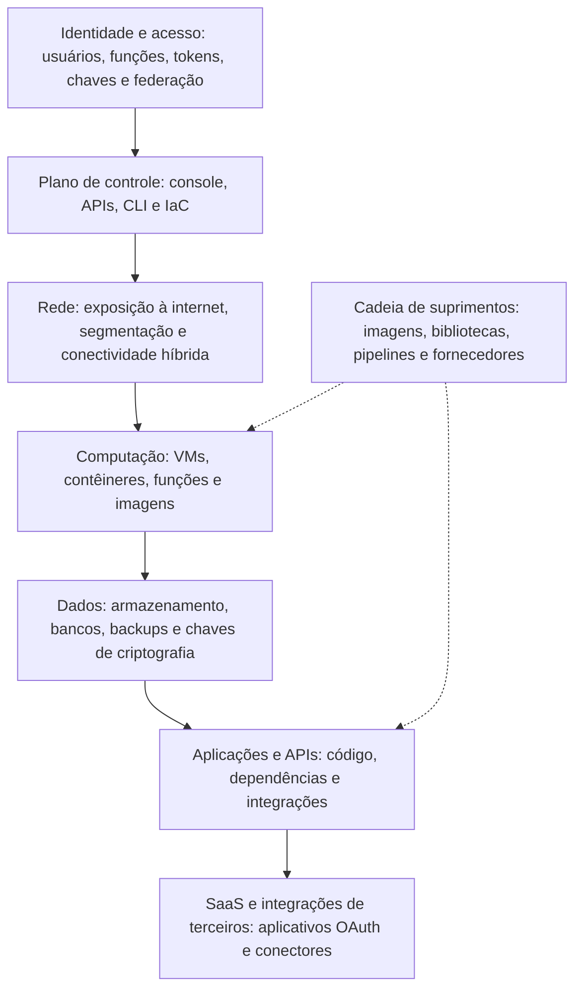

# Por Que a Nuvem Muda a Segurança: Ameaças e Desafios

> **Objetivo pedagógico:** compreender as propriedades da nuvem que alteram a forma de proteger sistemas (controle por API, elasticidade, efemeridade, multilocação, identidade como perímetro e velocidade de mudança), conhecer as principais ameaças documentadas (Cloud Security Alliance e MITRE ATT&CK for Cloud), mapear a superfície de ataque por camadas e reconhecer os desafios organizacionais (visibilidade, competências, shadow IT, dependência de fornecedor e residência de dados).

## 1. O que muda e o que permanece

| Permanece | Muda |
|---|---|
| Objetivos de segurança (confidencialidade, integridade e disponibilidade) | A infraestrutura é definida e alterada por software e por APIs |
| Necessidade de gestão de riscos, de governança e de conformidade | A fronteira de responsabilidade passa a ser compartilhada com o provedor |
| Vulnerabilidades de aplicações e de sistemas | O perímetro de rede perde centralidade; a identidade assume o papel principal |
| Importância de processos, de pessoas e de treinamento | A velocidade de criação e de alteração de recursos exige automação e guardrails |
| Obrigações legais sobre dados pessoais | Dados podem estar distribuídos em várias regiões e serviços |

## 2. Propriedades da nuvem e implicações

| Propriedade | Implicação de segurança | Resposta típica |
|---|---|---|
| Infraestrutura controlada por API | Uma credencial comprometida pode criar, alterar e excluir recursos em segundos | Identidade forte, privilégio mínimo, MFA e monitoramento do plano de controle |
| Elasticidade e efemeridade | Recursos surgem e desaparecem; inventário e evidências ficam voláteis | Inventário automático, registros centralizados e retenção, imagens imutáveis |
| Multilocação | Dependência do isolamento do provedor | Escolha de provedores com garantias auditadas; criptografia e controle de chaves |
| Identidade como perímetro | Acessos vêm de qualquer lugar; a rede não basta | Zero Trust, acesso condicional, autenticação resistente a phishing (pasta 07) |
| Velocidade e autoatendimento | Configurações inseguras são replicadas em escala | Infraestrutura como código, políticas como código, revisão e guardrails |
| Serviços gerenciados | Parte da pilha é do provedor, com configuração do cliente | Entender o modelo de responsabilidade de cada serviço (pasta 02) |
| Dados em múltiplos locais e serviços | Dificulta saber onde estão os dados e quem acessa | Classificação, descoberta de dados e controles de acesso (pasta 09) |
| Modelo de cobrança por uso | Abuso resulta em custos; custos são um sinal | Alertas de orçamento e de anomalia de custos |
| Exposição por padrão em alguns serviços | Configurações permissivas podem expor dados | Bloqueios de acesso público, linhas de base e verificação contínua (pasta 17) |

## 3. Principais ameaças

### 3.1 Cloud Security Alliance: Pandemic Eleven (2022)

| # | Ameaça | Descrição resumida |
|---|---|---|
| 1 | Gestão insuficiente de identidade, de credenciais, de acesso e de chaves | Credenciais fracas, permissões excessivas e segredos expostos |
| 2 | Interfaces e APIs inseguras | APIs sem autenticação, autorização ou validação adequadas |
| 3 | Configuração incorreta e controle de mudanças inadequado | Recursos expostos, permissões amplas e alterações não revisadas |
| 4 | Falta de arquitetura e de estratégia de segurança em nuvem | Adoção sem desenho, sem padrões e sem responsabilidades claras |
| 5 | Desenvolvimento de software inseguro | Vulnerabilidades e falhas no ciclo de vida de aplicações |
| 6 | Recursos de terceiros inseguros | Componentes, bibliotecas e serviços de terceiros |
| 7 | Vulnerabilidades de sistemas | Sistemas sem correção, imagens desatualizadas |
| 8 | Divulgação acidental de dados em nuvem | Compartilhamentos e armazenamentos expostos |
| 9 | Configuração incorreta e exploração de cargas *serverless* e de contêineres | Funções e contêineres com permissões e configurações inseguras |
| 10 | Crime organizado, *hackers* e ameaças persistentes avançadas | Atores com recursos e motivação |
| 11 | Exfiltração de dados em armazenamento em nuvem | Cópias não autorizadas de dados em armazenamentos |

A CSA atualiza periodicamente seu relatório de ameaças; consulte a edição vigente. Os temas centrais se repetem: **identidade, configuração, APIs e visibilidade**.

### 3.2 MITRE ATT&CK for Cloud (visão resumida)

| Tática | Exemplos de técnicas em nuvem |
|---|---|
| Acesso inicial | Contas válidas de nuvem (T1078.004), exploração de aplicações expostas (T1190), *phishing* (T1566) |
| Persistência | Manipulação de contas (T1098), criação de contas de nuvem (T1136.003) |
| Escalonamento de privilégios | Abuso de contas e de funções válidas (T1078.004) |
| Evasão de defesas | Desabilitar ou modificar registros de nuvem (T1562.008) |
| Acesso a credenciais | API de metadados de instâncias (T1552.005), roubo de tokens de acesso de aplicações (T1528) |
| Descoberta | Descoberta de serviços (T1526) e de infraestrutura de nuvem (T1580) |
| Coleta | Dados de armazenamento em nuvem (T1530) |
| Exfiltração | Transferência de dados para outra conta de nuvem (T1537) |
| Impacto | Sequestro de recursos (T1496), destruição de dados (T1485) e criptografia para impacto (T1486) |

### 3.3 OWASP Cloud-Native Application Security Top 10 (2022)

Lista de riscos específicos de aplicações nativas de nuvem, incluindo configuração insegura de recursos e de orquestração, autenticação e autorização inadequadas, segredos expostos, vulnerabilidades de cadeia de suprimentos e monitoramento insuficiente. Consulte a edição vigente.

## 4. Superfície de ataque por camadas

| Camada | Perguntas de segurança |
|---|---|
| Identidade | Quem pode fazer o quê? Há MFA resistente a phishing? Há contas e chaves de longa duração? |
| Plano de controle | Quem pode criar e alterar recursos? Os registros de auditoria estão habilitados e protegidos? |
| Rede | O que está exposto à internet? Há segmentação entre ambientes? |
| Computação | As imagens são confiáveis e atualizadas? As funções e os contêineres têm permissões mínimas? |
| Dados | Onde estão os dados sensíveis? Estão criptografados? Quem acessa? Há backups protegidos? |
| Aplicações | O código e as dependências são verificados? As APIs exigem autenticação? |
| SaaS | Quais aplicativos têm acesso aos dados? Há compartilhamento externo sem controle? |
| Cadeia de suprimentos | De onde vêm as imagens e os componentes? Os pipelines estão protegidos? |

## 5. Desafios organizacionais

| Desafio | Descrição | Resposta |
|---|---|---|
| Visibilidade | Dificuldade de saber o que existe e o que acontece | Inventário automático, registros centralizados e painéis de postura |
| Competências | Equipes treinadas em ambientes locais precisam de novas habilidades | Capacitação, certificações e comunidades de prática |
| *Shadow IT* | Áreas contratam serviços sem passar pela segurança | Governança, processos simples de aprovação e descoberta de uso (CASB e análise de faturamento) |
| Dependência de fornecedor (*lock-in*) | Dificuldade de migrar ou de portar dados e serviços | Estratégia de saída, padrões abertos e requisitos contratuais |
| Residência e soberania de dados | Requisitos legais sobre local de armazenamento e de processamento | Escolha de regiões, cláusulas contratuais e controles (pasta 11) |
| Cadeia de fornecedores | Terceiros com acesso a dados e a sistemas | Gestão de riscos de terceiros |
| Conformidade contínua | Auditorias sobre ambientes dinâmicos | Conformidade como código e evidências automáticas |
| Custos e abuso | Consumo inesperado | Orçamentos, alertas e políticas de limites |
| Cultura | Tensão entre velocidade e controle | DevSecOps e guardrails que permitem velocidade com segurança (pasta 21) |

## 6. Exemplo prático: do incidente à ameaça

Cenário fictício: uma empresa descobre que um armazenamento de objetos com dados de clientes estava acessível publicamente por 3 semanas.

| Pergunta | Análise |
|---|---|
| Qual ameaça da CSA? | Configuração incorreta e controle de mudanças inadequado (3); divulgação acidental de dados (8) |
| Que técnica do ATT&CK? | Coleta de dados de armazenamento em nuvem (T1530), por terceiros |
| Que camada falhou? | Dados e plano de controle (configuração do armazenamento) |
| Que desafio organizacional? | Falta de visibilidade e de guardrails; mudança sem revisão |
| Que controles teriam evitado? | Bloqueio de acesso público na conta, política como código, verificação contínua de postura e alertas de exposição |
| Que controles teriam detectado antes? | Alertas de exposição pública, registros de acesso aos dados e verificação periódica |

## 7. Casos de uso corporativos

- Elaboração do modelo de ameaças inicial para a adoção de nuvem (pasta 14).
- Justificativa de investimentos em identidade, postura e monitoramento.
- Treinamento de arquitetos e de desenvolvedores sobre as ameaças mais frequentes.

## 8. Normas e frameworks relevantes

- CSA. Top Threats to Cloud Computing: Pandemic Eleven (2022) e edições posteriores
- MITRE ATT&CK for Cloud (IaaS, SaaS, provedor de identidade e suíte de escritório)
- OWASP Cloud-Native Application Security Top 10; ENISA. Cloud Computing Risk Assessment
- NIST SP 800-144; CIS Controls v8.1; CISA. Cloud Security Technical Reference Architecture

## 9. Checklist operacional: ameaças principais e controles mínimos

- [ ] Todas as identidades administrativas com MFA resistente a phishing; sem chaves de longa duração onde possível
- [ ] Registros de auditoria do plano de controle habilitados, centralizados e protegidos
- [ ] Bloqueio de acesso público a armazenamentos habilitado no nível da conta ou da organização
- [ ] Segurança de rede: sem portas de administração abertas à internet
- [ ] Inventário de recursos, com proprietário e classificação
- [ ] Alertas de custos e de anomalias
- [ ] Verificação contínua de postura (pasta 17)
- [ ] Processo de revisão de mudanças e de infraestrutura como código

## 10. Referências

- Cloud Security Alliance. Top Threats to Cloud Computing: Pandemic Eleven. 2022.
- MITRE. ATT&CK for Cloud. https://attack.mitre.org
- OWASP. Cloud-Native Application Security Top 10. 2022.
- ENISA. Cloud Computing: Benefits, Risks and Recommendations for Information Security. 2009 e atualizações.
- CISA. Cloud Security Technical Reference Architecture. Versão 2, 2022.
- Dotson, C. Practical Cloud Security. O'Reilly, 2019.
