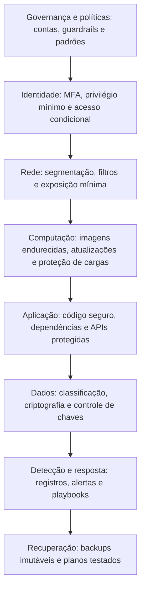

# Princípios de Segurança em Nuvem

> **Objetivo pedagógico:** aplicar os princípios clássicos de segurança da informação ao contexto de nuvem (confidencialidade, integridade e disponibilidade; os princípios de Saltzer e Schroeder; defesa em profundidade; privilégio mínimo; separação de funções; assumir violação; segurança desde o desenho e por padrão; automação e imutabilidade), classificar os tipos de controle e conhecer os 17 domínios do Cloud Controls Matrix (CCM) como estrutura de organização dos controles do framework.

## 1. Objetivos de segurança

| Objetivo | Descrição | Exemplo em nuvem |
|---|---|---|
| Confidencialidade | Somente quem está autorizado acessa a informação | Criptografia, controle de acesso e isolamento de contas |
| Integridade | Informação e sistemas não são alterados de forma não autorizada | Versionamento, assinaturas, registros imutáveis e controle de mudanças |
| Disponibilidade | Serviços e dados acessíveis quando necessário | Redundância entre zonas e regiões, backups e proteção contra abuso |
| Autenticidade e responsabilização | Identificar quem faz o quê e impedir negação | Identidades individuais, registros de auditoria e sincronização de tempo |
| Privacidade | Tratamento de dados pessoais conforme a lei | Minimização, base legal, residência e controle de acesso (pasta 09) |
| Resiliência | Capacidade de resistir e de se recuperar | Arquiteturas tolerantes a falhas, exercícios de recuperação (pasta 22) |

## 2. Princípios de projeto seguro (Saltzer e Schroeder, 1975)

| Princípio | Significado | Aplicação em nuvem |
|---|---|---|
| Privilégio mínimo | Conceder apenas o acesso necessário, pelo tempo necessário | Funções com permissões específicas; acesso temporário; revisões periódicas |
| Padrões seguros (*fail-safe defaults*) | O acesso é negado por padrão | Políticas de negação padrão; bloqueio de acesso público |
| Economia de mecanismo | Projetos simples são mais fáceis de proteger | Padrões de arquitetura reutilizáveis; menos exceções |
| Mediação completa | Todo acesso é verificado | Autorização em todas as chamadas de API; sem caminhos alternativos |
| Projeto aberto | A segurança não depende do segredo do projeto | Algoritmos públicos; segredos apenas em chaves |
| Separação de privilégios | Operações críticas exigem mais de uma condição ou pessoa | Aprovação dupla para ações destrutivas; separação entre quem desenvolve, implanta e audita |
| Menor mecanismo comum | Minimizar o compartilhamento entre usuários | Contas e redes separadas por ambiente e por criticidade |
| Aceitabilidade psicológica | Controles devem ser usáveis | Fluxos simples, acesso temporário fácil, autenticação sem atrito excessivo |

## 3. Princípios adicionais para a nuvem

| Princípio | Descrição | Aplicação |
|---|---|---|
| Defesa em profundidade | Várias camadas independentes de proteção | Identidade, rede, host, aplicação, dados e monitoramento |
| Assumir violação (*assume breach*) | Projetar para detectar, conter e recuperar | Segmentação, registros, resposta a incidentes e backups imutáveis |
| Zero Trust | Verificação explícita, privilégio mínimo e suposição de violação | Acesso condicional, microssegmentação e verificação contínua (pasta 07) |
| Segurança desde o desenho e por padrão (*secure by design* e *by default*) | A segurança faz parte do projeto, e o padrão é seguro | Modelos de infraestrutura já endurecidos; configurações seguras sem ação do usuário |
| Automação e segurança como código | Controles definidos em código, versionados e testados | Infraestrutura como código, políticas como código e testes automatizados |
| Imutabilidade | Recursos substituídos, e não alterados | Imagens reconstruídas, sem acesso interativo de administradores a servidores de produção |
| Segmentação e isolamento | Limitar o raio de impacto | Contas separadas por ambiente, redes segmentadas e identidades por carga |
| Visibilidade e rastreabilidade | O que não se vê não se protege | Registros, inventário e telemetria centralizados |
| Responsabilidade clara | Cada recurso e cada controle tem dono | Etiquetas de proprietário; matriz de responsabilidades (pasta 02) |
| Melhoria contínua | Aprender com incidentes e avaliações | Revisões e indicadores (pastas 27 e 28) |

## 4. Defesa em profundidade em nuvem



Cada camada deve funcionar de forma **independente**: a falha de uma camada não deve comprometer todas as demais.

## 5. Tipos de controle

| Tipo | Objetivo | Exemplos em nuvem |
|---|---|---|
| Preventivo | Impedir o evento | Políticas de negação, bloqueio de acesso público, MFA |
| Detectivo | Identificar o evento | Alertas de atividade anômala, verificação de postura, registros |
| Corretivo | Limitar o dano e restaurar | Isolamento automático, restauração a partir de backups |
| Dissuasivo | Desencorajar | Avisos de monitoramento, responsabilização |
| Compensatório | Substituir um controle que não pode ser aplicado | Monitoramento reforçado quando a correção não é possível |
| Administrativo, técnico e físico | Natureza do controle | Políticas e treinamento; criptografia e firewalls; segurança de datacenters (do provedor) |

## 6. Domínios do Cloud Controls Matrix (CCM v4)

O CCM da Cloud Security Alliance organiza controles de segurança em nuvem em **17 domínios**, que serão usados como espinha dorsal de referência neste repositório:

| Sigla | Domínio |
|---|---|
| A&A | Auditoria e garantia |
| AIS | Segurança de aplicações e de interfaces |
| BCR | Continuidade de negócios e resiliência operacional |
| CCC | Controle de mudanças e gestão de configuração |
| CEK | Criptografia, gestão de chaves |
| DCS | Segurança de datacenters |
| DSP | Segurança e privacidade de dados e ciclo de vida |
| GRC | Governança, risco e conformidade |
| HRS | Recursos humanos |
| IAM | Gestão de identidade e de acesso |
| IPY | Interoperabilidade e portabilidade |
| IVS | Segurança de infraestrutura e de virtualização |
| LOG | Registro e monitoramento |
| SEF | Gestão de incidentes, descoberta eletrônica e forense em nuvem |
| STA | Cadeia de suprimentos, transparência e responsabilização |
| TVM | Gestão de ameaças e de vulnerabilidades |
| UEM | Gestão de dispositivos de usuário final |

## 7. Exemplo prático: aplicando os princípios a um armazenamento de objetos

| Princípio | Controle aplicado |
|---|---|
| Padrões seguros | Bloqueio de acesso público habilitado na conta; acesso negado por padrão |
| Privilégio mínimo | Política de leitura restrita a um prefixo, para uma função específica |
| Defesa em profundidade | Criptografia no armazenamento, TLS obrigatório, registros de acesso e alertas |
| Integridade | Versionamento e proteção contra exclusão (retenção de objetos) |
| Separação de funções | A função que grava não pode alterar a política do bucket |
| Visibilidade | Eventos de dados e logs de acesso enviados à conta de auditoria |
| Recuperação | Replicação para outra região e teste de restauração |

```json
{
  "Version": "2012-10-17",
  "Statement": [
    {
      "Sid": "LeituraDoPrefixoRelatorios",
      "Effect": "Allow",
      "Action": ["s3:GetObject"],
      "Resource": "arn:aws:s3:::exemplo-dados-corp/relatorios/*"
    },
    {
      "Sid": "ListarSomenteOPrefixo",
      "Effect": "Allow",
      "Action": ["s3:ListBucket"],
      "Resource": "arn:aws:s3:::exemplo-dados-corp",
      "Condition": { "StringLike": { "s3:prefix": ["relatorios/*"] } }
    }
  ]
}
```

```json
{
  "Version": "2012-10-17",
  "Statement": [
    {
      "Sid": "NegarTransporteSemTLS",
      "Effect": "Deny",
      "Principal": "*",
      "Action": "s3:*",
      "Resource": [
        "arn:aws:s3:::exemplo-dados-corp",
        "arn:aws:s3:::exemplo-dados-corp/*"
      ],
      "Condition": { "Bool": { "aws:SecureTransport": "false" } }
    }
  ]
}
```

Os exemplos usam nomes fictícios; adapte os recursos e valide as políticas em ambiente de teste.

## 8. Casos de uso corporativos

- Definição dos princípios de arquitetura segura da organização.
- Avaliação de projetos de nuvem por revisões de arquitetura baseadas em princípios.
- Mapeamento dos controles da organização para os domínios do CCM.

## 9. Normas e frameworks relevantes

- Saltzer, J.; Schroeder, M. The Protection of Information in Computer Systems. 1975
- CSA Cloud Controls Matrix v4 (17 domínios) e CAIQ; NIST SP 800-53 Rev. 5; NIST SP 800-207 (Zero Trust)
- ISO/IEC 27001:2022 e 27002:2022; ISO/IEC 27017:2015; CISA Secure by Design (2023)
- AWS, Microsoft e Google: pilares de segurança dos frameworks de boas práticas de arquitetura

## 10. Checklist operacional: princípios aplicados a uma nova carga

- [ ] Acesso negado por padrão e permissões mínimas definidas
- [ ] Ao menos três camadas de defesa independentes identificadas (por exemplo, identidade, rede e dados)
- [ ] Ações críticas exigem aprovação ou separação de funções
- [ ] Infraestrutura definida como código, versionada e revisada
- [ ] Registros e alertas habilitados e centralizados
- [ ] Plano de recuperação e backups testados
- [ ] Proprietário e classificação do recurso definidos
- [ ] Controles mapeados aos domínios do CCM

## 11. Referências

- Saltzer, J. H.; Schroeder, M. D. The Protection of Information in Computer Systems. Proceedings of the IEEE, 1975.
- Cloud Security Alliance. Cloud Controls Matrix v4 e Consensus Assessments Initiative Questionnaire (CAIQ) v4. 2021.
- Rose, S. et al. NIST SP 800-207: Zero Trust Architecture. 2020.
- CISA. Secure by Design. 2023.
- Amazon Web Services; Microsoft; Google Cloud. Frameworks de boas práticas de arquitetura (pilar de segurança), versões vigentes.
