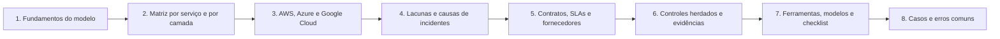

# 02 Modelo de Responsabilidade Compartilhada

## Objetivo

Compreender, aplicar e operacionalizar o modelo de responsabilidade compartilhada: distinguir a segurança "da" nuvem (do provedor) da segurança "na" nuvem (do cliente), mapear as responsabilidades por modelo de serviço e por camada, conhecer como AWS, Azure e Google Cloud descrevem o modelo, identificar as lacunas que causam incidentes, tratar a responsabilidade em contratos e na gestão de fornecedores, documentar controles herdados, compartilhados e do cliente como evidências de conformidade, e dividir as responsabilidades dentro da própria organização.

## Trilha de estudo recomendada

## Conteúdo da pasta

| Ordem | Arquivo | Objetivo |
|---|---|---|
| 1 | [fundamentos-do-modelo-de-responsabilidade-compartilhada.md](fundamentos-do-modelo-de-responsabilidade-compartilhada.md) | Conceito, origem, princípios e responsabilidades que nunca se transferem |
| 2 | [matriz-de-responsabilidades-por-servico-e-por-camada.md](matriz-de-responsabilidades-por-servico-e-por-camada.md) | Matriz detalhada de IaaS, CaaS, PaaS, FaaS, SaaS e ambiente local |
| 3 | [responsabilidade-compartilhada-em-aws-azure-e-google-cloud.md](responsabilidade-compartilhada-em-aws-azure-e-google-cloud.md) | Como cada provedor descreve o modelo, com exemplos por serviço |
| 4 | [lacunas-de-responsabilidade-e-causas-reais-de-incidentes.md](lacunas-de-responsabilidade-e-causas-reais-de-incidentes.md) | Tipos de lacuna, causas frequentes e análise de lacunas |
| 5 | [contratos-slas-e-gestao-de-fornecedores-de-nuvem.md](contratos-slas-e-gestao-de-fornecedores-de-nuvem.md) | Contratos, SLAs, LGPD, diligência e saída |
| 6 | [controles-herdados-compartilhados-e-evidencias-de-conformidade.md](controles-herdados-compartilhados-e-evidencias-de-conformidade.md) | Classificação de controles, evidências e responsabilidades internas (RACI) |
| 7 | [ferramentas-fluxo-modelos-e-checklist-de-responsabilidade-compartilhada.md](ferramentas-fluxo-modelos-e-checklist-de-responsabilidade-compartilhada.md) | Inventário de serviços, modelos e checklist de integração de serviços |
| 8 | [casos-de-uso-e-erros-comuns-em-responsabilidade-compartilhada.md](casos-de-uso-e-erros-comuns-em-responsabilidade-compartilhada.md) | Casos fictícios, erros comuns, exercícios e perguntas de revisão |

## Princípios da pasta

- O provedor protege a nuvem; o cliente protege o que coloca e configura na nuvem
- Dados, identidades, contas e dispositivos são sempre responsabilidade do cliente
- A divisão muda por serviço: leia o modelo de cada serviço, e não apenas o do provedor
- Toda responsabilidade do cliente precisa de dono interno, de controle implementado e de evidência
- A certificação do provedor cobre a parte do provedor, e não a do cliente
- Contratos e evidências devem refletir a divisão de responsabilidades

## Relação com outras pastas

- 01: conceitos e modelos de serviço
- 03 e 04: governança e gestão de riscos de terceiros
- 06, 09, 10 e 12: identidade, dados, criptografia e controles do cliente
- 11 e 29: conformidade e auditorias
- 22 e 23: resposta a incidentes e forense, com limites de acesso a registros do provedor
- 24 a 26: detalhes específicos de Azure, AWS e Google Cloud

## Referências

- Jansen, W.; Grance, T. NIST SP 800-144: Guidelines on Security and Privacy in Public Cloud Computing. 2011.
- ISO/IEC 27017:2015, controle CLD.6.3.1 (funções e responsabilidades compartilhadas)
- CSA Cloud Controls Matrix v4, domínio STA (modelo de responsabilidade de segurança compartilhada)
- Documentação oficial de AWS, Microsoft Azure e Google Cloud sobre responsabilidade compartilhada
- Brasil. Lei nº 13.709/2018 (LGPD), arts. 37 a 42 e 46
