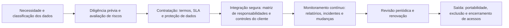

# Contratos, SLAs e Gestão de Fornecedores de Nuvem

> **Objetivo pedagógico:** refletir o modelo de responsabilidade compartilhada em contratos, em acordos de nível de serviço (SLAs) e na gestão do ciclo de vida de fornecedores de nuvem: conduzir a diligência prévia, interpretar relatórios e certificações, definir cláusulas essenciais (proteção de dados, incidentes, auditoria, localização, subcontratação, saída e portabilidade), considerar os requisitos regulatórios brasileiros, monitorar fornecedores continuamente e planejar a saída.

> **Aviso:** este material é técnico e educacional e **não constitui parecer jurídico**. Os contratos devem ser revisados pelo Jurídico, pelo DPO e pela área de contratações. Os termos de provedores globais costumam ser padronizados e pouco negociáveis; entenda o que é possível ajustar e o que deve ser mitigado por controles do cliente.

## 1. Ciclo de vida do fornecedor de nuvem

## 2. Diligência prévia

| Aspecto | O que avaliar | Evidências |
|---|---|---|
| Segurança da informação | Controles, certificações, resultados de auditoria, testes de intrusão e gestão de vulnerabilidades | ISO/IEC 27001, 27017 e 27018 (escopo e validade), SOC 2 Tipo II, CAIQ e CSA STAR |
| Privacidade e proteção de dados | Papel (operador), subprocessadores, locais de tratamento e transferências | Acordo de tratamento de dados, lista de subprocessadores e política de privacidade |
| Resiliência | Arquitetura de disponibilidade, SLAs, histórico de incidentes e testes de recuperação | Relatórios de disponibilidade, páginas de status, documentação de arquitetura |
| Gestão de incidentes | Processo, prazos de notificação e cooperação | Políticas e cláusulas |
| Acesso de funcionários do provedor a dados | Controles, registros e opções de aprovação do cliente | Documentação técnica e contratos |
| Localização de dados | Regiões de armazenamento, de processamento e de suporte | Documentação do serviço e termos contratuais |
| Cadeia de suprimentos | Dependências críticas e subcontratados | Declarações e avaliações |
| Viabilidade e concentração | Solidez financeira e risco de dependência | Relatórios e análise de concentração |
| Capacidade de saída | Formatos, ferramentas de exportação e prazos | Documentação e testes |
| Aderência regulatória | Atendimento a requisitos setoriais (por exemplo, acesso do regulador) | Cláusulas e declarações |

## 3. Interpretando relatórios e certificações

| Artefato | Ponto de atenção |
|---|---|
| SOC 2 Tipo II | Escopo (serviços e regiões), período (cobertura contínua), exceções, opinião e controles complementares do cliente (CUECs) |
| SOC 2 com serviços subcontratados | Verifique se o relatório usa o método **inclusivo** ou o método de **exclusão** (*carve-out*) para os subcontratados |
| ISO/IEC 27001 | O escopo da certificação (nem todos os serviços e regiões estão cobertos) e a declaração de aplicabilidade |
| ISO/IEC 27017 e 27018 | Cobertura de controles específicos de nuvem e de dados pessoais |
| CSA STAR | Nível de garantia (autoavaliação, certificação ou atestação) |
| Testes de intrusão (resumos) | Data, escopo e correções |
| Páginas de status e relatórios de incidentes | Histórico de disponibilidade e de eventos de segurança |

Lembre: **o relatório descreve os controles do provedor; os controles do cliente precisam ser implementados e evidenciados por você.**

## 4. Cláusulas essenciais (orientação para revisão com o Jurídico)

| Tema | O que buscar | Observações |
|---|---|---|
| Papéis e proteção de dados | Definição de controlador e operador; instruções documentadas; confidencialidade; medidas de segurança; assistência a direitos dos titulares; subprocessadores com aviso e direito de objeção; devolução e exclusão ao término | LGPD, arts. 37 a 42 e 46 |
| Notificação de incidentes | Prazo e conteúdo da notificação do provedor, cooperação na investigação e acesso a registros | O prazo do provedor deve permitir que o cliente cumpra seus próprios prazos legais (LGPD, art. 48) |
| Localização e transferência | Regiões de armazenamento e de processamento; transferências internacionais e mecanismos | LGPD, arts. 33 a 36 e regulamentação da ANPD |
| Auditoria e acesso | Direito de auditoria, acesso a relatórios, acesso do regulador (quando exigido) | Setor financeiro: requisitos de acesso do Banco Central |
| Segurança | Obrigações mínimas de segurança, certificações mantidas, testes e correções | Referência a ISO/IEC 27001, 27017 e 27018 |
| Disponibilidade e SLA | Metas, medição, créditos e exclusões | SLA não é garantia de segurança |
| Continuidade | Planos de continuidade e de recuperação do provedor | Teste e evidência |
| Subcontratação | Aviso prévio, equivalência de controles e responsabilidade | Cadeia de suprimentos |
| Propriedade e uso dos dados | Os dados permanecem do cliente; vedação de uso para fins próprios sem autorização, inclusive treinamento de modelos | Atenção a termos de serviços de IA |
| Saída e portabilidade | Formatos abertos, ferramentas, prazos e custos de exportação; assistência na transição | Previna dependência |
| Exclusão de dados | Prazos, método e certificação de eliminação, inclusive em cópias de segurança | Evidência de exclusão |
| Responsabilidade e limites | Limites de responsabilidade, indenizações e seguros | Revisão jurídica e de riscos |
| Direito aplicável e foro | Lei e jurisdição | Impacto prático em disputas |
| Alterações unilaterais | Notificação e direito de saída em mudanças materiais | Termos de provedores mudam |

## 5. Requisitos regulatórios no Brasil: pontos de atenção

| Norma | Pontos relevantes para a contratação de nuvem (resumo) |
|---|---|
| LGPD | Contrato com o operador, segurança, subprocessadores, transferência internacional e comunicação de incidentes |
| Resolução CMN nº 4.893/2021 (instituições financeiras) | Procedimentos de avaliação da relevância do serviço, de verificação da capacidade do prestador, requisitos de cláusulas contratuais (inclusive localização, acesso do regulador, continuidade e comunicação) e comunicação prévia ao Banco Central em contratações relevantes, conforme o texto vigente |
| Resolução BCB nº 85/2021 (instituições de pagamento) | Requisitos análogos para o segmento |
| Circular Susep nº 638/2021 (seguradoras) | Requisitos de segurança cibernética e de contratação de serviços de nuvem |
| IN GSI/PR nº 5/2021 (administração pública federal) | Requisitos mínimos para o uso de soluções de computação em nuvem, inclusive classificação de informações e localização |
| Normas setoriais | Saúde, telecomunicações, energia e outros |

Confirme o texto vigente e a aplicabilidade com o Jurídico e com a área de conformidade.

## 6. SLA e segurança: o que o SLA não cobre

| Tema | Observação |
|---|---|
| Disponibilidade | O SLA mede o tempo de serviço; não protege contra configurações incorretas do cliente |
| Créditos | Compensam parcialmente, e não cobrem os prejuízos do negócio |
| Exclusões | Falhas decorrentes de uso do cliente, de manutenções programadas ou de eventos fora do controle costumam ser excluídas |
| Segurança | O SLA padrão raramente garante tempo de resposta a incidentes, acesso a registros ou perdas de dados |
| ISO/IEC 19086 | Fornece uma estrutura e métricas para SLAs de nuvem, inclusive de segurança, que podem orientar requisitos |

## 7. Monitoramento contínuo do fornecedor

| Atividade | Frequência | Fonte |
|---|---|---|
| Revisão de relatórios e de certificações renovados | Anual ou a cada emissão | Portais de conformidade |
| Acompanhamento de incidentes e de status | Contínuo | Páginas de status e comunicados |
| Avaliação de mudanças em termos, em serviços e em subprocessadores | A cada aviso | Comunicados e contratos |
| Revisão de acessos e de integrações do fornecedor | Trimestral | Registros e inventários |
| Verificação de cumprimento de SLAs | Mensal | Relatórios e métricas |
| Reavaliação de riscos | Anual ou sob mudança relevante | Registro de riscos |
| Teste de saída (portabilidade) | Periódico, para serviços críticos | Exportações de teste |
| Revisão da matriz de responsabilidades | Anual | Documentação do provedor |

## 8. Planejamento de saída

| Elemento | Descrição |
|---|---|
| Cenários | Fim de contrato, falha do provedor, mudança regulatória, incidente grave ou decisão estratégica |
| Dados | Formatos de exportação, volume, tempo, custos, integridade e criptografia |
| Dependências | Serviços que dependem do fornecedor; alternativas |
| Acessos | Revogação de credenciais, de integrações e de aplicativos |
| Exclusão | Eliminação dos dados no provedor, com certificação |
| Continuidade | Plano para manter operações durante a transição |
| Testes | Exercícios de exportação e de restauração em ambiente alternativo |

## 9. Exemplo prático: avaliação de um SaaS de análise de dados com dados pessoais

| Passo | Resultado |
|---|---|
| Classificação | Dados de clientes (pessoais, confidenciais) |
| Diligência | SOC 2 Tipo II com escopo adequado e uma exceção em gestão de acesso; ISO/IEC 27001 e 27018; CAIQ respondido; lista de subprocessadores com dois fora do Brasil |
| Gaps identificados | Retenção de registros de auditoria de 30 dias; sem opção de chaves do cliente; exportação apenas em formato proprietário |
| Cláusulas negociadas | Notificação de incidentes em até 48 horas; direito de objeção a novos subprocessadores; exportação em formato aberto; exclusão certificada em até 30 dias |
| Controles do cliente | SSO com MFA; exportação de logs ao SIEM; minimização e pseudonimização de dados; revisão trimestral de acessos |
| Decisão | Aprovado com riscos residuais registrados (retenção de logs e ausência de chaves do cliente), com plano de revisão em 12 meses |

## 10. Casos de uso corporativos

- Processo de aprovação de novos serviços de nuvem, com diligência e matriz de responsabilidades.
- Revisão de contratos existentes de nuvem para alinhar notificações, auditoria e saída.
- Monitoramento contínuo de provedores críticos.

## 11. Normas e frameworks relevantes

- ISO/IEC 27036-4:2016 (segurança nas relações com fornecedores: serviços de nuvem); ISO/IEC 19086 (SLAs de nuvem); ISO/IEC 27017:2015 e 27018:2019
- NIST SP 800-161 Rev. 1 (gestão de riscos da cadeia de suprimentos); CSA CCM v4 (STA) e CAIQ; CSA STAR; SOC 2
- LGPD, arts. 33 a 42, 46 e 48; Resolução CMN 4.893/2021; Resolução BCB 85/2021; Circular Susep 638/2021; IN GSI/PR 5/2021

## 12. Checklist operacional: contratação e gestão de fornecedor de nuvem

- [ ] Classificação dos dados e requisitos regulatórios definidos antes da avaliação
- [ ] Diligência concluída: relatórios, certificações, CAIQ e escopo verificados
- [ ] CUECs do SOC 2 e controles do cliente identificados
- [ ] Cláusulas essenciais revisadas (proteção de dados, incidentes, auditoria, localização, subcontratação, saída e exclusão)
- [ ] Prazo de notificação do provedor compatível com os prazos legais do cliente
- [ ] Matriz de responsabilidades do serviço preenchida e aprovada
- [ ] Riscos residuais registrados e aceitos pelo responsável
- [ ] Monitoramento contínuo e calendário de revisões definidos
- [ ] Plano de saída documentado e testado para serviços críticos

## 13. Referências

- ISO/IEC 27036-4:2016. Information security for supplier relationships: Guidelines for security of cloud services.
- ISO/IEC 19086-1:2016. Cloud computing: Service level agreement (SLA) framework.
- Boyens, J. et al. NIST SP 800-161 Rev. 1: Cybersecurity Supply Chain Risk Management Practices. 2022.
- AICPA. SOC 2 e guias de uso de relatórios SOC por entidades usuárias.
- Brasil. LGPD; Resolução CMN nº 4.893/2021; Resolução BCB nº 85/2021; Circular Susep nº 638/2021; IN GSI/PR nº 5/2021.
- Cloud Security Alliance. CAIQ v4 e CSA STAR.
