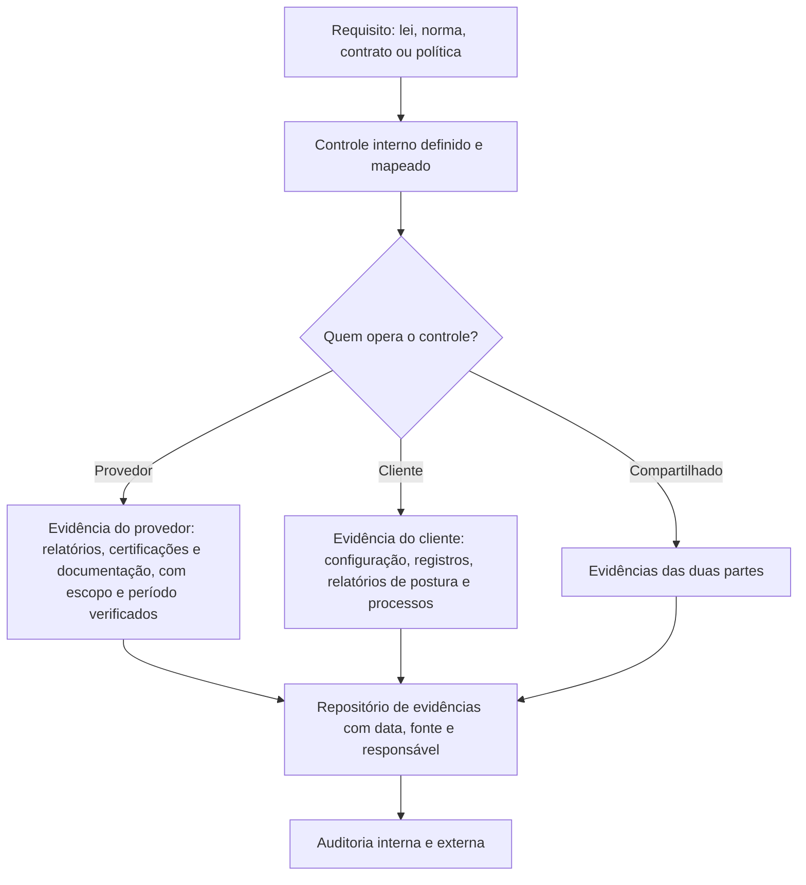

# Controles Herdados, Compartilhados e Evidências de Conformidade

> **Objetivo pedagógico:** documentar a divisão de responsabilidades em termos de controles (herdados, compartilhados e específicos do cliente) para fins de conformidade e de auditoria, construir a cadeia de evidências (relatórios do provedor mais evidências de configuração do cliente), mapear os controles a normas (ISO/IEC 27017, NIST SP 800-53, CCM e LGPD), definir a divisão de responsabilidades **dentro da organização** (equipes de plataforma, de aplicações, de segurança e de conformidade) e produzir uma matriz RACI.

## 1. Classificação dos controles para fins de conformidade

| Classe | Quem opera | Como evidenciar | Exemplo |
|---|---|---|---|
| Herdado | Provedor | Relatórios e certificações do provedor, com escopo verificado | Segurança física de datacenters; proteção ambiental |
| Compartilhado | Provedor e cliente | Evidência do provedor (parte dele) e evidência do cliente (parte dele) | Gestão de patches; gestão de configuração; treinamento; resposta a incidentes |
| Específico do cliente | Cliente | Evidências de configuração, de processo e de operação do cliente | Gestão de acesso de usuários; classificação de dados; regras de rede do cliente |

Em auditorias, a organização deve demonstrar **os três**: o que herda (com prova do provedor), o que compartilha (com prova das duas partes) e o que opera sozinha.

## 2. Exemplo: o controle "criptografia de dados em repouso"

| Camada | Responsável | Evidência |
|---|---|---|
| Criptografia nos discos físicos do provedor | Provedor | Relatórios e documentação do provedor |
| Habilitação da criptografia no serviço (bucket, banco e volume) | Cliente | Configuração exportada e verificação de política |
| Gestão de chaves e controle de acesso às chaves | Cliente (ou compartilhada, conforme o modelo) | Políticas de chaves, rotação e registros de uso |
| Verificação contínua de que todos os recursos estão criptografados | Cliente | Relatório de postura e alertas |
| Procedimento de exceções | Cliente | Registros de aprovação de exceções |

## 3. Cadeia de evidências

| Tipo de evidência do cliente | Exemplos |
|---|---|
| Configuração | Exportações de configuração, infraestrutura como código versionada, capturas de políticas |
| Registros | Trilhas de auditoria, registros de acesso e de mudanças |
| Relatórios automáticos de postura | Resultados de verificação contínua com data |
| Processos | Procedimentos, aprovações, revisões de acesso e atas |
| Testes | Resultados de testes de restauração, de resposta a incidentes e de intrusão |
| Treinamentos | Registros de participação |

Boas práticas: **automatizar a coleta** de evidências (por exemplo, relatórios periódicos), registrar **data e fonte**, armazenar em local protegido e manter por prazos definidos.

## 4. Mapeamento a normas (exemplos)

| Tema de controle | CSA CCM v4 | ISO/IEC 27002 e 27017 | NIST SP 800-53 Rev. 5 | LGPD |
|---|---|---|---|---|
| Papéis e responsabilidades compartilhadas | STA (SSRM) | 27017: CLD.6.3.1; 27002: 5.2 e 5.19 a 5.23 | Famílias SA e PM | Arts. 37 a 42 |
| Gestão de acesso | IAM | 27002: 5.15 a 5.18 e 8.2 | Família AC e IA | Art. 46 |
| Criptografia e chaves | CEK | 27002: 8.24 | SC-12 e SC-28 | Art. 46 |
| Registro e monitoramento | LOG | 27002: 8.15 e 8.16; 27017: CLD.12.4.5 | Família AU | Art. 37 e 46 |
| Gestão de incidentes | SEF | 27002: 5.24 a 5.28 | Família IR | Art. 48 |
| Gestão de fornecedores | STA | 27002: 5.19 a 5.23; 27036-4 | SR (cadeia de suprimentos) | Arts. 39 e 42 |
| Continuidade | BCR | 27002: 5.29 e 5.30; 8.13 e 8.14 | Família CP | Art. 46 |

Verifique a numeração na versão vigente de cada norma e mantenha o mapeamento versionado.

## 5. Responsabilidade compartilhada **dentro da organização**

A responsabilidade não termina na fronteira com o provedor: dentro da organização, **várias equipes compartilham** a execução dos controles do cliente. A falta de clareza interna é uma das lacunas mais comuns.

| Equipe | Responsabilidades típicas |
|---|---|
| Plataforma de nuvem (cloud platform) | Landing zone, guardrails, contas, rede base, registros centrais, infraestrutura como código padrão |
| Equipes de aplicações e de produto | Código, dependências, configuração de serviços da aplicação, identidades de carga, segredos, registros da aplicação |
| Segurança (arquitetura e operações) | Padrões, revisões, monitoramento, detecção e resposta, gestão de vulnerabilidades e de postura |
| Identidade e acesso | Provedor de identidade, MFA, funções, revisões de acesso |
| Governança, risco e conformidade (GRC) | Políticas, matriz de responsabilidades, mapeamento a normas, evidências e auditorias |
| Privacidade e jurídico | Base legal, RIPD, contratos com provedores, comunicações legais |
| Gestão de terceiros e contratos | Diligência, contratos e monitoramento de fornecedores |
| Operações e continuidade | Backups, recuperação, testes de continuidade |
| Proprietários de dados e de negócio | Classificação, aceitação de risco e aprovação de acesso |

### 5.1 Matriz RACI (exemplo para três controles)

| Atividade | Plataforma | Aplicações | Segurança | Identidade | GRC | Privacidade | Dono do dado |
|---|---|---|---|---|---|---|---|
| Habilitar registros do plano de controle | R | I | A | I | C | I | I |
| Bloquear acesso público a armazenamentos | R | C | A | I | C | I | C |
| Classificar os dados de um sistema | C | R | C | I | C | C | A |
| Revisar acessos privilegiados | C | C | C | R | A | I | C |
| Avaliar um novo fornecedor de nuvem | C | C | R | C | C | R | A |
| Testar a restauração de backups | C | R | C | I | I | I | A |
| Evidenciar controles em auditoria | C | C | C | C | A/R | C | I |

R: responsável pela execução; A: aprovador final; C: consultado; I: informado. Mantenha **um único A** por atividade.

## 6. Declaração de responsabilidades por serviço (modelo de documento)

| Seção | Conteúdo |
|---|---|
| Identificação | Serviço, provedor, modelo, ambiente, proprietário |
| Classificação | Dados, criticidade e requisitos regulatórios |
| Matriz P, C e S | Camadas e controles, com a responsabilidade (arquivo 2) |
| Controles do cliente | Lista, com dono, implementação, evidência e frequência de verificação |
| Controles herdados | Referência a relatórios e certificações, com escopo e período |
| Controles compartilhados | Divisão e evidências de ambas as partes |
| Riscos residuais e exceções | Com aprovação |
| Revisão | Data, responsável e próxima revisão |

## 7. Exemplo prático: evidências para uma auditoria de ISO/IEC 27001 com serviços em nuvem

| Requisito do auditor | Evidência do provedor | Evidência do cliente |
|---|---|---|
| Segurança física dos datacenters | Certificação ISO/IEC 27001 e relatório SOC 2 do provedor, com escopo e período | Registro da análise do relatório e dos CUECs |
| Controle de acesso lógico | Documentação dos controles do plano de controle | Relatório de revisão trimestral de acessos; políticas de MFA e de acesso condicional |
| Gestão de vulnerabilidades | Declaração do provedor sobre a plataforma | Relatórios de varredura das imagens e dos sistemas do cliente; prazos de correção |
| Backup e recuperação | Documentação do recurso e da durabilidade | Procedimento, relatório do teste de restauração mais recente |
| Registro e monitoramento | Disponibilidade e retenção dos registros do provedor | Configuração das trilhas, retenção no SIEM e alertas |
| Gestão de fornecedores | Contrato e acordo de tratamento de dados | Avaliação do fornecedor, matriz de responsabilidades e monitoramento |

## 8. Casos de uso corporativos

- Preparação para auditorias e certificações com repositório de evidências por controle.
- Definição das responsabilidades internas em um modelo operacional de nuvem.
- Demonstração a clientes e reguladores de como os controles em nuvem são divididos e evidenciados.

## 9. Normas e frameworks relevantes

- ISO/IEC 27001:2022 e 27002:2022; ISO/IEC 27017:2015 (CLD.6.3.1); ISO/IEC 27036-4:2016
- NIST SP 800-53 Rev. 5 (controles comuns, híbridos e específicos) e NIST SP 800-37 (gestão de riscos e autorização)
- CSA CCM v4 (STA e A&A); SOC 2 (CUECs); LGPD, arts. 37 a 42, 46 e 50

## 10. Checklist operacional: evidências e responsabilidades

- [ ] Controles classificados como herdados, compartilhados ou específicos do cliente
- [ ] Evidências do provedor coletadas, com escopo, período e CUECs revisados
- [ ] Evidências do cliente coletadas de forma automática e periódica, com data e fonte
- [ ] Mapeamento dos controles às normas aplicáveis, versionado
- [ ] Matriz RACI interna aprovada, com um único responsável final por atividade
- [ ] Declaração de responsabilidades do serviço assinada pelo proprietário
- [ ] Repositório de evidências protegido, com retenção definida
- [ ] Revisão anual e a cada mudança relevante do serviço ou do provedor

## 11. Referências

- NIST. SP 800-53 Rev. 5 e SP 800-37 Rev. 2. 2020 e 2018.
- ISO/IEC 27017:2015; ISO/IEC 27002:2022; ISO/IEC 27036-4:2016.
- Cloud Security Alliance. CCM v4 (STA e A&A). 2021.
- AICPA. SOC 2: controles complementares da entidade usuária.
- Brasil. LGPD, arts. 37 a 42 e 46.
- Pastas 11, 12 e 29 deste repositório.
