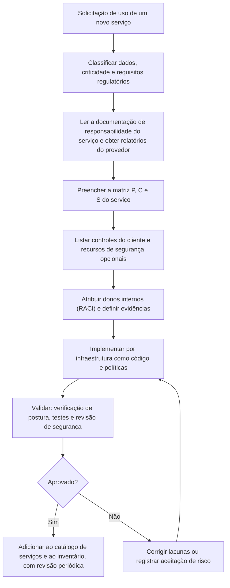

# Ferramentas, Fluxo, Modelos e Checklist de Responsabilidade Compartilhada

> **Objetivo pedagógico:** operacionalizar o modelo de responsabilidade compartilhada: levantar os serviços em uso nos três provedores (comandos de somente leitura), gerar automaticamente a lista de controles do cliente por serviço a partir de uma matriz de referência, padronizar o fluxo de integração de um novo serviço de nuvem e usar modelos e um checklist para registrar decisões, lacunas e evidências.

> **Segurança:** os comandos apenas **consultam** informações. Use identidades de leitura, em contas autorizadas. Nomes de recursos e identificadores são fictícios; as opções dos comandos variam entre versões: confirme na documentação.

## 1. Fluxo de integração de um novo serviço de nuvem



## 2. Levantamento dos serviços em uso (somente leitura)

### 2.1 AWS

```bash
# Serviços com custo no último mês (indica os serviços realmente usados; ajuste as datas)
aws ce get-cost-and-usage \
  --time-period Start=2026-10-01,End=2026-11-01 \
  --granularity MONTHLY --metrics UnblendedCost \
  --group-by Type=DIMENSION,Key=SERVICE \
  --query "ResultsByTime[0].Groups[].[Keys[0],Metrics.UnblendedCost.Amount]" --output table

# Recursos etiquetados (verifica a cobertura de etiquetas de proprietário e de classificação)
aws resourcegroupstaggingapi get-resources --tags-per-page 100 \
  --query "ResourceTagMappingList[].[ResourceARN,Tags[?Key=='proprietario']|[0].Value,Tags[?Key=='classificacao']|[0].Value]" --output table
```

### 2.2 Azure

```bash
# Tipos de recursos em uso na assinatura atual, com contagem
az resource list --query "[].type" --output tsv | sort | uniq -c | sort -rn

# Recursos sem a etiqueta de proprietário
az resource list --query "[?tags.proprietario==null].[name,type,resourceGroup]" --output table
```

### 2.3 Google Cloud

```bash
# Tipos de ativos em um projeto (requer a API do inventário de ativos habilitada)
gcloud asset search-all-resources --scope=projects/ID-DO-PROJETO --format="value(assetType)" | sort | uniq -c | sort -rn

# APIs habilitadas no projeto (indica os serviços ativos)
gcloud services list --enabled --project=ID-DO-PROJETO --format="value(config.name)"
```

Salve a saída com data e hora (UTC), conta e comando, e use-a para construir o inventário de serviços.

## 3. Geração automática dos controles do cliente por serviço

`matriz_referencia.csv` (modelo simplificado; adapte as camadas ao seu catálogo):

```
modelo,camada,responsavel
IaaS,Sistema operacional e patches,C
IaaS,Rede virtual e filtros,C
IaaS,Identidade e acesso,C
IaaS,Dados e criptografia,C
IaaS,Registros e monitoramento,C
IaaS,Backup e recuperação,C
PaaS,Configuração do serviço,C
PaaS,Identidade e acesso,C
PaaS,Dados e criptografia,S
PaaS,Registros e monitoramento,S
PaaS,Backup e recuperação,S
PaaS,Plataforma e patches,P
SaaS,Identidade e MFA,C
SaaS,Compartilhamento e configuração,C
SaaS,Retenção e backup,S
SaaS,Auditoria e registros,S
SaaS,Aplicação e infraestrutura,P
```

`servicos_em_uso.csv` (fictício):

```
servico,provedor,modelo,classificacao
Máquinas virtuais do portal,AWS,IaaS,confidencial
Banco de dados de clientes,Azure,PaaS,restrito
Plataforma de colaboração,Microsoft 365,SaaS,confidencial
```

```python
# Lista, por serviço, as camadas em que o cliente tem responsabilidade (C ou S) e que precisam de dono, controle e evidência
import csv
from collections import defaultdict

matriz = defaultdict(list)
with open("matriz_referencia.csv", encoding="utf-8") as f:
    for linha in csv.DictReader(f):
        matriz[linha["modelo"]].append((linha["camada"], linha["responsavel"]))

with open("servicos_em_uso.csv", encoding="utf-8") as f:
    for s in csv.DictReader(f):
        pendentes = [camada for camada, resp in matriz[s["modelo"]] if resp in ("C", "S")]
        print(f'{s["servico"]} ({s["provedor"]}, {s["modelo"]}, {s["classificacao"]}):')
        for camada in pendentes:
            print(f"   - exigir dono, controle e evidência: {camada}")
```

O resultado alimenta o registro de controles do cliente (seção 4.2) e o planejamento de auditorias.

## 4. Modelos

### 4.1 Matriz de responsabilidades por serviço

| Camada ou controle | P, C ou S | Fonte da informação (documento e data) | Dono interno | Controle implementado? | Evidência |
|---|---|---|---|---|---|
| | | | | | |
| | | | | | |

### 4.2 Registro de controles do cliente

| ID | Serviço | Controle | Tipo (preventivo, detectivo ou corretivo) | Dono | Implementação (por código, por política ou manual) | Evidência e frequência | Mapeamento (CCM, ISO e CIS) | Status |
|---|---|---|---|---|---|---|---|---|
| CC-001 | | | | | | | | |

### 4.3 Registro de lacunas de responsabilidade

| ID | Serviço | Lacuna | Tipo (suposição, padrão, recurso opcional, terceiro ou resposta) | Risco | Ação | Responsável | Prazo | Status |
|---|---|---|---|---|---|---|---|---|
| LR-001 | | | | | | | | |

### 4.4 Registro de pedidos de esclarecimento ao provedor

| ID | Data | Serviço | Pergunta sobre responsabilidade | Canal | Resposta do provedor (e data) | Decisão resultante |
|---|---|---|---|---|---|---|
| PE-001 | | | | | | |

### 4.5 Registro de recursos de segurança opcionais

| Serviço | Recurso | Habilitado por padrão? | Depende de plano ou licença? | Decisão (habilitar ou não) | Responsável | Data |
|---|---|---|---|---|---|---|
| | | | | | | |

## 5. Checklist: integração de um novo serviço de nuvem

**Serviço:** ____________________
**Solicitante e proprietário:** ____________________
**Data:** ____________________

### 5.1 Classificação e conformidade

- [ ] Dados classificados; presença de dados pessoais, sensíveis ou de cartão identificada
- [ ] Requisitos legais, regulatórios e contratuais levantados
- [ ] Regiões, residência e transferência internacional avaliadas
- [ ] Avaliação do fornecedor concluída; relatórios e certificações arquivados com escopo e período verificados

### 5.2 Responsabilidades

- [ ] Documentação de responsabilidade do serviço arquivada (com data)
- [ ] Matriz P, C e S preenchida
- [ ] CUECs e controles do cliente identificados
- [ ] Donos internos atribuídos (RACI), com um único responsável final
- [ ] Dúvidas encaminhadas ao provedor por escrito e respostas registradas

### 5.3 Controles mínimos do cliente

- [ ] Identidade: SSO, MFA resistente a phishing e privilégio mínimo
- [ ] Dados: criptografia, chaves, retenção e backup (com teste de restauração)
- [ ] Rede: exposição mínima e segmentação
- [ ] Registros: habilitados, exportados e retidos; alertas definidos
- [ ] Configuração por código, com revisão e verificação contínua de postura
- [ ] Plano de resposta a incidentes e contatos do provedor definidos

### 5.4 Encerramento

- [ ] Riscos residuais registrados e aceitos
- [ ] Serviço adicionado ao inventário e ao catálogo
- [ ] Data de revisão agendada

## 6. Resultado da verificação

| Resultado | Condição |
|---|---|
| Conforme | Todos os itens aplicáveis marcados |
| Conforme com ressalvas | Pendências sem exposição de dados nem de acesso privilegiado, com plano de ação |
| Não conforme | Ausência de dono, de classificação, de MFA em acesso privilegiado, de registros ou de matriz de responsabilidades; não liberar para dados reais |

**Assinatura do proprietário:** ____________________
**Assinatura da segurança:** ____________________

## 7. Exemplo prático: integração de um serviço de fila gerenciada

| Passo | Resultado |
|---|---|
| Classificação | Mensagens com identificadores de clientes (confidencial; dados pessoais) |
| Documentação | Divisão P e C consultada; provedor mantém plataforma e durabilidade |
| Controles do cliente | Permissões mínimas por função; criptografia com chave gerenciada pelo cliente; acesso apenas por rede privada; registros de acesso habilitados |
| Lacuna encontrada | A retenção padrão das mensagens era maior que a necessária |
| Ação | Reduzir a retenção para 24 horas e documentar o motivo |
| Evidências | Infraestrutura como código, relatório de postura e política de acesso exportada |
| Decisão | Aprovado, com revisão em 12 meses |

## 8. Casos de uso corporativos

- Processo padronizado de integração de serviços de nuvem pelo time de plataforma e pelo de segurança.
- Inventário contínuo de serviços e de controles do cliente.
- Base de dados para auditorias, para avaliações de riscos e para o catálogo de serviços aprovados.

## 9. Normas e frameworks relevantes

- NIST SP 800-144 e 800-53 Rev. 5; ISO/IEC 27017:2015; ISO/IEC 27002:2022 (5.9 e 5.23)
- CSA CCM v4 (STA, DSP, IAM e LOG); CIS Controls v8.1 (controles 1 e 2, inventário)
- LGPD, arts. 37 a 42 e 46

## 10. Referências

- Documentação das ferramentas de linha de comando: AWS CLI (Cost Explorer e Resource Groups Tagging API), Azure CLI e Google Cloud CLI (Cloud Asset Inventory).
- NIST. SP 800-53 Rev. 5. 2020.
- Cloud Security Alliance. CCM v4 e CAIQ v4.
- Nygard, M. Documenting Architecture Decisions. 2011.
- Pastas 01, 11, 12 e 17 deste repositório.
