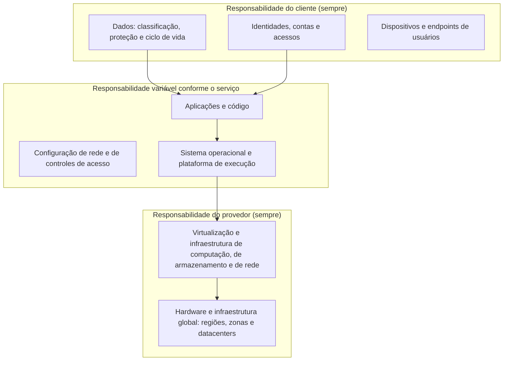

# Fundamentos do Modelo de Responsabilidade Compartilhada

> **Objetivo pedagógico:** compreender o conceito de responsabilidade compartilhada (segurança "da" nuvem e segurança "na" nuvem), seus princípios, as responsabilidades que o cliente nunca transfere, a distinção entre responsabilidade operacional e responsabilização (accountability), os conceitos relacionados (controles herdados, compartilhados e do cliente; "responsabilidade compartilhada" versus "destino compartilhado") e as consequências práticas para quem projeta, opera e audita ambientes em nuvem.

## 1. O conceito

Quando uma organização usa nuvem, **parte da segurança passa a ser executada pelo provedor** (instalações, hardware, virtualização e, conforme o serviço, sistema operacional e plataforma) e **parte permanece com o cliente** (dados, identidades, configurações e uso). O modelo de responsabilidade compartilhada descreve essa divisão.

| Expressão | Significado |
|---|---|
| Segurança **da** nuvem (*security of the cloud*) | O que o provedor opera e protege: infraestrutura física, hardware, software de virtualização e os serviços que oferece |
| Segurança **na** nuvem (*security in the cloud*) | O que o cliente decide e configura: dados, identidades, configuração dos serviços, redes virtuais, sistemas e aplicações que implanta |

A divisão **não é fixa**: muda conforme o modelo de serviço (IaaS, PaaS, SaaS), o serviço específico e, às vezes, a configuração escolhida (por exemplo, nós gerenciados versus autogerenciados em Kubernetes).

## 2. Por que o modelo existe e por que falha na prática

| Aspecto | Descrição |
|---|---|
| Origem | O provedor opera uma infraestrutura que o cliente não pode inspecionar nem controlar fisicamente; portanto, as responsabilidades precisam ser divididas |
| Benefício | O cliente se beneficia da escala e da especialização do provedor em segurança física e de infraestrutura |
| Risco | O cliente assume que "o provedor cuida da segurança" e deixa de implementar os controles que lhe cabem |
| Falha típica | Incidentes em nuvem decorrem, em grande parte, de configuração, de identidade e de uso pelo cliente, e não de falhas da infraestrutura do provedor |

## 3. Representação em camadas

## 4. Responsabilidades que o cliente nunca transfere

Mesmo no modelo de SaaS, em que o provedor opera quase toda a pilha, permanecem com o cliente:

| Responsabilidade | Explicação |
|---|---|
| Dados | Classificação, decisão sobre o que armazenar, base legal, retenção e proteção; a LGPD mantém o controlador responsável |
| Contas e identidades | Quem tem acesso, com que permissões, com que autenticação e por quanto tempo |
| Dispositivos e endpoints | Segurança dos dispositivos que acessam os serviços |
| Configuração de uso | Compartilhamento externo, políticas, integrações e opções de segurança disponíveis |
| Gestão de acessos de terceiros | Aplicativos, parceiros e fornecedores com acesso aos dados |
| Conformidade com leis e contratos | A organização responde perante titulares, reguladores e clientes |
| Resposta a incidentes no seu ambiente | Detecção, contenção e comunicação dos eventos sob seu controle |
| Continuidade da sua operação | Backups e recuperação de dados, quando não oferecidos ou não suficientes |

## 5. Responsabilização (*accountability*) versus execução

| Conceito | Descrição |
|---|---|
| Execução (*responsibility*) | Quem realiza o controle (por exemplo, o provedor aplica patches no hipervisor) |
| Responsabilização (*accountability*) | Quem responde perante partes interessadas e a lei pelo resultado |

**A responsabilização perante clientes, titulares e reguladores permanece com a organização**, ainda que parte da execução seja delegada a um provedor. É o princípio que sustenta a LGPD (controlador responde pelo tratamento, mesmo quando usa operadores), as normas setoriais de terceirização e a gestão de riscos de terceiros.

## 6. Tipos de controle quanto à responsabilidade

| Tipo | Descrição | Exemplo |
|---|---|---|
| Herdado | Implementado e operado pelo provedor; o cliente o herda e o documenta como evidência de terceiros | Segurança física dos datacenters; controle de acesso físico |
| Compartilhado | Exige ações do provedor e do cliente | Gestão de patches (o provedor corrige a plataforma; o cliente corrige o que gerencia), treinamento, gestão de configuração |
| Específico do cliente | Implementado e operado exclusivamente pelo cliente | Classificação de dados, gestão de acesso de usuários, regras de rede do cliente |

Esses tipos correspondem às designações de controles comuns, híbridos e específicos do sistema do NIST SP 800-53 e a termos usados por provedores e por programas como o FedRAMP.

## 7. Responsabilidade compartilhada e "destino compartilhado"

Alguns provedores descrevem, além da divisão de responsabilidades, uma postura de **destino compartilhado** (*shared fate*): o provedor assume papel ativo para ajudar o cliente a ter sucesso na segurança, oferecendo configurações seguras por padrão, modelos de arquitetura, ferramentas de verificação e garantias. Isso **não elimina** as responsabilidades do cliente, mas reduz a distância entre as partes.

## 8. Modelos de serviço e a movimentação da fronteira

| Do ambiente local para o SaaS | Efeito na fronteira |
|---|---|
| Ambiente local | O cliente é responsável por tudo, da instalação física à aplicação |
| IaaS | O provedor assume a infraestrutura física e a virtualização; o cliente assume o sistema operacional para cima |
| CaaS e PaaS | O provedor assume também o sistema operacional e a plataforma; o cliente assume aplicações, dados e configuração |
| FaaS (*serverless*) | O provedor assume o ambiente de execução; o cliente assume o código, as permissões e os eventos |
| SaaS | O provedor assume a aplicação; o cliente assume dados, identidades, configuração e uso |

Quanto mais alto o nível de abstração, **menos** o cliente executa, mas **mais** depende da transparência, do contrato e da verificação do provedor. A **responsabilização** do cliente sobre os dados não diminui.

## 9. Exemplo prático: o mesmo dado em três modelos

Cenário: armazenar documentos com dados pessoais.

| Modelo | O que o provedor faz | O que o cliente continua fazendo |
|---|---|---|
| IaaS (máquina virtual com servidor de arquivos) | Infraestrutura, virtualização | Sistema operacional, patches, firewall, antivírus, permissões, criptografia, backups, registros |
| PaaS (armazenamento de objetos gerenciado) | Infraestrutura, plataforma, durabilidade e disponibilidade do serviço | Políticas de acesso, bloqueio de acesso público, criptografia (inclusive chaves, quando aplicável), registros, retenção, classificação |
| SaaS (plataforma de colaboração) | Aplicação, infraestrutura, disponibilidade | Identidade e MFA, permissões, compartilhamento externo, retenção, rótulos de sensibilidade, aplicativos de terceiros, dispositivos |

Em todos os casos, **a classificação, a base legal e a decisão de compartilhamento são do cliente**.

## 10. Casos de uso corporativos

- Definição de princípios internos de responsabilidade para projetos em nuvem.
- Treinamento de áreas de negócio, de arquitetura e de auditoria sobre o que o provedor faz e o que não faz.
- Base para contratos e para avaliações de provedores.

## 11. Normas e frameworks relevantes

- NIST SP 800-144 (responsabilidades em nuvem pública); NIST SP 500-292 (atores); NIST SP 800-53 Rev. 5 (controles comuns, híbridos e específicos)
- ISO/IEC 27017:2015, CLD.6.3.1; ISO/IEC 17789:2014 (papéis do cliente e do provedor); ISO/IEC 27036-4:2016 (relações com fornecedores de nuvem)
- CSA CCM v4, STA-01 a STA-06 (modelo de responsabilidade compartilhada de segurança), numeração a confirmar na versão vigente
- LGPD, arts. 37 a 42 (controlador e operador) e 46

## 12. Checklist operacional: entendimento do modelo

- [ ] Modelo de serviço de cada serviço usado identificado
- [ ] Documentação oficial de responsabilidade compartilhada do provedor e do serviço lida e arquivada
- [ ] Responsabilidades do cliente (dados, identidades, configuração e dispositivos) listadas
- [ ] Cada responsabilidade do cliente com dono interno nomeado
- [ ] Controles herdados identificados, com a evidência do provedor obtida
- [ ] Controles compartilhados com divisão explícita
- [ ] Responsabilização perante titulares, clientes e reguladores mapeada

## 13. Referências

- Jansen, W.; Grance, T. NIST SP 800-144. 2011.
- Amazon Web Services. Shared Responsibility Model (documentação vigente).
- Microsoft. Shared responsibility in the cloud (Microsoft Learn, documentação vigente).
- Google Cloud. Shared responsibilities and shared fate on Google Cloud (documentação vigente).
- ISO/IEC 27017:2015. Code of practice for information security controls based on ISO/IEC 27002 for cloud services.
- Cloud Security Alliance. Cloud Controls Matrix v4, domínio STA. 2021.
