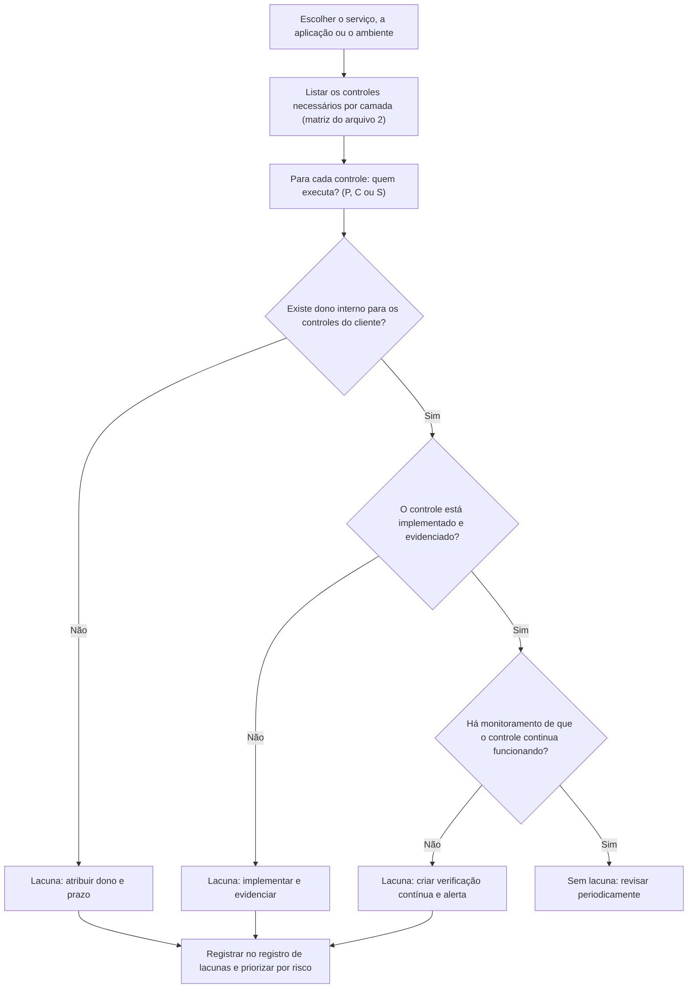

# Lacunas de Responsabilidade e Causas Reais de Incidentes

> **Objetivo pedagógico:** identificar os tipos de lacunas de responsabilidade (aquelas em que ninguém executa um controle porque cada parte supõe que é da outra) que causam incidentes em nuvem, reconhecer as causas mais frequentes (configuração, identidade, registros, backup, integrações e terceiros), conduzir uma análise sistemática de lacunas em um serviço ou em um ambiente e priorizar a correção com base em risco.

## 1. O que é uma lacuna de responsabilidade

Uma **lacuna de responsabilidade** ocorre quando um controle necessário **não é executado por ninguém**, porque o cliente supõe que o provedor o faz, o provedor supõe que o cliente o faz (ou o cliente não sabe que o controle existe), ou porque o controle depende de uma configuração que nenhuma das partes habilitou.

| Tipo de lacuna | Descrição | Exemplo |
|---|---|---|
| Suposição | Supor que o provedor faz algo que é do cliente | "O provedor faz backup dos nossos dados" (em muitos serviços SaaS, a retenção não equivale a backup) |
| Padrão inseguro | Confiar nos padrões do serviço sem verificá-los | Armazenamento com acesso mais permissivo do que o necessário |
| Recurso opcional não habilitado | O recurso de segurança existe, mas está desativado ou depende de plano | Registros de acesso a dados desabilitados |
| Nuance do serviço | Diferenças entre serviços semelhantes | Nós gerenciados versus autogerenciados em Kubernetes |
| Multicloud e híbrido | Políticas inconsistentes entre ambientes | Controles de identidade diferentes em cada nuvem |
| Terceiros e provedores gerenciados (MSP) | Responsabilidades pouco claras entre cliente, parceiro e provedor | Ninguém monitora os alertas do ambiente |
| Resposta a incidentes | Ninguém sabe quem age primeiro e com que acesso | Provedor e cliente aguardando um ao outro |
| Conformidade | Provedor certificado, cliente não conforme | Relatório SOC 2 do provedor sem os controles complementares do cliente |
| Ciclo de vida | Controles esquecidos ao encerrar o serviço | Dados não excluídos e acessos não revogados após o término do contrato |
| Dados em movimento entre serviços | Dados copiados para locais sem controles equivalentes | Exportações e relatórios armazenados em locais abertos |

## 9. Causas mais frequentes de incidentes em nuvem

| Causa | Por que é frequente | Controle de referência |
|---|---|---|
| Identidade e credenciais comprometidas ou excessivas | A identidade controla as APIs; credenciais vazam; permissões são amplas | MFA resistente a phishing, privilégio mínimo, credenciais temporárias (pasta 06) |
| Configuração incorreta de armazenamento, de rede e de bancos | Autoatendimento e velocidade sem guardrails | Políticas preventivas e verificação contínua de postura (pasta 17) |
| Registros desabilitados ou insuficientes | Recursos opcionais e retenção limitada | Registros centralizados e retidos (pasta 13) |
| Aplicações e APIs vulneráveis | O cliente é responsável pelo código | Desenvolvimento seguro e testes (pasta 21) |
| Segredos expostos em código, em imagens e em pipelines | Práticas de desenvolvimento | Cofres de segredos e varredura (pasta 21) |
| Integrações e aplicativos de terceiros | Consentimentos amplos e pouco monitorados | Governança de aplicativos e revisão de acessos |
| Falta de backup e de recuperação | Suposição de que o provedor protege | Backups independentes e testes de restauração |
| Falta de inventário e de propriedade | Recursos órfãos e fora de controle | Inventário, etiquetas e revisões |
| Cadeia de suprimentos | Imagens e bibliotecas de terceiros | Verificação de origem e assinatura |
| Resposta lenta por falta de preparo | Playbooks e contatos inexistentes | Preparação e exercícios (pasta 22) |

## 3. Análise de lacunas: método

### Perguntas-guia por controle

| Pergunta | Objetivo |
|---|---|
| Quem executa este controle e como sabemos? | Identificar suposições |
| Está habilitado por padrão ou depende de nossa ação? | Reconhecer recursos opcionais |
| Qual a evidência de que funciona? | Exigir comprovação |
| Quem é o dono interno e o substituto? | Garantir responsabilidade |
| O que acontece se este controle falhar? | Avaliar o impacto |
| O que muda se o provedor alterar o serviço? | Gerir mudanças |
| Como detectamos que o controle foi desativado? | Garantir monitoramento |

## 4. Lacunas típicas por serviço e verificações

| Serviço | Lacunas frequentes | Verificação |
|---|---|---|
| Suíte de produtividade (SaaS) | Retenção confundida com backup; compartilhamento externo livre; MFA parcial; auditoria com retenção curta | Revisar políticas de retenção, de compartilhamento, de autenticação e exportação de logs |
| Armazenamento de objetos | Acesso público; ausência de registros de acesso a dados; chaves e políticas amplas | Bloqueios de acesso público, eventos de dados e revisão de políticas |
| Banco de dados gerenciado | Exposição à internet; credenciais padrão; sem auditoria; backups não testados | Regras de rede, usuários, auditoria e restauração |
| Máquinas virtuais | Patches atrasados; administração aberta à internet; sem agentes de registro | Gestão de vulnerabilidades, regras de rede e agentes |
| Kubernetes gerenciado | Nós sem atualização; permissões amplas; imagens não verificadas; registros desabilitados | Modo de nós, RBAC, políticas e auditoria do cluster |
| Funções *serverless* | Permissões amplas; segredos em variáveis; dependências vulneráveis | Revisão de papéis e varredura de dependências |
| Provedor de identidade | Contas administrativas sem MFA resistente a phishing; consentimento amplo de aplicativos | Revisão de políticas e de aplicativos |
| Rede e conectividade híbrida | Segmentação insuficiente; ausência de inspeção; rotas excessivas | Revisão de regras e de topologia |

## 5. Priorização das lacunas

| Fator | Pergunta | Peso (exemplo) |
|---|---|---|
| Sensibilidade dos dados afetados | Há dados restritos ou pessoais sensíveis? | Alto |
| Exposição | O recurso está exposto à internet? | Alto |
| Facilidade de exploração | Depende de credencial comum ou de condição rara? | Médio a alto |
| Impacto no negócio | Qual a criticidade da carga? | Alto |
| Controles compensatórios | Há outras camadas de defesa? | Reduz |
| Esforço de correção | Tempo e custo | Orienta a ordem, e não o risco |

Registre as lacunas em um registro com **ID, descrição, risco, dono, prazo e status**. As lacunas críticas (acesso público a dados, MFA ausente em contas privilegiadas e registros desabilitados) têm prioridade imediata.

## 6. Exemplo prático: análise de lacunas de uma plataforma de colaboração (SaaS)

| Controle | Quem executa | Estado | Lacuna | Ação |
|---|---|---|---|---|
| Disponibilidade da plataforma | Provedor | Garantido por SLA | Nenhuma | Monitorar a página de status |
| MFA para todos os usuários | Cliente | Habilitado para 70% | Usuários sem MFA | Exigir MFA por acesso condicional até 30 dias |
| Compartilhamento externo | Cliente | Liberado para todos | Risco de exposição | Restringir a domínios aprovados e links com expiração |
| Backup dos dados | Cliente (retenção do provedor não equivale a backup) | Sem backup independente | Perda irrecuperável por exclusão acidental ou ransomware | Adotar backup independente e testar restauração |
| Auditoria | Compartilhada | Habilitada, retenção curta | Evidências insuficientes em incidentes | Exportar logs para o SIEM com retenção de 12 meses |
| Aplicativos de terceiros | Cliente | Consentimento livre | Acesso excessivo a e-mail e arquivos | Exigir aprovação de administrador e revisão trimestral |
| Dispositivos | Cliente | Sem verificação de conformidade | Acesso por dispositivos não gerenciados | Acesso condicional por conformidade do dispositivo |

## 7. Casos de uso corporativos

- Revisões de arquitetura com análise de lacunas de responsabilidade antes da implantação.
- Auditorias internas de serviços críticos com foco em controles do cliente.
- Avaliação de riscos de provedores gerenciados e de integrações.

## 8. Normas e frameworks relevantes

- CSA Top Threats to Cloud Computing (Pandemic Eleven e edições posteriores); OWASP Cloud-Native Application Security Top 10
- CSA CCM v4 (STA, IAM, LOG, DSP e CCC); NIST SP 800-144; NIST CSF 2.0
- CIS Foundations Benchmarks; ISO/IEC 27017:2015 (CLD.6.3.1)
- LGPD, arts. 6º, 37 a 42 e 46

## 9. Checklist operacional: análise de lacunas

- [ ] Matriz de responsabilidades do serviço preenchida (arquivo 2)
- [ ] Cada controle do cliente com dono, estado de implementação e evidência
- [ ] Recursos opcionais de segurança verificados (registros, retenção, MFA e criptografia)
- [ ] Backups independentes e restauração testada para dados críticos
- [ ] Responsabilidades de parceiros e de MSPs definidas em contrato
- [ ] Papéis e acessos para resposta a incidentes combinados com o provedor
- [ ] Lacunas registradas, priorizadas e acompanhadas
- [ ] Verificação contínua de postura para os controles críticos

## 10. Referências

- Cloud Security Alliance. Top Threats to Cloud Computing: Pandemic Eleven. 2022.
- OWASP. Cloud-Native Application Security Top 10. 2022.
- Jansen, W.; Grance, T. NIST SP 800-144. 2011.
- Center for Internet Security. CIS Foundations Benchmarks (AWS, Azure e Google Cloud).
- Pastas 06, 09, 13, 17 e 22 deste repositório.
