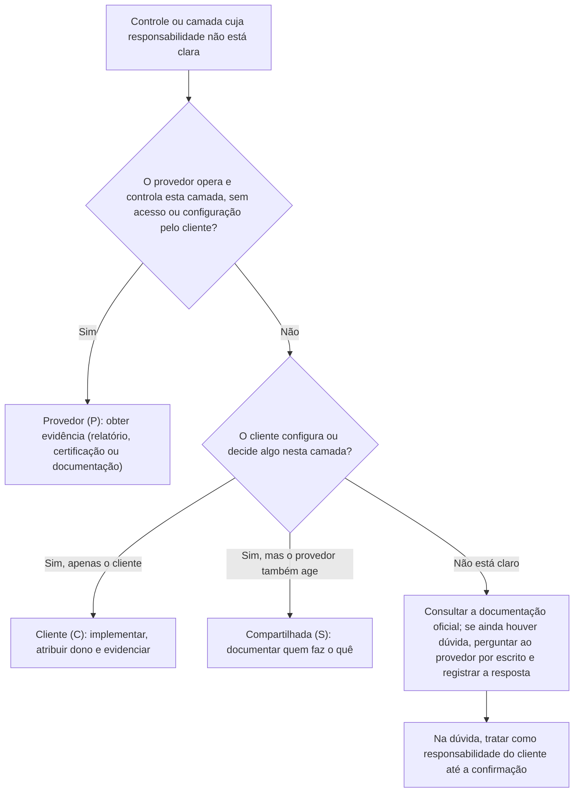

# Matriz de Responsabilidades por Serviço e por Camada

> **Objetivo pedagógico:** mapear, camada por camada, quem é responsável por cada controle em cada modelo de serviço (ambiente local, IaaS, CaaS, PaaS, FaaS e SaaS), usar uma notação padronizada (Provedor, Cliente e Compartilhada), aplicar a matriz a serviços concretos, reconhecer as nuances (nós gerenciados, serviços de abstração alta, e recursos de segurança opcionais) e usar um fluxo de decisão para determinar a responsabilidade quando a documentação não é explícita.

> A matriz é **de referência didática**. A divisão real depende de cada serviço e de sua documentação vigente: confirme sempre na documentação oficial do provedor (arquivo 3).

## 1. Notação

| Código | Significado |
|---|---|
| **P** | Responsabilidade do provedor |
| **C** | Responsabilidade do cliente |
| **S** | Responsabilidade compartilhada (ambos têm ações) |

## 2. Matriz de referência por camada e por modelo

| Camada ou controle | Local | IaaS | CaaS (Kubernetes gerenciado) | PaaS | FaaS | SaaS |
|---|---|---|---|---|---|---|
| Segurança física de datacenters | C | P | P | P | P | P |
| Hardware (servidores, armazenamento e rede) | C | P | P | P | P | P |
| Virtualização e hipervisor | C | P | P | P | P | P |
| Rede física e backbone | C | P | P | P | P | P |
| Plano de controle da orquestração | C | n/a | P | n/a | n/a | n/a |
| Sistema operacional do hospedeiro (nós) | C | C | S (depende do serviço) | P | P | P |
| Atualização de patches do sistema operacional | C | C | S | P | P | P |
| Runtime e middleware | C | C | S | P | P | P |
| Configuração de rede virtual, filtros e segmentação | C | C | C | S | S | S (opções limitadas) |
| Aplicação e código | C | C | C | C | C | P |
| Configuração segura da aplicação ou do serviço | C | C | C | C | C | C |
| Gestão de identidade e de acesso do cliente (usuários e funções) | C | C | C | C | C | C |
| Autenticação multifator e acesso condicional | C | C | C | C | C | C (quando oferecido) |
| Classificação, proteção e ciclo de vida dos dados | C | C | C | C | C | C |
| Criptografia de dados em repouso | C | C | S | S | S | S |
| Gestão de chaves de criptografia | C | C | C (ou serviço do provedor) | S | S | S |
| Criptografia em trânsito (configuração) | C | C | C | S | S | S |
| Backup e recuperação dos dados do cliente | C | C | C | S | S | S (varia muito) |
| Registro e monitoramento do plano de controle | C | S | S | S | S | S |
| Registro e monitoramento da aplicação e dos dados | C | C | C | C | C | S |
| Gestão de vulnerabilidades do código do cliente | C | C | C | C | C | P |
| Gestão de vulnerabilidades da plataforma | C | S | S | P | P | P |
| Dispositivos de usuários (endpoints) | C | C | C | C | C | C |
| Resposta a incidentes no ambiente do cliente | C | C | C | C | C | C (com apoio do provedor) |
| Resposta a incidentes na infraestrutura do provedor | n/a | P | P | P | P | P |
| Continuidade e recuperação de desastres (arquitetura) | C | C | C | S | S | S |
| Conformidade regulatória do uso e do tratamento de dados | C | C | C | C | C | C |

Observações essenciais:

- **A configuração do serviço, a identidade e os dados são do cliente em todos os modelos.**
- Em **CaaS**, a divisão depende do serviço: o plano de controle é do provedor, mas os nós de trabalho podem ser autogerenciados (cliente), gerenciados (compartilhada) ou totalmente gerenciados (modos "piloto automático" ou similares, em que o provedor assume mais).
- Em **SaaS**, as opções de segurança (MFA, registros, retenção, DLP e backup) dependem de **plano e de licença**, e o cliente é responsável por habilitá-las e por configurá-las.

## 3. Aplicação a serviços concretos (exemplos)

| Serviço (categoria) | Modelo | Responsabilidades-chave do cliente |
|---|---|---|
| Máquina virtual | IaaS | Sistema operacional, patches, hardening, firewall do host, antivírus, agentes, contas locais, registros, backups |
| Disco gerenciado e volume | IaaS | Criptografia, snapshots, controle de acesso ao volume, retenção |
| Rede virtual e grupos de segurança | IaaS | Regras, segmentação, exposição, registros de fluxo |
| Banco de dados gerenciado | PaaS | Rede (exposição), usuários e permissões, criptografia (chaves), backups e retenção, auditoria, parâmetros de segurança |
| Armazenamento de objetos | PaaS | Políticas de acesso, bloqueio de acesso público, criptografia e chaves, versionamento, registros de acesso, retenção e replicação |
| Serviço de aplicações web | PaaS | Código, dependências, segredos, identidade do serviço, autenticação, rede e registros |
| Kubernetes gerenciado | CaaS | Configuração do cluster, RBAC, políticas de rede, imagens, segredos, nós (conforme o modo), registros (pastas 19 e 20) |
| Funções *serverless* | FaaS | Código, permissões da função, segredos, validação das entradas, dependências e registros |
| Fila e mensageria gerenciadas | PaaS | Permissões, criptografia, políticas de acesso e retenção |
| Suíte de produtividade (e-mail e colaboração) | SaaS | Identidade, MFA, acesso condicional, compartilhamento externo, retenção, DLP, aplicativos de terceiros, dispositivos, auditoria e backup |
| CRM e sistemas de RH | SaaS | Perfis e permissões, SSO, exportações de dados, integrações, registros de auditoria, retenção |
| Provedor de identidade em nuvem | SaaS | Políticas de autenticação, contas privilegiadas, federações, aplicativos, registros |

## 4. Nuances importantes

| Nuance | Explicação |
|---|---|
| Abstração alta não significa menos responsabilidade do cliente | Em serviços muito abstratos (por exemplo, armazenamento de objetos e bancos sem servidor), o cliente tem menos camadas, mas **mais foco em identidade, em política e em dados** |
| Recursos de segurança opcionais | Muitos recursos existem, mas **não estão habilitados por padrão** ou dependem de plano; a responsabilidade de ativá-los é do cliente |
| Mudança de padrões ao longo do tempo | Provedores alteram configurações padrão; verifique os padrões vigentes e fixe a configuração por código |
| Serviços compostos | Um sistema usa vários serviços; cada um tem sua divisão; a soma define o risco |
| Integrações e aplicativos de terceiros | O cliente responde pelo que autoriza a acessar seus dados |
| Responsabilidade por parceiros (MSP) | Se um parceiro opera parte do ambiente, é preciso uma terceira coluna na matriz, com contrato claro |
| Regiões e soberania | O local de processamento e de suporte pode ser requisito do cliente, com cláusulas específicas |

## 5. Como determinar a responsabilidade quando a documentação não é clara

Princípio prático: **na dúvida, assuma que a responsabilidade é do cliente** até que o provedor a confirme por escrito.

## 6. Exemplo prático: matriz aplicada a uma aplicação web

Aplicação com servidor web em máquinas virtuais, banco de dados gerenciado, armazenamento de objetos e login corporativo por SaaS de identidade.

| Componente | Modelo | Provedor | Cliente | Compartilhada |
|---|---|---|---|---|
| Máquinas virtuais do servidor web | IaaS | Hardware e virtualização | SO, patches, hardening, aplicação, registros, backups | Registro do plano de controle |
| Banco de dados gerenciado | PaaS | Plataforma e patches do motor | Usuários, rede, criptografia e chaves, auditoria, backups e retenção | Parâmetros de segurança |
| Armazenamento de objetos | PaaS | Infraestrutura e durabilidade | Políticas de acesso, bloqueio público, criptografia, versionamento, registros | Chaves (conforme a escolha) |
| Provedor de identidade | SaaS | Plataforma e disponibilidade | Políticas de MFA, contas administrativas, aplicativos autorizados | Registros de auditoria (retenção) |
| Aplicação | n/a | n/a | Todo o código, dependências e segredos | n/a |

A soma mostra que **quase todos os controles que determinam o risco de dados estão na coluna do cliente**.

## 7. Casos de uso corporativos

- Matriz padrão de responsabilidades por serviço no catálogo de serviços de nuvem aprovados.
- Instrumento de revisão de arquitetura: para cada serviço, quem faz o quê.
- Base para a definição de controles obrigatórios por serviço e para auditorias.

## 8. Normas e frameworks relevantes

- NIST SP 800-144; NIST SP 800-53 Rev. 5 (controles herdados e compartilhados); ISO/IEC 27017:2015 (CLD.6.3.1)
- CSA CCM v4 (STA e domínios técnicos); ISO/IEC 17789:2014
- CIS Foundations Benchmarks (responsabilidades do cliente por configuração)

## 9. Checklist operacional: preenchimento da matriz de um serviço

- [ ] Serviço e modelo identificados
- [ ] Documentação de responsabilidade compartilhada do serviço consultada e arquivada (com data)
- [ ] Cada camada da matriz classificada como P, C ou S
- [ ] Recursos de segurança opcionais listados, com o estado (habilitado ou não) e o dono
- [ ] Controles do cliente mapeados a controles internos e a evidências
- [ ] Dúvidas registradas e encaminhadas ao provedor por escrito
- [ ] Revisão ao menos anual e a cada mudança relevante do serviço

## 10. Referências

- Jansen, W.; Grance, T. NIST SP 800-144. 2011.
- NIST. SP 800-53 Rev. 5. 2020.
- ISO/IEC 27017:2015; ISO/IEC 17789:2014.
- Documentação de responsabilidade compartilhada de cada serviço (AWS, Microsoft Azure e Google Cloud), versões vigentes.
- Binnie, C.; McCune, R. Cloud Native Security. Wiley, 2021.
