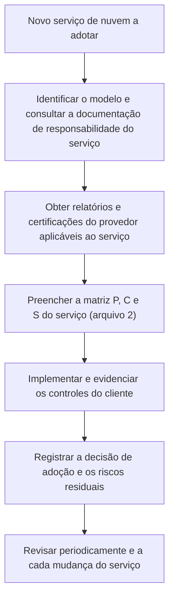

# Responsabilidade Compartilhada em AWS, Azure e Google Cloud

> **Objetivo pedagógico:** conhecer como a Amazon Web Services, a Microsoft e o Google Cloud descrevem o modelo de responsabilidade compartilhada, aplicar o modelo a serviços típicos de cada provedor (computação, banco de dados, armazenamento, contêineres, funções e identidade), saber onde obter evidências do lado do provedor (portais de conformidade e relatórios) e reconhecer as diferenças de terminologia entre as plataformas.

> As documentações dos provedores mudam com frequência. Os exemplos abaixo ilustram a lógica de divisão; **confirme os detalhes na documentação oficial vigente** antes de basear controles ou contratos.

## 1. Como cada provedor descreve o modelo

| Provedor | Descrição resumida |
|---|---|
| AWS | Segurança **da** nuvem (AWS: hardware, software, rede e instalações que executam os serviços) e segurança **na** nuvem (cliente: o que fez com os serviços; a extensão depende do serviço). A AWS distingue controles **herdados**, **compartilhados** (por exemplo, gestão de patches, de configuração e treinamento) e **específicos do cliente** |
| Microsoft Azure e Microsoft 365 | A responsabilidade varia por tipo de serviço (local, IaaS, PaaS e SaaS). Independentemente do tipo, permanecem com o cliente as informações e os dados, os dispositivos e as contas e identidades. Em SaaS, a Microsoft assume a maior parte da pilha, mas a configuração do locatário, a identidade e os dados continuam com o cliente |
| Google Cloud | Descreve a responsabilidade compartilhada e o conceito de **destino compartilhado** (*shared fate*): além de delimitar responsabilidades, o provedor oferece modelos de arquitetura (*blueprints*), configurações seguras e ferramentas para ajudar o cliente |

## 2. Terminologia equivalente

| Conceito | AWS | Azure | Google Cloud |
|---|---|---|---|
| Unidade de isolamento e de cobrança | Conta | Assinatura | Projeto |
| Agrupamento hierárquico | Organização e unidades organizacionais | Grupos de gerenciamento | Organização e pastas |
| Política preventiva central | Políticas de controle de serviços | Azure Policy e negação por política | Políticas da organização |
| Identidade de carga de trabalho | Funções do IAM | Identidades gerenciadas | Contas de serviço |
| Registro de auditoria do plano de controle | CloudTrail | Log de atividade | Cloud Audit Logs |
| Gestão de chaves | KMS | Key Vault e HSM gerenciado | Cloud KMS |
| Portal de conformidade e relatórios | AWS Artifact | Service Trust Portal | Central de recursos de conformidade |

## 3. Aplicação a serviços típicos

### 3.1 Computação em máquinas virtuais (IaaS)

| Responsabilidade | Provedor | Cliente |
|---|---|---|
| Hardware, hipervisor e rede do datacenter | Sim | Não |
| Sistema operacional (patches e hardening) | Não | Sim |
| Firewall do host e regras de rede virtual | Não | Sim |
| Aplicações e dados | Não | Sim |
| Contas locais, chaves e identidade da instância | Não | Sim |
| Registros do sistema operacional e agentes | Não | Sim |
| Backups e snapshots | Disponibiliza o recurso | Configura, protege e testa |

### 3.2 Banco de dados gerenciado (PaaS)

| Responsabilidade | Provedor | Cliente |
|---|---|---|
| Infraestrutura e plataforma do banco | Sim | Não |
| Patches do mecanismo do banco (conforme a janela) | Sim | Define janelas e versões, quando aplicável |
| Exposição de rede (público ou privado) | Disponibiliza as opções | Decide e configura |
| Usuários, permissões e autenticação | Não | Sim |
| Criptografia em repouso e em trânsito | Disponibiliza | Habilita, exige TLS e gere chaves, quando aplicável |
| Backups, retenção e restauração | Oferece o recurso | Configura retenção e testa restauração |
| Auditoria e registros do banco | Oferece o recurso | Habilita, retém e monitora |

### 3.3 Armazenamento de objetos (PaaS de alta abstração)

| Responsabilidade | Provedor | Cliente |
|---|---|---|
| Durabilidade e infraestrutura | Sim | Não |
| Políticas de acesso e controle de público | Oferece controles | Define e verifica |
| Criptografia e chaves | Disponibiliza | Escolhe o modelo de chaves e controla o acesso |
| Versionamento, retenção e proteção contra exclusão | Oferece | Habilita e configura |
| Registros de acesso a dados | Oferece (muitas vezes opcionais) | Habilita, retém e analisa |
| Classificação do conteúdo | Não | Sim |

### 3.4 Kubernetes gerenciado (CaaS)

| Responsabilidade | Provedor | Cliente |
|---|---|---|
| Plano de controle (servidor de API e etcd) | Sim | Não |
| Nós de trabalho (sistema operacional e patches) | Depende do modo (nós autogerenciados, grupos gerenciados ou modo totalmente gerenciado) | Depende do modo |
| Configuração do cluster, RBAC e políticas de rede | Não | Sim |
| Imagens de contêineres e cadeia de suprimentos | Não | Sim |
| Segredos e identidades de cargas | Não | Sim |
| Registros de auditoria do cluster | Oferece | Habilita, retém e analisa |

### 3.5 Funções sem servidor (FaaS)

| Responsabilidade | Provedor | Cliente |
|---|---|---|
| Ambiente de execução e patches do *runtime* | Sim | Não |
| Código e dependências | Não | Sim |
| Permissões da função (identidade) | Não | Sim |
| Validação das entradas e dos eventos | Não | Sim |
| Segredos e variáveis de ambiente | Não | Sim |
| Registros da função | Oferece | Habilita e retém |

### 3.6 Identidade e diretório (SaaS crítico)

| Responsabilidade | Provedor | Cliente |
|---|---|---|
| Disponibilidade e segurança da plataforma | Sim | Não |
| Políticas de autenticação, MFA e acesso condicional | Oferece | Define e aplica |
| Contas privilegiadas e acesso de emergência | Não | Sim |
| Aplicativos e consentimentos | Oferece controles | Governa |
| Registros de entrada e de auditoria | Oferece (retenção varia conforme o plano) | Exporta, retém e monitora |

## 4. Onde obter evidências do lado do provedor

| Provedor | Fonte de evidências | O que contém |
|---|---|---|
| AWS | AWS Artifact | Relatórios de auditoria e certificações (por exemplo, SOC e ISO) e acordos |
| Microsoft | Service Trust Portal | Relatórios de auditoria, certificações, guias de conformidade e avaliações |
| Google Cloud | Central de recursos de conformidade (Compliance Reports Manager) | Relatórios e certificações |
| Todos | Questionários da CSA (CAIQ) e entradas do registro CSA STAR | Respostas aos controles do CCM |
| Todos | Páginas de status, boletins de segurança e documentação técnica | Incidentes, mudanças e boas práticas |

Ao obter um relatório (por exemplo, SOC 2 Tipo II), verifique: **escopo** (serviços e regiões), **período**, **exceções** e **controles complementares do cliente** (CUECs), que descrevem o que o cliente precisa fazer para que o relatório se aplique à sua situação.

## 5. Diferenças que merecem atenção

| Tema | Observação |
|---|---|
| Padrões de segurança | Os padrões variam entre provedores e serviços; verifique e fixe a configuração por código |
| Retenção de registros | Os registros do plano de controle e de identidade têm retenção padrão limitada; exporte para o seu armazenamento |
| Acesso do provedor a dados | Verifique as garantias, os controles de acesso do provedor e as opções de chaves do cliente |
| Regiões e suporte | Verifique onde os dados são processados e de onde ocorre o suporte |
| Serviços globais | Alguns serviços operam fora da região escolhida |
| Mudanças frequentes | Assine as comunicações de mudanças e reavalie as responsabilidades periodicamente |

## 6. Exemplo prático: armazenamento de objetos nos três provedores

| Controle do cliente | AWS | Azure | Google Cloud |
|---|---|---|---|
| Bloquear acesso público | Bloqueio de acesso público (conta e bucket) | Desabilitar acesso público a blobs na conta de armazenamento | Prevenção de acesso público e política da organização |
| Criptografia | Criptografia padrão e chaves do KMS | Criptografia do serviço e chaves gerenciadas pelo cliente | Criptografia padrão e chaves do Cloud KMS |
| Registro de acesso a dados | Eventos de dados e logs de acesso | Logs de recursos e diagnóstico de armazenamento | Logs de auditoria de acesso a dados |
| Retenção e proteção contra exclusão | Versionamento e bloqueio de objetos | Imutabilidade e exclusão reversível | Versionamento e bloqueios de retenção |

Os nomes e as opções mudam; consulte as pastas 24 a 26 e a documentação vigente.

## 7. Casos de uso corporativos

- Comparação das divisões de responsabilidade em avaliações de provedores e de serviços.
- Padronização de matrizes por serviço para ambientes multicloud.
- Coleta e arquivamento de relatórios de conformidade dos provedores para auditorias.

## 8. Normas e frameworks relevantes

- NIST SP 800-144; ISO/IEC 27017:2015; ISO/IEC 27018:2019; CSA CCM v4 (STA) e CAIQ; CSA STAR
- SOC 2 (AICPA) e controles complementares da entidade usuária (CUECs); ISO/IEC 27001:2022
- CIS Foundations Benchmarks (AWS, Azure e Google Cloud)

## 9. Checklist operacional: por provedor e por serviço

- [ ] Documentação oficial de responsabilidade compartilhada do provedor arquivada (com data e versão)
- [ ] Relatórios e certificações obtidos (portal do provedor), com escopo, período e exceções verificados
- [ ] CUECs identificados e mapeados a controles do cliente
- [ ] Recursos de segurança opcionais de cada serviço listados, com decisão de habilitar e responsável
- [ ] Registros exportados para armazenamento do cliente, com retenção definida
- [ ] Padrões de configuração fixados por infraestrutura como código
- [ ] Assinatura das comunicações de mudanças e de incidentes do provedor

## 10. Referências

- Amazon Web Services. AWS Shared Responsibility Model e AWS Artifact (documentação vigente).
- Microsoft. Shared responsibility in the cloud e Service Trust Portal (documentação vigente).
- Google Cloud. Shared responsibilities and shared fate on Google Cloud; Compliance Reports Manager (documentação vigente).
- AICPA. SOC 2 Reporting on an Examination of Controls at a Service Organization.
- Cloud Security Alliance. CAIQ v4 e CSA STAR.
- Pastas 24, 25 e 26 deste repositório.
