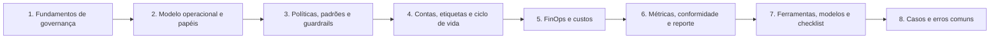

# 03 Governança de Nuvem

## Objetivo

Estabelecer a governança de nuvem da organização: definir princípios, estrutura de decisão e papéis (inclusive o Cloud Center of Excellence), escrever e aplicar políticas, padrões e guardrails como código, organizar contas, assinaturas e projetos com etiquetas e ciclo de vida de recursos, governar custos com FinOps, medir a conformidade de forma contínua e reportar à direção, de modo que a velocidade da nuvem se combine com segurança, conformidade e controle financeiro.

## Trilha de estudo recomendada

## Conteúdo da pasta

| Ordem | Arquivo | Objetivo |
|---|---|---|
| 1 | [fundamentos-de-governanca-de-nuvem.md](fundamentos-de-governanca-de-nuvem.md) | Governança versus gestão, pilares, referenciais, hierarquia documental e governança de dados |
| 2 | [modelo-operacional-papeis-e-cloud-center-of-excellence.md](modelo-operacional-papeis-e-cloud-center-of-excellence.md) | Modelos operacionais, CCoE, papéis, direitos de decisão e RACI |
| 3 | [politicas-padroes-e-guardrails-de-nuvem.md](politicas-padroes-e-guardrails-de-nuvem.md) | Políticas essenciais, padrões, guardrails como código e gestão de exceções |
| 4 | [contas-etiquetas-e-ciclo-de-vida-de-recursos.md](contas-etiquetas-e-ciclo-de-vida-de-recursos.md) | Estrutura de contas, nomenclatura, etiquetas, inventário e desativação |
| 5 | [finops-custos-e-governanca-financeira-de-nuvem.md](finops-custos-e-governanca-financeira-de-nuvem.md) | FinOps, alocação, orçamentos, anomalias e relação com a segurança |
| 6 | [metricas-conformidade-continua-e-reporte-de-governanca.md](metricas-conformidade-continua-e-reporte-de-governanca.md) | Indicadores, conformidade contínua, maturidade e reporte |
| 7 | [ferramentas-fluxo-modelos-e-checklist-de-governanca.md](ferramentas-fluxo-modelos-e-checklist-de-governanca.md) | Verificações nos três provedores, modelos e checklist |
| 8 | [casos-de-uso-e-erros-comuns-em-governanca-de-nuvem.md](casos-de-uso-e-erros-comuns-em-governanca-de-nuvem.md) | Casos fictícios, erros comuns, exercícios e perguntas de revisão |

## Princípios da pasta

- Governança define **quem decide o quê, com quais regras e como se verifica**; a gestão executa
- Guardrails automáticos permitem velocidade com segurança: o caminho seguro deve ser o mais fácil
- Toda conta, todo recurso e todo custo têm proprietário
- Políticas escritas viram controles técnicos verificáveis (políticas como código)
- Exceções são temporárias, aprovadas por quem aceita o risco e revisadas
- Governança é medida e reportada à direção, com indicadores de risco e de resultado

## Relação com outras pastas

- 01 e 02: conceitos e responsabilidade compartilhada
- 04: gestão de riscos de nuvem
- 05 a 10: arquitetura, identidade, zero trust, rede, dados e criptografia
- 11 e 12: conformidade e controles
- 17: gestão de postura (verificação contínua dos guardrails)
- 21: DevSecOps (políticas no pipeline)
- 27 a 29: métricas, roteiro e auditorias

## Referências

- NIST. Cybersecurity Framework 2.0 (2024), função Govern (GV)
- ISO/IEC 38500:2015; ISO/IEC 38505-1:2017; ISO/IEC 27014:2020; COBIT 2019
- Cloud Security Alliance. Security Guidance v4.0, domínios 2 a 5; Cloud Controls Matrix v4 (GRC)
- FinOps Foundation. FinOps Framework
- Brasil. Lei nº 13.709/2018 (LGPD), arts. 37, 38, 46 e 50
