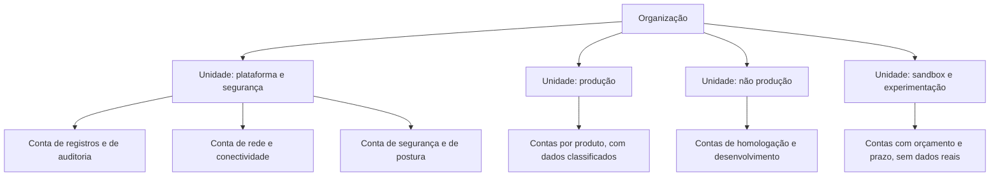
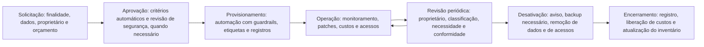

# Contas, Etiquetas e Ciclo de Vida de Recursos

> **Objetivo pedagógico:** estruturar as unidades de isolamento (contas, assinaturas e projetos) com critérios claros, definir convenções de nomenclatura e um esquema de etiquetas obrigatórias, manter o inventário de recursos, governar o ciclo de vida (solicitação, provisionamento, operação, revisão e desativação), detectar recursos órfãos e desvios de configuração, e verificar a cobertura de etiquetas com comandos de consulta.

## 1. Estratégia de contas, assinaturas e projetos

| Critério de separação | Justificativa |
|---|---|
| Ambiente (produção, homologação, desenvolvimento e teste) | Limitar o raio de impacto e os acessos |
| Criticidade e classificação dos dados | Controles diferentes para dados restritos |
| Equipe ou produto | Responsabilidade, custos e permissões separados |
| Função de plataforma (segurança, registros, rede, gestão e compartilhados) | Proteção de serviços críticos |
| Requisitos regulatórios | Isolamento de cargas regulamentadas |
| Ciclo de vida e custo | Faturamento e cotas por unidade |

Evite extremos: **uma única conta para tudo** (sem isolamento) ou **contas demais sem automação** (sobrecarga de gestão). A criação de contas deve ser **automatizada** (por exemplo, por uma "fábrica de contas") com guardrails, registros e etiquetas desde o início.



## 2. Convenções de nomenclatura

| Recurso | Padrão sugerido | Exemplo |
|---|---|---|
| Conta, assinatura ou projeto | `<organização>-<produto>-<ambiente>-<número>` | `acme-faturamento-prd-001` |
| Recursos | `<tipo>-<produto>-<ambiente>-<região>-<sequência>` | `vm-faturamento-prd-sae1-01` |
| Redes | `<tipo>-<finalidade>-<ambiente>-<região>` | `vnet-hub-prd-sae1` |
| Grupos de acesso | `grp-<papel>-<escopo>` | `grp-admin-faturamento-prd` |

Regras: nomes sem dados sensíveis; minúsculas e hífens quando o provedor exigir; documentação do padrão e verificação automática.

## 3. Etiquetas obrigatórias

| Etiqueta | Finalidade | Valores (exemplos) |
|---|---|---|
| `proprietario` | Responsável pelo recurso (grupo ou pessoa) | `financeiro-contas-a-pagar` |
| `classificacao` | Nível de classificação dos dados | `publico`, `interno`, `confidencial`, `restrito` |
| `ambiente` | Ambiente | `prd`, `hml`, `dev`, `sbx` |
| `centro-de-custo` | Alocação financeira | `CC-1042` |
| `criticidade` | Impacto no negócio | `baixa`, `media`, `alta`, `critica` |
| `dados-pessoais` | Presença de dados pessoais | `sim`, `nao` |
| `produto` | Produto ou aplicação | `faturamento` |
| `data-de-expiracao` (recursos temporários) | Fim da vida útil | `2026-12-31` |

| Boa prática | Descrição |
|---|---|
| Poucas etiquetas, bem definidas | Muitas etiquetas reduzem a adesão |
| Valores controlados | Lista fechada de valores para classificação e ambiente |
| Aplicação por política | Negar recursos sem etiquetas e herdar de grupos de recursos, quando possível |
| Verificação contínua | Relatórios de cobertura e de valores inválidos |
| Correção | Etiquetas ausentes têm prazo de correção e escalonamento ao proprietário |
| Atenção | Etiquetas não são um controle de segurança por si só: não armazene segredos nelas; podem ser alteradas por quem tem permissão |

## 4. Ciclo de vida de recursos



| Fase | Atividades de governança |
|---|---|
| Solicitação | Formulário padronizado; classificação dos dados; centro de custo |
| Aprovação | Regras automáticas (contas conformes, orçamento e etiquetas); revisão humana para dados sensíveis e serviços novos |
| Provisionamento | Infraestrutura como código; contas criadas por automação; guardrails e registros ativos desde o início |
| Operação | Gestão de patches, de acessos, de custos e de incidentes; alertas |
| Revisão periódica | Confirmar proprietário, classificação, necessidade, custos e conformidade; revisar acessos (trimestral ou semestral) |
| Desativação | Notificar usuários; confirmar necessidade de retenção legal; fazer backup necessário; excluir dados e chaves conforme a política; revogar acessos e segredos; remover registros DNS e integrações |
| Encerramento | Atualizar inventário; encerrar a conta, a assinatura ou o projeto; registrar a evidência de eliminação |

## 5. Recursos órfãos, ociosos e desvios

| Problema | Indicadores | Ação |
|---|---|---|
| Recursos sem proprietário | Etiqueta de proprietário ausente ou de pessoa que saiu da empresa | Identificar o responsável; notificar; desativar após prazo |
| Recursos ociosos | Baixo uso de CPU, de rede e de armazenamento por período prolongado | Revisar com o proprietário; redimensionar ou remover |
| Ambientes temporários esquecidos | Data de expiração vencida | Desativação automática ou alerta |
| Desvio de configuração (*drift*) | Divergência entre o código e o estado real | Detecção periódica; correção pelo código; investigação de alterações manuais |
| Contas sem uso | Sem atividade nos últimos meses | Revisar e encerrar |
| Acessos de pessoas que saíram | Credenciais ativas após o desligamento | Integração com o processo de RH; revisão de acessos |

## 6. Consultas de verificação (somente leitura)

```bash
# AWS: contas da organização (confirme a existência, o estado e a estrutura)
aws organizations list-accounts --query "Accounts[].[Id,Name,Status]" --output table

# Azure: recursos sem a etiqueta de proprietário (requer a extensão resource-graph: az extension add --name resource-graph)
az graph query -q "Resources | where isnull(tags['proprietario']) | project name, type, resourceGroup, subscriptionId | limit 100" --output table

# Google Cloud: recursos do projeto com seus rótulos (verificar a presença de rótulos obrigatórios)
gcloud asset search-all-resources --scope=projects/ID-DO-PROJETO --format="table(name.basename(),assetType,labels)" | head -n 50
```

```sql
-- DuckDB: cobertura de etiquetas obrigatórias a partir de um inventário exportado (colunas: id, tipo, proprietario, classificacao, ambiente, centro_de_custo)
SELECT
  count(*) AS recursos,
  round(100.0 * count(proprietario)    / count(*), 1) AS pct_proprietario,
  round(100.0 * count(classificacao)   / count(*), 1) AS pct_classificacao,
  round(100.0 * count(ambiente)        / count(*), 1) AS pct_ambiente,
  round(100.0 * count(centro_de_custo) / count(*), 1) AS pct_centro_de_custo
FROM read_csv_auto('inventario_recursos.csv');
```

## 7. Exemplo prático: limpeza de um ambiente após uma auditoria de inventário

| Achado | Quantidade | Ação |
|---|---|---|
| Recursos sem etiqueta de proprietário | 312 | Notificar os donos das contas; prazo de 30 dias; política para negar novos recursos sem etiqueta |
| Máquinas virtuais com uso médio de CPU abaixo de 3% por 60 dias | 41 | Revisão com os proprietários; redimensionar ou desativar |
| Ambientes de teste com data de expiração vencida | 9 | Desativação após aviso |
| Contas sem atividade há 6 meses | 4 | Encerrar após revisão |
| Usuários desligados com acesso ativo | 7 | Revogar; integrar o desligamento do RH à revisão de acessos |
| Economia mensal estimada | Cerca de 11% do custo de nuvem | Registrada em relatório de FinOps |

## 8. Casos de uso corporativos

- Fábrica de contas padronizada com guardrails e etiquetas desde a criação.
- Programa de higiene de recursos: órfãos, ociosos, temporários e contas sem uso.
- Inventário confiável como base para auditorias, para segurança e para custos.

## 9. Normas e frameworks relevantes

- ISO/IEC 27002:2022 (5.9 inventário de ativos, 5.10 uso aceitável, 5.11 devolução de ativos, 8.9 gestão de configuração, 7.14 descarte seguro)
- CIS Controls v8.1 (controle 1, inventário de ativos; controle 2, inventário de software; controle 3, proteção de dados)
- CSA CCM v4 (DSP, CCC e UEM); NIST CSF 2.0 (ID.AM, gestão de ativos)
- FinOps Foundation (alocação de custos por etiquetas)

## 10. Checklist operacional: contas, etiquetas e ciclo de vida

- [ ] Estratégia de separação de contas definida e documentada
- [ ] Criação de contas automatizada, com guardrails e registros desde o início
- [ ] Convenção de nomenclatura publicada e verificada
- [ ] Etiquetas obrigatórias definidas, com valores controlados e aplicação por política
- [ ] Inventário de recursos atualizado automaticamente
- [ ] Cobertura de etiquetas medida e meta definida
- [ ] Processo de solicitação, de aprovação, de revisão e de desativação documentado
- [ ] Revisão periódica de proprietários, classificação e acessos
- [ ] Detecção de recursos órfãos, ociosos e de desvio de configuração
- [ ] Integração do processo de desligamento de pessoas com a revogação de acessos

## 11. Referências

- Center for Internet Security. CIS Controls v8.1, controles 1 e 2. 2024.
- ISO/IEC 27002:2022. Controles de segurança da informação.
- Amazon Web Services. Best Practices for Tagging AWS Resources; AWS Organizations (documentação).
- Microsoft. Cloud Adoption Framework: estratégia de nomenclatura e etiquetagem; Azure Resource Graph (documentação).
- Google Cloud. Resource hierarchy e Cloud Asset Inventory (documentação).
