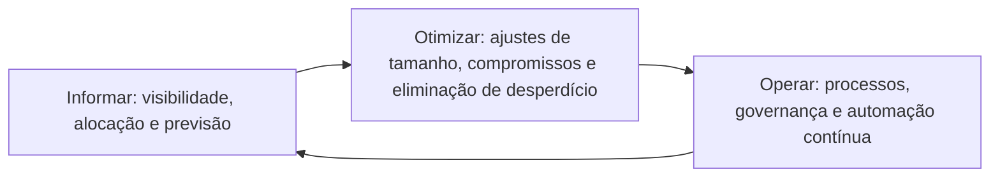

# FinOps, Custos e Governança Financeira de Nuvem

> **Objetivo pedagógico:** compreender a prática de FinOps e seus princípios, estabelecer a governança financeira da nuvem (alocação de custos por etiquetas, orçamentos, alertas de anomalias, *showback* e *chargeback*, compromissos de uso e otimização), reconhecer a relação entre custos e segurança (anomalias de custo como sinal de abuso e a necessidade de equilibrar investimento em segurança e eficiência) e usar consultas de somente leitura para verificar orçamentos e monitores de anomalias.

## 1. O que é FinOps

FinOps é uma prática cultural e operacional que une **engenharia, finanças e negócio** para gerir os custos de nuvem de forma colaborativa, equilibrando velocidade, custo e qualidade. A FinOps Foundation define princípios e um framework.

| Princípio (resumo do FinOps Framework) | Significado |
|---|---|
| Equipes precisam colaborar | Engenharia, finanças e negócio trabalham juntas |
| Valor de negócio orienta as decisões de tecnologia | Custo é avaliado frente ao valor |
| Todos assumem a responsabilidade pelo uso da nuvem | Quem usa decide e responde |
| Os dados de FinOps devem ser acessíveis, oportunos e precisos | Visibilidade de custos |
| FinOps deve ser habilitado de forma central | Prática, ferramentas e padrões comuns |
| Aproveite o modelo de custo variável da nuvem | Ajustar a capacidade à demanda |

### Ciclo de FinOps



| Fase | Atividades |
|---|---|
| Informar (*inform*) | Alocar custos por produto, por equipe e por ambiente; construir relatórios e previsões; padronizar dados de custo e de uso |
| Otimizar (*optimize*) | Dimensionar corretamente recursos, eliminar ociosidade, usar modelos de compra (compromissos e capacidade reservada), arquitetar para eficiência |
| Operar (*operate*) | Definir políticas, metas, cadência de revisões e automações |

## 2. Governança financeira da nuvem

| Elemento | Prática |
|---|---|
| Alocação de custos | Etiquetas de centro de custo e de produto obrigatórias; hierarquia de contas alinhada à estrutura financeira |
| Orçamentos | Orçamento por conta, por produto e por ambiente, com alertas em níveis (por exemplo, 50%, 80% e 100%) |
| Alertas de anomalias | Monitores de anomalias de custo por serviço e por conta |
| *Showback* e *chargeback* | Mostrar os custos às áreas (showback) ou cobrá-los (chargeback), conforme a política |
| Previsão | Projeções mensais e anuais, com revisões |
| Compromissos de uso | Planos de economia, capacidade reservada e descontos por compromisso, geridos centralmente |
| Eficiência (otimização) | Redimensionamento, desligamento de ambientes não produtivos fora do horário, armazenamento em camadas |
| Métricas unitárias | Custo por transação, por cliente ou por ambiente, para relacionar custo e valor |
| Revisões periódicas | Reuniões mensais de custos com os donos das cargas |
| Padrão de dados | A especificação aberta FOCUS (FinOps Open Cost and Usage Specification) padroniza dados de custo entre provedores |

## 3. Papéis em FinOps

| Papel | Responsabilidades |
|---|---|
| Responsável por FinOps (prática central) | Estabelecer processos, relatórios, metas e cultura |
| Engenharia e donos das cargas | Dimensionar, otimizar e responder pelo custo de seus recursos |
| Finanças | Orçamento, previsão e contabilização |
| Compras e fornecedores | Contratos, descontos e compromissos |
| Liderança | Priorização entre custo, velocidade e qualidade |
| Segurança | Alertas de anomalias como sinal de abuso; avaliação do custo dos controles |

## 4. Custos e segurança

| Relação | Descrição |
|---|---|
| Anomalias de custo como sinal de segurança | Picos de custo podem indicar mineração de criptomoedas, abuso de credenciais, exfiltração por transferência de dados ou ataques de negação de carteira; alertas de custo devem chegar também à segurança |
| Cotas e limites como controle | Limites de recursos e de regiões reduzem o impacto de abuso |
| Custo dos controles de segurança | Registros, retenção, criptografia e redundância têm custo; deve-se equilibrar risco e custo, e não eliminar controles essenciais para economizar |
| Redução de superfície | Desativar recursos ociosos reduz custos e ataques |
| Etiquetas e atribuição | A alocação de custos por etiquetas apoia a responsabilização e a investigação |
| Governança de exceções | Ambientes sem proprietário e sem orçamento são riscos |

Critérios para a **decisão de investimento em segurança**: risco reduzido, requisitos regulatórios, custo de implementação e de operação, e alternativas (por exemplo, reduzir a retenção de registros não críticos, mas manter a dos registros de auditoria).

## 5. Consultas de verificação (somente leitura)

```bash
# AWS: orçamentos configurados (substitua o identificador da conta)
aws budgets describe-budgets --account-id 111122223333 --query "Budgets[].[BudgetName,BudgetLimit.Amount,BudgetLimit.Unit,TimeUnit]" --output table

# AWS: monitores de anomalias de custo
aws ce get-anomaly-monitors --query "AnomalyMonitors[].[MonitorName,MonitorType]" --output table

# Azure: orçamentos da assinatura atual
az consumption budget list --output table

# Google Cloud: orçamentos de uma conta de faturamento (substitua o identificador)
gcloud billing budgets list --billing-account=000000-AAAAAA-111111
```

```sql
-- DuckDB: custos por centro de custo e por mês, a partir de uma exportação de custos (colunas: mes, servico, centro_de_custo, custo)
SELECT mes,
       coalesce(centro_de_custo, 'SEM-ETIQUETA') AS centro_de_custo,
       round(sum(custo), 2) AS custo_total
FROM read_csv_auto('custos_mensais.csv')
GROUP BY mes, centro_de_custo
ORDER BY mes, custo_total DESC;
```

O custo "SEM-ETIQUETA" indica a parcela não alocada, um indicador de maturidade de governança (meta típica: reduzi-la a poucos pontos percentuais).

## 6. Indicadores de FinOps

| Indicador | Definição |
|---|---|
| Percentual de custo alocado | Custo com etiquetas válidas dividido pelo custo total |
| Variação entre previsão e realizado | Precisão da previsão |
| Cobertura de compromissos | Parcela do uso coberta por compromissos |
| Desperdício estimado | Custo de recursos ociosos ou superdimensionados |
| Custo unitário | Custo por transação, por cliente ou por produto |
| Tempo para tratar anomalias | Do alerta à resolução |
| Recursos sem proprietário | Contagem e custo |

## 7. Exemplo prático: anomalia de custo como sinal de abuso

| Evento | Análise |
|---|---|
| Alerta de anomalia | Custo diário de computação 12 vezes acima da média, em regiões nunca usadas |
| Triagem | O alerta chegou à equipe de FinOps e à de segurança |
| Investigação | Registros de auditoria mostram criação de instâncias de GPU por uma chave de acesso exposta |
| Resposta | Chave desativada; recursos removidos após preservação; regiões restritas por política (pasta 22) |
| Governança | Alertas de custo com limites baixos, restrição de regiões e de tipos de instância; revisão de chaves de longa duração; relatório ao comitê |

## 8. Casos de uso corporativos

- Estruturação da prática de FinOps com responsabilidade compartilhada entre engenharia, finanças e negócio.
- Integração dos alertas de custo ao centro de operações de segurança.
- Programa de otimização com metas, sem reduzir controles de segurança essenciais.

## 9. Normas e frameworks relevantes

- FinOps Foundation. FinOps Framework e especificação FOCUS
- ISO/IEC 38500:2015 (desempenho e estratégia); COBIT 2019 (gestão de valor e custos)
- CSA CCM v4 (GRC); NIST CSF 2.0 (GV.OC e GV.RM)
- Documentação de gestão de custos dos provedores (AWS Cost Management, Microsoft Cost Management e Google Cloud Billing)

## 10. Checklist operacional: governança financeira

- [ ] Prática de FinOps estabelecida, com responsável e cadência de revisões
- [ ] Etiquetas de centro de custo e de produto obrigatórias, com cobertura medida
- [ ] Orçamentos e alertas por conta, por produto e por ambiente
- [ ] Monitores de anomalias de custo ativos, com alertas para FinOps e segurança
- [ ] Política de *showback* ou de *chargeback* definida
- [ ] Gestão central de compromissos de uso e revisão periódica
- [ ] Rotina de otimização: dimensionamento, ociosidade e ambientes não produtivos
- [ ] Indicadores financeiros reportados ao comitê
- [ ] Decisões de custo de segurança baseadas em risco, e não apenas em economia

## 11. Referências

- Storment, J. R.; Fuller, M. Cloud FinOps. 2. ed. O'Reilly, 2023.
- FinOps Foundation. FinOps Framework. https://www.finops.org
- FinOps Foundation. FOCUS: FinOps Open Cost and Usage Specification.
- Amazon Web Services. AWS Cost Management; Microsoft. Cost Management and Billing; Google Cloud. Cloud Billing (documentação).
- Pastas 13 e 22 deste repositório (monitoramento e resposta a incidentes).
