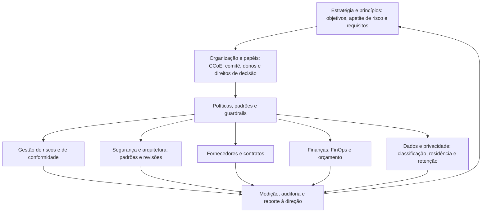

# Fundamentos de Governança de Nuvem

> **Objetivo pedagógico:** compreender o que é governança de nuvem e como ela se diferencia da gestão e da operação; conhecer os pilares da governança (estratégia e políticas, organização e papéis, riscos, conformidade, segurança, arquitetura, fornecedores e finanças); relacionar a governança de nuvem aos referenciais corporativos (NIST CSF 2.0, ISO/IEC 38500, 27014 e COBIT); entender a hierarquia documental (princípios, políticas, padrões, procedimentos e guardrails); e reconhecer os requisitos de governança de dados e de privacidade na nuvem.

## 1. Governança, gestão e operação

| Nível | Pergunta | Exemplos em nuvem |
|---|---|---|
| Governança | Quem decide, com que autoridade, com que princípios, e como a direção supervisiona? | Aprovar a estratégia de nuvem, o apetite de risco, as políticas, os provedores e os investimentos; supervisionar indicadores |
| Gestão | Como planejamos, organizamos e controlamos para atingir as decisões? | Planos de migração, programa de segurança, gestão de fornecedores, orçamento e capacidade |
| Operação | Como executamos no dia a dia? | Provisionar recursos, aplicar patches, monitorar, responder a incidentes |

Em nuvem, a distinção é crucial: **a velocidade do autoatendimento transfere decisões de governança para quem provisiona recursos**. Sem governança, cada equipe decide sozinha, com resultados inconsistentes de segurança, de custo e de conformidade.

## 2. Por que a governança de nuvem é diferente

| Característica | Efeito na governança |
|---|---|
| Autoatendimento e velocidade | As decisões são tomadas por muitas equipes, o tempo todo; é necessário **governança preventiva e automática** (guardrails) |
| Infraestrutura como código | As políticas podem ser **codificadas, testadas e versionadas** |
| Responsabilidade compartilhada | A governança precisa tratar o que é do provedor e o que é do cliente (pasta 02) |
| Modelo de custo variável | Governança financeira contínua (FinOps), e não apenas orçamento anual |
| Multiplicidade de contas, de provedores e de serviços | Estrutura de organização e padrões comuns |
| Fornecedor global com termos padronizados | Gestão de terceiros e saída planejada |
| Dados distribuídos | Governança de dados, de residência e de privacidade |
| Mudança contínua nos serviços | Revisão periódica e monitoramento de mudanças |

## 3. Pilares da governança de nuvem

| Pilar | Objetivo | Entregáveis típicos |
|---|---|---|
| Estratégia e princípios | Alinhar a nuvem ao negócio e ao apetite de risco | Estratégia de nuvem, princípios, critérios de decisão |
| Organização e papéis | Definir responsáveis e direitos de decisão | Carta do CCoE, matriz RACI, comitês (arquivo 2) |
| Políticas, padrões e guardrails | Traduzir princípios em regras verificáveis | Políticas, padrões técnicos e controles automáticos (arquivo 3) |
| Riscos e conformidade | Identificar, tratar e demonstrar | Registro de riscos, mapeamento a normas, evidências (pastas 04 e 11) |
| Segurança e arquitetura | Projetar e revisar com padrões seguros | Arquiteturas de referência, revisões de arquitetura (pasta 05) |
| Fornecedores e contratos | Gerir terceiros e saída | Diligência, contratos, monitoramento (pasta 02) |
| Finanças (FinOps) | Governar custos e valor | Orçamentos, alocação, otimização (arquivo 5) |
| Dados e privacidade | Governar o ciclo de vida dos dados | Classificação, residência, retenção, RIPD (seção 6) |
| Medição e reporte | Supervisionar | Indicadores, painéis, auditorias (arquivo 6) |

## 4. Referenciais de governança

| Referencial | Contribuição |
|---|---|
| NIST CSF 2.0, função **Govern** (GV) | Contexto organizacional (GV.OC), estratégia de gestão de riscos (GV.RM), papéis, responsabilidades e autoridades (GV.RR), políticas (GV.PO), supervisão (GV.OV) e gestão de riscos da cadeia de suprimentos de segurança cibernética (GV.SC) |
| ISO/IEC 38500:2015 | Princípios de governança de TI: responsabilidade, estratégia, aquisição, desempenho, conformidade e comportamento humano; ciclo avaliar, dirigir e monitorar |
| ISO/IEC 27014:2020 | Governança da segurança da informação: avaliar, dirigir, monitorar, comunicar e garantir |
| ISO/IEC 38505-1:2017 | Governança de dados |
| COBIT 2019 | Objetivos de governança e de gestão de TI corporativa |
| ISO 37000:2021 | Governança de organizações |
| CSA Security Guidance v4.0 | Domínio 2 (governança e gestão de riscos corporativos), 3 (aspectos legais e contratos), 4 (conformidade e auditoria) e 5 (governança da informação) |
| CSA CCM v4, domínio GRC | Controles de governança, risco e conformidade em nuvem |
| ISO/IEC 27001:2022 | Sistema de gestão: liderança, políticas, papéis, riscos e melhoria |
| Frameworks de adoção dos provedores | Orientações de governança e de zonas de aterrissagem (pasta 01) |

### Ciclo de governança (ISO/IEC 38500 e 27014): avaliar, dirigir, monitorar

| Atividade | Descrição aplicada à nuvem |
|---|---|
| Avaliar | A direção analisa o contexto, os riscos, as propostas e o desempenho (por exemplo, avalia a estratégia multicloud) |
| Dirigir | A direção estabelece políticas, prioridades e recursos (por exemplo, aprova a política de nuvem e o orçamento do CCoE) |
| Monitorar | A direção acompanha indicadores e conformidade (por exemplo, recebe o painel trimestral de governança) |

## 5. Hierarquia documental da governança

| Nível | Documento | Característica | Exemplo |
|---|---|---|---|
| 1 | Princípios | Declarações de alto nível, estáveis | "Dados são classificados antes de serem hospedados" |
| 2 | Políticas | Requisitos obrigatórios, aprovados pela direção | Política de uso de nuvem; política de gestão de identidades |
| 3 | Padrões | Requisitos técnicos específicos e mensuráveis | "Todas as contas de produção exigem MFA resistente a phishing" |
| 4 | Procedimentos | Passos detalhados para executar atividades | Procedimento de criação de nova conta |
| 5 | Diretrizes | Orientações recomendadas | Guia de arquitetura de referência |
| 6 | Guardrails (controles automáticos) | Políticas executadas por código | Política que nega armazenamento público |
| 7 | Evidências e registros | Provas de execução | Relatórios de conformidade e registros de exceções |

Boas práticas: manter poucos documentos, claros e atualizados; **cada requisito de política deve ter um controle técnico ou um processo que o verifique**.

## 6. Governança de dados e privacidade na nuvem

| Tema | Orientação de governança |
|---|---|
| Responsabilidade pelos dados | Cada conjunto de dados tem um proprietário (decide acesso, retenção e classificação) e um custodiante (opera tecnicamente) |
| Classificação | Política de classificação com requisitos por nível (pasta 01, arquivo 6) |
| Inventário e mapeamento | Registro das operações de tratamento de dados pessoais (LGPD, art. 37) e catálogo de dados |
| Avaliação de impacto | Relatório de impacto à proteção de dados pessoais quando cabível (LGPD, art. 38) |
| Privacidade desde a concepção | Medidas de segurança e de privacidade desde a fase de concepção (LGPD, art. 46, §2º) |
| Programa de governança em privacidade | Boas práticas e governança (LGPD, art. 50) |
| Residência e transferência | Regiões aprovadas por classificação; avaliação de transferência internacional (LGPD, arts. 33 a 36) |
| Retenção e eliminação | Prazos por tipo de dado, inclusive cópias e backups; eliminação comprovada |
| Acesso e compartilhamento | Aprovação do proprietário; revisão periódica; compartilhamento externo controlado |
| Dados e IA | Regras para uso de dados em treinamento e em serviços de IA (pastas 24 a 26 do repositório de forense e normas de IA) |

A proteção técnica de dados é tratada na pasta 09, e a conformidade, na pasta 11.

## 7. Contexto regulatório brasileiro (visão geral)

> **Aviso:** orientações gerais, sem caráter jurídico. Confirme a vigência e a aplicabilidade com o Jurídico.

| Norma | Relevância para a governança |
|---|---|
| LGPD | Governança em privacidade, papéis (controlador, operador e encarregado), segurança e incidentes |
| Resolução CMN nº 4.893/2021 e Resolução BCB nº 85/2021 | Política de segurança cibernética, responsabilidades da diretoria e contratação de serviços em nuvem (setor financeiro) |
| Circular Susep nº 638/2021 | Segurança cibernética (setor de seguros) |
| Decreto nº 9.637/2018 e IN GSI/PR nº 5/2021 | Política Nacional de Segurança da Informação e requisitos de nuvem para a administração pública federal |
| Orientações do TCU sobre computação em nuvem na administração pública (por exemplo, o levantamento de 2015) | Referência de riscos e de controles para órgãos públicos |

## 8. Exemplo prático: do princípio ao controle verificável

| Nível | Conteúdo |
|---|---|
| Princípio | "Dados confidenciais não ficam expostos à internet." |
| Política | "Armazenamentos de dados classificados como confidenciais ou restritos não podem ter acesso público." |
| Padrão | "Contas de produção devem ter o bloqueio de acesso público habilitado no nível da conta ou da organização." |
| Procedimento | "Para exceção justificada, o proprietário solicita aprovação do comitê, com prazo e controles compensatórios." |
| Guardrail | Política da organização que nega a criação de recursos públicos nas contas de produção |
| Verificação | Relatório automático de postura que lista armazenamentos públicos; alerta imediato |
| Evidência | Relatório mensal ao comitê com o número de exceções ativas e seu prazo de validade |

## 9. Casos de uso corporativos

- Desenho da governança de nuvem na adoção inicial ou na reestruturação de uma plataforma existente.
- Alinhamento entre TI, segurança, jurídico, finanças e negócio sobre papéis e decisões.
- Preparação de materiais para o conselho e para auditores sobre a supervisão da nuvem.

## 10. Normas e frameworks relevantes

- NIST CSF 2.0 (Govern); ISO/IEC 38500:2015; ISO/IEC 27014:2020; ISO/IEC 38505-1:2017; ISO 37000:2021; COBIT 2019
- ISO/IEC 27001:2022; CSA CCM v4 (GRC); CSA Security Guidance v4.0
- LGPD, arts. 37, 38, 46 e 50; Resolução CMN 4.893/2021; Resolução BCB 85/2021; IN GSI/PR 5/2021

## 11. Checklist operacional: base de governança de nuvem

- [ ] Estratégia de nuvem aprovada pela direção, com objetivos e apetite de risco
- [ ] Patrocinador executivo e instância de decisão (comitê ou CCoE) definidos
- [ ] Hierarquia documental estabelecida (princípios, políticas, padrões e procedimentos)
- [ ] Cada requisito de política com um controle técnico ou processo de verificação
- [ ] Política de classificação de dados e proprietários de dados definidos
- [ ] Registro das operações de tratamento e avaliação de impacto, quando aplicáveis
- [ ] Indicadores de governança definidos e reportados periodicamente
- [ ] Revisão anual das políticas e da estratégia

## 12. Referências

- NIST. Cybersecurity Framework 2.0. 2024.
- ISO/IEC 38500:2015. Governance of IT for the organization; ISO/IEC 27014:2020. Governance of information security; ISO/IEC 38505-1:2017. Governance of data.
- ISACA. COBIT 2019 Framework: Introduction and Methodology.
- Cloud Security Alliance. Security Guidance for Critical Areas of Focus in Cloud Computing v4.0. 2017; CCM v4. 2021.
- Brasil. Lei nº 13.709/2018; Decreto nº 9.637/2018.
- Tribunal de Contas da União. Acórdão nº 1.739/2015 (Plenário): levantamento sobre computação em nuvem.
