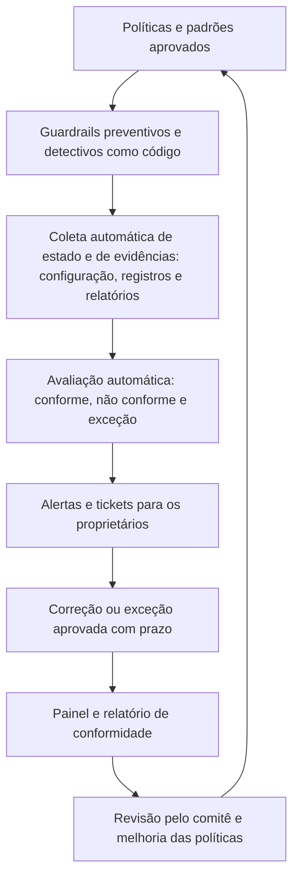
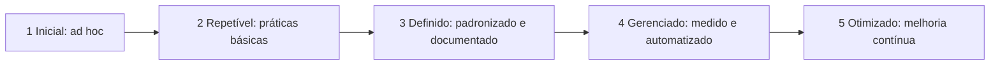

# Métricas, Conformidade Contínua e Reporte de Governança

> **Objetivo pedagógico:** medir a governança de nuvem com indicadores de cobertura, de conformidade, de risco e de resultado; implementar a conformidade contínua (verificação automática de políticas e geração de evidências); avaliar a maturidade da governança com um modelo de cinco níveis; definir o calendário de governança e os relatórios para a direção, para comitês e para auditores; e evitar armadilhas de medição.

## 1. Princípios de medição

| Princípio | Aplicação |
|---|---|
| Medir o que apoia decisões | Cada indicador deve levar a uma ação ou decisão |
| Cobertura antes de conformidade | Primeiro saber o que existe (inventário); depois medir a conformidade do que existe |
| Automatizar a coleta | Dados vindos dos provedores e de ferramentas, com data e fonte |
| Indicadores de risco, de processo e de resultado | Combinar tipos |
| Tendências | Comparar períodos |
| Definições claras | Fórmula, fonte, frequência e responsável |
| Cuidado com a Lei de Goodhart | Quando uma medida vira meta, pode ser manipulada; combine métricas |

## 2. Indicadores de governança de nuvem

### 2.1 Cobertura e inventário

| Indicador | Definição | Meta típica |
|---|---|---|
| Contas dentro da landing zone | Contas, assinaturas e projetos sob a organização e os guardrails, divididos pelo total conhecido | 100% |
| Recursos com proprietário | Recursos com etiqueta de proprietário válida | Acima de 95% |
| Recursos com classificação | Recursos com etiqueta de classificação válida | Acima de 95% |
| Serviços de nuvem inventariados e aprovados | Serviços em uso que constam no catálogo aprovado | 100% dos críticos |
| Fornecedores de nuvem e de SaaS avaliados | Fornecedores com diligência concluída e atual | 100% dos críticos |

### 2.2 Conformidade e controles

| Indicador | Definição | Meta típica |
|---|---|---|
| Conformidade com políticas (guardrails detectivos) | Recursos conformes divididos pelos avaliados | Acima de 95% |
| Achados críticos abertos | Desvios críticos de postura sem correção | Zero, ou com prazo curto |
| Tempo médio de correção de desvios | Da detecção à correção, por severidade | Críticos em horas; altos em dias |
| Exceções ativas, vencidas e idade média | Contagem e tempo | Poucas, sem vencidas |
| Cobertura de registros | Contas e serviços críticos com registros centralizados e retenção adequada | 100% |
| Cobertura de MFA resistente a phishing em contas privilegiadas | Contas privilegiadas com MFA forte | 100% |
| Cobertura de backups testados | Cargas críticas com restauração testada no período | 100% semestral |

### 2.3 Riscos e incidentes

| Indicador | Definição |
|---|---|
| Riscos de nuvem por nível e status | Distribuição no registro de riscos (pasta 04) |
| Incidentes de segurança em nuvem | Número, gravidade e causa |
| Incidentes por causa de configuração ou de identidade | Proporção, para orientar prioridades |
| Tempo de detecção e de contenção | Medianas (pasta 27) |
| Lacunas de registros identificadas em incidentes | Contagem |

### 2.4 Eficiência e experiência

| Indicador | Definição |
|---|---|
| Tempo de provisionamento de uma nova conta | Da solicitação à entrega |
| Tempo de resposta a exceções e a revisões de arquitetura | Cumprimento dos SLAs internos |
| Percentual de implantações pelos caminhos pavimentados | Adoção de padrões |
| Satisfação das equipes de produto | Pesquisa periódica |
| Percentual de custo alocado e desperdício | Indicadores de FinOps (arquivo 5) |

## 3. Conformidade contínua



| Elemento | Prática |
|---|---|
| Fonte única de verdade | Inventário e estado da configuração coletados automaticamente |
| Evidências automáticas | Relatórios periódicos com data, escopo e resultado, arquivados em repositório protegido |
| Mapeamento a normas | Cada verificação ligada a controles (CCM, ISO/IEC 27002, CIS e LGPD) |
| Ciclo de correção | Tickets atribuídos aos donos, com prazos e escalonamento |
| Exceções | Registradas, com expiração, e visíveis no painel |
| Auditoria | Os auditores acessam relatórios e evidências consistentes, e não coletas manuais pontuais |
| Revisão | Revisão trimestral das regras e dos limiares |

## 4. Cálculo de indicadores (exemplo)

`conformidade_recursos.csv` (fictício; resultado de verificações automáticas):

```
recurso,conta,regra,resultado,severidade,excecao
bucket-relatorios,acme-fin-prd-001,armazenamento-sem-acesso-publico,nao_conforme,critica,nao
bucket-site,acme-web-prd-001,armazenamento-sem-acesso-publico,conforme,critica,sim
vm-portal-01,acme-fin-prd-001,sem-ssh-exposto,conforme,alta,nao
vm-legado-02,acme-fin-prd-001,sem-ssh-exposto,nao_conforme,alta,nao
bd-clientes,acme-crm-prd-001,auditoria-habilitada,conforme,alta,nao
```

```sql
-- DuckDB: conformidade por regra e severidade, ignorando exceções formalmente aprovadas
SELECT regra, severidade,
       count(*) AS avaliados,
       count(*) FILTER (WHERE resultado = 'conforme' OR excecao = 'sim') AS conformes,
       round(100.0 * count(*) FILTER (WHERE resultado = 'conforme' OR excecao = 'sim') / count(*), 1) AS pct_conformidade
FROM read_csv_auto('conformidade_recursos.csv')
GROUP BY regra, severidade
ORDER BY severidade, pct_conformidade;
```

## 5. Modelo de maturidade da governança de nuvem (referência)

Modelo **didático deste repositório**, inspirado em modelos de maturidade de processos; adapte-o à organização.



| Dimensão | Nível 1 | Nível 3 | Nível 5 |
|---|---|---|---|
| Estratégia e organização | Sem estratégia nem donos | Estratégia aprovada, CCoE e comitê funcionando | Estratégia revisada com dados; governança adaptativa |
| Políticas e guardrails | Políticas dispersas e manuais | Políticas e padrões publicados; guardrails principais ativos | Políticas como código, testadas e revisadas continuamente |
| Contas e inventário | Contas criadas livremente | Fábrica de contas e inventário automático | Inventário em tempo real; desvios corrigidos automaticamente |
| Conformidade e evidências | Evidências manuais e pontuais | Verificações periódicas e relatórios | Conformidade contínua com evidências automáticas |
| Riscos e fornecedores | Avaliações informais | Diligência e registro de riscos | Gestão de riscos integrada e monitoramento contínuo de fornecedores |
| FinOps | Custos conhecidos apenas na fatura | Alocação e orçamentos | Otimização contínua e métricas unitárias |
| Pessoas e cultura | Dependência de indivíduos | Treinamento e comunidade de prática | Cultura de autonomia com responsabilidade |

### Autoavaliação (modelo)

| Dimensão | Nível atual (1 a 5) | Evidências | Lacunas | Nível-alvo e prazo | Ações |
|---|---|---|---|---|---|
| Estratégia e organização | | | | | |
| Políticas e guardrails | | | | | |
| Contas e inventário | | | | | |
| Conformidade e evidências | | | | | |
| Riscos e fornecedores | | | | | |
| FinOps | | | | | |
| Pessoas e cultura | | | | | |

## 6. Calendário de governança

| Frequência | Atividade | Participantes |
|---|---|---|
| Semanal | Revisão de arquiteturas e de solicitações; triagem de desvios críticos | CCoE, plataforma e segurança |
| Mensal | Reunião de custos (FinOps), revisão de exceções e de indicadores operacionais | CCoE, FinOps e donos das cargas |
| Trimestral | Comitê de governança: indicadores, riscos, exceções relevantes, incidentes e investimentos | Direção e líderes |
| Semestral | Revisão de acessos privilegiados e de fornecedores críticos; testes de recuperação | Segurança, identidade e GRC |
| Anual | Revisão das políticas, da estratégia, da maturidade e da regulação; exercício de resposta a incidentes | Comitê, CCoE e GRC |
| Sob demanda | Mudanças relevantes de provedores, incidentes e novas obrigações | Instâncias competentes |

## 7. Relatórios

| Público | Conteúdo | Formato e frequência |
|---|---|---|
| Direção e conselho | Postura de risco, tendências, decisões necessárias, investimentos e incidentes relevantes | Painel de uma página, trimestral |
| Comitê de governança | Indicadores detalhados, exceções, achados críticos e ações | Relatório trimestral |
| Equipes de produto | Conformidade e custos de suas cargas | Painéis contínuos |
| Auditoria interna e externa | Evidências por controle, com período e fonte | Repositório de evidências, sob demanda |
| Reguladores e clientes | Informações exigidas por norma ou contrato | Conforme a obrigação, coordenado pelo Jurídico |

### Modelo de resumo executivo de governança (1 página)

| Seção | Conteúdo |
|---|---|
| Situação geral | Semáforo por dimensão (cobertura, conformidade, riscos, custos e incidentes) |
| Principais indicadores | 6 a 8 indicadores com meta e tendência |
| Riscos e exceções relevantes | O que mudou e o que exige decisão |
| Incidentes e lições | Resumo e ações |
| Conquistas | Melhorias do período |
| Decisões solicitadas | Aprovações, recursos e aceitação de riscos |
| Próximos passos | Prioridades do próximo trimestre |

## 8. Armadilhas de medição

| Armadilha | Consequência | Prevenção |
|---|---|---|
| Medir apenas o que é fácil | Foco errado | Incluir indicadores de risco e de resultado |
| Conformidade alta com inventário incompleto | Falsa segurança | Medir a cobertura primeiro |
| Metas isoladas (por exemplo, apenas reduzir exceções) | Exceções escondidas ou desvios não relatados | Métricas complementares e auditoria |
| Excesso de indicadores | Perda de foco | Poucos indicadores, ligados a decisões |
| Dados sem fonte nem data | Falta de credibilidade | Coleta automática e rastreável |
| Relatórios que ninguém usa | Esforço sem valor | Definir público, decisão e ação para cada relatório |
| Comparar equipes sem contexto | Conflitos | Indicadores ajustados à criticidade e à maturidade |

## 9. Casos de uso corporativos

- Painel de governança de nuvem para a direção, com cobertura, conformidade, riscos e custos.
- Conformidade contínua com evidências automáticas para auditorias de certificações.
- Avaliação anual de maturidade e plano de evolução.

## 10. Normas e frameworks relevantes

- NIST CSF 2.0 (GV.OV, supervisão; ID.IM, melhoria); NIST SP 800-55 (medição); ISO/IEC 27004 (monitoramento e medição); ISO/IEC 27001:2022 (cláusulas 9 e 10)
- ISO/IEC 27014:2020 (monitorar e comunicar); COBIT 2019 (gestão do desempenho)
- CSA CCM v4 (A&A e GRC); CIS Controls v8.1; CIS Foundations Benchmarks

## 11. Checklist operacional: métricas e reporte

- [ ] Indicadores de cobertura, de conformidade, de riscos e de eficiência definidos, com fórmula, fonte, frequência e responsável
- [ ] Coleta automática de dados com data e fonte
- [ ] Conformidade contínua com mapeamento a normas e geração de evidências
- [ ] Exceções registradas, com expiração, e incluídas nos relatórios
- [ ] Autoavaliação de maturidade realizada e plano de evolução aprovado
- [ ] Calendário de governança definido e cumprido
- [ ] Relatórios por público, com decisões e ações associadas
- [ ] Revisão anual dos indicadores e das metas

## 12. Referências

- Chew, E. et al. NIST SP 800-55 Vol. 1 e Vol. 2: Measurement Guide for Information Security. 
- ISO/IEC 27004:2016. Information security management: Monitoring, measurement, analysis and evaluation.
- ISO/IEC 27014:2020. Governance of information security.
- Cloud Security Alliance. CCM v4 (A&A e GRC). 2021.
- Documentação do DuckDB.
