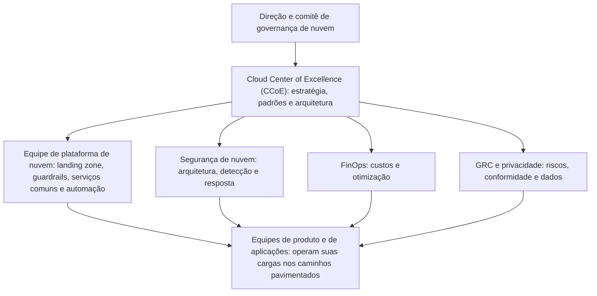

# Modelo Operacional, Papéis e Cloud Center of Excellence

> **Objetivo pedagógico:** definir o modelo operacional de nuvem da organização (centralizado, descentralizado ou federado), estruturar o Cloud Center of Excellence (CCoE) e o comitê de governança, atribuir papéis e direitos de decisão, estabelecer o conceito de "caminhos pavimentados" (paved roads) que equilibram autonomia e controle, elaborar uma matriz RACI e a carta do CCoE, e definir processos de escalonamento e de resolução de conflitos.

## 1. Modelos operacionais

| Modelo | Descrição | Vantagens | Riscos |
|---|---|---|---|
| Centralizado | Uma equipe central provisiona e opera a nuvem para todas as áreas | Consistência, controle e economia de escala | Gargalo, lentidão, distância do negócio |
| Descentralizado | Cada área ou produto gerencia sua própria nuvem | Velocidade e autonomia | Inconsistência, duplicação, riscos de segurança e de custos |
| Federado (recomendado na maioria dos casos) | Uma plataforma central define padrões, guardrails e serviços comuns; as equipes de produto operam suas cargas dentro desses limites | Equilíbrio entre autonomia e controle | Exige maturidade, boa comunicação e produto de plataforma bem desenhado |

## 2. Cloud Center of Excellence (CCoE)

O CCoE é uma equipe multidisciplinar que **define, apoia e evolui** a forma como a organização usa a nuvem. Seu papel é **habilitar** (e não apenas controlar).

| Função do CCoE | Atividades |
|---|---|
| Estratégia e arquitetura | Princípios, arquiteturas de referência, padrões e revisão de arquiteturas |
| Plataforma | Landing zone, automação, catálogo de serviços aprovados e modelos de infraestrutura como código |
| Segurança e conformidade | Padrões de segurança, guardrails, linhas de base e apoio a auditorias |
| Finanças (FinOps) | Alocação de custos, metas de otimização e relatórios |
| Pessoas e competências | Treinamento, certificações, comunidade de prática e gestão da mudança |
| Gestão de fornecedores | Avaliação, contratos e relacionamento com provedores |
| Medição | Indicadores, painéis e melhoria contínua |

### 2.1 Composição

| Membro | Origem |
|---|---|
| Líder do CCoE | Arquitetura, TI ou engenharia de plataforma |
| Arquitetos de nuvem e de segurança | Arquitetura e segurança |
| Engenheiros de plataforma e de DevOps | Engenharia |
| Representante de FinOps | Finanças e TI |
| Representante de GRC e de privacidade | Governança, risco e conformidade |
| Representante jurídico e de contratos (sob demanda) | Jurídico e compras |
| Representantes de negócio e de produtos | Áreas usuárias |

### 2.2 Carta do CCoE (modelo)

| Seção | Conteúdo |
|---|---|
| Missão | Habilitar o uso seguro, eficiente e conforme da nuvem |
| Escopo | Provedores, ambientes e serviços cobertos |
| Autoridade | Decisões que o CCoE toma e as que escalona ao comitê |
| Entregáveis | Padrões, arquiteturas, catálogo, treinamentos, relatórios |
| Indicadores | Tempo de provisionamento, conformidade, custos, satisfação dos usuários |
| Rotina | Reuniões, revisões de arquitetura, horário de atendimento |
| Patrocinador | Executivo responsável |
| Revisão | Periodicidade da revisão da carta |

## 3. Comitê de governança de nuvem

| Elemento | Descrição |
|---|---|
| Composição | Executivos de TI, segurança, finanças, jurídico, privacidade, riscos e negócio |
| Frequência | Trimestral (e extraordinária para decisões urgentes) |
| Pauta típica | Estratégia, riscos e exceções relevantes, indicadores, investimentos, provedores, incidentes significativos e auditorias |
| Decisões | Políticas de alto nível, apetite de risco, escolha e renovação de provedores, aceitação de riscos de maior impacto |
| Registro | Atas e decisões arquivadas |

## 4. Papéis e responsabilidades

| Papel | Responsabilidades principais |
|---|---|
| Patrocinador executivo | Remover obstáculos, aprovar recursos e responder pela estratégia |
| Líder do CCoE | Coordenar a governança operacional e o roteiro de evolução |
| Proprietário da carga de trabalho (workload owner) | Responder pelo recurso, pelos dados, pelo risco e pelo custo |
| Proprietário de dados | Classificar, aprovar acessos e decidir sobre retenção |
| Equipe de plataforma | Operar a landing zone, os guardrails e os serviços comuns |
| Arquiteto de segurança | Padrões, revisões e orientação |
| Operações de segurança (SecOps) | Monitoramento, detecção e resposta |
| Gestor de identidade e acesso | Provedor de identidade, MFA e revisões de acesso |
| Responsável por FinOps | Alocação, orçamentos, anomalias e otimização |
| GRC | Políticas, mapeamento a normas, evidências e riscos |
| Encarregado de proteção de dados (DPO) | Orientar sobre privacidade, RIPD e comunicação à ANPD |
| Gestor de fornecedores | Diligência, contratos e monitoramento |
| Equipes de produto e de aplicações | Operar as cargas conforme os padrões e responder pelo uso |
| Auditoria interna | Avaliação independente da governança e dos controles |

## 5. Direitos de decisão

| Decisão | Quem decide | Quem é consultado | Instância de escalonamento |
|---|---|---|---|
| Adotar um novo provedor de nuvem | Comitê de governança | CCoE, segurança, jurídico, finanças | Direção |
| Adotar um novo serviço de um provedor existente | CCoE | Segurança, dono da carga, GRC | Comitê |
| Aprovar uma nova conta, assinatura ou projeto | Plataforma (por critérios) | Dono da carga, segurança | CCoE |
| Aprovar uma exceção a uma política | Dono do risco (com parecer de segurança e GRC) | CCoE | Comitê, se o risco for alto |
| Definir padrões de arquitetura | CCoE | Segurança, equipes de produto | Comitê |
| Aceitar um risco residual relevante | Executivo responsável pelo risco | Segurança, GRC, DPO | Comitê |
| Aprovar um orçamento de nuvem | Finanças e dono da carga | FinOps, CCoE | Direção |
| Declarar incidente de segurança | SecOps | Líder de resposta | Gestão de crise |

## 6. "Caminhos pavimentados" (paved roads)

Em vez de proibir, o CCoE oferece **caminhos prontos, seguros e fáceis**: modelos de infraestrutura como código, imagens endurecidas, pipelines padronizados e catálogos de serviços. Quem usa o caminho pavimentado obtém aprovação rápida e conformidade automática; quem se desvia precisa justificar e assumir mais responsabilidade.

| Elemento | Exemplo |
|---|---|
| Modelo de conta ou projeto | Contas criadas por automação, já com guardrails, registros e etiquetas |
| Módulos de infraestrutura como código | Armazenamento, banco e rede com configurações seguras por padrão |
| Pipelines padrão | Com verificações de segurança e de políticas |
| Catálogo de serviços | Lista de serviços aprovados, com condições de uso |
| Imagens base | Imagens de contêiner e de máquinas virtuais endurecidas |
| Autoatendimento | Portal ou repositório para solicitar recursos com aprovação automática quando conformes |

## 7. Matriz RACI (exemplo)

| Atividade | Comitê | CCoE | Plataforma | Segurança | GRC e DPO | FinOps | Dono da carga |
|---|---|---|---|---|---|---|---|
| Aprovar a estratégia de nuvem | A | R | C | C | C | C | I |
| Definir padrões de arquitetura | I | A/R | C | R | C | I | C |
| Operar a landing zone e os guardrails | I | A | R | C | I | I | I |
| Aprovar um novo serviço de nuvem | I | A | R | R | C | C | C |
| Aprovar exceções a políticas | I | C | C | R | C | I | A |
| Monitorar a conformidade | I | A | R | R | R | I | C |
| Governar custos | I | C | C | I | I | A/R | R |
| Reportar à direção | A | R | C | C | C | C | I |

R: responsável pela execução; A: aprovador final; C: consultado; I: informado. Mantenha **um único A** por linha.

## 8. Escalonamento e resolução de conflitos

| Situação | Caminho |
|---|---|
| Equipe de produto discorda de um padrão | Revisão no CCoE com justificativa técnica; decisão em prazo definido |
| Pedido de exceção negado | Recurso ao comitê, com avaliação de riscos |
| Conflito entre velocidade e segurança | Quantificar riscos; propor controles compensatórios; decisão do dono do risco |
| Incidente com impacto em vários times | Gestão de crise e resposta a incidentes (pasta 22) |
| Dúvida de responsabilidade com o provedor | Pedido de esclarecimento por escrito (pasta 02) |

Estabeleça **prazos de resposta** (por exemplo, 5 dias úteis para exceções e revisões de arquitetura) para evitar que a governança vire gargalo.

## 9. Exemplo prático: criação de uma conta de produção

| Passo | Responsável | Resultado |
|---|---|---|
| Solicitação | Dono da carga | Formulário com finalidade, dados, classificação, centro de custo e proprietário |
| Validação automática | Plataforma | Verifica etiquetas, classificação e orçamento |
| Revisão de segurança (somente para dados confidenciais ou restritos) | Segurança | Parecer em até 3 dias úteis |
| Criação por automação | Plataforma | Conta criada com guardrails, registros centralizados, rede base e funções padrão |
| Registro | Plataforma | Inventário e catálogo atualizados |
| Revisão periódica | GRC | Revisão anual de proprietário, de classificação e de necessidade |

## 10. Casos de uso corporativos

- Criação de um CCoE e do comitê de governança em uma adoção em larga escala.
- Transição de um modelo centralizado lento para um modelo federado com caminhos pavimentados.
- Definição de direitos de decisão para reduzir conflitos entre áreas.

## 11. Normas e frameworks relevantes

- NIST CSF 2.0 (GV.RR, papéis, responsabilidades e autoridades); ISO/IEC 27001:2022 (cláusula 5.3 e controle 5.2)
- COBIT 2019 (estruturas organizacionais); ISO/IEC 38500:2015 (responsabilidade)
- Microsoft Cloud Adoption Framework (estratégia organizacional e CCoE); AWS Cloud Adoption Framework (perspectivas de governança e de pessoas); Google Cloud Adoption Framework

## 12. Checklist operacional: modelo operacional e CCoE

- [ ] Modelo operacional escolhido (centralizado, descentralizado ou federado) e justificado
- [ ] CCoE com carta, patrocinador, membros e rotina definidos
- [ ] Comitê de governança com composição, frequência e pauta
- [ ] Papéis e responsabilidades documentados, com nomes e substitutos
- [ ] Direitos de decisão e instâncias de escalonamento definidos
- [ ] Matriz RACI aprovada, com um único responsável final por atividade
- [ ] Caminhos pavimentados disponíveis (modelos de conta, módulos e pipelines)
- [ ] Prazos de resposta (SLAs internos) definidos para aprovações
- [ ] Revisão anual do modelo operacional

## 13. Referências

- Microsoft. Cloud Adoption Framework for Azure: organizar e CCoE. Documentação vigente.
- Amazon Web Services. AWS Cloud Adoption Framework: perspectivas de governança e de pessoas. Documentação vigente.
- Google Cloud. Cloud Adoption Framework. Documentação vigente.
- Kim, G. et al. The DevOps Handbook. 2. ed. IT Revolution, 2021.
- Skelton, M.; Pais, M. Team Topologies. IT Revolution, 2019 (equipes de plataforma).
- NIST. Cybersecurity Framework 2.0. 2024.
