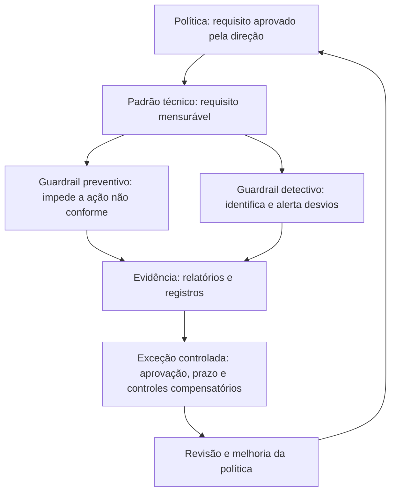
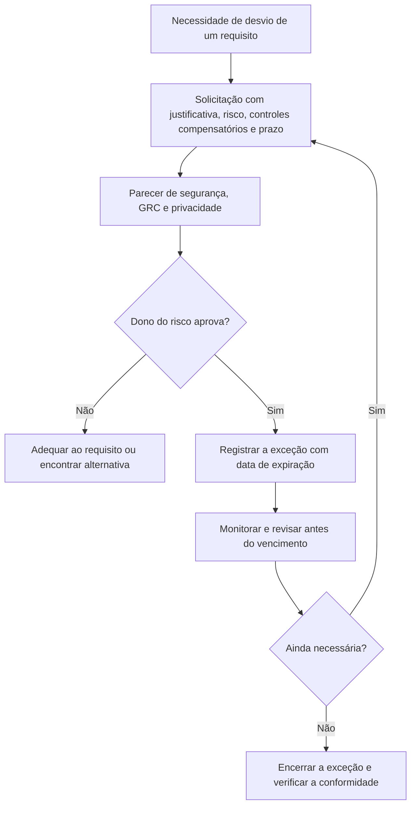

# Políticas, Padrões e Guardrails de Nuvem

> **Objetivo pedagógico:** definir o conjunto essencial de políticas de nuvem, escrever padrões técnicos mensuráveis, traduzi-los em guardrails preventivos e detectivos como código (políticas de organização dos provedores, Open Policy Agent e verificação de infraestrutura como código), gerir exceções com prazo e aprovação, e manter o ciclo de vida das políticas (criação, publicação, verificação, revisão e retirada).

## 1. Do documento ao controle

Uma política que existe apenas em um documento **não protege**. Em nuvem, cada requisito deve ter uma **forma de aplicação** (guardrail), uma **forma de verificação** (detecção de desvio) e uma **forma de exceção** (processo controlado).



## 2. Políticas essenciais de nuvem

| Política | Conteúdo mínimo | Pasta de aprofundamento |
|---|---|---|
| Uso aceitável e adoção de nuvem | Serviços e provedores permitidos, processo de aprovação, responsabilidades, proibição de *shadow IT* | 01 e 03 |
| Classificação e tratamento de dados | Níveis, requisitos por nível, residência, retenção, rótulos | 01 e 09 |
| Gestão de identidade e acesso | Autenticação forte, privilégio mínimo, contas privilegiadas, acesso temporário, revisão periódica | 06 |
| Criptografia e gestão de chaves | Algoritmos e tamanhos mínimos, uso obrigatório, gestão e rotação de chaves, controle das chaves | 10 |
| Rede e conectividade | Exposição à internet, segmentação, conectividade híbrida, inspeção | 08 |
| Registro e monitoramento | Fontes obrigatórias, retenção, centralização, proteção e alertas | 13 |
| Gestão de configuração e de mudanças | Infraestrutura como código, revisão, ambientes e reversão | 12 |
| Gestão de vulnerabilidades e de patches | Prazos por severidade e responsabilidades | 15 |
| Backup, continuidade e recuperação | RTO e RPO por criticidade, teste de restauração | 09 e 22 |
| Gestão de fornecedores e de SaaS | Diligência, contratos, integrações e revisão | 02 |
| Desenvolvimento seguro e cadeia de suprimentos | Revisão de código, dependências, segredos, imagens | 21 |
| Resposta a incidentes em nuvem | Papéis, preservação de evidências e comunicação | 22 e 23 |
| Etiquetagem e inventário | Etiquetas obrigatórias e responsáveis | arquivo 4 |
| Gestão de custos | Orçamentos, alertas e responsabilidades | arquivo 5 |
| Desativação e descarte | Remoção segura de dados e de acessos | arquivo 4 |

## 3. Estrutura de uma política (modelo)

| Seção | Conteúdo |
|---|---|
| Identificação | Título, código, versão, data, proprietário e aprovador |
| Objetivo | Por que a política existe |
| Escopo | A quem e a que se aplica |
| Princípios | Declarações que orientam |
| Requisitos | Regras claras, numeradas, verificáveis (usar "deve" e "não deve") |
| Papéis e responsabilidades | Quem faz o quê |
| Exceções | Como solicitar, quem aprova e prazo máximo |
| Verificação e consequências | Como se verifica a conformidade e o que ocorre em caso de desvio |
| Referências | Normas, padrões e documentos relacionados |
| Histórico de revisões | Alterações e datas |

Escreva requisitos que possam ser **medidos**. Exemplo ruim: "As contas devem ser protegidas adequadamente." Exemplo bom: "Contas com permissões administrativas devem usar autenticação multifator resistente a phishing."

## 4. Padrões técnicos (exemplos)

| Área | Padrão | Verificação |
|---|---|---|
| Identidade | MFA resistente a phishing para todas as contas privilegiadas; sem chaves de acesso de longa duração em usuários humanos | Relatório de contas sem MFA; inventário de chaves |
| Armazenamento | Bloqueio de acesso público habilitado; criptografia em repouso; TLS obrigatório | Política da organização e verificação contínua de postura |
| Rede | Portas de administração (SSH e RDP) não expostas à internet | Regras de rede e alertas |
| Registro | Trilhas de auditoria habilitadas em todas as contas e regiões; centralizadas; retenção de 12 meses | Verificação de configuração e consulta de retenção |
| Regiões | Recursos somente em regiões aprovadas | Política preventiva |
| Etiquetas | Proprietário, classificação, ambiente e centro de custo obrigatórios | Política que nega recursos sem etiquetas |
| Imagens | Imagens base endurecidas e atualizadas a cada 30 dias | Verificação do pipeline |
| Segredos | Segredos em cofre; proibido em código e em variáveis em texto claro | Varredura de segredos |

## 5. Guardrails como código

### 5.1 Tipos

| Tipo | Quando atua | Exemplo |
|---|---|---|
| Preventivo | Antes da ação | Negar a criação de um recurso não conforme |
| Detectivo | Depois da ação | Alertar sobre recurso não conforme existente |
| Corretivo | Reação automática | Remover acesso público ou isolar recurso (com cautela e registro) |
| No pipeline (*shift-left*) | Antes da implantação | Falhar a verificação de infraestrutura como código quando violar a política |

### 5.2 Mecanismos por provedor

| Provedor | Preventivo | Detectivo e de conformidade |
|---|---|---|
| AWS | Políticas de controle de serviços (SCPs) na organização; políticas do IAM | AWS Config (regras) e serviços de postura |
| Azure | Azure Policy (negação, auditoria e implantação se ausente) e grupos de gerenciamento | Azure Policy (conformidade) e Defender for Cloud |
| Google Cloud | Serviço de políticas da organização (restrições) | Cloud Asset Inventory e Security Command Center |
| Multicloud | Open Policy Agent e ferramentas de política em infraestrutura como código | Ferramentas de gestão de postura (pasta 17) |

### 5.3 Exemplo: Azure Policy que exige etiqueta de classificação

```json
{
  "properties": {
    "displayName": "Exigir a etiqueta 'classificacao' nos recursos",
    "mode": "Indexed",
    "policyRule": {
      "if": {
        "field": "tags['classificacao']",
        "exists": "false"
      },
      "then": {
        "effect": "deny"
      }
    }
  }
}
```

O modo `Indexed` aplica-se a recursos que suportam etiquetas e localização. Teste primeiro com o efeito `audit` para medir o impacto antes de passar para `deny`.

### 5.4 Exemplo: política da organização no Google Cloud (prevenção de acesso público a armazenamento)

```yaml
name: organizations/123456789012/policies/storage.publicAccessPrevention
spec:
  rules:
  - enforce: true
```

```bash
# Aplicar a política a partir do arquivo (substitua o identificador da organização)
gcloud org-policies set-policy politica_acesso_publico.yaml
```

### 5.5 Exemplo: política de controle de serviços (AWS) que restringe regiões

```json
{
  "Version": "2012-10-17",
  "Statement": [
    {
      "Sid": "NegarRegioesNaoAprovadas",
      "Effect": "Deny",
      "NotAction": ["iam:*", "organizations:*", "sts:*", "support:*", "route53:*", "cloudfront:*"],
      "Resource": "*",
      "Condition": {
        "StringNotEquals": { "aws:RequestedRegion": ["sa-east-1", "us-east-1"] }
      }
    }
  ]
}
```

As exceções de serviços globais e as regiões devem refletir as necessidades da organização. Aplique primeiro em uma unidade organizacional de teste.

### 5.6 Exemplo: verificação em pipeline com Open Policy Agent (ilustrativo)

```rego
package terraform.armazenamento

# Falha se um bucket for planejado sem o bloqueio de acesso público completo (exemplo didático; adapte ao seu plano)
deny[msg] {
  r := input.resource_changes[_]
  r.type == "aws_s3_bucket_public_access_block"
  not r.change.after.block_public_acls
  msg := sprintf("Bloqueio de ACLs públicas desabilitado em %s", [r.address])
}
```

Esse tipo de verificação roda antes da implantação (por exemplo, sobre o plano de infraestrutura como código), e a falha impede a mudança. Ferramentas de análise de infraestrutura como código (por exemplo, Checkov, tfsec e Trivy) trazem regras prontas que complementam as políticas próprias.

## 6. Gestão de exceções

| Elemento | Prática |
|---|---|
| Solicitação | Formulário com recurso, requisito não atendido, justificativa, risco, controles compensatórios e prazo |
| Avaliação | Segurança e GRC emitem parecer; DPO, se houver dados pessoais |
| Aprovação | O **dono do risco** aprova (e o comitê, para riscos altos) |
| Prazo | Toda exceção tem **data de expiração** (por exemplo, no máximo 6 ou 12 meses) |
| Registro | Registro central de exceções com status |
| Controles compensatórios | Monitoramento reforçado ou limitação de acesso |
| Revisão | Reavaliação antes do vencimento; expiração automática quando possível |
| Indicadores | Número de exceções ativas, idade média e vencidas |



## 7. Ciclo de vida das políticas

| Fase | Atividades |
|---|---|
| Criação | Identificar a necessidade (risco, regulação ou incidente), redigir e consultar as áreas |
| Aprovação e publicação | Aprovação pela instância competente; comunicação e treinamento |
| Implementação | Guardrails, processos e ferramentas |
| Verificação | Monitoramento da conformidade e medição |
| Revisão | Revisão ao menos anual e após incidentes, mudanças de serviços ou de regulação |
| Retirada | Desativação com registro quando não for mais necessária |

## 8. Exemplo prático: política de acesso público a armazenamento

| Elemento | Conteúdo |
|---|---|
| Política | "Armazenamentos de dados não podem ter acesso público, exceto repositórios de conteúdo público aprovados." |
| Padrão | "O bloqueio de acesso público deve estar habilitado na conta ou na organização; as exceções ficam em contas específicas para conteúdo público." |
| Guardrail preventivo | Política da organização que impede a criação de armazenamentos públicos nas contas de produção |
| Guardrail detectivo | Regra de conformidade que alerta qualquer armazenamento público fora das contas de conteúdo público |
| Exceção | Site estático institucional em conta dedicada, com aprovação do dono do risco e revisão anual |
| Evidência | Relatório mensal de armazenamentos públicos, com justificativas |

## 9. Casos de uso corporativos

- Elaboração do conjunto de políticas de nuvem com mapeamento aos controles técnicos.
- Implementação de guardrails graduais (auditoria e depois negação) para reduzir impacto.
- Processo central de exceções com expiração e relatórios à direção.

## 10. Normas e frameworks relevantes

- NIST CSF 2.0 (GV.PO, políticas); ISO/IEC 27001:2022 (cláusula 5.2 e controles 5.1 e 5.36); ISO/IEC 27002:2022
- CSA CCM v4 (GRC, CCC e IVS); CIS Foundations Benchmarks (linhas de base técnicas)
- Open Policy Agent; documentação de SCPs (AWS), Azure Policy e políticas de organização (Google Cloud)
- LGPD, arts. 46 e 50

## 11. Checklist operacional: políticas e guardrails

- [ ] Conjunto de políticas essenciais aprovado e publicado
- [ ] Cada requisito de política com padrão mensurável e dono
- [ ] Guardrails preventivos aplicados nos pontos críticos (regiões, acesso público, registros e etiquetas)
- [ ] Guardrails detectivos e alertas configurados e testados
- [ ] Verificações de políticas no pipeline de infraestrutura como código
- [ ] Introdução gradual: auditoria, depois negação
- [ ] Processo de exceções com aprovação do dono do risco, prazo e controles compensatórios
- [ ] Registro central de exceções e revisão periódica
- [ ] Revisão anual das políticas e dos padrões

## 12. Referências

- ISO/IEC 27002:2022. Controles de segurança da informação (5.1 políticas de segurança da informação).
- Center for Internet Security. CIS Foundations Benchmarks (AWS, Azure e Google Cloud).
- Open Policy Agent. Documentação (linguagem Rego). https://www.openpolicyagent.org
- Documentação de AWS Organizations (SCPs), Azure Policy e Google Cloud Organization Policy Service.
- Morris, K. Infrastructure as Code. 2. ed. O'Reilly, 2020.
