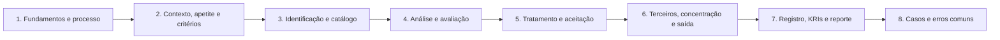

# 04 Gestão de Riscos de Nuvem

## Objetivo

Estabelecer e operar a gestão de riscos de segurança e de resiliência em ambientes de nuvem: compreender os conceitos e o processo (ISO 31000, ISO/IEC 27005 e NIST), definir contexto, apetite e critérios de risco, identificar riscos com apoio de um catálogo específico de nuvem, analisá-los de forma qualitativa, semiquantitativa e quantitativa, tratá-los e aceitá-los com autoridade e prazo, gerir riscos de terceiros e de concentração com estratégia de saída, e manter o registro, os indicadores e o reporte à direção.

## Trilha de estudo recomendada

## Conteúdo da pasta

| Ordem | Arquivo | Objetivo |
|---|---|---|
| 1 | [fundamentos-de-gestao-de-riscos-de-nuvem.md](fundamentos-de-gestao-de-riscos-de-nuvem.md) | Conceitos, referenciais, processo e fatores de risco específicos de nuvem |
| 2 | [contexto-apetite-e-criterios-de-risco.md](contexto-apetite-e-criterios-de-risco.md) | Escopo, apetite, tolerância, escalas, matriz e autoridade de aceitação |
| 3 | [identificacao-de-riscos-e-catalogo-de-riscos-de-nuvem.md](identificacao-de-riscos-e-catalogo-de-riscos-de-nuvem.md) | Técnicas de identificação e catálogo de 28 riscos de nuvem |
| 4 | [analise-e-avaliacao-de-riscos-qualitativa-e-quantitativa.md](analise-e-avaliacao-de-riscos-qualitativa-e-quantitativa.md) | Métodos de análise, risco inerente e residual, FAIR e simulação |
| 5 | [tratamento-aceitacao-e-planos-de-acao-de-riscos.md](tratamento-aceitacao-e-planos-de-acao-de-riscos.md) | Opções de tratamento, seguro cibernético, aceitação e planos de ação |
| 6 | [riscos-de-terceiros-concentracao-e-estrategia-de-saida.md](riscos-de-terceiros-concentracao-e-estrategia-de-saida.md) | Fornecedores, concentração, interrupções sistêmicas e saída |
| 7 | [registro-de-riscos-kri-reporte-modelos-e-checklist.md](registro-de-riscos-kri-reporte-modelos-e-checklist.md) | Registro, indicadores de risco, reporte, modelos e checklist |
| 8 | [casos-de-uso-e-erros-comuns-em-gestao-de-riscos-de-nuvem.md](casos-de-uso-e-erros-comuns-em-gestao-de-riscos-de-nuvem.md) | Casos fictícios, erros comuns, exercícios e perguntas de revisão |

## Princípios da pasta

- O risco é avaliado em relação aos **objetivos da organização**, e não apenas às ameaças técnicas
- Apetite e critérios de risco são definidos **antes** de avaliar, e aprovados pela direção
- Todo risco tem dono, e toda aceitação tem autoridade, prazo e revisão
- Risco inerente e risco residual são distintos: os controles precisam ser verificados para reduzir o risco
- Em nuvem, identidade, configuração, terceiros e concentração dominam o perfil de risco
- O registro de riscos é um instrumento vivo, alimentado por incidentes, auditorias e verificações de postura

## Relação com outras pastas

- 01 e 02: conceitos e responsabilidade compartilhada
- 03: governança e gestão de exceções
- 05 a 10: arquitetura e controles técnicos que tratam os riscos
- 11 e 12: conformidade e controles
- 13 a 18: monitoramento, ameaças, vulnerabilidades, avaliações e postura
- 22 e 23: resposta a incidentes e forense
- 27 a 29: métricas, roteiro e auditorias

## Referências

- ISO 31000:2018; ISO/IEC 27005:2022; ISO/IEC 27001:2022
- NIST SP 800-30 Rev. 1; NIST SP 800-37 Rev. 2; NIST SP 800-39; NIST IR 8286
- The Open Group. FAIR (Factor Analysis of Information Risk), O-RA e O-RT
- ENISA. Cloud Computing Risk Assessment (2009)
- IIA. Three Lines Model (2020); COSO. ERM 2017
- Brasil. LGPD, arts. 38, 46, 48 e 50
