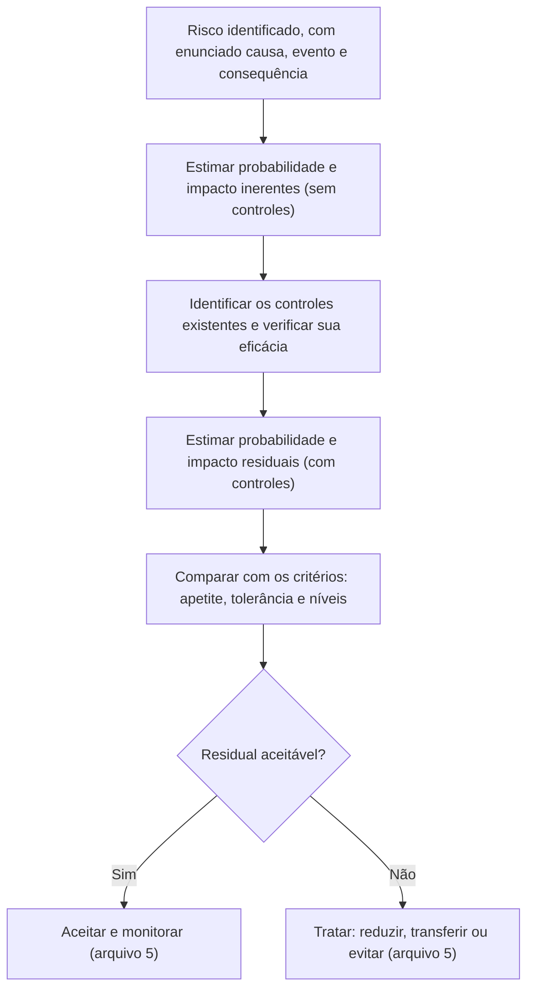

# Análise e Avaliação de Riscos: Qualitativa e Quantitativa

> **Objetivo pedagógico:** analisar riscos de nuvem com métodos qualitativos, semiquantitativos e quantitativos (perda anual esperada, FAIR e simulação de Monte Carlo); estimar probabilidade e impacto com base em fatores específicos de nuvem (exposição, eficácia dos controles, raio de impacto e tempo de detecção); distinguir risco inerente e residual; tratar a incerteza e os vieses das estimativas; avaliar riscos em relação aos critérios; e interpretar resultados para decisões de investimento.

## 1. Escolha do método

| Método | Descrição | Vantagens | Limitações | Quando usar |
|---|---|---|---|---|
| Qualitativo | Escalas descritivas (baixo, médio, alto) e matriz | Rápido, simples, acessível | Subjetivo; pouca precisão; difícil de comparar riscos distintos | Triagem inicial; muitos riscos |
| Semiquantitativo | Pontuações numéricas (1 a 5) multiplicadas ou ponderadas | Padroniza e permite ordenar | Dá falsa precisão aos números; escalas ordinais não são aditivas | Registro de riscos corporativo |
| Quantitativo | Valores monetários e distribuições de probabilidade (por exemplo, FAIR) | Permite comparar com custos de controles e apoiar decisões financeiras | Exige dados e especialização; incerteza alta | Riscos críticos, decisões de investimento e de seguro |

Recomendação prática: usar a abordagem **qualitativa ou semiquantitativa** para todos os riscos e **quantificar** os riscos mais relevantes ou os que sustentam decisões de investimento.

## 2. Fluxo de análise: do inerente ao residual



### Risco inerente e residual

| Conceito | Como estimar |
|---|---|
| Inerente | Considere o ativo, a ameaça e a exposição **sem controles** (ou com controles mínimos do provedor) |
| Residual | Considere os controles **implementados e verificados**, ajustando probabilidade e, quando aplicável, impacto |
| Eficácia de controles | Avalie com evidências (configuração, testes e relatórios de postura), e não apenas pela existência da política |

**Atenção:** um controle documentado, mas não verificado, **não reduz** o risco residual até que sua eficácia seja comprovada.

## 3. Fatores de estimativa específicos de nuvem

| Fator | Efeito na probabilidade ou no impacto |
|---|---|
| Exposição (internet, parceiros ou interna) | Eleva a probabilidade |
| Superfície de identidade (número de contas e de privilégios) | Eleva a probabilidade |
| Eficácia de controles preventivos (MFA resistente a phishing, guardrails e privilégio mínimo) | Reduz a probabilidade |
| Raio de impacto (*blast radius*) | Contas e redes segmentadas reduzem o impacto |
| Tempo de detecção e de resposta | Quanto mais rápido, menor o impacto |
| Classificação e volume dos dados | Eleva o impacto |
| Criticidade, RTO e RPO | Definem o impacto operacional |
| Maturidade da automação e da infraestrutura como código | Reduz a probabilidade de erros de configuração |
| Dependência de terceiros e redundância | Afeta probabilidade e impacto de indisponibilidade |
| Histórico de incidentes e de achados | Calibra a probabilidade |

## 4. Análise qualitativa e semiquantitativa

| Passo | Prática |
|---|---|
| 1 | Estimar a probabilidade e o impacto usando as escalas do arquivo 2, com o **maior** impacto entre as dimensões |
| 2 | Registrar a **justificativa** da estimativa (evidências, fatos e suposições) |
| 3 | Calcular a pontuação e o nível, aplicando regras de piso |
| 4 | Revisar com um segundo avaliador (2ª linha) para reduzir vieses |
| 5 | Calibrar entre riscos: comparar riscos semelhantes para garantir consistência |

### Vieses comuns nas estimativas

| Viés | Descrição | Mitigação |
|---|---|---|
| Otimismo | Subestimar riscos próprios | Revisão independente; uso de dados históricos |
| Ancoragem | Fixar-se no primeiro número | Estimar de forma independente e depois comparar |
| Disponibilidade | Superestimar riscos recentes ou vívidos | Usar dados de longo prazo |
| Excesso de confiança | Intervalos estreitos demais | Estimar intervalos (mínimo, mais provável e máximo) |
| Efeito de grupo | Alinhamento com o líder | Estimativas anônimas antes da discussão |
| Falsa precisão | Tratar pontuações como medidas exatas | Declarar a incerteza |

## 5. Análise quantitativa

### 5.1 Perda anual esperada (ALE)

| Termo | Definição |
|---|---|
| Valor do ativo (AV) | Valor monetário do ativo ou da exposição |
| Fator de exposição (EF) | Percentual do valor perdido em um evento |
| Perda por evento (SLE) | SLE = AV × EF |
| Taxa anual de ocorrência (ARO) | Número esperado de eventos por ano |
| Perda anual esperada (ALE) | ALE = SLE × ARO |

Exemplo: exposição de uma base de clientes com perda estimada de R$ 2.400.000 por evento e taxa de 0,15 evento por ano. ALE = 2.400.000 × 0,15 = **R$ 360.000 por ano**.

Limitações: depende de estimativas pontuais e ignora a variabilidade; a perda real é muito dispersa (eventos raros e muito caros).

### 5.2 Modelo FAIR (resumo)

O FAIR decompõe o risco em **frequência de eventos de perda** e **magnitude de perda**:

| Componente | Descrição |
|---|---|
| Frequência de eventos de perda (LEF) | Frequência de contato com a ameaça (TEF) × probabilidade de sucesso da ameaça (vulnerabilidade, que depende da força da ameaça contra a resistência dos controles) |
| Magnitude de perda (LM) | Perdas primárias (resposta, reposição, perda de produtividade) e perdas secundárias (multas, reputação, ações de partes interessadas) |
| Risco | Distribuição de perdas anuais, geralmente expressa com intervalos (faixas) |

O FAIR trabalha com **intervalos calibrados** (mínimo, mais provável e máximo) e simulações, em vez de números únicos.

### 5.3 Simulação de Monte Carlo (exemplo didático)

```python
# Simulação de perda anual: frequência de eventos (Poisson) e severidade por evento (lognormal)
# Os parâmetros são ilustrativos: calibre-os com dados da organização, do setor e opinião de especialistas
import numpy as np

rng = np.random.default_rng(42)
simulacoes = 100_000
frequencia_media = 0.15          # eventos por ano
mediana_perda = 1_200_000        # perda mediana por evento (R$)
sigma = 0.9                      # dispersão da severidade (maior = cauda mais pesada)

perdas_anuais = np.zeros(simulacoes)
for i in range(simulacoes):
    n = rng.poisson(frequencia_media)
    if n:
        perdas_anuais[i] = rng.lognormal(mean=np.log(mediana_perda), sigma=sigma, size=n).sum()

print(f"Perda anual média:              R$ {perdas_anuais.mean():,.0f}")
print(f"Probabilidade de perda > R$ 0:  {(perdas_anuais > 0).mean():.1%}")
print(f"Percentil 90 (perda anual):     R$ {np.percentile(perdas_anuais, 90):,.0f}")
print(f"Percentil 99 (perda anual):     R$ {np.percentile(perdas_anuais, 99):,.0f}")
```

Para comparar um **controle** (por exemplo, MFA resistente a phishing), reduza a frequência estimada (e/ou a severidade) no cenário "com controle", repita a simulação e compare as perdas médias e os percentis: a diferença estima o **benefício anual** do controle, a ser comparado ao seu custo.

### 5.4 Fontes de dados para a quantificação

| Fonte | Uso |
|---|---|
| Incidentes e quase-incidentes internos | Frequência e perdas reais |
| Relatórios do setor (por exemplo, relatórios anuais de investigações de violações e de custos de incidentes) | Referências de frequência e de custos (use com cautela e cite a edição) |
| Opinião calibrada de especialistas | Estimativas em intervalos |
| Resultados de testes e de verificações de postura | Probabilidade de sucesso de ameaças |
| Dados financeiros e contratuais | Valores dos ativos, multas e custos de resposta |
| Regulamentação | Faixas de sanções e custos de notificação |

## 6. Interpretação para decisões

| Pergunta | Como usar a análise |
|---|---|
| Quais riscos priorizar? | Ordenar por nível residual e por perda esperada |
| Vale investir em um controle? | Comparar o benefício estimado (redução de perda anual) com o custo anual do controle |
| Quanto de seguro contratar? | Usar a cauda da distribuição (percentis altos) e a capacidade de retenção |
| O risco é aceitável? | Comparar com apetite e tolerância (arquivo 2) |
| Onde há maior incerteza? | Direcionar coleta de dados e testes |

## 7. Exemplo prático: justificativa de MFA resistente a phishing

| Item | Estimativa |
|---|---|
| Cenário | Comprometimento de uma conta administrativa com impacto em dados de clientes e em produção |
| Frequência sem o controle (intervalo) | 0,10 a 0,40 evento por ano; mais provável 0,20 |
| Perda por evento (intervalo) | R$ 600 mil a R$ 6 milhões; mediana R$ 1,5 milhão |
| Perda anual esperada sem o controle (simulação) | Cerca de R$ 330 mil |
| Com MFA resistente a phishing | Frequência reduzida a 0,03 a 0,10; mais provável 0,05 |
| Perda anual esperada com o controle (simulação) | Cerca de R$ 85 mil |
| Benefício anual estimado | Cerca de R$ 245 mil |
| Custo anual do controle (chaves físicas, gestão e suporte) | R$ 90 mil |
| Decisão | Controle justificado (benefício estimado cerca de 2,7 vezes o custo), além de reduzir o risco regulatório |

Os números são fictícios e servem apenas à demonstração do raciocínio.

## 8. Cuidados na análise quantitativa

| Cuidado | Descrição |
|---|---|
| Não confundir precisão com exatidão | Apresente intervalos e a incerteza |
| Documentar suposições e fontes | Permite revisão e atualização |
| Revisar com especialistas e finanças | Valida valores e cenários |
| Evitar dupla contagem | Perdas primárias e secundárias devem ser distintas |
| Atualizar | Revisar quando houver novos dados, incidentes ou mudanças de controles |
| Complementar com julgamento | Modelos apoiam decisões, mas não as substituem |

## 9. Casos de uso corporativos

- Avaliação de riscos de novas cargas e de fornecedores com método padronizado.
- Justificativa de investimentos em segurança com base em redução de perda esperada.
- Dimensionamento de seguro cibernético e de reservas financeiras.

## 10. Normas e frameworks relevantes

- ISO/IEC 27005:2022; ISO 31000:2018 (análise e avaliação); IEC 31010 (técnicas de avaliação de riscos)
- NIST SP 800-30 Rev. 1; NIST IR 8286B (priorização); FAIR (O-RA e O-RT)
- NIST CSF 2.0 (ID.RA); CSA CCM v4 (GRC)

## 11. Checklist operacional: análise e avaliação

- [ ] Método escolhido por risco (qualitativo, semiquantitativo ou quantitativo) e justificado
- [ ] Risco inerente e residual estimados, com justificativa e evidências
- [ ] Eficácia dos controles verificada (e não apenas declarada)
- [ ] Fatores específicos de nuvem considerados (exposição, raio de impacto, detecção)
- [ ] Revisão por segundo avaliador e calibração entre riscos
- [ ] Riscos mais relevantes quantificados com intervalos e suposições registradas
- [ ] Resultados comparados com apetite e tolerância
- [ ] Incertezas e vieses declarados

## 12. Referências

- IEC 31010:2019. Risk management: Risk assessment techniques.
- ISO/IEC 27005:2022.
- Jones, J.; Freund, J. Measuring and Managing Information Risk: A FAIR Approach. 2014.
- Hubbard, D.; Seiersen, R. How to Measure Anything in Cybersecurity Risk. 2. ed. Wiley, 2023.
- Ross, R. et al. NIST SP 800-30 Rev. 1. 2012.
- The Open Group. Risk Analysis (O-RA) e Risk Taxonomy (O-RT).
