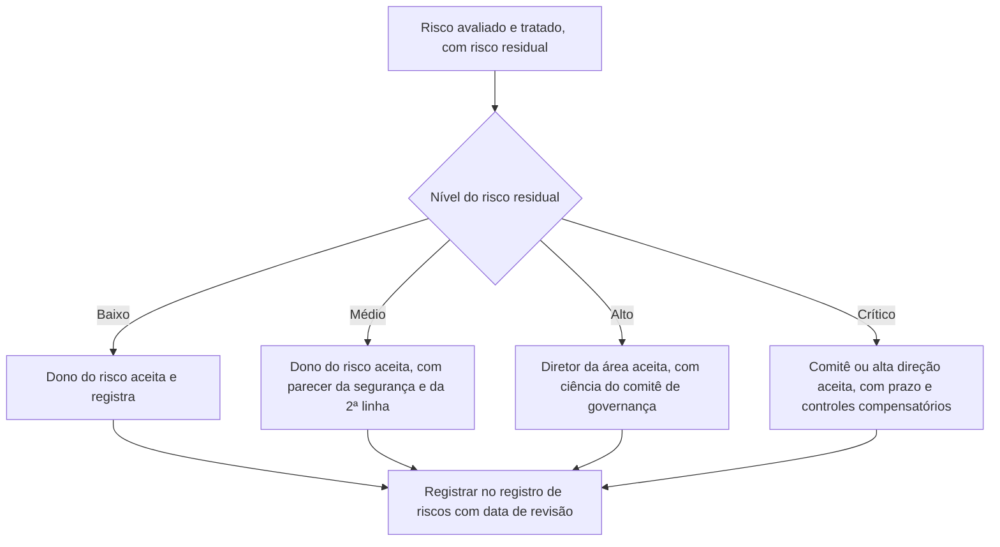

# Contexto, Apetite e Critérios de Risco

> **Objetivo pedagógico:** estabelecer o escopo e o contexto da gestão de riscos de nuvem, formular declarações de apetite e de tolerância ao risco, definir escalas de probabilidade e de impacto (financeiro, operacional, legal, reputacional e de privacidade), construir a matriz de risco e os níveis de risco, atribuir autoridade de aceitação por nível, relacionar a classificação de dados e a criticidade aos critérios, e aplicar uma função simples de pontuação.

## 1. Escopo e contexto

| Elemento | Perguntas a responder |
|---|---|
| Objetivos da organização | Que objetivos de negócio dependem da nuvem? (receita, continuidade, conformidade, inovação) |
| Escopo | Provedores, contas, ambientes, aplicações, dados e processos incluídos |
| Contexto externo | Regulação (LGPD e normas setoriais), ameaças, mercado, clientes, contratos |
| Contexto interno | Estratégia de nuvem, maturidade, competências, cultura, governança (pasta 03) |
| Partes interessadas | Direção, donos de produtos, segurança, jurídico, DPO, finanças, auditoria, reguladores, clientes |
| Interdependências | Dependências entre sistemas, provedores e processos |
| Restrições | Orçamento, prazos, contratos, tecnologia |
| Fontes de informação | Incidentes, auditorias, inventário, avaliações de fornecedores, relatórios de postura |

## 2. Apetite e tolerância ao risco

O apetite deve ser **definido pela direção** e traduzido em declarações utilizáveis nas decisões.

### 2.1 Declarações qualitativas (exemplos)

| Categoria | Declaração de apetite (exemplo) |
|---|---|
| Dados pessoais e sensíveis | Baixo apetite: a organização não aceita exposição de dados restritos; as exceções exigem aprovação do comitê |
| Disponibilidade de serviços críticos | Baixo apetite para indisponibilidade acima do RTO definido |
| Inovação em nuvem | Apetite moderado: aceita riscos controlados em ambientes de desenvolvimento e de experimentação, sem dados reais |
| Conformidade regulatória | Apetite muito baixo para descumprimentos conhecidos |
| Terceiros | Baixo apetite para fornecedores críticos sem garantias auditadas e sem plano de saída |
| Custos | Apetite moderado para variações de custo, com alertas e limites |

### 2.2 Limites quantitativos de tolerância (exemplos)

| Indicador | Tolerância (exemplo) |
|---|---|
| Perda financeira anual esperada por risco individual | Até R$ 500 mil sem escalonamento ao comitê |
| Indisponibilidade de serviço crítico | Máximo de 4 horas por evento (RTO) e perda de dados de até 15 minutos (RPO) |
| Contas privilegiadas sem MFA resistente a phishing | Zero |
| Achados críticos de postura sem correção | Nenhum além de 7 dias |
| Fornecedores críticos sem avaliação válida | Zero |

Os valores acima são **ilustrativos**: cada organização deve definir os seus com base em sua capacidade financeira, em seu setor e na regulação.

## 3. Critérios de risco: escalas

### 3.1 Escala de probabilidade (período: 12 meses)

| Nível | Descrição | Frequência indicativa |
|---|---|---|
| 1 Raro | Ocorre apenas em circunstâncias excepcionais | Menos de 1 vez em 10 anos |
| 2 Improvável | Pode ocorrer, mas não é esperado | 1 vez em 3 a 10 anos |
| 3 Possível | Pode ocorrer em algum momento | 1 vez em 1 a 3 anos |
| 4 Provável | Esperado ocorrer | 1 vez por ano ou mais |
| 5 Quase certo | Ocorre repetidamente ou já ocorreu | Várias vezes por ano |

### 3.2 Escala de impacto (múltiplas dimensões; usar o **maior** nível aplicável)

| Nível | Financeiro (exemplo) | Operacional | Legal e regulatório | Reputacional | Privacidade e titulares |
|---|---|---|---|---|---|
| 1 Insignificante | Menos de R$ 50 mil | Sem interrupção perceptível | Sem implicação | Sem repercussão | Sem exposição de dados |
| 2 Menor | R$ 50 mil a R$ 250 mil | Interrupção de serviços não críticos por até 4 horas | Observação interna | Reclamações isoladas | Exposição de dados não sensíveis de poucas pessoas |
| 3 Moderado | R$ 250 mil a R$ 1 milhão | Interrupção de serviço relevante por até 1 dia | Notificação a regulador ou cliente | Cobertura limitada na imprensa | Exposição de dados pessoais de centenas ou milhares de titulares |
| 4 Maior | R$ 1 milhão a R$ 5 milhões | Interrupção de serviço crítico por mais de 1 dia | Sanções, processos ou perda de licença parcial | Cobertura ampla na imprensa e perda de clientes | Exposição de dados sensíveis ou de dezenas de milhares de titulares |
| 5 Catastrófico | Acima de R$ 5 milhões | Parada prolongada de operações críticas | Sanções graves, risco à continuidade do negócio | Dano reputacional duradouro | Exposição em larga escala de dados sensíveis ou de crianças e adolescentes |

Ajuste os valores à dimensão da organização. Os critérios de **privacidade** conectam-se à avaliação de risco ou dano relevante aos titulares prevista na regulamentação de incidentes (LGPD, art. 48; Resolução CD/ANPD nº 15/2024).

## 4. Matriz de risco e níveis

Pontuação = probabilidade × impacto.

| Prob. \ Impacto | 1 | 2 | 3 | 4 | 5 |
|---|---|---|---|---|---|
| **5** | 5 | 10 | 15 | 20 | 25 |
| **4** | 4 | 8 | 12 | 16 | 20 |
| **3** | 3 | 6 | 9 | 12 | 15 |
| **2** | 2 | 4 | 6 | 8 | 10 |
| **1** | 1 | 2 | 3 | 4 | 5 |

| Nível de risco | Pontuação | Resposta esperada |
|---|---|---|
| Baixo | 1 a 4 | Aceitar e monitorar; tratar por rotina |
| Médio | 5 a 9 | Tratar com plano e prazo; aceitação pelo dono do risco |
| Alto | 10 a 16 | Tratamento prioritário; aceitação somente pela direção da área e ciência do comitê |
| Crítico | 17 a 25 | Tratamento imediato; aceitação somente pelo comitê ou pela alta direção, com prazo curto e controles compensatórios |

## 5. Autoridade de aceitação de riscos



| Nível residual | Quem aceita | Validade máxima da aceitação (exemplo) |
|---|---|---|
| Baixo | Dono do risco | 24 meses |
| Médio | Dono do risco, com parecer da 2ª linha | 12 meses |
| Alto | Diretor da área, com ciência do comitê | 6 meses |
| Crítico | Comitê ou alta direção | 3 meses, com plano de tratamento aprovado |

## 6. Relação com classificação de dados e criticidade

| Fator | Efeito nos critérios |
|---|---|
| Classificação dos dados (pasta 01) | Dados restritos e sensíveis elevam o nível mínimo de impacto de privacidade (por exemplo, nível 4 ou acima para exposição) |
| Criticidade, RTO e RPO | Definem o impacto operacional de interrupções |
| Exposição (internet, parceiros ou interna) | Eleva a probabilidade |
| Regulação aplicável | Eleva o impacto legal |
| Escala (número de titulares e de clientes) | Eleva o impacto por volume |

Defina **regras de piso**: por exemplo, a exposição de dados restritos nunca recebe impacto inferior a 4.

## 7. Função de pontuação (exemplo em Python)

```python
# Pontuação e nível de risco a partir de probabilidade e impacto (escalas de 1 a 5), conforme a matriz da seção 4
NIVEIS = [(1, 4, "baixo"), (5, 9, "medio"), (10, 16, "alto"), (17, 25, "critico")]

def nivel_de_risco(probabilidade: int, impacto: int) -> tuple[int, str]:
    if not (1 <= probabilidade <= 5 and 1 <= impacto <= 5):
        raise ValueError("Probabilidade e impacto devem estar entre 1 e 5")
    pontuacao = probabilidade * impacto
    for minimo, maximo, nome in NIVEIS:
        if minimo <= pontuacao <= maximo:
            return pontuacao, nome

# Regra de piso para dados restritos: o impacto nunca é menor que 4
def impacto_com_piso(impacto: int, classificacao: str) -> int:
    return max(impacto, 4) if classificacao == "restrito" else impacto

print(nivel_de_risco(4, impacto_com_piso(3, "restrito")))   # (16, 'alto')
```

## 8. Exemplo prático: aplicação dos critérios

| Risco | Prob. | Impacto (dimensão dominante) | Pontuação e nível | Quem aceita |
|---|---|---|---|---|
| Armazenamento com dados de clientes exposto publicamente por erro de configuração | 4 | 4 (privacidade) | 16, Alto | Diretor da área, com ciência do comitê |
| Indisponibilidade de uma região por até 4 horas para um serviço crítico | 3 | 4 (operacional) | 12, Alto | Diretor da área |
| Falta de documentação de uma aplicação de teste | 3 | 1 | 3, Baixo | Dono do risco |
| Contas administrativas sem MFA resistente a phishing em produção | 4 | 5 (financeiro, privacidade) | 20, Crítico | Comitê ou alta direção |

## 9. Casos de uso corporativos

- Aprovação da política de riscos de nuvem pelo comitê, com apetite e escalas explícitos.
- Padronização das avaliações entre equipes, com critérios comuns e regras de piso.
- Definição clara de quem pode aceitar riscos de cada nível.

## 10. Normas e frameworks relevantes

- ISO 31000:2018 (cláusula 6.3, escopo, contexto e critérios); ISO/IEC 27005:2022; NIST SP 800-30 Rev. 1 (apêndices de escalas)
- NIST IR 8286A e 8286B (contexto, apetite e priorização); COSO ERM 2017 (apetite e tolerância)
- NIST CSF 2.0 (GV.RM, estratégia de gestão de riscos); ISO/IEC 27001:2022 (6.1.2)
- LGPD, arts. 38, 48 e 50; Resolução CD/ANPD nº 15/2024

## 11. Checklist operacional: critérios de risco

- [ ] Escopo, objetivos e partes interessadas documentados
- [ ] Declarações de apetite aprovadas pela direção, por categoria
- [ ] Limites de tolerância quantitativos definidos
- [ ] Escalas de probabilidade e de impacto, com as dimensões relevantes, aprovadas
- [ ] Matriz de risco e níveis definidos, com respostas esperadas
- [ ] Autoridade e validade de aceitação por nível definidas
- [ ] Regras de piso por classificação de dados e por regulação
- [ ] Critérios revisados ao menos anualmente

## 12. Referências

- ISO 31000:2018. Risk management: Guidelines.
- ISO/IEC 27005:2022.
- Stine, K. et al. NIST IR 8286A e NIST IR 8286B: Identifying and Estimating Cybersecurity Risk for Enterprise Risk Management; Prioritizing Cybersecurity Risk for Enterprise Risk Management. 2021.
- COSO. Enterprise Risk Management: Integrating with Strategy and Performance. 2017.
- ANPD. Resolução CD/ANPD nº 15/2024 (comunicação de incidentes de segurança).
