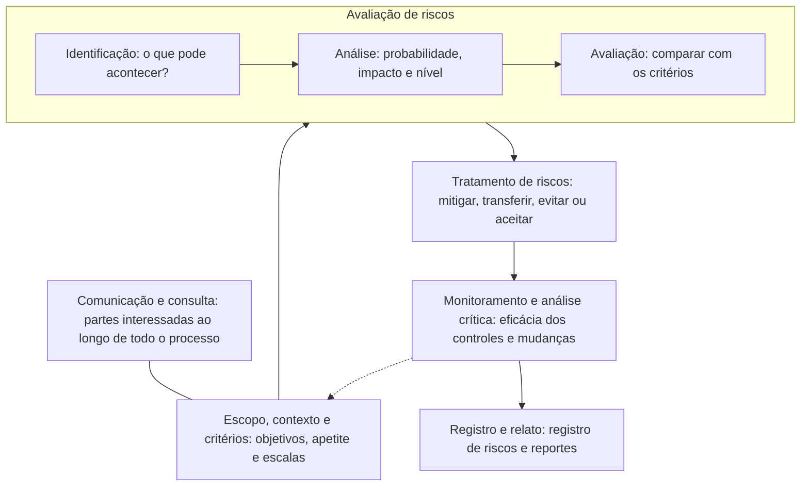

# Fundamentos de Gestão de Riscos de Nuvem

> **Objetivo pedagógico:** compreender os conceitos centrais de risco (ativo, ameaça, vulnerabilidade, probabilidade, impacto, controle, risco inerente e residual, apetite e tolerância), conhecer os referenciais de gestão de riscos (ISO 31000, ISO/IEC 27005, NIST e FAIR), entender o processo de gestão de riscos e sua integração à gestão de riscos corporativos (três linhas), e reconhecer os fatores que tornam o risco de nuvem particular (identidade, configuração, terceiros, concentração, velocidade e responsabilidade compartilhada).

## 1. O que é risco

A ISO 31000 define risco como o **efeito da incerteza sobre os objetivos**. Em segurança da informação, expressa-se em termos de **possibilidade de eventos que comprometam confidencialidade, integridade ou disponibilidade e afetem os objetivos da organização**.

| Conceito | Definição |
|---|---|
| Ativo | Qualquer coisa de valor para a organização (dados, sistemas, serviços, reputação e pessoas) |
| Ameaça | Causa potencial de um incidente indesejado (atacante, falha, erro, evento natural, mudança regulatória) |
| Vulnerabilidade | Fraqueza que pode ser explorada por uma ameaça (configuração, código, processo e dependência) |
| Evento de risco | Ocorrência ou mudança de um conjunto de circunstâncias |
| Probabilidade (ou frequência) | Chance de o evento ocorrer em um período |
| Impacto (ou consequência) | Efeito sobre os objetivos (financeiro, operacional, legal, reputacional e sobre os titulares de dados) |
| Controle | Medida que modifica o risco (política, processo, tecnologia e prática) |
| Risco inerente | Nível de risco **antes** dos controles |
| Risco residual | Nível de risco **depois** dos controles existentes |
| Apetite de risco | Quantidade e tipo de risco que a organização está disposta a buscar ou a reter para atingir seus objetivos |
| Tolerância ao risco | Variação aceitável em torno do apetite, para objetivos específicos |
| Capacidade de risco | Máximo de risco que a organização consegue suportar sem comprometer a continuidade |
| Dono do risco | Pessoa com responsabilidade e autoridade para gerir o risco |

Fórmula conceitual: **risco = f(probabilidade, impacto)**, condicionada pela **exposição**, pela **eficácia dos controles** e pelo **tempo de detecção e de resposta**.

### Enunciado de risco (boa prática)

Escreva riscos em forma de **causa, evento e consequência**:

> "Devido a [causa/vulnerabilidade], uma [ameaça] pode [evento], resultando em [consequência para o objetivo]."

Exemplo: "Devido à ausência de MFA resistente a phishing em contas administrativas, um atacante pode comprometer uma conta e alterar recursos de produção, resultando em indisponibilidade e vazamento de dados de clientes."

## 2. Referenciais

| Referencial | Contribuição |
|---|---|
| ISO 31000:2018 | Princípios, estrutura e processo de gestão de riscos, aplicável a qualquer organização |
| ISO/IEC 27005:2022 | Gestão de riscos de segurança da informação (abordagens baseadas em eventos e em ativos) |
| ISO/IEC 27001:2022 | Exige avaliação e tratamento de riscos de segurança da informação (cláusula 6.1) |
| NIST SP 800-30 Rev. 1 | Guia para conduzir avaliações de riscos (identificação, análise, probabilidade e impacto) |
| NIST SP 800-37 Rev. 2 | Estrutura de gestão de riscos (RMF): preparar, categorizar, selecionar, implementar, avaliar, autorizar e monitorar |
| NIST SP 800-39 | Gestão de risco de segurança da informação em três níveis: organização, processos de negócio e sistemas |
| NIST IR 8286 (série) | Integração da gestão de riscos de segurança cibernética à gestão de riscos corporativos |
| FAIR (The Open Group) | Modelo para quantificar riscos de informação em termos financeiros |
| COSO ERM 2017 | Gestão de riscos corporativos integrada à estratégia e ao desempenho |
| IIA Three Lines Model (2020) | Papéis da gestão (1ª linha), das funções de risco e de conformidade (2ª linha) e da auditoria interna (3ª linha) |
| ENISA. Cloud Computing Risk Assessment | Avaliação de riscos específicos de nuvem (organizacionais, técnicos, legais) |
| CSA CCM v4 e Top Threats | Controles e ameaças específicas de nuvem |
| LGPD, art. 50, §2º, I, d | Programas de governança em privacidade com avaliação sistemática de impactos e riscos |

## 3. Processo de gestão de riscos (ISO 31000)

| Etapa | Pergunta | Arquivo |
|---|---|---|
| Escopo, contexto e critérios | O que protegemos, para quê, e como mediremos o risco? | 2 |
| Identificação | O que pode dar errado em nuvem? | 3 |
| Análise e avaliação | Quão provável, quão grave, e é aceitável? | 4 |
| Tratamento | O que fazemos a respeito? | 5 |
| Terceiros e concentração | E quando o risco vem do provedor? | 6 |
| Registro, monitoramento e relato | Como acompanhamos e comunicamos? | 7 |

## 4. Níveis de gestão de riscos (NIST SP 800-39)

| Nível | Foco | Exemplos em nuvem |
|---|---|---|
| Organização (estratégico) | Apetite, estratégia e governança | Estratégia de nuvem, provedores, regiões e apetite a riscos de terceiros |
| Missão e processos de negócio | Riscos por processo | Impacto de indisponibilidade de um processo crítico na nuvem |
| Sistema (operacional) | Riscos técnicos por sistema | Configuração, identidade e vulnerabilidades de uma aplicação |

A informação deve fluir nos dois sentidos: o apetite desce da direção; os riscos operacionais sobem em forma agregada.

## 5. Três linhas

| Linha | Papel na gestão de riscos de nuvem |
|---|---|
| 1ª linha: gestão e equipes operacionais (produto, plataforma, TI e segurança operacional) | Identificam e gerem riscos no dia a dia; implementam e operam os controles |
| 2ª linha: gestão de riscos, segurança da informação (como função de supervisão), conformidade e privacidade | Definem o método, desafiam as avaliações, monitoram e reportam |
| 3ª linha: auditoria interna | Fornece avaliação independente da eficácia da governança, da gestão de riscos e dos controles |

## 6. Fatores que tornam o risco de nuvem particular

| Fator | Efeito no risco |
|---|---|
| Identidade como principal ponto de entrada | A comprometimento de credenciais dá acesso ao plano de controle |
| Configuração em vez de código | A maior parte dos incidentes decorre de configurações incorretas ou excessivamente permissivas |
| Velocidade e autoatendimento | Riscos são introduzidos e replicados rapidamente |
| Responsabilidade compartilhada | Lacunas de responsabilidade geram riscos não geridos (pasta 02) |
| Dependência de terceiros e concentração | Falhas e mudanças do provedor afetam muitas cargas ao mesmo tempo |
| Exposição à internet por padrão em alguns serviços | A superfície de ataque cresce |
| Dados distribuídos e múltiplas jurisdições | Riscos legais e de residência |
| Efemeridade | Riscos de visibilidade, de inventário e de evidências |
| Escala | Pequenas falhas têm grande raio de impacto (blast radius) |
| Mudança contínua de serviços e de termos | Riscos de gestão de mudanças e de conformidade |
| Competências | Falta de conhecimento especializado |

## 7. Tipos de riscos de nuvem

| Tipo | Exemplos |
|---|---|
| Segurança e privacidade | Comprometimento de contas, exposição de dados, vazamentos, acesso indevido |
| Operacional e resiliência | Indisponibilidade, falha de recuperação, erros de mudança |
| Conformidade e legal | Descumprimento da LGPD, de normas setoriais, de requisitos contratuais; jurisdição e acesso por autoridades estrangeiras |
| Terceiros e cadeia de suprimentos | Falha do provedor, subcontratados, componentes de terceiros |
| Concentração e dependência | Dependência de um provedor, região ou serviço |
| Financeiro | Custos inesperados, abuso de recursos, compromissos mal dimensionados |
| Estratégico | Aprisionamento tecnológico, decisões de arquitetura difíceis de reverter |
| Pessoas e cultura | Falta de competências, *shadow IT* |
| Reputacional | Perda de confiança por incidentes |

## 8. Exemplo prático: do enunciado ao risco inerente

| Elemento | Conteúdo |
|---|---|
| Ativo | Base de dados de clientes (restrito, dados pessoais) em um banco de dados gerenciado |
| Ameaça | Atacante externo com credenciais obtidas por phishing |
| Vulnerabilidade | Banco acessível pela internet; autenticação apenas por senha |
| Evento | Acesso e cópia de dados |
| Consequência | Vazamento de dados de 180 mil titulares; comunicação à ANPD; multas e perda de confiança |
| Probabilidade inerente | Alta |
| Impacto inerente | Alto |
| Dono do risco | Diretor de produtos |
| Controles possíveis | Acesso privado, autenticação integrada com MFA, auditoria, criptografia, monitoramento (arquivo 5) |

## 9. Casos de uso corporativos

- Estruturação do processo de gestão de riscos de nuvem alinhado ao programa corporativo de riscos.
- Treinamento de líderes de produtos e de tecnologia como donos de riscos.
- Base metodológica para avaliações de riscos de novas cargas e de fornecedores.

## 10. Normas e frameworks relevantes

- ISO 31000:2018; ISO/IEC 27005:2022; ISO/IEC 27001:2022 (6.1.2 e 6.1.3); ISO/IEC 27017:2015
- NIST SP 800-30 Rev. 1, 800-37 Rev. 2 e 800-39; NIST IR 8286; NIST CSF 2.0 (GV.RM)
- FAIR; COSO ERM 2017; IIA Three Lines Model; ENISA Cloud Computing Risk Assessment
- LGPD, arts. 38, 46 e 50

## 11. Checklist operacional: fundamentos

- [ ] Metodologia de gestão de riscos definida e aprovada (referencial de base escolhido)
- [ ] Definições de risco, de apetite, de tolerância e de dono acordadas
- [ ] Riscos escritos no formato causa, evento e consequência
- [ ] Papéis das três linhas definidos para riscos de nuvem
- [ ] Integração com a gestão de riscos corporativos definida (agregação e reporte)
- [ ] Fatores específicos de nuvem considerados no método
- [ ] Revisão anual do método

## 12. Referências

- ISO 31000:2018. Risk management: Guidelines.
- ISO/IEC 27005:2022. Information security, cybersecurity and privacy protection: Guidance on managing information security risks.
- Ross, R. et al. NIST SP 800-30 Rev. 1: Guide for Conducting Risk Assessments. 2012; NIST SP 800-37 Rev. 2. 2018; NIST SP 800-39. 2011.
- Stine, K. et al. NIST IR 8286: Integrating Cybersecurity and Enterprise Risk Management. 2020.
- Jones, J.; Freund, J. Measuring and Managing Information Risk: A FAIR Approach. Butterworth-Heinemann, 2014.
- The Institute of Internal Auditors. The IIA's Three Lines Model. 2020.
- ENISA. Cloud Computing Risk Assessment. 2009.
