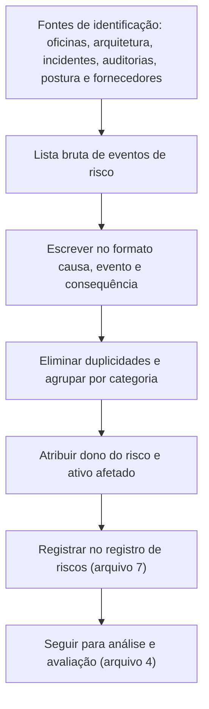

# Identificação de Riscos e Catálogo de Riscos de Nuvem

> **Objetivo pedagógico:** aplicar técnicas para identificar riscos de nuvem (oficinas, revisão de arquitetura, modelagem de ameaças, análise de incidentes, achados de auditoria e de postura, avaliações de fornecedores e cenários), usar fontes de referência (CSA, MITRE ATT&CK for Cloud, ENISA e CCM), e adotar um catálogo de 28 riscos de nuvem com causas, consequências e controles principais, como ponto de partida para o registro de riscos da organização.

## 1. Técnicas de identificação

| Técnica | Descrição | Quando usar |
|---|---|---|
| Oficinas de riscos | Sessões com donos de produtos, arquitetos, segurança e operações | Início de programa, novos produtos e revisões anuais |
| Revisão de arquitetura | Análise de diagramas e de fluxos por camadas e por componentes | Antes da implantação e em mudanças significativas |
| Modelagem de ameaças | Análise sistemática de ameaças, fronteiras de confiança e cenários de ataque (pasta 14) | Sistemas críticos e novas funcionalidades |
| Análise de incidentes e de quase-incidentes | Lições aprendidas de incidentes internos e públicos | Contínua |
| Achados de auditorias e de avaliações | Resultados de auditorias internas e externas e de testes de intrusão | Após cada ciclo |
| Verificação de postura e de vulnerabilidades | Desvios e vulnerabilidades detectados automaticamente (pastas 15 e 17) | Contínua |
| Avaliação de fornecedores | Lacunas em relatórios, em contratos e em responsabilidades (pasta 02) | Na contratação e nas renovações |
| Análise de cenários | Cenários plausíveis e severos (por exemplo, falha de região, comprometimento do provedor de identidade) | Resiliência e riscos de concentração |
| Inteligência de ameaças | Técnicas e campanhas relevantes (MITRE ATT&CK for Cloud) | Contínua |
| Análise de mudanças | Impacto de mudanças regulatórias, de serviços e de termos | Ao receber comunicados e novas normas |
| Listas de verificação e catálogos | Catálogos de riscos e de controles (arquivo atual, CSA CCM e ENISA) | Apoio à oficina |

## 2. Fontes de referência

| Fonte | Uso |
|---|---|
| CSA. Top Threats to Cloud Computing | Ameaças recorrentes (identidade, configuração, APIs, visibilidade e terceiros) |
| MITRE ATT&CK for Cloud | Táticas e técnicas de atacantes em nuvem, para construir cenários |
| ENISA. Cloud Computing Risk Assessment | Riscos políticos, organizacionais, técnicos e legais |
| CSA CCM v4 | Controles esperados; ausência de controles sugere riscos |
| OWASP Cloud-Native Application Security Top 10 | Riscos de aplicações nativas de nuvem |
| CIS Foundations Benchmarks | Configurações inseguras comuns |
| Relatórios de incidentes públicos e relatórios do setor | Frequência e causas de incidentes |
| Relatórios pós-incidente dos provedores | Falhas de disponibilidade e de segurança |

## 3. Catálogo de riscos de nuvem (ponto de partida)

> Use o catálogo como **lista de verificação**. Cada organização deve selecionar, adaptar, acrescentar e atribuir donos, ativos e níveis de risco. Os identificadores (R-NUV-NNN) servem de referência cruzada no registro.

| ID | Risco | Causas típicas | Consequências principais | Controles principais (pastas) |
|---|---|---|---|---|
| R-NUV-001 | Comprometimento de credenciais e de identidades | Phishing, reutilização de senhas, tokens roubados, ausência de MFA resistente a phishing | Acesso indevido a dados e ao plano de controle | Identidade e MFA (06), acesso condicional (07), monitoramento (13) |
| R-NUV-002 | Permissões excessivas e contas privilegiadas mal governadas | Papéis amplos, ausência de revisão, contas compartilhadas | Escalonamento e movimento lateral; abuso | Privilégio mínimo e acesso temporário (06), revisões de acesso (03) |
| R-NUV-003 | Configuração incorreta de armazenamento e exposição pública de dados | Autoatendimento, padrões permissivos, falta de guardrails | Vazamento de dados; sanções | Guardrails (03), proteção de dados (09), postura (17) |
| R-NUV-004 | Registros de auditoria ausentes, desabilitados ou insuficientes | Recursos opcionais, retenção curta, ausência de centralização | Detecção tardia; impossibilidade de investigar | Monitoramento (13), forense (23) |
| R-NUV-005 | Exposição de segredos e de chaves (código, imagens e pipelines) | Práticas de desenvolvimento, falta de cofre e de varredura | Acesso indevido; abuso de recursos | DevSecOps (21), gestão de segredos (10) |
| R-NUV-006 | Vulnerabilidades em cargas de trabalho, em imagens e em dependências | Patches atrasados, imagens desatualizadas | Exploração e invasão | Gestão de vulnerabilidades (15), proteção de cargas (18) |
| R-NUV-007 | APIs e interfaces inseguras | Autenticação e autorização frágeis, falta de validação | Acesso indevido; abuso | Arquitetura (05), DevSecOps (21) |
| R-NUV-008 | Segmentação de rede insuficiente e exposição de administração | Regras amplas, portas de gestão abertas | Movimento lateral e invasões | Segurança de rede (08) |
| R-NUV-009 | Perda, comprometimento ou gestão inadequada de chaves de criptografia | Chaves sem controle ou sem rotação; perda de acesso | Perda de dados ou exposição | Criptografia e chaves (10) |
| R-NUV-010 | Vazamento por SaaS e por integrações de terceiros (aplicativos OAuth) | Consentimentos amplos, compartilhamento externo | Exposição de e-mails e de arquivos | Governança de SaaS (02 e 06) |
| R-NUV-011 | *Shadow IT* e adoção de serviços sem avaliação | Processos lentos, falta de catálogo | Dados em serviços não avaliados | Governança (03) |
| R-NUV-012 | Indisponibilidade do provedor (zona, região ou serviço) | Falhas de infraestrutura, de software ou de configuração do provedor | Interrupção de serviços críticos | Resiliência (05), continuidade (22) |
| R-NUV-013 | Concentração em um provedor, em uma região ou em um serviço | Arquitetura sem redundância; dependências compartilhadas | Impacto sistêmico de uma falha | Arquivo 6; arquitetura (05) |
| R-NUV-014 | Aprisionamento tecnológico e dificuldade de saída | Serviços proprietários, formatos fechados, custos de saída | Perda de poder de negociação e de opções | Arquivo 6; contratos (02) |
| R-NUV-015 | Não conformidade regulatória (LGPD e normas setoriais) | Falta de mapeamento, de evidências e de controles | Sanções, multas, perda de clientes | Conformidade (11), auditorias (29) |
| R-NUV-016 | Residência de dados, jurisdição e acesso por autoridades estrangeiras | Regiões inadequadas, replicação, suporte e telemetria fora do país | Descumprimento legal e contratual | Dados (09), conformidade (11) |
| R-NUV-017 | Falha de backup e de recuperação | Backups não testados, retenção inadequada, mesma conta para dados e cópias | Perda irrecuperável de dados | Proteção de dados (09), resposta (22) |
| R-NUV-018 | Ransomware e destruição de dados em nuvem | Credenciais comprometidas, backups acessíveis ao atacante | Perda de dados e extorsão | Identidade (06), backups imutáveis (09), resposta (22) |
| R-NUV-019 | Comprometimento da cadeia de suprimentos (imagens, bibliotecas e componentes) | Fontes não verificadas, dependências maliciosas | Execução de código malicioso | DevSecOps (21), contêineres (19) |
| R-NUV-020 | Comprometimento de pipelines de CI/CD | Credenciais de pipeline, permissões amplas | Implantação de código malicioso; vazamento de segredos | DevSecOps (21) |
| R-NUV-021 | Configuração insegura de contêineres e de Kubernetes | Permissões amplas, imagens não verificadas, políticas de rede ausentes | Escape, movimentação lateral e exposição | Contêineres (19) e Kubernetes (20) |
| R-NUV-022 | Funções *serverless* com permissões excessivas | Papéis amplos, entradas não validadas | Acesso a dados e a serviços | Proteção de cargas (18) |
| R-NUV-023 | Abuso de recursos e custos inesperados (mineração e negação de carteira) | Credenciais expostas, falta de limites | Custos elevados; indisponibilidade | FinOps (03), monitoramento (13) |
| R-NUV-024 | Ameaça interna (colaboradores e pessoal do provedor) | Privilégios amplos, falta de segregação e de monitoramento | Exfiltração e sabotagem | Identidade (06), monitoramento (13), contratos (02) |
| R-NUV-025 | Falta de competências e de capacidade operacional | Escassez de profissionais, rotatividade | Configurações incorretas; resposta lenta | Governança (03), roteiro (28) |
| R-NUV-026 | Mudanças unilaterais de serviços, de preços e de termos pelo provedor | Contratos padronizados | Perda de funcionalidades ou de garantias; custos | Gestão de fornecedores (02) |
| R-NUV-027 | Uso inseguro de serviços de IA generativa com dados corporativos | Ferramentas não aprovadas, ausência de políticas | Vazamento de dados confidenciais e pessoais | Governança (03), proteção de dados (09) |
| R-NUV-028 | Resposta a incidentes comprometida por responsabilidades pouco claras | Matriz de responsabilidade inexistente, contatos desatualizados | Atraso na contenção; perda de evidências | Responsabilidade compartilhada (02), resposta (22) e forense (23) |

## 4. Exemplo prático: oficina de identificação para uma nova plataforma

Plataforma de análise de dados de clientes, com banco gerenciado, armazenamento de objetos, funções *serverless* e acesso por parceiros.

| Passo | Resultado |
|---|---|
| Preparação | Diagrama de arquitetura, classificação dos dados (confidencial, com dados pessoais), lista de fornecedores |
| Aplicação do catálogo | Riscos candidatos: R-NUV-001, 002, 003, 004, 007, 009, 010, 016, 017, 022 e 028 |
| Cenários específicos | "Um parceiro com acesso excessivo exporta toda a base de clientes" (R-NUV-002 e 024); "Uma função com permissões amplas é usada para ler o armazenamento" (R-NUV-022) |
| Enunciados | Cada risco reescrito em causa, evento e consequência |
| Donos | Dono da plataforma (R-NUV-003, 007, 022), identidade (R-NUV-001, 002), DPO e jurídico (R-NUV-016) e gestão de fornecedores (R-NUV-010) |
| Saída | 11 riscos no registro, prontos para análise |

## 5. Casos de uso corporativos

- Oficinas de riscos para novos produtos e para migrações de nuvem.
- Construção do registro de riscos inicial de nuvem a partir do catálogo.
- Atualização do registro após incidentes, auditorias e mudanças de serviços.

## 6. Normas e frameworks relevantes

- ISO/IEC 27005:2022 (identificação de riscos, abordagens baseadas em eventos e em ativos); NIST SP 800-30 Rev. 1 (identificação de ameaças e de eventos)
- CSA Top Threats; MITRE ATT&CK for Cloud; ENISA Cloud Computing Risk Assessment; OWASP Cloud-Native Application Security Top 10
- CSA CCM v4; CIS Foundations Benchmarks; NIST CSF 2.0 (ID.RA, avaliação de riscos)

## 7. Checklist operacional: identificação de riscos

- [ ] Fontes de identificação definidas e acionadas (oficinas, arquitetura, incidentes, auditorias, postura e fornecedores)
- [ ] Catálogo usado como lista de verificação e adaptado ao contexto
- [ ] Riscos escritos em causa, evento e consequência
- [ ] Ativos afetados e donos atribuídos
- [ ] Duplicidades eliminadas e riscos agrupados por categoria
- [ ] Cenários severos e plausíveis considerados (falha de região, comprometimento do provedor de identidade)
- [ ] Riscos registrados com identificador único
- [ ] Atualização após incidentes, auditorias e mudanças relevantes

## 8. Referências

- Cloud Security Alliance. Top Threats to Cloud Computing: Pandemic Eleven. 2022.
- MITRE. ATT&CK for Cloud. https://attack.mitre.org
- ENISA. Cloud Computing Risk Assessment. 2009.
- OWASP. Cloud-Native Application Security Top 10. 2022.
- ISO/IEC 27005:2022; NIST SP 800-30 Rev. 1. 2012.
- Cloud Security Alliance. CCM v4. 2021.
