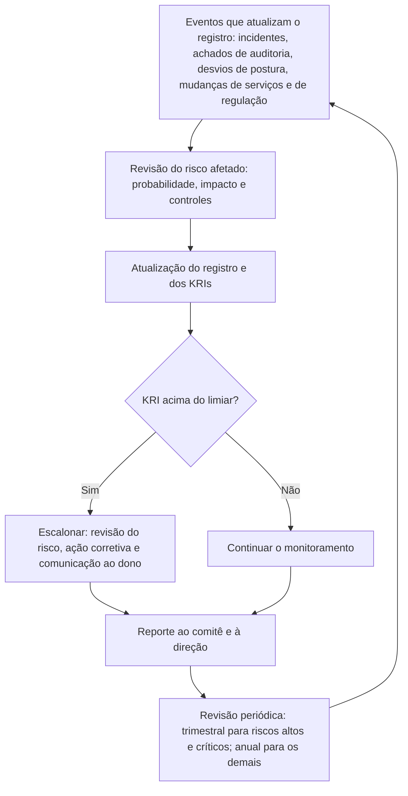

# Registro de Riscos, KRIs, Reporte, Modelos e Checklist

> **Objetivo pedagógico:** manter um registro de riscos de nuvem útil e atualizado, definir indicadores-chave de risco (KRIs) com limiares, integrar o registro a incidentes, a auditorias e a verificações de postura, calcular pontuações a partir de um registro exportado, reportar à direção e aos comitês, e usar modelos e um checklist para operar o ciclo de gestão de riscos com cadência definida.

## 1. Registro de riscos: campos

| Campo | Descrição |
|---|---|
| ID | Identificador único (por exemplo, R-NUV-001 do catálogo ou identificador próprio) |
| Título e enunciado | Causa, evento e consequência |
| Categoria | Segurança, privacidade, resiliência, terceiros, conformidade, financeiro ou estratégico |
| Ativo ou serviço afetado | Aplicação, conta, serviço ou fornecedor |
| Dono do risco | Pessoa com responsabilidade e autoridade |
| Probabilidade e impacto inerentes | Escalas de 1 a 5, com justificativa |
| Controles existentes e eficácia | Lista, com evidências |
| Probabilidade e impacto residuais | Escalas de 1 a 5 |
| Pontuação e nível residual | Calculados |
| Tratamento (mitigar, transferir, evitar ou aceitar) | Decisão e justificativa |
| Plano de ação | Ações, responsáveis, prazos e status |
| Aceitação | Aceitante, data e expiração |
| KRIs associados | Indicadores monitorados |
| Fontes e referências | Incidentes, achados, normas e controles |
| Datas | Criação, última revisão e próxima revisão |
| Status | Aberto, em tratamento, aceito, monitorado ou encerrado |

## 2. Ciclo de monitoramento



## 3. Indicadores-chave de risco (KRIs)

Os KRIs são **indicadores antecedentes** que sinalizam aumento de exposição **antes** de um incidente.

| KRI | Risco(s) relacionado(s) | Fonte | Verde | Amarelo | Vermelho |
|---|---|---|---|---|---|
| Contas privilegiadas sem MFA resistente a phishing | R-NUV-001, 002 | Provedor de identidade | 0 | 1 a 2 | 3 ou mais |
| Armazenamentos com acesso público fora de contas aprovadas | R-NUV-003 | Verificação de postura | 0 | 1 a 2 | 3 ou mais |
| Achados críticos de postura abertos há mais de 7 dias | R-NUV-003, 008, 021 | Gestão de postura | 0 | 1 a 3 | 4 ou mais |
| Contas e serviços críticos sem registros centralizados | R-NUV-004 | Inventário e SIEM | 0% | até 5% | acima de 5% |
| Segredos expostos detectados em repositórios (abertos) | R-NUV-005 | Varredura de segredos | 0 | 1 a 3 | 4 ou mais |
| Vulnerabilidades críticas fora do prazo de correção | R-NUV-006 | Gestão de vulnerabilidades | 0 | 1 a 5 | 6 ou mais |
| Cargas críticas com restauração de backup testada nos últimos 6 meses | R-NUV-017, 018 | Registros de testes | 100% | 90 a 99% | abaixo de 90% |
| Fornecedores críticos com avaliação vencida | R-NUV-012, 013, 014 | Gestão de fornecedores | 0 | 1 | 2 ou mais |
| Exceções vencidas ou sem dono | Vários | Registro de exceções | 0 | 1 a 3 | 4 ou mais |
| Percentual de recursos com proprietário e classificação | R-NUV-011, 025 | Inventário | acima de 95% | 85 a 95% | abaixo de 85% |
| Anomalias de custo não tratadas em 48 horas | R-NUV-023 | FinOps | 0 | 1 | 2 ou mais |
| Testes de recuperação de região ou de saída realizados no período | R-NUV-012, 013, 014 | Registros de exercícios | Todos | Atraso até 3 meses | Atraso acima de 3 meses |

Os limiares são ilustrativos; calibre-os com o apetite e com a capacidade da organização.

## 4. Integração com outras fontes

| Fonte | Como alimenta o registro |
|---|---|
| Incidentes (pasta 22) | Atualiza probabilidade, revela controles ineficazes e novos riscos |
| Achados de auditoria (pasta 29) | Cria ou atualiza riscos e planos |
| Gestão de postura e de vulnerabilidades (pastas 15 e 17) | Fornece evidências sobre a eficácia dos controles e sobre os KRIs |
| Avaliações de fornecedores (pasta 02) | Riscos de terceiros e lacunas de responsabilidade |
| Mudanças regulatórias (pasta 11) | Novos riscos de conformidade |
| Exceções de política (pasta 03) | Aceitações de risco |
| Métricas e roteiro (pastas 27 e 28) | Priorização de investimentos |

## 5. Cálculo de pontuações a partir de um registro exportado

`registro_riscos.csv` (dados fictícios):

```
id,titulo,dono,prob_inerente,imp_inerente,prob_residual,imp_residual,tratamento,status
R-NUV-001,Credenciais comprometidas em contas administrativas,Identidade,5,5,4,5,mitigar,em_tratamento
R-NUV-003,Exposição de armazenamento com dados de clientes,Plataforma,4,4,2,4,mitigar,monitorado
R-NUV-017,Falha de backup e de recuperação de dados críticos,Operacoes,3,5,3,4,mitigar,em_tratamento
R-NUV-014,Aprisionamento tecnologico em servico de analise,Arquitetura,3,3,3,3,aceitar,aceito
R-NUV-023,Abuso de recursos e custos inesperados,FinOps,4,3,2,2,mitigar,monitorado
```

```sql
-- DuckDB: pontuação e nível inerente e residual, ordenando pelo risco residual
SELECT id, titulo, dono, tratamento, status,
       prob_inerente * imp_inerente AS pontuacao_inerente,
       prob_residual * imp_residual AS pontuacao_residual,
       CASE
         WHEN prob_residual * imp_residual >= 17 THEN 'critico'
         WHEN prob_residual * imp_residual >= 10 THEN 'alto'
         WHEN prob_residual * imp_residual >= 5  THEN 'medio'
         ELSE 'baixo'
       END AS nivel_residual
FROM read_csv_auto('registro_riscos.csv')
ORDER BY pontuacao_residual DESC;

-- Distribuição dos riscos por nível residual (para o painel do comitê)
SELECT CASE
         WHEN prob_residual * imp_residual >= 17 THEN 'critico'
         WHEN prob_residual * imp_residual >= 10 THEN 'alto'
         WHEN prob_residual * imp_residual >= 5  THEN 'medio'
         ELSE 'baixo'
       END AS nivel, count(*) AS riscos
FROM read_csv_auto('registro_riscos.csv')
GROUP BY nivel
ORDER BY riscos DESC;
```

## 6. Reporte

| Público | Conteúdo | Frequência |
|---|---|---|
| Direção e comitê de governança | Principais riscos (altos e críticos), tendência, KRIs em vermelho, aceitações relevantes, decisões necessárias | Trimestral |
| Donos de riscos e equipes | Riscos de seu escopo, planos e KRIs | Mensal |
| Comitê de auditoria e de riscos | Visão integrada, aderência ao apetite, eficácia dos controles, achados | Trimestral ou semestral |
| 2ª linha (riscos e conformidade) | Painel completo e qualidade das avaliações | Mensal |
| Auditoria interna e externa | Registro, evidências e histórico de decisões | Sob demanda |
| Seguradoras e clientes | Informações exigidas por contrato ou apólice | Conforme a obrigação |

### Modelo de resumo executivo de riscos de nuvem (1 página)

| Seção | Conteúdo |
|---|---|
| Panorama | Número de riscos por nível, em comparação ao trimestre anterior |
| Principais riscos | Os 5 principais, com dono, tendência e situação do tratamento |
| KRIs em alerta | Indicadores amarelos e vermelhos, com causa e ação |
| Aceitações | Novas aceitações e vencimentos próximos |
| Incidentes e lições | Eventos relevantes e impacto nos riscos |
| Concentração e terceiros | Mudanças relevantes e riscos de fornecedores críticos |
| Decisões solicitadas | Aprovações, recursos e aceitações |
| Próximos passos | Prioridades do trimestre |

## 7. Cadência do ciclo de gestão de riscos

| Frequência | Atividade |
|---|---|
| Contínua | Atualização por eventos (incidentes, achados e mudanças) e monitoramento de KRIs |
| Mensal | Revisão dos KRIs e dos planos de tratamento pelos donos e pela 2ª linha |
| Trimestral | Revisão dos riscos altos e críticos; reporte ao comitê; revisão das aceitações |
| Semestral | Revisão da concentração e dos fornecedores críticos; testes de resiliência |
| Anual | Revisão completa do registro, dos critérios, do apetite e do método; nova oficina de identificação; autoavaliação de maturidade |

## 8. Modelos

### 8.1 Ficha de risco

| Campo | Preenchimento |
|---|---|
| ID, título e enunciado (causa, evento e consequência) | |
| Ativo ou serviço e categoria | |
| Dono do risco | |
| Inerente: probabilidade, impacto, pontuação e nível | |
| Controles existentes e evidências de eficácia | |
| Residual: probabilidade, impacto, pontuação e nível | |
| Tratamento e justificativa | |
| Plano de ação (resumo, responsável e prazo) | |
| KRIs associados e limiares | |
| Aceitação (aceitante, data e expiração) | |
| Data de revisão e próxima revisão | |

### 8.2 Registro de KRIs

| KRI | Definição e fórmula | Fonte | Frequência | Limiares (verde, amarelo e vermelho) | Dono | Riscos relacionados |
|---|---|---|---|---|---|---|
| | | | | | | |

### 8.3 Registro de eventos que acionam revisão de riscos

| Data | Evento (incidente, achado ou mudança) | Riscos afetados | Atualizações realizadas | Responsável |
|---|---|---|---|---|
| | | | | |

## 9. Checklist operacional: ciclo de gestão de riscos de nuvem

**Escopo:** ____________________
**Responsável (2ª linha):** ____________________
**Período:** ____________________

### 9.1 Estrutura

- [ ] Metodologia, apetite, tolerância e critérios aprovados
- [ ] Papéis das três linhas e donos dos riscos definidos
- [ ] Registro de riscos único, com campos padronizados
- [ ] Catálogo de riscos de nuvem adaptado e em uso

### 9.2 Operação

- [ ] Riscos identificados por oficinas, por arquitetura e por eventos
- [ ] Análise com riscos inerente e residual, evidências e segundo avaliador
- [ ] Riscos mais relevantes quantificados
- [ ] Tratamento definido, com planos, prazos e verificação de eficácia
- [ ] Aceitações formalizadas, com autoridade, prazo e controles compensatórios

### 9.3 Monitoramento e reporte

- [ ] KRIs definidos, com limiares e coleta automática
- [ ] Registro atualizado por incidentes, por auditorias e por desvios de postura
- [ ] Riscos de terceiros e de concentração revisados semestralmente
- [ ] Relatório trimestral ao comitê, com decisões e ações
- [ ] Revisão anual completa do ciclo

## 10. Resultado da verificação

| Resultado | Condição |
|---|---|
| Conforme | Todos os itens aplicáveis marcados |
| Conforme com ressalvas | Pendências sem riscos críticos sem dono ou sem tratamento, com plano de ação |
| Não conforme | Riscos críticos sem dono, sem tratamento ou com aceitações vencidas; ausência de apetite e de critérios aprovados; registro desatualizado há mais de 6 meses |

**Assinatura do responsável:** ____________________
**Assinatura do revisor:** ____________________

## 11. Casos de uso corporativos

- Registro de riscos de nuvem integrado ao registro corporativo de riscos.
- Painel de KRIs para o comitê, com alertas antecedentes.
- Evidências do ciclo de gestão de riscos para auditorias e para a ISO/IEC 27001.

## 12. Normas e frameworks relevantes

- ISO 31000:2018 (monitoramento, análise crítica, registro e relato); ISO/IEC 27005:2022; ISO/IEC 27001:2022 (6.1, 8.2 e 9.1)
- NIST SP 800-37 Rev. 2 (monitorar); NIST IR 8286C e 8286D (agregação e reporte de riscos); NIST CSF 2.0 (GV.RM e GV.OV)
- ISO/IEC 27004 (indicadores); COSO ERM 2017; IIA Three Lines Model

## 13. Referências

- ISO 31000:2018; ISO/IEC 27004:2016; ISO/IEC 27005:2022.
- Stine, K. et al. NIST IR 8286C: Staging Cybersecurity Risks for Enterprise Risk Management and Governance Oversight; NIST IR 8286D. 2022.
- COSO. Enterprise Risk Management: Integrating with Strategy and Performance. 2017.
- Documentação do DuckDB.
- Pastas 03, 22, 27 e 29 deste repositório.
