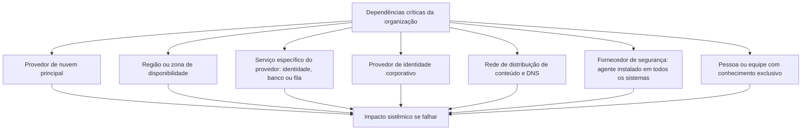

# Riscos de Terceiros, Concentração e Estratégia de Saída

> **Objetivo pedagógico:** gerir os riscos que decorrem da dependência de provedores de nuvem e de outros terceiros: classificar fornecedores por criticidade, identificar e medir a concentração (provedor, região, serviço, identidade, rede de distribuição e DNS), aprender com interrupções sistêmicas públicas, escolher estratégias de resiliência (multi-zona, multirregião e multicloud) considerando custos e complexidade, elaborar e testar planos de saída (planejada e sob estresse) e reconhecer as expectativas regulatórias sobre terceirização e concentração.

> Os incidentes públicos citados são resumidos a partir de relatórios divulgados pelos próprios provedores e pela imprensa técnica; confira os relatórios pós-incidente originais antes de citar detalhes.

## 1. Classificação de fornecedores por criticidade

| Camada | Critério | Exemplos | Nível de diligência e de monitoramento |
|---|---|---|---|
| Crítico | Interrupção ou comprometimento afeta processos críticos, dados restritos ou obrigações regulatórias; difícil de substituir | Provedor principal de nuvem, provedor de identidade, rede de distribuição de conteúdo, provedor de DNS | Diligência completa, contrato negociado quando possível, monitoramento contínuo, plano de saída testado |
| Importante | Afeta processos relevantes ou dados confidenciais; substituível em prazo razoável | SaaS de CRM, de RH e de colaboração; ferramentas de segurança | Diligência padrão, monitoramento periódico, plano de saída documentado |
| Padrão | Impacto limitado; dados internos ou públicos | Ferramentas de produtividade de baixo risco | Avaliação simplificada |

Os critérios devem usar a **classificação de dados**, a **criticidade do processo** (RTO e RPO), a **substituibilidade** e a **exposição regulatória**.

## 2. Riscos específicos de terceiros em nuvem

| Risco | Descrição |
|---|---|
| Falha de segurança do provedor | Vulnerabilidades ou ataques que afetam vários clientes |
| Indisponibilidade | Interrupções de zona, de região ou de serviço |
| Falha em cascata | Um serviço central do provedor (identidade, DNS, rede ou banco interno) afeta muitos outros serviços |
| Dependências ocultas | Serviços de terceiros usados pelo provedor ou por seus fornecedores |
| Mudanças unilaterais | Alterações de serviços, de preços, de termos e de regiões |
| Descontinuidade de serviços | Fim de vida de serviços ou de versões |
| Acesso de funcionários do provedor a dados | Controles e registros insuficientes |
| Subcontratação | Subprocessadores sem controles equivalentes |
| Jurisdição e conformidade | Acesso por autoridades estrangeiras; descumprimento de requisitos locais |
| Falência ou aquisição do fornecedor | Continuidade do serviço e dos dados |
| Aprisionamento tecnológico | Dificuldade e custo de migração |

## 3. Concentração

A **concentração** ocorre quando muitas funções críticas dependem de um **mesmo ponto**, de modo que uma única falha produz impacto amplo.

### 3.1 Dimensões da concentração

| Dimensão | Pergunta |
|---|---|
| Provedor | Quantos processos críticos dependem do mesmo provedor? |
| Região | Todas as cargas críticas estão na mesma região? Há dependência de uma região global específica? |
| Serviço | Há serviços de plano de controle ou de identidade sem alternativa? |
| Identidade | Se o provedor de identidade falhar, é possível acessar sistemas críticos (contas de emergência)? |
| Rede de entrega e DNS | Há redundância de DNS e de distribuição? |
| Ferramentas de segurança | Uma falha de um agente instalado em todos os sistemas pode causar interrupção ampla? |
| Pessoas | Há conhecimento crítico concentrado em poucas pessoas? |
| Dados | Há uma única cópia de dados críticos, ou todas as cópias estão no mesmo provedor e na mesma conta? |

### 3.2 Aprendizados de interrupções públicas (resumos)

| Evento (referência) | Natureza | Lições para a gestão de riscos |
|---|---|---|
| Interrupção em uma região de grande uso de um provedor (por exemplo, a de dezembro de 2021 e a de outubro de 2025, em regiões de alta concentração de serviços) | Falhas de serviços internos de rede e de DNS afetaram muitos serviços dependentes | Concentração em regiões e em serviços de plano de controle; dependências ocultas; testar planos de resiliência fora da região principal |
| Interrupção de um serviço global de borda de um provedor (outubro de 2025) | Uma alteração de configuração afetou serviços de entrega e de identidade | Dependência de pontos de entrada globais; alternativas de acesso e de entrega |
| Interrupção ligada a um serviço de controle de APIs de um provedor (junho de 2025) | Falha em componente de gestão afetou serviços de vários clientes | Dependência de serviços de controle; monitoramento e comunicação |
| Atualização defeituosa de um agente de segurança instalado em milhões de sistemas (julho de 2024) | Interrupção ampla de sistemas por um único fornecedor | Concentração em ferramentas de segurança; estratégia de implantação gradual de atualizações; recuperação de sistemas em larga escala |

Esses eventos mostram que **a disponibilidade depende de uma cadeia de componentes** e que a resiliência exige conhecer as dependências, e não apenas contratar redundância na camada visível.

## 4. Estratégias de resiliência e seus custos

| Estratégia | Descrição | Protege contra | Custo e complexidade |
|---|---|---|---|
| Multi-zona | Distribuir a carga entre zonas de disponibilidade de uma região | Falhas de datacenter ou de zona | Baixo a moderado; padrão para cargas críticas |
| Multirregião (ativo e passivo ou ativo e ativo) | Replicar em outra região | Falhas de região ou de serviços regionais | Moderado a alto; replicação de dados, de identidade e de rede |
| Multicloud (para continuidade) | Manter capacidade em outro provedor | Falhas de provedor, aprisionamento, risco regulatório | Alto; complexidade, competências e consistência de segurança; avaliar a necessidade real |
| Nuvem e ambiente local (híbrido) | Retenção de capacidade crítica localmente | Falhas amplas de nuvem; requisitos regulatórios | Alto |
| Redundância de ferramentas críticas | Alternativas para identidade, DNS e acesso de emergência | Falhas de ponto único | Moderado |
| Degradação controlada | Projetar para funcionar com funcionalidades reduzidas | Falhas parciais | Moderado |
| Backups independentes e imutáveis em outro domínio | Cópias fora do provedor e da conta principais | Ransomware, exclusão, falha do provedor | Moderado |

Princípio: **a resiliência deve ser proporcional à criticidade** (RTO e RPO) e **comprovada por testes**; o multicloud, em particular, só se justifica quando o risco específico (regulatório, de continuidade ou de aprisionamento) supera a complexidade adicional.

## 5. Estratégia de saída

### 5.1 Tipos de saída

| Tipo | Gatilhos | Características |
|---|---|---|
| Saída planejada | Fim de contrato, mudança de estratégia, custos, insatisfação | Tempo para planejar e migrar; testes e negociações |
| Saída sob estresse | Falha grave do provedor, incidente de segurança, sanção, falência, mudança regulatória | Tempo curto; exige alternativas já preparadas |

### 5.2 Elementos do plano de saída

| Elemento | Conteúdo |
|---|---|
| Cenários e gatilhos | Condições que ativam o plano |
| Dados | Formatos de exportação (preferencialmente abertos), volume, tempo de exportação, integridade, criptografia e chaves |
| Aplicações e dependências | Serviços proprietários e alternativas; esforço de reescrita |
| Identidade e acessos | Federação, contas e segredos |
| Rede e integrações | Conectividade, DNS, APIs e parceiros |
| Capacidade alternativa | Outro provedor, ambiente local ou combinação; capacidade e custos |
| Contratos | Cláusulas de assistência na transição, prazos de retenção e de exclusão |
| Papéis e comunicação | Responsáveis, partes interessadas, reguladores e clientes |
| Testes | Exercícios periódicos de exportação, de restauração e de migração parcial |
| Exclusão e encerramento | Eliminação dos dados, certificação, revogação de acessos |

### 5.3 Avaliação de substituibilidade

| Critério | Pergunta | Resposta (exemplo) |
|---|---|---|
| Padrões abertos | Os dados e as interfaces usam padrões abertos? | Parcialmente: o banco usa formato aberto; o serviço de análise é proprietário |
| Esforço de migração | Quanto tempo e custo para migrar? | 9 a 12 meses para o sistema de análise |
| Alternativas no mercado | Existem fornecedores equivalentes? | Sim, mas com diferenças de funcionalidades |
| Conhecimento interno | Há competências para operar a alternativa? | Parcial |
| Impacto regulatório | Há requisitos para a troca (por exemplo, comunicação a reguladores)? | Verificar com a área de conformidade |

## 6. Expectativas regulatórias (visão geral)

> **Aviso:** orientações gerais, sem caráter jurídico. Confirme a vigência e a aplicabilidade com o Jurídico e com a área de conformidade.

| Norma | Pontos relevantes |
|---|---|
| Resolução CMN nº 4.893/2021 e Resolução BCB nº 85/2021 | Política de segurança cibernética; avaliação da relevância dos serviços de nuvem e da capacidade do prestador; cláusulas contratuais; planos de continuidade; comunicação ao regulador em contratações relevantes |
| Resolução CMN nº 4.557/2017 | Estrutura de gerenciamento de riscos e de capital (inclui riscos operacionais e de terceiros) |
| Regulamento (UE) 2022/2554 (DORA) | Gestão de riscos de terceiros de TIC, registro de contratos, testes de resiliência, estratégias de saída e supervisão de provedores críticos (para entidades financeiras da UE) |
| Diretrizes da EBA sobre terceirização (EBA/GL/2019/02) | Gestão de acordos de terceirização, inclusive nuvem, para instituições financeiras da UE |
| LGPD | Responsabilidade de controlador e de operador; transferência internacional |
| IN GSI/PR nº 5/2021 | Requisitos de nuvem na administração pública federal, com atenção a riscos de dependência |

## 7. Monitoramento da concentração e dos terceiros

| Atividade | Frequência | Resultado |
|---|---|---|
| Mapa de dependências críticas (provedores, regiões, serviços e pessoas) | Anual e a cada mudança relevante | Visão de concentração |
| Indicadores de concentração (percentual de cargas críticas por provedor e por região) | Trimestral | Painel de riscos |
| Revisão de relatórios pós-incidente dos provedores | A cada evento relevante | Lições e ajustes |
| Testes de resiliência e de recuperação | Semestral para sistemas críticos | Evidência de RTO e RPO |
| Teste de exportação de dados | Anual para serviços críticos | Evidência de saída |
| Reavaliação de fornecedores críticos | Anual | Diligência atualizada |
| Acompanhamento de mudanças de termos, de serviços e de regiões | Contínuo | Gestão de mudanças |

## 8. Exemplo prático: análise de concentração de uma plataforma de pagamentos

| Dimensão | Situação | Risco | Tratamento |
|---|---|---|---|
| Provedor | 100% das cargas críticas em um provedor | Falha ou mudança de termos afeta tudo | Plano de saída testado; backups em domínio separado; avaliação de necessidade de multicloud para o núcleo crítico |
| Região | Produção em uma região, recuperação na mesma região | Falha regional paralisa tudo | Recuperação em segunda região, com teste semestral (RTO de 4 horas) |
| Identidade | Provedor de identidade único em nuvem | Falha impede acesso a sistemas críticos | Contas de emergência independentes e testadas; procedimento de acesso alternativo |
| DNS e entrega | Um único provedor de DNS e de entrega | Indisponibilidade de endpoints | DNS secundário e documentação do desvio |
| Agente de segurança | Atualizações automáticas imediatas em todos os servidores | Atualização defeituosa derruba tudo | Implantação em anéis (canário, parcial e total) |
| Dados | Backups na mesma conta de produção | Ransomware ou erro apaga tudo | Cópias imutáveis em conta de recuperação separada |
| Resultado | Risco de concentração reduzido de Alto (16) para Médio (8), com custos adicionais de cerca de 6% do orçamento de infraestrutura | | |

## 9. Casos de uso corporativos

- Mapa de dependências e indicadores de concentração para o comitê de riscos.
- Plano de saída e testes de exportação para provedores críticos.
- Estratégia de resiliência proporcional à criticidade, com decisões justificadas sobre multirregião e multicloud.

## 10. Normas e frameworks relevantes

- ISO/IEC 27036-4:2016; ISO/IEC 27001:2022 (5.19 a 5.23); NIST SP 800-161 Rev. 1; ISO 22301:2019 (continuidade); ISO/IEC 27031 (continuidade de TIC)
- CSA CCM v4 (STA e BCR); NIST CSF 2.0 (GV.SC, gestão de riscos da cadeia de suprimentos)
- Resolução CMN 4.893/2021; Resolução BCB 85/2021; Resolução CMN 4.557/2017; Regulamento (UE) 2022/2554 (DORA); EBA/GL/2019/02

## 11. Checklist operacional: terceiros, concentração e saída

- [ ] Fornecedores classificados por criticidade, com diligência proporcional
- [ ] Mapa de dependências críticas (provedor, região, serviço, identidade, DNS, ferramentas e pessoas)
- [ ] Indicadores de concentração calculados e reportados
- [ ] Estratégia de resiliência definida por criticidade (multi-zona, multirregião e outras) e testada
- [ ] Acesso de emergência independente do provedor de identidade
- [ ] Backups independentes e imutáveis em outro domínio de falha
- [ ] Plano de saída (planejada e sob estresse) documentado para fornecedores críticos
- [ ] Teste de exportação de dados realizado e registrado
- [ ] Revisão dos relatórios pós-incidente dos provedores e lições registradas
- [ ] Requisitos regulatórios de terceirização verificados

## 12. Referências

- ISO/IEC 27036-4:2016. Information security for supplier relationships: Guidelines for security of cloud services.
- Boyens, J. et al. NIST SP 800-161 Rev. 1. 2022.
- ISO 22301:2019. Security and resilience: Business continuity management systems.
- Brasil. Resolução CMN nº 4.893/2021; Resolução BCB nº 85/2021; Resolução CMN nº 4.557/2017.
- União Europeia. Regulamento (UE) 2022/2554 (DORA); European Banking Authority. Guidelines on outsourcing arrangements (EBA/GL/2019/02).
- Relatórios pós-incidente publicados pelos provedores de nuvem e pelos fornecedores mencionados.
