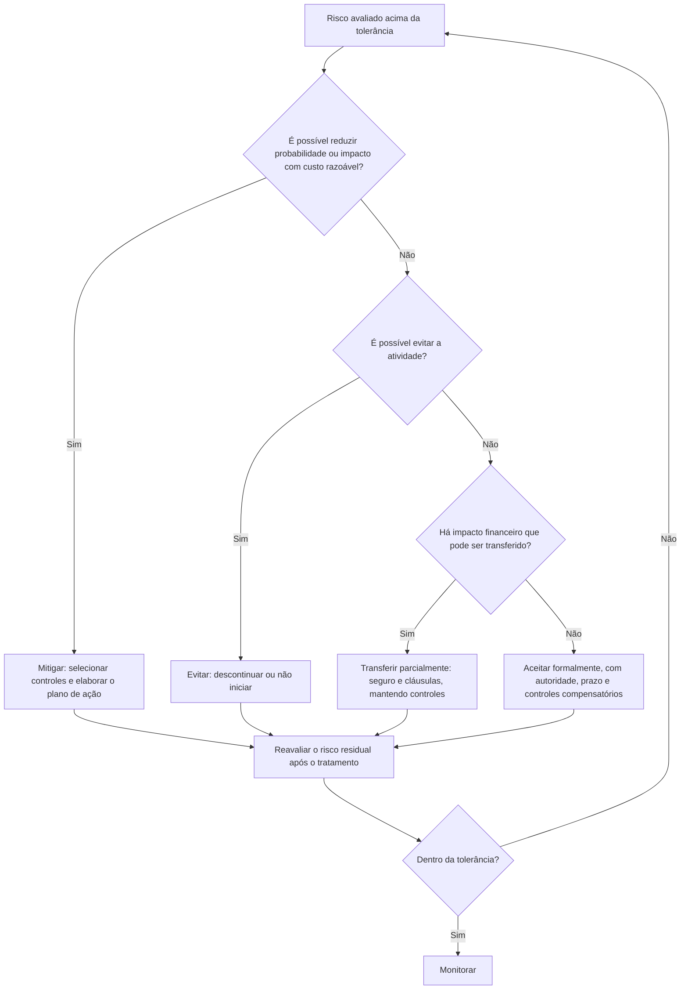

# Tratamento, Aceitação e Planos de Ação de Riscos

> **Objetivo pedagógico:** escolher e aplicar as opções de tratamento de riscos (mitigar, transferir, evitar e aceitar) no contexto de nuvem, selecionar controles com base em eficácia e em custo, entender o papel e os limites do seguro cibernético e da transferência contratual, conduzir a aceitação formal de riscos com autoridade, prazo e controles compensatórios, elaborar planos de tratamento verificáveis e integrar o tratamento à gestão de exceções e ao roteiro de segurança.

## 1. Opções de tratamento

| Opção | Descrição | Exemplos em nuvem |
|---|---|---|
| Mitigar (reduzir) | Reduzir a probabilidade e/ou o impacto | MFA resistente a phishing, guardrails, criptografia com chaves do cliente, segmentação, monitoramento, backups imutáveis |
| Transferir (compartilhar) | Transferir parte do impacto financeiro a terceiros | Seguro cibernético, cláusulas contratuais de responsabilidade e de indenização (limitadas) |
| Evitar | Eliminar a atividade que gera o risco | Não migrar dados restritos para um serviço sem garantias; descontinuar um serviço de alto risco |
| Aceitar (reter) | Aceitar o risco residual de forma consciente | Risco baixo, ou risco cujo tratamento é mais custoso que o impacto; ambientes de teste sem dados reais |

## 2. Seleção de controles

| Critério | Pergunta |
|---|---|
| Eficácia | Quanto o controle reduz a probabilidade ou o impacto do risco específico? |
| Custo | Custo de implementação e de operação, em relação à redução de perda esperada |
| Viabilidade | Competências, tempo, dependências e impacto operacional |
| Cobertura | O controle trata vários riscos ao mesmo tempo? |
| Tipo | Preventivo, detectivo ou corretivo: usar combinações em camadas |
| Verificabilidade | É possível evidenciar o funcionamento (testes e métricas)? |
| Responsabilidade | Quem opera (cliente, provedor ou ambos) |
| Dependências | O controle depende de outros controles ou de mudanças de arquitetura? |

### Mapeamento de controles aos riscos do catálogo (exemplos)

| Risco | Controles de mitigação | Referências |
|---|---|---|
| R-NUV-001 Comprometimento de credenciais | MFA resistente a phishing; acesso condicional; credenciais temporárias; detecção de anomalias de acesso | CCM IAM; ISO/IEC 27002: 5.15 a 5.18 e 8.5; CIS Controls 5 e 6 |
| R-NUV-003 Exposição de armazenamento | Bloqueio de acesso público na organização; verificação contínua de postura; classificação e varredura de dados | CCM DSP e IVS; CIS Benchmarks |
| R-NUV-004 Registros insuficientes | Trilhas organizacionais, centralização, retenção e imutabilidade; alertas | CCM LOG; ISO/IEC 27002: 8.15 e 8.16; CIS Control 8 |
| R-NUV-012 e R-NUV-013 Indisponibilidade e concentração | Arquitetura multi-zona e, para sistemas críticos, multirregião; testes de recuperação; plano de saída | CCM BCR; ISO/IEC 27002: 5.29 e 5.30 |
| R-NUV-017 e R-NUV-018 Backup e ransomware | Backups imutáveis e isolados; testes de restauração; segregação de contas | CCM BCR e DSP; ISO/IEC 27002: 8.13 |
| R-NUV-005 Segredos expostos | Cofre de segredos; varredura de segredos; rotação | CCM CEK e AIS; ISO/IEC 27002: 8.24 e 8.28 |

## 3. Seguro cibernético e transferência contratual

| Tema | Orientação |
|---|---|
| O que o seguro faz | Transfere parte do impacto financeiro (custos de resposta, de recuperação, de notificação, perdas de receita e responsabilidade perante terceiros), conforme a apólice |
| O que o seguro **não** faz | Não elimina o risco, nem impede incidentes; pode ter exclusões, sublimites, franquias e exigências de controles mínimos |
| Exigências comuns | MFA, backups protegidos, detecção e resposta em endpoints, gestão de patches, treinamento e plano de resposta a incidentes |
| Seleção da cobertura | Basear-se em cenários e na cauda da distribuição de perdas (arquivo 4); avaliar sublimites para extorsão, interrupção de negócios e responsabilidade de terceiros |
| Cláusulas contratuais com provedores | Indenizações e limites de responsabilidade de provedores globais costumam ser restritos; **não** devem ser consideradas substitutas de controles |
| Seguros e fornecedores | Verifique se os fornecedores críticos mantêm seguros adequados |
| Atuação conjunta | Envolver a área de riscos, o jurídico e o corretor; guardar evidências de controles exigidas pela seguradora |

## 4. Aceitação formal de riscos

| Elemento | Prática |
|---|---|
| Quando | Após o tratamento, quando o risco residual ainda excede a tolerância mas o tratamento adicional não é viável ou justificável, ou quando o risco está dentro da tolerância e requer ciência |
| Quem | Autoridade conforme o nível (arquivo 2, seção 5); o aceitante deve ter autoridade e recursos para suportar o risco |
| Informação | O aceitante deve receber uma descrição clara: o risco, as consequências, os controles existentes, as alternativas e o custo de tratamento |
| Condições | Prazo, controles compensatórios e gatilhos de revisão (por exemplo, incidente, mudança de arquitetura ou de regulação) |
| Registro | Termo de aceitação, com data, assinatura e data de expiração |
| Vencimento | A aceitação expira; sem renovação formal, o risco volta a ser "não aceito" |
| Escalonamento | Riscos críticos e aceitações recorrentes devem ir ao comitê |
| Relação com exceções | Exceções a políticas são uma forma de aceitação de risco (pasta 03): use o mesmo registro e a mesma governança |

### Termo de aceitação de risco (modelo)

| Campo | Preenchimento |
|---|---|
| ID do risco e título | |
| Descrição (causa, evento e consequência) | |
| Nível inerente e residual (pontuação e nível) | |
| Controles existentes e sua eficácia | |
| Opções de tratamento avaliadas e motivo da não adoção | |
| Controles compensatórios e monitoramento | |
| Prazo da aceitação e gatilhos de revisão | |
| Aceitante (nome, cargo e autoridade) | |
| Parecer da 2ª linha | |
| Data e assinatura | |

## 5. Plano de tratamento

| Campo | Descrição |
|---|---|
| Risco | Identificador e enunciado |
| Ação | Específica, mensurável e verificável (SMART) |
| Tipo | Preventiva, detectiva ou corretiva |
| Responsável | Uma pessoa com autoridade |
| Prazo e marcos | Datas e entregas intermediárias |
| Recursos | Orçamento e equipe |
| Dependências | Outras ações ou decisões |
| Risco residual esperado | Nível após a ação |
| Verificação de eficácia | Como e quando será comprovado (teste, relatório de postura ou auditoria) |
| Status | Proposta, aprovada, em andamento, implementada ou verificada |

Priorize as ações por **redução de risco**, por **urgência regulatória** e por **esforço**, de modo semelhante ao método da pasta 30 do repositório de forense digital (arquivo de plano de ação). Limite o número de ações simultâneas por equipe.

## 6. Exemplo prático: plano de tratamento de três riscos

| Risco | Nível residual atual | Tratamento | Ação (SMART) | Risco residual esperado |
|---|---|---|---|---|
| R-NUV-001: credenciais comprometidas em contas administrativas | Crítico (20) | Mitigar | Exigir MFA resistente a phishing para todas as contas administrativas e remover chaves de longa duração, até 60 dias; verificação por relatório de contas sem MFA igual a zero | Médio (8) |
| R-NUV-017: backups de dados críticos sem teste de restauração | Alto (12) | Mitigar | Implantar backups imutáveis em conta separada e testar a restauração em 90 dias; teste semestral | Baixo (4) |
| R-NUV-014: aprisionamento tecnológico em serviço proprietário de análise de dados | Médio (9) | Aceitar com monitoramento (e plano de saída básico) | Aceitação de 12 meses pelo dono do risco; documentar formatos de exportação e testar a exportação em 6 meses | Médio (9), com plano de saída testado |

## 7. Casos de uso corporativos

- Decisão de investimento em controles com base em redução de risco e em custo.
- Processo formal de aceitação de riscos, integrado às exceções de política.
- Planejamento do seguro cibernético com base em cenários de perda.

## 8. Normas e frameworks relevantes

- ISO 31000:2018 (tratamento de riscos); ISO/IEC 27005:2022 (opções de tratamento e riscos residuais); ISO/IEC 27001:2022 (6.1.3, plano de tratamento e declaração de aplicabilidade)
- NIST SP 800-37 Rev. 2 (seleção e implementação de controles; resposta a riscos); NIST SP 800-53 Rev. 5; CSA CCM v4
- CIS Controls v8.1; NIST CSF 2.0 (GV.RM e ID.RA)

## 9. Checklist operacional: tratamento e aceitação

- [ ] Opção de tratamento definida e justificada para cada risco acima da tolerância
- [ ] Controles selecionados por eficácia, custo, viabilidade e verificabilidade
- [ ] Combinação de controles preventivos, detectivos e corretivos
- [ ] Planos de tratamento com responsável, prazo, recursos e verificação de eficácia
- [ ] Risco residual reavaliado após a implementação
- [ ] Seguro cibernético avaliado com base em cenários, com exigências da apólice atendidas
- [ ] Aceitações formalizadas com autoridade, prazo, controles compensatórios e parecer da 2ª linha
- [ ] Aceitações vencidas tratadas e renovadas ou encerradas
- [ ] Integração com o registro de exceções e com o roteiro de segurança

## 10. Referências

- ISO 31000:2018; ISO/IEC 27005:2022; ISO/IEC 27001:2022.
- Joint Task Force. NIST SP 800-37 Rev. 2: Risk Management Framework for Information Systems and Organizations. 2018.
- NIST. SP 800-53 Rev. 5. 2020.
- Cloud Security Alliance. CCM v4. 2021.
- Center for Internet Security. CIS Controls v8.1.
- Pastas 03, 06, 09, 10, 22 e 28 deste repositório.
