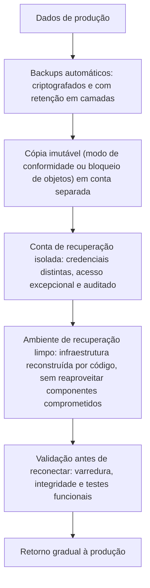

# Arquitetura de Resiliência e Recuperação Segura

> **Objetivo pedagógico:** projetar a resiliência e a recuperação como parte da arquitetura de segurança: traduzir RTO e RPO em estratégias de recuperação (backup e restauração, luz piloto, espera aquecida e multissite ativo), projetar backups imutáveis e ambientes de recuperação isolados contra ransomware, identificar dependências e pontos únicos de falha, projetar degradação controlada, e comprovar a resiliência por meio de testes e exercícios proporcionais à criticidade.

## 1. Resiliência como propriedade de segurança

A disponibilidade e a integridade são objetivos de segurança. Em nuvem, a resiliência exige **desenhar para a falha**: de componentes, de zonas, de regiões, de serviços, de credenciais e de ataques (como o ransomware).

| Tipo de falha | Exemplos | Resposta de arquitetura |
|---|---|---|
| Falha de componente | Instância, disco ou contêiner | Redundância e substituição automática |
| Falha de zona de disponibilidade | Problema em um datacenter | Distribuição entre zonas |
| Falha de região ou de serviço regional | Interrupção de serviços regionais | Recuperação em outra região (conforme a criticidade) |
| Falha de serviço global ou de dependência | Identidade, DNS ou rede de entrega | Alternativas, acesso de emergência e degradação controlada |
| Erro humano ou de configuração | Exclusão acidental, mudança incorreta | Versionamento, proteção contra exclusão e reversão |
| Ataque (ransomware, destruição, credenciais comprometidas) | Criptografia ou exclusão de dados e de backups | Backups imutáveis, isolamento e ambiente de recuperação limpo |
| Corrupção de dados | Defeito de aplicação ou ataque à integridade | Pontos de recuperação múltiplos e verificação de integridade |

## 2. Do RTO e do RPO à estratégia

| Termo | Definição |
|---|---|
| RTO (objetivo de tempo de recuperação) | Tempo máximo tolerável para restabelecer o serviço |
| RPO (objetivo de ponto de recuperação) | Perda máxima tolerável de dados, medida em tempo |
| Tempo máximo de interrupção tolerável | Limite além do qual o negócio é seriamente afetado |
| Capacidade mínima | Nível mínimo de serviço aceitável durante a recuperação |

### 2.1 Estratégias de recuperação de desastres


| Estratégia | Descrição | RTO e RPO típicos | Custo relativo |
|---|---|---|---|
| Backup e restauração | Cópias de dados e de configuração restauradas em caso de desastre | Horas a dias | Baixo |
| Luz piloto (*pilot light*) | Dados replicados e núcleo mínimo da aplicação pronto; o restante é provisionado ao ativar | Dezenas de minutos a poucas horas | Moderado |
| Espera aquecida (*warm standby*) | Ambiente completo em escala reduzida, sempre em execução | Minutos a poucas horas | Alto |
| Multissite ativo e ativo | Aplicação em várias regiões, atendendo tráfego simultaneamente | Próximos de zero | Muito alto; exige arquitetura de dados distribuída |

### 2.2 Camadas de criticidade (exemplo)

| Camada | Descrição | RTO e RPO | Estratégia | Teste |
|---|---|---|---|---|
| 0 | Serviços críticos de missão, com impacto imediato em clientes e em obrigações regulatórias | RTO de até 1 hora; RPO de até 5 minutos | Espera aquecida ou multissite ativo em duas regiões | Trimestral |
| 1 | Serviços importantes | RTO de até 4 horas; RPO de até 15 minutos | Luz piloto ou espera aquecida | Semestral |
| 2 | Serviços de suporte | RTO de até 24 horas; RPO de até 4 horas | Backup e restauração com automação | Anual |
| 3 | Serviços não críticos e ambientes de teste | RTO de dias; RPO de até 24 horas | Backup e reconstrução por código | Por amostragem |

Os valores são **exemplos**: derive os seus da análise de impacto nos negócios (BIA).

## 3. Recuperação segura contra ransomware e destruição de dados

O ransomware moderno procura **destruir os backups** e **usar credenciais administrativas**. A arquitetura deve assumir que o atacante terá acesso ao ambiente de produção.



| Controle | Descrição |
|---|---|
| Imutabilidade | Retenção que impede alteração e exclusão durante o período (modo de conformidade, bloqueio de objetos e bloqueios legais) |
| Isolamento de contas e de credenciais | Conta de recuperação separada, sem relação de confiança que permita o acesso a partir da produção |
| Regra 3-2-1-1 | 3 cópias, em 2 tipos de mídia ou de serviço, 1 fora do domínio principal e 1 imutável |
| Pontos de recuperação múltiplos | Várias versões ao longo do tempo, pois a corrupção pode passar despercebida |
| Verificação de integridade | Varreduras e testes de restauração periódicos |
| Reconstrução por código | Infraestrutura recriada por código em ambiente limpo; evitar restaurar sistemas comprometidos |
| Identidade restaurada primeiro | A recuperação começa pela identidade e pelos segredos confiáveis (rotação de credenciais) |
| Chaves e segredos | Cópias protegidas das chaves necessárias para decifrar backups |
| Documentação e acesso offline | Procedimentos e contatos disponíveis mesmo sem os sistemas principais |
| Planos de comunicação | Papéis, decisão de acionamento e comunicação (pasta 22) |

## 4. Dependências e degradação controlada

| Tema | Prática |
|---|---|
| Mapa de dependências | Listar serviços do provedor, identidade, DNS, rede de entrega, bibliotecas, parceiros e pessoas dos quais a carga depende |
| Pontos únicos de falha | Identificar e tratar (alternativas, redundância e acesso de emergência) |
| Dependências circulares | Evitar que a recuperação dependa do que está indisponível (por exemplo, o repositório de código ou o provedor de identidade necessário para restaurar) |
| Degradação controlada (*graceful degradation*) | Projetar para funcionar com funcionalidades reduzidas quando um componente falha (por exemplo, leitura sem escrita) |
| Disjuntores e limites | Evitar falhas em cascata com tempos limites, tentativas controladas e isolamento (*bulkheads*) |
| Capacidade | Garantir cotas e capacidade na região de recuperação |
| Configuração em código | Ambientes reproduzíveis |
| Isolamento de falhas por células | Reduzir o impacto (arquivo 3) |

## 5. Testes e exercícios de resiliência

| Teste | Objetivo | Frequência |
|---|---|---|
| Teste de restauração de backups | Comprovar que os dados são recuperáveis e íntegros | Conforme a camada (trimestral a anual) |
| Teste de reconstrução de ambiente por código | Comprovar que a infraestrutura pode ser recriada | Semestral |
| Exercício de recuperação de região (*game day*) | Medir o RTO e o RPO reais; descobrir dependências ocultas | Conforme a camada |
| Teste de acesso de emergência | Comprovar que há acesso sem o provedor de identidade principal | Semestral |
| Exercício de ransomware | Testar decisão, isolamento, recuperação e comunicação | Anual |
| Experimentos de caos (*chaos engineering*) | Injetar falhas controladas para verificar a resiliência | Contínuo, em ambientes preparados |
| Exercício de mesa | Testar decisões e comunicação | Semestral |

Registre os resultados: **RTO e RPO medidos**, falhas encontradas, ações corretivas e data do próximo teste. Um plano **não testado** deve ser tratado como **não funcional**.

```bash
# Exemplo (AWS): verificar a configuração de bloqueio de objetos em um bucket de backups (somente leitura)
aws s3api get-object-lock-configuration --bucket backups-exemplo-recuperacao

# Exemplo (AWS): listar planos de backup configurados (substitua a região, se necessário)
aws backup list-backup-plans --query "BackupPlansList[].[BackupPlanName,BackupPlanId]" --output table
```

## 6. Exemplo prático: arquitetura de recuperação de uma plataforma de pagamentos

| Elemento | Decisão |
|---|---|
| Camada de criticidade | 0: RTO de 1 hora; RPO de 5 minutos |
| Estratégia | Espera aquecida em segunda região, com replicação contínua do banco |
| Backups | Automáticos a cada hora; cópia imutável diária em conta de recuperação isolada, com retenção de 35 dias e mensal por 12 meses |
| Identidade | Contas de emergência independentes; credenciais de recuperação em cofre físico |
| Chaves | Chaves replicadas na região de recuperação; cópia protegida fora do domínio principal |
| Reconstrução | Infraestrutura 100% por código; imagens verificadas |
| Dependências | Mapeadas: DNS secundário; provedor de identidade com acesso de emergência |
| Testes | Restauração mensal automatizada; exercício de recuperação regional trimestral (RTO medido: 52 minutos); exercício de ransomware anual |
| Resultado | RTO e RPO medidos dentro das metas; duas dependências ocultas corrigidas após o primeiro exercício |

## 7. Casos de uso corporativos

- Definição de camadas de criticidade e de estratégias de recuperação alinhadas ao negócio.
- Projeto de recuperação resistente a ransomware com cópias imutáveis e ambiente limpo.
- Programa de testes de resiliência com métricas de RTO e de RPO medidos.

## 8. Normas e frameworks relevantes

- ISO 22301:2019 (continuidade de negócios); ISO/IEC 27031 (continuidade de TIC); ISO/IEC 27002:2022 (5.29, 5.30, 8.13 e 8.14)
- NIST SP 800-34 Rev. 1 (planejamento de contingência); NIST SP 800-184 (recuperação de incidentes de segurança); NIST IR 8374 (gestão de riscos de ransomware)
- CSA CCM v4 (BCR); Pilar de confiabilidade dos frameworks de boas práticas de arquitetura; NIST CSF 2.0 (RC, recuperar)
- Resolução CMN 4.893/2021 (continuidade de negócios para instituições financeiras)

## 9. Checklist operacional: resiliência e recuperação segura

- [ ] Camadas de criticidade definidas, com RTO e RPO derivados da análise de impacto nos negócios
- [ ] Estratégia de recuperação escolhida e justificada por camada
- [ ] Backups automáticos, criptografados e com retenção em camadas
- [ ] Cópias imutáveis em conta separada e isolada, com credenciais distintas
- [ ] Ambiente de recuperação limpo reconstruível por código
- [ ] Mapa de dependências e pontos únicos de falha tratados; sem dependências circulares na recuperação
- [ ] Acesso de emergência independente do provedor de identidade principal
- [ ] Chaves e segredos necessários à recuperação protegidos e replicados
- [ ] Testes periódicos com RTO e RPO medidos e registrados
- [ ] Exercício anual de ransomware e de mesa; lições incorporadas

## 10. Referências

- ISO 22301:2019. Security and resilience: Business continuity management systems.
- Swanson, M. et al. NIST SP 800-34 Rev. 1: Contingency Planning Guide for Federal Information Systems. 2010.
- Cichonski, P. et al. NIST SP 800-184: Guide for Cybersecurity Event Recovery. 2016.
- NIST. IR 8374: Ransomware Risk Management: A Cybersecurity Framework Profile. 2022.
- Amazon Web Services. Disaster Recovery of Workloads on AWS: Recovery in the Cloud (whitepaper); Microsoft e Google Cloud: guias de confiabilidade e de recuperação de desastres (versões vigentes).
- Rosenthal, C.; Jones, N. Chaos Engineering. O'Reilly, 2020.
