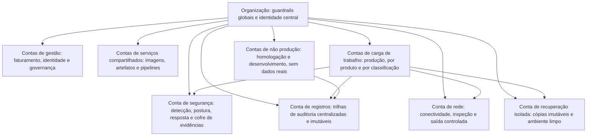
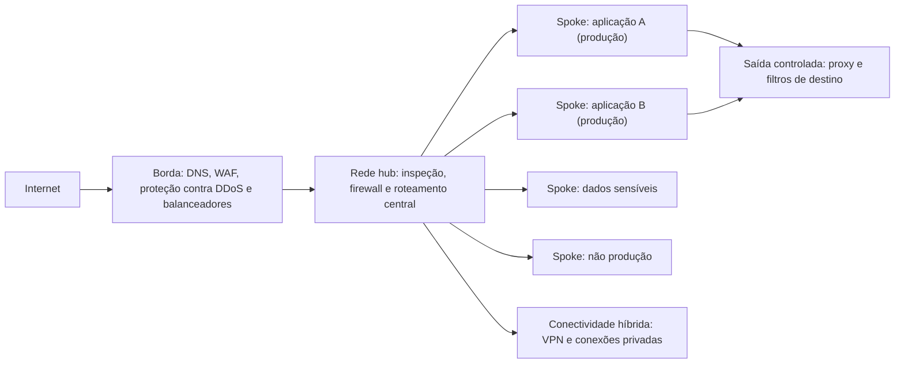
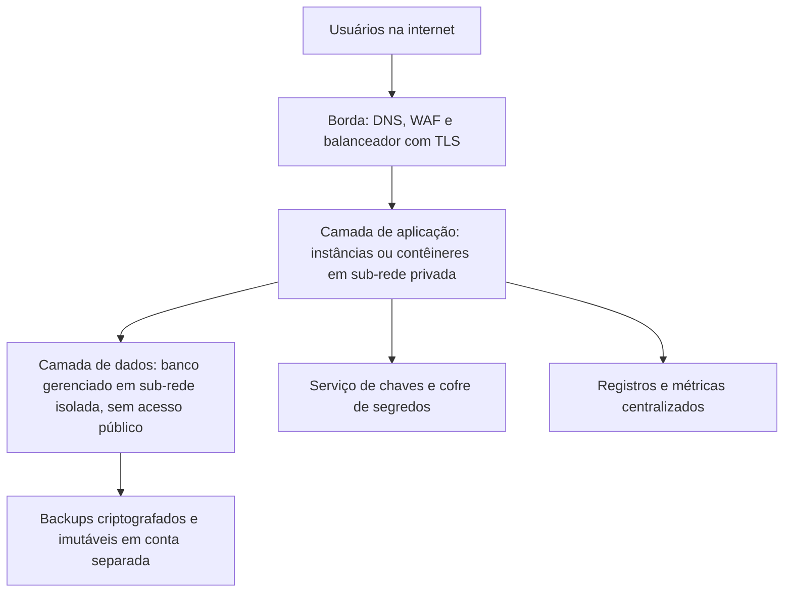

# Arquiteturas de Referência e Padrões de Segurança

> **Objetivo pedagógico:** conhecer e aplicar arquiteturas de referência para ambientes de nuvem (organização multiconta, contas de segurança e de registros, rede em hub e spoke, controle de entrada e de saída) e padrões de segurança para tipos recorrentes de aplicação (aplicação web em três camadas, API sem servidor, aplicação orientada a eventos, plataforma de dados e análise, microsserviços em contêineres, integração com parceiros e conectividade híbrida), identificando em cada um as fronteiras de confiança e os controles obrigatórios.

## 1. Arquitetura de referência do ambiente (organização multiconta)

| Conta ou unidade | Função de segurança | Controles-chave |
|---|---|---|
| Gestão e identidade | Controle da organização e das identidades | Contas de emergência protegidas; acesso mínimo; MFA resistente a phishing; sem cargas de trabalho |
| Segurança | Operação de segurança | Acesso de leitura às demais contas; serviços de detecção e de postura; repositório de evidências forenses |
| Registros | Preservação de registros | Armazenamento imutável, acesso restrito e retenção definida; os administradores das cargas não podem alterar |
| Rede | Conectividade e inspeção | Roteamento central, firewall, filtros de saída e inspeção; administração restrita |
| Serviços compartilhados | Insumos comuns | Registro de imagens verificadas, repositório de artefatos, pipelines padronizados |
| Cargas de trabalho | Aplicações | Guardrails herdados; permissões por função; registros enviados à conta de registros |
| Não produção | Desenvolvimento | Sem dados reais; orçamentos; restrição de conectividade com produção |
| Recuperação isolada | Cópias e ambiente limpo | Credenciais separadas; imutabilidade; acesso excepcional e auditado |

## 2. Rede em hub e spoke (referência)

| Elemento | Princípios de segurança |
|---|---|
| Borda | Pontos de entrada únicos e inspecionados; terminação de TLS; WAF; proteção contra negação de serviço |
| Hub | Inspeção do tráfego entre spokes e de entrada e saída; administração separada |
| Spokes | Isolamento por aplicação e por classificação; sem roteamento direto entre spokes, exceto por política |
| Saída | Filtro de destinos (lista permitida), proxy e registros; sem acesso irrestrito à internet |
| Conectividade híbrida | Criptografia, redundância e segmentação das redes locais |
| Serviços privados | Acesso a serviços gerenciados por pontos de extremidade privados, sem tráfego pela internet |
| Registros | Registros de fluxo e de firewall centralizados |

Detalhes de segurança de rede: pasta 08.

## 3. Padrões de segurança por tipo de aplicação

### 3.1 Aplicação web em três camadas

| Camada | Controles obrigatórios |
|---|---|
| Borda | TLS moderno; WAF com regras gerenciadas; limitação de taxa; proteção contra negação de serviço; cabeçalhos de segurança |
| Aplicação | Sub-rede privada; sem acesso administrativo pela internet; identidade de carga com privilégio mínimo; imagens endurecidas e atualizadas; segredos em cofre |
| Dados | Banco sem endereço público; acesso somente da camada de aplicação; criptografia em repouso e em trânsito; auditoria habilitada; backups protegidos |
| Operação | Registros centralizados, alertas, gestão de patches e de vulnerabilidades |

### 3.2 API sem servidor (*serverless*)

| Elemento | Controles obrigatórios |
|---|---|
| Gateway de API | Autenticação (OAuth 2.0 e OpenID Connect), autorização, limitação de taxa, validação de esquema |
| Funções | Uma identidade por função com permissões mínimas; validação das entradas; tempo e memória limitados; sem segredos em variáveis de ambiente em texto claro |
| Dependências | Varredura de dependências e fixação de versões |
| Dados | Acesso por identidade, e não por chaves embutidas; criptografia |
| Registros | Registros estruturados com identificadores de correlação |
| Segurança de eventos | Validação de origem e de integridade das mensagens de eventos |

### 3.3 Aplicação orientada a eventos (filas e mensageria)

| Elemento | Controles obrigatórios |
|---|---|
| Produtores e consumidores | Identidades distintas e permissões mínimas (publicar ou consumir) |
| Filas e tópicos | Política de acesso restrita; criptografia; filas de mensagens mortas monitoradas |
| Conteúdo das mensagens | Evitar dados sensíveis desnecessários; validação do esquema |
| Idempotência e integridade | Proteção contra repetição e adulteração |
| Retenção | Prazos mínimos e exclusão |

### 3.4 Plataforma de dados e análise

| Elemento | Controles obrigatórios |
|---|---|
| Zonas de dados | Camadas (bruta, tratada e consumo), com classificação e controles por zona |
| Acesso | Controle de acesso por dados (linha, coluna e domínio), identidades individuais, acesso temporário a dados restritos |
| Catálogo e linhagem | Inventário, classificação, proprietários e rastreio de origem |
| Anonimização e mascaramento | Dados pessoais e sensíveis minimizados ou pseudonimizados nas zonas de consumo |
| Chaves | Chaves por domínio de dados; controle por quem não administra os dados |
| Exportações | Controladas e registradas; sem cópias em locais não governados |
| Registros | Auditoria de acesso a dados e de consultas |

### 3.5 Microsserviços em contêineres e Kubernetes (visão arquitetural)

| Elemento | Controles obrigatórios |
|---|---|
| Imagens | Origem verificada, assinadas e varridas; imagens mínimas |
| Cluster | Plano de controle privado; RBAC mínimo; políticas de admissão; isolamento por espaço de nomes |
| Rede | Políticas de rede entre serviços (negar por padrão); malha de serviços com autenticação mútua, quando justificada |
| Identidade de cargas | Identidade federada por serviço, sem chaves embutidas |
| Segredos | Cofre externo ou integração com o gerenciador de segredos do provedor |
| Registros e auditoria | Auditoria do cluster e registros das aplicações centralizados |

Detalhes: pastas 19 e 20.

### 3.6 Integração com parceiros e SaaS

| Elemento | Controles obrigatórios |
|---|---|
| Autenticação | Credenciais por parceiro; autenticação forte; rotação |
| Autorização | Escopos mínimos; acesso apenas aos dados necessários |
| Rede | Conectividade privada ou listas de permissão, quando possível |
| Contrato e dados | Acordos de tratamento de dados; minimização |
| Monitoramento | Registros de acesso, alertas de volumes anômalos e revisão periódica |
| Saída | Revogação rápida de acessos de parceiros |

### 3.7 Conectividade híbrida

| Elemento | Controles obrigatórios |
|---|---|
| Enlaces | Redundância; criptografia; segmentação |
| Roteamento | Rotas mínimas; sem trânsito indevido entre redes |
| Identidade | Federação com o diretório corporativo; sem credenciais locais duplicadas |
| Monitoramento | Visibilidade integrada de eventos locais e de nuvem |
| Falha | Procedimento de operação sem o enlace híbrido |

## 4. Matriz de padrões, controles e riscos

| Padrão | Riscos principais (catálogo da pasta 04) | Controles centrais (pastas) |
|---|---|---|
| Aplicação web em três camadas | R-NUV-001, 003, 006, 007, 008 | Borda e rede (08), identidade (06), dados (09), vulnerabilidades (15) |
| API sem servidor | R-NUV-005, 007, 022 | Identidade e APIs (05 e 06), proteção de cargas (18), DevSecOps (21) |
| Orientada a eventos | R-NUV-002, 007 | Identidade e dados (06 e 09) |
| Plataforma de dados | R-NUV-003, 009, 010, 016 | Dados e criptografia (09 e 10), conformidade (11) |
| Microsserviços em contêineres | R-NUV-019, 020, 021 | Contêineres e Kubernetes (19 e 20), DevSecOps (21) |
| Integração com parceiros | R-NUV-010, 024 | Identidade e governança (02, 03 e 06) |
| Híbrida | R-NUV-008, 012 | Rede (08) e resiliência (arquivo 5) |

## 5. Biblioteca de padrões (como organizar)

| Elemento | Descrição |
|---|---|
| Descrição do padrão | Problema, contexto e solução |
| Diagrama | Componentes, fluxos e fronteiras de confiança |
| Controles obrigatórios e opcionais | Lista verificável |
| Implementação | Módulos de infraestrutura como código e exemplos |
| Verificações | Regras de política e testes automatizados |
| Riscos tratados e residuais | Referência ao catálogo de riscos |
| Dono e versão | Responsável e histórico de alterações |
| Desvios | Como solicitar exceções |

Os padrões devem ser **fáceis de usar** (caminhos pavimentados, pasta 03) e **mantidos como produto**: com versões, documentação e suporte.

## 6. Exemplo prático: escolha do padrão para um novo serviço

Serviço de consulta de extratos para clientes, com picos de tráfego, dados confidenciais e integração com sistemas locais.

| Decisão | Escolha | Justificativa |
|---|---|---|
| Padrão de aplicação | API em contêineres gerenciados (microsserviços) com banco gerenciado | Picos de carga e equipe com experiência em contêineres |
| Conta | Conta de produção dedicada ao produto; dados em conta separada | Isolamento e raio de impacto |
| Borda | WAF, limitação de taxa, autenticação por OpenID Connect | Exposição à internet |
| Rede | Spoke de produção; pontos de extremidade privados para o banco; saída por proxy | Redução de exposição |
| Integração local | VPN redundante e criptografada; autenticação mútua | Requisitos de integridade |
| Dados | Criptografia com chave gerenciada pelo cliente; mascaramento de campos sensíveis em registros | Classificação confidencial |
| Resiliência | Multi-zona; recuperação em segunda região com RTO de 4 horas | Criticidade alta |

## 7. Casos de uso corporativos

- Catálogo de arquiteturas de referência e de padrões usado por todas as equipes de produto.
- Aceleração de projetos com módulos de infraestrutura como código que já incorporam os controles.
- Base para revisões de arquitetura mais rápidas, com desvios explícitos.

## 8. Normas e frameworks relevantes

- NIST SP 800-204 (série); NIST SP 800-207; NIST SP 800-210; CISA Cloud Security Technical Reference Architecture
- Arquiteturas de referência dos provedores (zonas de aterrissagem e padrões de segurança); CSA CCM v4 (IVS, AIS, DSP, IAM e CEK)
- OWASP ASVS e API Security Top 10; CIS Foundations Benchmarks; PCI DSS v4.0 (segmentação de ambientes de dados de cartão)

## 9. Checklist operacional: arquitetura de referência e padrões

- [ ] Estrutura multiconta definida, com contas de segurança, de registros, de rede e de recuperação
- [ ] Rede em hub e spoke ou equivalente, com borda, inspeção e saída controlada
- [ ] Padrões de aplicação documentados, com controles obrigatórios e módulos de código
- [ ] Biblioteca de padrões com donos, versões e verificações automáticas
- [ ] Serviços gerenciados acessados por pontos privados
- [ ] Registros de todas as contas centralizados na conta de registros
- [ ] Desvios aos padrões tratados como exceções formais
- [ ] Revisão semestral das arquiteturas e dos padrões

## 10. Referências

- Chandramouli, R. NIST SP 800-204. 2019; NIST SP 800-204A e 204B. 2020 e 2021.
- CISA. Cloud Security Technical Reference Architecture. 2022.
- OWASP. Application Security Verification Standard (ASVS) 4.0 e API Security Top 10.
- Amazon Web Services; Microsoft; Google Cloud. Documentação de arquiteturas de referência de segurança e de zonas de aterrissagem (versões vigentes).
- Pastas 01, 03, 08, 09, 18, 19 e 20 deste repositório.
