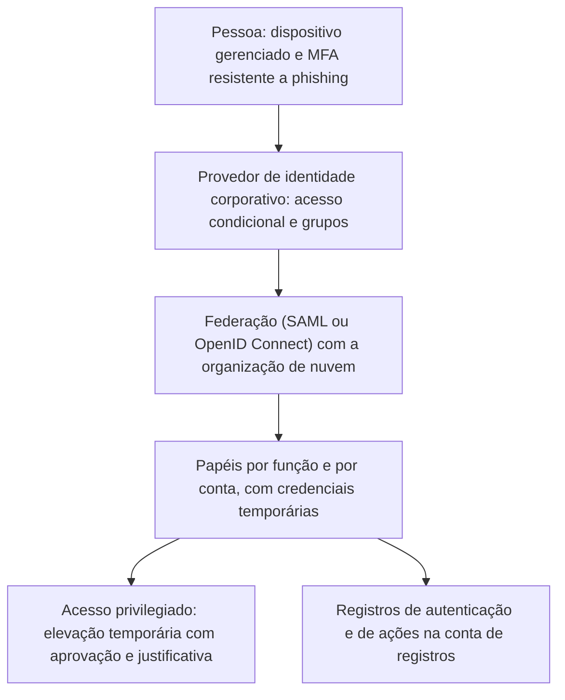
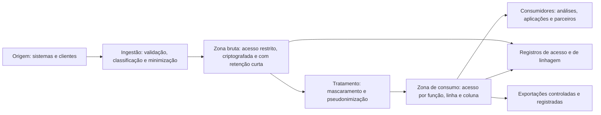
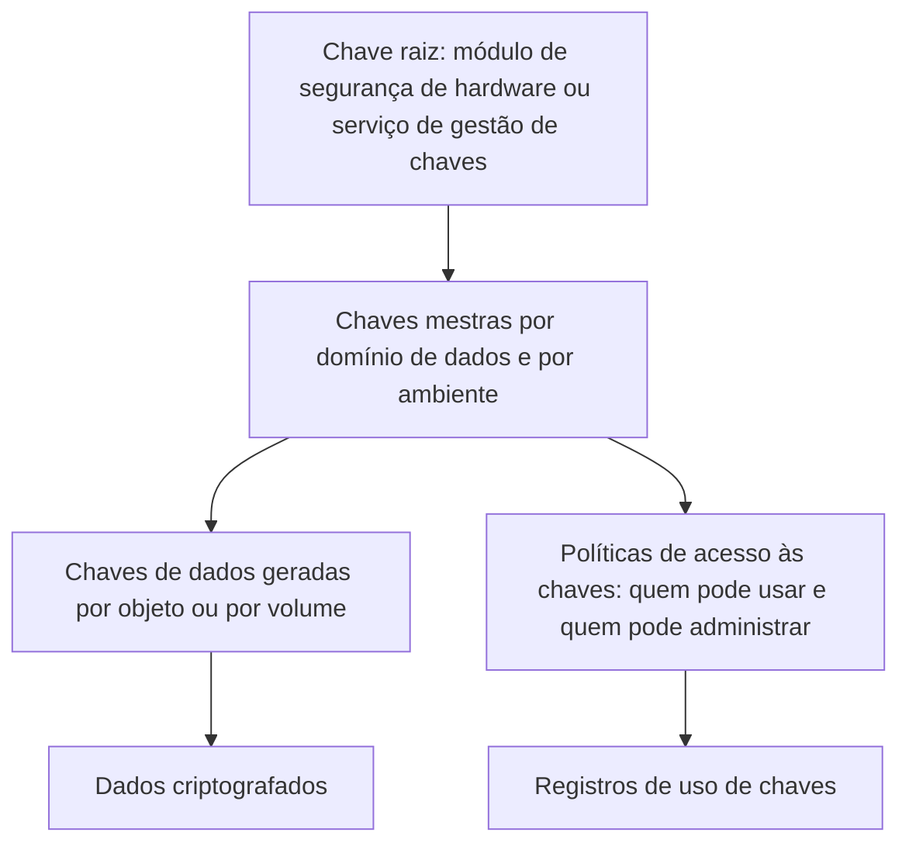

# Desenho de Identidade, Dados e Chaves

> **Objetivo pedagógico:** projetar, em nível de arquitetura, os três pilares que definem a maior parte do risco em nuvem: a identidade (de pessoas e de cargas de trabalho, com federação, acesso temporário e eliminação de credenciais de longa duração), os dados (zonas por classificação, fluxos e pontos de controle) e as chaves e os segredos (hierarquia de chaves, criptografia em envelope, separação de funções e gestão de segredos), conectando as decisões de desenho a controles detalhados nas pastas 06, 09 e 10.

## 1. Arquitetura de identidade

### 1.1 Princípios

| Princípio | Aplicação |
|---|---|
| Fonte única de identidade | Um provedor de identidade corporativo; contas locais nos provedores de nuvem apenas para emergência |
| Federação | Os provedores de nuvem confiam no provedor de identidade corporativo (SSO) |
| Autenticação forte | MFA resistente a phishing para acesso privilegiado e para o plano de controle |
| Privilégio mínimo e temporário | Acesso concedido por papéis específicos, por tempo limitado e com aprovação para privilégios altos |
| Sem credenciais de longa duração | Pessoas e cargas obtêm credenciais temporárias; chaves permanentes são exceção justificada |
| Identidade para cargas de trabalho | Cada carga tem sua identidade, com permissões mínimas e auditoria |
| Separação entre contas | Administradores têm contas separadas das de uso diário |
| Ciclo de vida | Entrada, mudança e saída integradas ao RH; revisão periódica |
| Registro | Autenticações e autorizações registradas e monitoradas |

### 1.2 Padrão de identidade de pessoas



### 1.3 Padrão de identidade de cargas de trabalho

| Cenário | Padrão recomendado | Evitar |
|---|---|---|
| Carga em máquina virtual, contêiner ou função do provedor | Identidade gerenciada, função de serviço ou conta de serviço associada à carga, com credenciais temporárias | Chaves embutidas em arquivos, imagens ou variáveis |
| Pipeline de CI/CD acessando a nuvem | Federação de identidade (OpenID Connect) entre o sistema de CI/CD e o provedor, com condições por repositório e por ramo | Chaves de acesso de longa duração armazenadas no sistema de CI/CD |
| Carga em outro provedor ou local | Federação de identidade de cargas (por exemplo, com certificados ou tokens assinados) | Duplicar chaves entre provedores |
| Acesso de parceiros | Federação ou credenciais por parceiro com escopo mínimo e expiração | Credenciais compartilhadas |
| Aplicações de usuários finais | Provedores de identidade de clientes (OpenID Connect) | Armazenar senhas sem necessidade |

#### Exemplo: função de nuvem assumida por um pipeline por federação (AWS)

```json
{
  "Version": "2012-10-17",
  "Statement": [
    {
      "Effect": "Allow",
      "Principal": {
        "Federated": "arn:aws:iam::111122223333:oidc-provider/token.actions.githubusercontent.com"
      },
      "Action": "sts:AssumeRoleWithWebIdentity",
      "Condition": {
        "StringEquals": {
          "token.actions.githubusercontent.com:aud": "sts.amazonaws.com"
        },
        "StringLike": {
          "token.actions.githubusercontent.com:sub": "repo:organizacao-exemplo/repositorio-exemplo:ref:refs/heads/main"
        }
      }
    }
  ]
}
```

A política de confiança acima permite que somente fluxos de trabalho do repositório e do ramo indicados obtenham credenciais temporárias, **sem chaves armazenadas**. As permissões da função devem ser mínimas e restritas ao ambiente (por exemplo, uma função por ambiente). Valide os campos de condição na documentação vigente do provedor.

### 1.3.1 Decisões de arquitetura de identidade

| Decisão | Opções | Critério |
|---|---|---|
| Quantos provedores de identidade? | Um corporativo (recomendado) ou vários com federação | Simplicidade e governança |
| Onde ficam os grupos e os papéis? | No provedor corporativo, mapeados para papéis na nuvem | Fonte única |
| Elevação de privilégio | Acesso privilegiado sob demanda com aprovação | Redução de privilégios permanentes |
| Contas de emergência | Contas locais independentes, com credenciais físicas em cofre | Continuidade se o provedor de identidade falhar |
| Acesso de terceiros | Contas convidadas com expiração e revisão | Risco de terceiros |

Detalhes: pasta 06 (identidade e acesso) e pasta 07 (zero trust).

## 2. Arquitetura de dados

### 2.1 Zonas de dados por classificação

| Zona | Classificação | Controles de arquitetura |
|---|---|---|
| Pública | Pública | Integridade e controle de alterações; sem dados internos |
| Interna | Interna | Acesso autenticado; criptografia padrão |
| Confidencial | Confidencial | Contas ou projetos dedicados quando houver grande volume; chaves gerenciadas pelo cliente; registros de acesso; regiões aprovadas |
| Restrita (cofre de dados) | Restrita | Conta e rede dedicadas; chaves exclusivas e controladas pela organização; acesso nominal e temporário; monitoramento reforçado; sem cópias fora da zona |

### 2.2 Fluxos de dados e pontos de controle



| Ponto de controle | Perguntas de arquitetura |
|---|---|
| Entrada | Os dados são validados e classificados na origem? Coletamos apenas o necessário? |
| Armazenamento | Em que zona estão? Quem acessa? Qual a retenção? |
| Tratamento | Quando e onde ocorre o mascaramento e a pseudonimização? |
| Saída e compartilhamento | Que exportações e que acessos de terceiros existem? São registrados? |
| Eliminação | Como os dados e as cópias são eliminados? |

### 2.3 Decisões de arquitetura de dados

| Decisão | Considerações |
|---|---|
| Residência e regiões | Regiões aprovadas por classificação; replicação e backups |
| Isolamento | Conta ou projeto dedicado para dados restritos |
| Tokenização ou pseudonimização | Reduz o escopo de conformidade (por exemplo, dados de cartão) |
| Acesso por atributos | Controle de acesso em nível de linha, de coluna e por finalidade |
| Cópias e ambientes não produtivos | Dados sintéticos ou anonimizados fora da produção |
| Catálogo e linhagem | Inventário e rastreabilidade como requisito |

Detalhes: pasta 09 (proteção de dados).

## 3. Arquitetura de chaves e de segredos

### 3.1 Criptografia em envelope e hierarquia de chaves



| Elemento | Princípio |
|---|---|
| Chaves mestras por domínio | Chaves distintas por classificação, por ambiente e, quando necessário, por cliente |
| Criptografia em envelope | Chaves de dados criptografadas por chaves mestras, o que facilita a rotação e a revogação |
| Separação de funções | Quem administra as chaves não usa para decifrar; quem administra dados não administra as chaves |
| Quem controla a chave | Chaves gerenciadas pelo provedor (menor esforço), gerenciadas pelo cliente (mais controle) ou fornecidas e mantidas fora do provedor (maior controle e maior responsabilidade) |
| Rotação e revogação | Rotação automática, plano de revogação e de recuperação |
| Perda de chaves | A perda de uma chave pode significar a perda dos dados: backup e proteção contra exclusão acidental |
| Uso e auditoria | Registro de cada uso e alertas para uso anômalo |
| Localização | Região das chaves compatível com a residência dos dados |

### 3.2 Arquitetura de segredos

| Tema | Padrão |
|---|---|
| Armazenamento | Cofre de segredos gerenciado, com controle de acesso por identidade e registros |
| Entrega às cargas | Injeção em tempo de execução por identidade da carga; evitar variáveis de ambiente em texto claro quando possível |
| Rotação | Rotação automática de senhas e de tokens; segredos de curta duração |
| Dinamismo | Credenciais dinâmicas para bancos e serviços, geradas sob demanda e expiráveis |
| Detecção | Varredura de segredos em repositórios, imagens e logs |
| Resposta | Procedimento de revogação e de rotação imediata em caso de exposição |

Detalhes: pasta 10 (criptografia) e pasta 21 (DevSecOps).

## 4. Dependências e pontos únicos de falha de identidade, dados e chaves

| Ponto | Risco | Mitigação de arquitetura |
|---|---|---|
| Provedor de identidade | Falha ou comprometimento afeta todo o acesso | Contas de emergência independentes; monitoramento; recuperação documentada |
| Serviço de chaves | Indisponibilidade impede o acesso a dados | Chaves em várias regiões para sistemas críticos; testes de falha |
| Cofre de segredos | Falha impede o início de cargas | Cache seguro com validade curta e redundância |
| Federação com o pipeline | Comprometimento do sistema de CI/CD permite acesso à nuvem | Condições estritas, funções por ambiente, aprovação para produção |

## 5. Exemplo prático: arquitetura de dados e de chaves para uma plataforma de saúde

| Elemento | Decisão |
|---|---|
| Classificação | Prontuários: restrito (dados sensíveis); estatísticas anonimizadas: confidencial |
| Zonas | Conta dedicada ao cofre de dados clínicos, na região do Brasil; conta de análises com dados pseudonimizados |
| Identidade | SSO corporativo; acesso nominal e temporário aos dados clínicos; funções de carga por serviço; pipeline por federação |
| Chaves | Chaves mestras exclusivas do cofre clínico, gerenciadas pela organização; administradores de chaves distintos dos administradores de dados; registros de uso de chaves com alertas |
| Fluxo | Ingestão com validação e minimização; pseudonimização antes da zona de análises; exportações apenas com aprovação do DPO |
| Segredos | Cofre gerenciado; credenciais dinâmicas para o banco; varredura de segredos nos repositórios |
| Resiliência | Chaves e dados replicados em segunda região no Brasil; testes semestrais |

## 6. Casos de uso corporativos

- Definição do modelo de identidade de pessoas e de cargas para toda a organização.
- Projeto de zonas de dados e de hierarquia de chaves para plataformas críticas.
- Eliminação de credenciais de longa duração em pipelines e em aplicações.

## 7. Normas e frameworks relevantes

- NIST SP 800-63 (identidade digital); NIST SP 800-57 (gestão de chaves); NIST SP 800-207 (zero trust); NIST SP 800-210
- CSA CCM v4 (IAM, CEK e DSP); ISO/IEC 27002:2022 (5.15 a 5.18, 8.5, 8.24 e 5.12)
- NCSC princípios 9, 10 e 12; OWASP ASVS (autenticação, gestão de segredos e criptografia)
- LGPD, arts. 6º, 11, 33 a 36 e 46

## 8. Checklist operacional: identidade, dados e chaves em nível de desenho

- [ ] Provedor de identidade único, com federação e acesso condicional
- [ ] MFA resistente a phishing para acessos privilegiados e para o plano de controle
- [ ] Contas de emergência independentes, protegidas e testadas
- [ ] Sem credenciais de longa duração em cargas e em pipelines (federação e identidades gerenciadas)
- [ ] Zonas de dados definidas por classificação, com contas ou projetos dedicados para dados restritos
- [ ] Fluxos de dados documentados, com pontos de controle e exportações registradas
- [ ] Hierarquia de chaves definida, com separação de funções e registros de uso
- [ ] Cofre de segredos com injeção por identidade, rotação e varredura
- [ ] Pontos únicos de falha de identidade, de chaves e de segredos tratados
- [ ] Revisão anual das decisões de identidade, dados e chaves

## 9. Referências

- Grassi, P. et al. NIST SP 800-63-3 (e revisão 4). Digital Identity Guidelines.
- Barker, E. NIST SP 800-57 Part 1 Rev. 5: Recommendation for Key Management. 2020.
- Hu, V. et al. NIST SP 800-210: General Access Control Guidance for Cloud Systems. 2020.
- OWASP. Application Security Verification Standard 4.0.
- GitHub. Documentação sobre OpenID Connect em fluxos de trabalho; Amazon Web Services. Documentação de federação de identidade com OIDC (versões vigentes).
- Pastas 06, 07, 09, 10 e 21 deste repositório.
