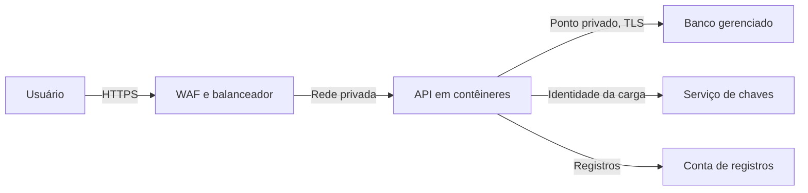

# Ferramentas, Diagramas, Modelos e Checklist de Arquitetura

> **Objetivo pedagógico:** documentar a arquitetura de segurança com diagramas como código (Mermaid e o modelo C4 com Structurizr), apoiar-se em ferramentas de modelagem de ameaças e de infraestrutura como código, verificar a exposição e a topologia de rede nos três provedores com comandos de **somente leitura**, e usar modelos (ficha de arquitetura, matriz de requisitos e controles) e um checklist de base de arquitetura de segurança.

> **Segurança:** os comandos apenas **consultam** configurações. Use identidades de leitura em contas autorizadas e registre as saídas como evidência. Identificadores são fictícios; as opções dos comandos variam entre versões: confirme na documentação.

## 1. Ferramentas por finalidade

| Finalidade | Ferramentas |
|---|---|
| Diagramas como código | Mermaid (renderizado no GitHub), Structurizr (DSL do modelo C4), PlantUML, Diagrams (Python) |
| Diagramas visuais | draw.io (diagrams.net), ferramentas de arquitetura dos provedores, bibliotecas de ícones oficiais |
| Modelagem de ameaças | OWASP Threat Dragon, Microsoft Threat Modeling Tool, planilhas de STRIDE (pasta 14) |
| Infraestrutura como código | Terraform, OpenTofu, CloudFormation, Bicep e Pulumi |
| Políticas e verificação | Open Policy Agent, Checkov, tfsec, Trivy e políticas nativas dos provedores |
| Inventário e topologia | AWS Config e consultas à API, Azure Resource Graph, Cloud Asset Inventory |
| Análise de permissões efetivas | Ferramentas de análise de acessos dos provedores e de gestão de privilégios na nuvem (pasta 06) |
| Registro de decisões | Arquivos Markdown versionados (ADR), repositório Git |

## 2. Diagramas como código

### 2.1 Mermaid (já usado neste repositório)

Vantagens: renderização nativa no GitHub, versionamento e revisão por diferenças. Limitações: layout automático e menos recursos para diagramas muito grandes.



### 2.2 Modelo C4 com Structurizr (DSL)

O modelo C4 organiza a documentação em quatro níveis: **contexto**, **contêineres**, **componentes** e **código**. A DSL do Structurizr descreve o modelo uma vez e gera várias visões.

```
workspace "Plataforma de Extratos" "Arquitetura de referência" {
  model {
    cliente = person "Cliente" "Consulta extratos"
    sistema = softwareSystem "Plataforma de Extratos" {
      api = container "API de extratos" "Autentica e consulta dados" "Contêiner"
      banco = container "Banco gerenciado" "Armazena extratos (dados confidenciais)" "Banco de dados"
    }
    idp = softwareSystem "Provedor de identidade corporativo" "Autenticação dos clientes"
    cliente -> api "Consulta extratos" "HTTPS"
    api -> banco "Lê dados" "TLS, ponto privado"
    api -> idp "Valida identidade" "OpenID Connect"
  }
  views {
    container sistema "Contêineres" {
      include *
      autolayout lr
    }
    theme default
  }
}
```

Boas práticas: um diagrama por nível de detalhe; **fronteiras de confiança** destacadas; legendas; versão e data; revisão conjunta com o código.

### 2.3 Elementos obrigatórios de um diagrama de segurança

| Elemento | Descrição |
|---|---|
| Fronteiras de confiança | Limites entre zonas, contas e redes |
| Fluxos de dados | Direção, protocolo e proteção (TLS, mTLS) |
| Identidades | Como cada componente se autentica |
| Dados e classificação | O que trafega e onde é armazenado |
| Pontos de entrada e de saída | Exposição à internet e conexões com terceiros |
| Registros e monitoramento | Para onde vão os registros |
| Legenda, versão e responsável | Para manutenção |

## 3. Verificações de topologia e de exposição (somente leitura)

### 3.1 AWS

```bash
# Redes virtuais, sub-redes e rotas
aws ec2 describe-vpcs --query "Vpcs[].[VpcId,CidrBlock,Tags[?Key=='Name']|[0].Value]" --output table
aws ec2 describe-subnets --query "Subnets[].[SubnetId,VpcId,CidrBlock,MapPublicIpOnLaunch]" --output table
aws ec2 describe-route-tables --query "RouteTables[].[RouteTableId,VpcId,Routes[?GatewayId!=null].GatewayId|join(',',@)]" --output table

# Gateways de internet e conexões entre redes
aws ec2 describe-internet-gateways --query "InternetGateways[].[InternetGatewayId,Attachments[0].VpcId]" --output table
aws ec2 describe-vpc-peering-connections --query "VpcPeeringConnections[].[VpcPeeringConnectionId,RequesterVpcInfo.VpcId,AccepterVpcInfo.VpcId,Status.Code]" --output table

# Interfaces de rede com endereço IP público (superfície de exposição direta)
aws ec2 describe-network-interfaces \
  --query "NetworkInterfaces[?Association.PublicIp!=null].[NetworkInterfaceId,Association.PublicIp,Description]" --output table
```

### 3.2 Azure

```bash
# Redes virtuais e peerings
az network vnet list --query "[].{nome:name,rg:resourceGroup,espaco:addressSpace.addressPrefixes[0]}" --output table
az network vnet peering list --resource-group RG-EXEMPLO --vnet-name VNET-EXEMPLO --output table

# Grupos de segurança de rede e endereços IP públicos
az network nsg list --query "[].{nome:name,rg:resourceGroup}" --output table
az network public-ip list --query "[].{nome:name,ip:ipAddress,rg:resourceGroup}" --output table
```

### 3.3 Google Cloud

```bash
# Redes, sub-redes e regras de firewall
gcloud compute networks list
gcloud compute networks subnets list --format="table(name,region,network.basename(),ipCidrRange)"
gcloud compute firewall-rules list --format="table(name,network.basename(),direction,priority,sourceRanges.list(),allowed[].map().firewall_rule().list())"

# Instâncias com endereço IP externo
gcloud compute instances list --format="table(name,zone.basename(),networkInterfaces[0].accessConfigs[0].natIP)"
```

Compare o resultado com os **diagramas de arquitetura** e com os padrões: qualquer recurso exposto que não apareça no diagrama indica **desvio** (ou diagrama desatualizado).

```sql
-- DuckDB: comparar exposição esperada e observada (arquivos CSV exportados: esperado.csv e observado.csv com a coluna "recurso")
SELECT o.recurso AS exposto_sem_registro_no_diagrama
FROM read_csv_auto('observado.csv') o
LEFT JOIN read_csv_auto('esperado.csv') e USING (recurso)
WHERE e.recurso IS NULL;
```

## 4. Modelos

### 4.1 Ficha de arquitetura de segurança de uma solução

| Seção | Conteúdo |
|---|---|
| Identificação | Nome, proprietário, arquiteto responsável, data e versão |
| Descrição e objetivo | Finalidade, usuários e criticidade (RTO e RPO) |
| Classificação de dados | Tipos, dados pessoais e sensíveis, regiões |
| Diagramas | Contexto, contêineres, fluxos de dados e fronteiras de confiança |
| Padrões e arquiteturas de referência usados | Referências e versões |
| Controles por camada | Identidade, rede, dados, aplicação, registros e resiliência |
| Dependências e fornecedores | Serviços, parceiros e planos de saída |
| Riscos e tratamento | Riscos principais, controles e riscos residuais (pasta 04) |
| Decisões e exceções | ADRs e exceções aprovadas |
| Verificações automáticas | Políticas, testes e relatórios de postura |
| Responsabilidade compartilhada | Matriz P, C e S dos serviços (pasta 02) |
| Revisões | Data, resultado e próximas revisões |

### 4.2 Matriz de requisitos e controles

| ID do requisito | Requisito de segurança | Origem (risco, norma ou negócio) | Controle de arquitetura | Implementação (código ou política) | Verificação (teste ou relatório) | Status |
|---|---|---|---|---|---|---|
| RS-001 | Nenhum banco com acesso público | R-NUV-003; CCM IVS | Ponto privado e política de organização | Módulo `banco-privado`; política de negação | Relatório de postura; teste de arquitetura | |
| RS-002 | Credenciais de curta duração em pipelines | R-NUV-005 e 020; NCSC 10 | Federação de identidade do pipeline | Função de confiança por repositório e ramo | Verificação de chaves permanentes igual a zero | |

### 4.3 Matriz de decisões de arquitetura (índice de ADRs)

| ADR | Título | Status | Data | Solução | Dono | Verificação |
|---|---|---|---|---|---|---|
| ADR-0001 | | | | | | |

## 5. Checklist de base da arquitetura de segurança de uma solução

**Solução:** ____________________
**Arquiteto responsável:** ____________________
**Data:** ____________________

### 5.1 Documentação

- [ ] Diagramas de contexto, de contêineres e de fluxo de dados atualizados, com fronteiras de confiança
- [ ] Classificação dos dados e criticidade (RTO e RPO) documentadas
- [ ] Padrões e arquiteturas de referência identificados
- [ ] ADRs para as decisões relevantes e exceções registradas

### 5.2 Identidade e acesso

- [ ] Identidades de pessoas federadas, com MFA resistente a phishing em acessos privilegiados
- [ ] Identidades de cargas e de pipelines sem credenciais de longa duração
- [ ] Privilégio mínimo e acesso temporário para operações sensíveis

### 5.3 Rede, isolamento e exposição

- [ ] Conta, assinatura ou projeto adequados ao ambiente e à classificação
- [ ] Rede segmentada, com negação por padrão, borda protegida e saída controlada
- [ ] Serviços gerenciados acessados por pontos privados; sem endereços públicos não justificados
- [ ] Verificação de exposição executada e conciliada com o diagrama

### 5.4 Dados, chaves e segredos

- [ ] Criptografia em repouso e em trânsito; chaves definidas, com separação de funções
- [ ] Segredos em cofre, com rotação e varredura
- [ ] Zonas de dados e fluxos documentados; exportações controladas

### 5.5 Resiliência, registros e operação

- [ ] Estratégia de recuperação definida e testada; backups imutáveis e isolados
- [ ] Registros centralizados, retidos e protegidos; alertas definidos
- [ ] Verificação contínua de postura e de políticas ativa
- [ ] Plano de resposta a incidentes e contatos definidos
- [ ] Revisão de arquitetura realizada e condições verificadas

## 6. Resultado da verificação

| Resultado | Condição |
|---|---|
| Conforme | Todos os itens aplicáveis marcados |
| Conforme com ressalvas | Pendências sem exposição de dados nem de acesso privilegiado, com plano de ação e prazo |
| Não conforme | Exposição pública de dados, credenciais de longa duração com privilégios amplos, ausência de registros ou de backups; não liberar para produção |

**Assinatura do arquiteto:** ____________________
**Assinatura da segurança:** ____________________

## 7. Exemplo prático: conciliação entre diagrama e ambiente real

| Verificação | Resultado | Ação |
|---|---|---|
| Interfaces com IP público | 7 encontradas; 4 constam no diagrama (balanceadores) | Investigar as 3 restantes: 2 eram instâncias de teste esquecidas; 1 era um servidor de administração com SSH aberto |
| Peerings entre redes | 3 conexões; 1 entre produção e desenvolvimento não prevista | Remover o peering e rever as rotas |
| Regras de firewall com origem 0.0.0.0/0 | 5 regras | Restringir ou justificar; 2 removidas |
| Diagramas | 40% desatualizados | Gerar diagramas a partir do código e revisar a cada mudança |

## 8. Casos de uso corporativos

- Documentação de arquitetura como código, revisada junto ao código da infraestrutura.
- Conciliação periódica entre diagramas e ambiente real, como controle de desvios.
- Padronização de fichas, matrizes e ADRs entre as equipes.

## 9. Normas e frameworks relevantes

- ISO/IEC/IEEE 42010:2022; modelo C4 (Simon Brown); STRIDE (modelagem de ameaças)
- CSA CCM v4 (IVS, IAM, CEK, LOG e BCR); CIS Foundations Benchmarks; NIST SP 800-160 Vol. 1
- ISO/IEC 27002:2022 (8.20 a 8.22, segurança de redes; 5.9, inventário)

## 10. Referências

- Brown, S. The C4 Model for Visualising Software Architecture. https://c4model.com
- Structurizr. Documentação da DSL. https://structurizr.com
- Mermaid. Documentação oficial. https://mermaid.js.org
- OWASP. Threat Dragon; Microsoft. Threat Modeling Tool (documentação).
- Documentação das ferramentas de linha de comando: AWS CLI, Azure CLI e Google Cloud CLI.
- Pastas 02, 04, 14 e 17 deste repositório.
