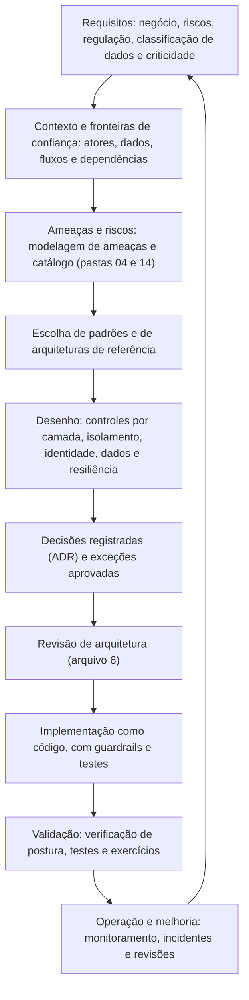

# Fundamentos de Arquitetura de Segurança em Nuvem

> **Objetivo pedagógico:** compreender o que é arquitetura de segurança e como ela se relaciona com a arquitetura corporativa e de soluções; conhecer os referenciais (SABSA, NIST SP 800-160, princípios de projeto dos provedores, os princípios de segurança em nuvem do NCSC e a arquitetura técnica de referência da CISA); entender o processo de arquitetar (requisitos, ameaças, padrões, decisões, revisão e validação); e distinguir os artefatos de arquitetura (princípios, padrões, arquiteturas de referência e projetos).

## 1. O que é arquitetura de segurança

Arquitetura de segurança é a **definição estruturada de como os controles de segurança se organizam e se relacionam** para proteger os objetivos de negócio. Ela responde: *que fronteiras, que controles, em que camadas, com que dependências e com que justificativas?*

| Conceito | Descrição |
|---|---|
| Arquitetura corporativa | Visão de negócios, de informação, de aplicações e de tecnologia da organização |
| Arquitetura de soluções | Desenho de um sistema específico, que atende a requisitos funcionais e não funcionais |
| Arquitetura de segurança | Dimensão transversal que define os requisitos, os padrões e os controles que as demais arquiteturas devem seguir |
| Arquitetura de referência | Modelo reutilizável para uma classe de soluções, com controles já incorporados |
| Padrão (pattern) | Solução reutilizável para um problema recorrente (por exemplo, acesso privado a bancos de dados) |
| Linha de base (baseline) | Configuração mínima obrigatória de um tipo de recurso |
| Decisão de arquitetura | Escolha entre alternativas, registrada com contexto e consequências |

Em nuvem, a arquitetura de segurança tem uma particularidade: **a infraestrutura é definida em código e criada por interfaces programáveis**. Por isso, a arquitetura pode (e deve) ser **verificável automaticamente**.

## 2. Camadas de arquitetura: o modelo SABSA

O SABSA (Sherwood Applied Business Security Architecture) conecta a segurança aos objetivos de negócio por camadas de abstração:

| Camada | Visão | Pergunta | Exemplo em nuvem |
|---|---|---|---|
| Contextual | Negócio | Por que a segurança é necessária? | Proteger dados de clientes e manter a disponibilidade do serviço de pagamentos |
| Conceitual | Arquiteto | O que a segurança precisa fazer? | Princípios: privilégio mínimo, zero trust, defesa em profundidade |
| Lógica | Projetista | Como os serviços de segurança se relacionam? | Serviços de identidade, de registro, de criptografia e de rede, com fluxos entre eles |
| Física | Construtor | Com que tecnologias e configurações? | Serviços e produtos específicos de um provedor, com configurações |
| Componente | Implementador | Que produtos, ferramentas e padrões? | Módulos de infraestrutura como código, agentes e políticas |
| Operacional | Operação | Como se opera e se mantém? | Monitoramento, gestão de mudanças, resposta a incidentes |

A rastreabilidade entre as camadas permite demonstrar que cada controle técnico existe por uma razão de negócio.

## 3. Referenciais de arquitetura de segurança em nuvem

| Referencial | Contribuição |
|---|---|
| NIST SP 800-160 Vol. 1 Rev. 1 | Engenharia de sistemas confiáveis e seguros: processos e princípios de projeto de segurança ao longo do ciclo de vida |
| NIST SP 800-204 (série) | Estratégias de segurança para aplicações baseadas em microsserviços; controle de acesso baseado em atributos; malha de serviços e DevSecOps |
| NIST SP 800-210 | Orientações de controle de acesso para sistemas em nuvem |
| NIST SP 800-207 | Arquitetura Zero Trust (pasta 07) |
| AWS Well-Architected Framework, pilar de segurança | Princípios: base forte de identidade, rastreabilidade, segurança em todas as camadas, automação, proteção de dados em trânsito e em repouso, afastar as pessoas dos dados e preparação para eventos de segurança |
| Microsoft Azure Well-Architected Framework, pilar de segurança | Confidencialidade, integridade e disponibilidade; segmentação; identidade; criptografia; resposta |
| Google Cloud Well-Architected Framework, pilar de segurança | Segurança desde o desenho, privacidade, controles automatizados e confiança zero |
| NCSC (Reino Unido), 14 princípios de segurança em nuvem | Lista de princípios para avaliar serviços e arquiteturas (seção 4) |
| CISA. Cloud Security Technical Reference Architecture | Arquitetura técnica de referência para adoção segura de nuvem por organizações governamentais, com serviços compartilhados, migração e gestão de postura |
| CSA Security Guidance v4.0 e CCM v4 | Orientação e controles organizados por domínio (IVS, IAM, DSP, CEK, LOG e outros) |
| OWASP Application Security Verification Standard (ASVS) | Requisitos de segurança de aplicações, base para o domínio de aplicação da arquitetura |
| CIS Foundations Benchmarks | Linhas de base técnicas por provedor |

## 4. Os 14 princípios de segurança em nuvem do NCSC (lista de verificação)

| # | Princípio | Pergunta para a arquitetura |
|---|---|---|
| 1 | Proteção de dados em trânsito | Os dados são protegidos entre usuários, serviços e componentes? |
| 2 | Proteção de ativos e resiliência | Os dados são protegidos fisicamente e logicamente, com resiliência e localização conhecida? |
| 3 | Separação entre usuários | Há separação entre os dados e os serviços de usuários diferentes? |
| 4 | Estrutura de governança | Há governança e responsabilidade para a segurança? |
| 5 | Segurança operacional | Há gestão de configuração, de vulnerabilidades, monitoramento e resposta? |
| 6 | Segurança de pessoal | As pessoas com acesso são examinadas e treinadas? |
| 7 | Desenvolvimento seguro | Os serviços são projetados e desenvolvidos de forma segura? |
| 8 | Segurança da cadeia de suprimentos | Os fornecedores e os componentes são confiáveis? |
| 9 | Gestão segura de usuários | Há ferramentas e processos para gerir o acesso dos usuários? |
| 10 | Identidade e autenticação | O acesso é restrito a usuários autenticados e autorizados? |
| 11 | Proteção das interfaces externas | As interfaces expostas são identificadas e protegidas? |
| 12 | Administração segura do serviço | A administração usa métodos seguros e separados? |
| 13 | Informação de auditoria para usuários | Há registros de auditoria acessíveis para detectar abusos? |
| 14 | Uso seguro do serviço | O cliente usa o serviço de forma segura, conforme sua responsabilidade? |

## 5. O processo de arquitetar a segurança

| Etapa | Entregáveis |
|---|---|
| Requisitos | Requisitos de segurança e de conformidade, classificação de dados, RTO e RPO |
| Contexto e fronteiras | Diagrama de contexto, de fluxo de dados e de fronteiras de confiança |
| Ameaças e riscos | Modelo de ameaças e riscos priorizados |
| Padrões | Padrões e arquiteturas de referência selecionados |
| Desenho | Diagramas lógicos e físicos; matriz de controles |
| Decisões | Registros de decisão de arquitetura |
| Revisão | Parecer da revisão e plano de correção |
| Implementação | Infraestrutura como código, políticas, pipelines |
| Validação | Relatórios de verificação, testes e exercícios |

## 6. Artefatos de arquitetura e seu ciclo de vida

| Artefato | Descrição | Dono típico | Revisão |
|---|---|---|---|
| Princípios de arquitetura de segurança | Declarações de alto nível (por exemplo, "sem credenciais de longa duração") | Arquitetura de segurança | Anual |
| Padrões de segurança (normas técnicas) | Requisitos mensuráveis por tipo de recurso | Segurança e CCoE | Semestral |
| Arquiteturas de referência | Modelos de ambientes e de aplicações com controles incorporados | Arquitetura e plataforma | Semestral |
| Padrões de solução | Soluções reutilizáveis (por exemplo, API pública com autenticação) | Arquitetura | Semestral |
| Módulos de infraestrutura como código | Implementação dos padrões | Plataforma | Contínua |
| Registros de decisão (ADR) | Decisões específicas e suas razões | Arquitetos e donos de soluções | Por decisão |
| Linhas de base técnicas | Configurações mínimas (CIS e padrões internos) | Segurança | Por versão do serviço |

## 7. Qualidades da boa arquitetura de segurança

| Qualidade | Descrição |
|---|---|
| Orientada a riscos | Os controles refletem os riscos e a classificação dos dados |
| Em camadas e independente | Falhas de uma camada não anulam as demais |
| Simples | Menos componentes e exceções, mais fácil de proteger e de operar |
| Verificável | Pode ser testada e comprovada por código e por registros |
| Automatizada | Implementada e aplicada por código e por guardrails |
| Resiliente | Prevê falhas, ataques e recuperação |
| Observável | Gera registros e métricas suficientes para detectar e investigar |
| Evolutiva | Adaptável às mudanças de serviços e de ameaças |
| Documentada | Decisões e suposições explícitas |

## 8. Exemplo prático: das exigências à arquitetura (uma API pública de pagamentos)

| Camada SABSA | Conteúdo |
|---|---|
| Contextual | Processar pagamentos de clientes com disponibilidade de 99,95% e conformidade com PCI DSS e LGPD |
| Conceitual | Defesa em profundidade, privilégio mínimo, segregação de ambientes, dados de cartão isolados |
| Lógica | Borda protegida (WAF e limitação de taxa), API em rede privada, banco isolado, serviço de chaves, registros centralizados |
| Física | Serviços específicos do provedor escolhido, contas separadas para produção, dados de cartão e segurança |
| Componente | Módulos de infraestrutura como código, imagens endurecidas, políticas de organização |
| Operacional | Monitoramento 24 horas, gestão de mudanças, testes de recuperação |

## 9. Casos de uso corporativos

- Definição do modelo de arquitetura de segurança da organização para a adoção de nuvem.
- Criação de arquiteturas de referência que acelerem projetos com controles já embutidos.
- Avaliação de serviços e de fornecedores com base nos princípios do NCSC e do CCM.

## 10. Normas e frameworks relevantes

- SABSA; NIST SP 800-160 Vol. 1 Rev. 1; NIST SP 800-204 (série); NIST SP 800-210; NIST SP 800-207
- Frameworks de boas práticas de arquitetura de AWS, Microsoft e Google Cloud; NCSC Cloud security principles; CISA Cloud Security Technical Reference Architecture
- CSA CCM v4; CIS Foundations Benchmarks; OWASP ASVS; ISO/IEC 27001:2022 e 27017:2015; ISO/IEC/IEEE 42010 (descrição de arquiteturas)

## 11. Checklist operacional: base de arquitetura de segurança

- [ ] Princípios de arquitetura de segurança aprovados e publicados
- [ ] Referenciais escolhidos e justificados (por exemplo, SABSA, NCSC e CCM)
- [ ] Padrões de segurança e linhas de base técnicas definidos e versionados
- [ ] Arquiteturas de referência e módulos de infraestrutura como código disponíveis
- [ ] Processo de arquitetura e de revisão definido, com responsáveis
- [ ] Registro de decisões de arquitetura mantido
- [ ] Rastreabilidade entre requisitos de negócio, riscos e controles
- [ ] Revisão anual dos artefatos

## 12. Referências

- Sherwood, J.; Clark, A.; Lynas, D. Enterprise Security Architecture: A Business-Driven Approach. CMP Books, 2005.
- Ross, R. et al. NIST SP 800-160 Vol. 1 Rev. 1: Engineering Trustworthy Secure Systems. 2022.
- Chandramouli, R. NIST SP 800-204: Security Strategies for Microservices-based Application Systems. 2019 (e SP 800-204A, 204B e 204C).
- National Cyber Security Centre. Cloud security guidance: the cloud security principles. Documentação vigente.
- CISA. Cloud Security Technical Reference Architecture, versão 2. 2022.
- ISO/IEC/IEEE 42010:2022. Software, systems and enterprise: Architecture description.
- Amazon Web Services; Microsoft; Google Cloud. Well-Architected Frameworks: Security pillar (documentação vigente).
