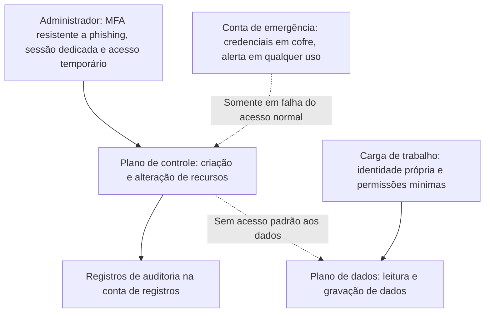

# Isolamento, Segmentação e Raio de Impacto

> **Objetivo pedagógico:** projetar fronteiras de isolamento que limitem o raio de impacto (*blast radius*) de falhas, de erros e de ataques em nuvem: usar contas, assinaturas e projetos como fronteiras de segurança; separar ambientes e classificações; aplicar limites de permissão e políticas organizacionais; escolher modelos de locação em plataformas multicliente (silo, pool e ponte); considerar arquiteturas em células; separar o plano de controle do plano de dados; projetar o acesso de emergência; e avaliar o raio de impacto de forma sistemática.

## 1. Conceito de raio de impacto

O **raio de impacto** é o conjunto de recursos, de dados e de funções afetados quando um componente falha ou é comprometido (uma credencial, uma conta, uma carga de trabalho ou um erro de configuração). A arquitetura de segurança em nuvem busca **reduzir esse raio**, de modo que qualquer incidente seja contido a uma pequena parte do ambiente.

| Ameaça ou falha | Raio de impacto sem isolamento | Raio de impacto com isolamento |
|---|---|---|
| Credencial de desenvolvedor comprometida | Toda a conta, inclusive produção | Somente o ambiente de desenvolvimento, sem dados reais |
| Erro em um script de implantação | Todos os recursos da conta | Recursos de uma aplicação, em uma conta própria |
| Vulnerabilidade em uma aplicação | Rede plana com acesso a todas as bases | Segmento da aplicação, sem rota para os dados de outras |
| Falha de configuração de política | Toda a organização | Uma unidade organizacional de teste, antes da propagação |
| Ransomware com credenciais administrativas | Dados e backups na mesma conta | Cópias imutáveis em conta separada e isolada |

## 2. Fronteiras de isolamento em nuvem

| Fronteira | Descrição | Força do isolamento |
|---|---|---|
| Organização ou locatário | Entidade de topo do cliente | Isolamento do provedor entre clientes |
| Conta, assinatura ou projeto | Unidade de cobrança, de identidade e de recursos | **Forte**: boa fronteira de segurança; por padrão, sem acesso entre contas |
| Rede virtual (VPC e VNet) e sub-redes | Segmentação de rede dentro de uma conta | Média: depende de regras e de roteamento |
| Grupos de segurança e listas de controle de acesso | Filtros por recurso e por sub-rede | Média, dependente de configuração |
| Identidade e funções | Permissões de pessoas e de cargas | Forte, se limitada; fraca se ampla |
| Chaves de criptografia | Quem pode decifrar | Forte para dados, se o acesso às chaves for separado |
| Cluster, espaço de nomes e contêiner | Isolamento de cargas orquestradas | Variável: depende de políticas e de isolamento de nós |
| Região | Local geográfico | Forte para falhas regionais; também para residência |

Regra prática: **trate a conta (assinatura ou projeto) como a principal fronteira de segurança**, e as demais como camadas adicionais.

## 3. Estratégias de separação

### 3.1 Separação de ambientes e de criticidade

| Estratégia | Descrição |
|---|---|
| Produção separada de não produção | Contas distintas, sem dados reais fora da produção, sem acesso de contas de desenvolvimento à produção |
| Separação por produto ou por domínio | Cada produto tem suas contas; reduz o impacto entre produtos |
| Separação por classificação de dados | Dados restritos em contas dedicadas, com controles reforçados |
| Separação por função de plataforma | Segurança, registros, rede e recuperação em contas próprias |
| Separação de privilégios | Quem implanta não administra registros; quem opera não altera chaves |

### 3.2 Limites de permissão e políticas organizacionais

| Mecanismo | Função |
|---|---|
| Políticas organizacionais (por exemplo, SCPs, políticas de organização e Azure Policy) | Limites máximos que **nenhuma** identidade das contas pode exceder |
| Limites de permissão para funções | Teto de permissões que um desenvolvedor pode atribuir a funções que cria |
| Políticas de negação explícita | Impedem ações perigosas (desabilitar registros, sair da organização, usar regiões não aprovadas) |
| Acesso temporário e por aprovação | Privilégios elevados por tempo limitado |
| Contas de serviço e funções por carga | Uma identidade por carga, com escopo mínimo |

```json
{
  "Version": "2012-10-17",
  "Statement": [
    {
      "Sid": "ProtegerRegistrosDeAuditoria",
      "Effect": "Deny",
      "Action": [
        "cloudtrail:StopLogging",
        "cloudtrail:DeleteTrail",
        "cloudtrail:UpdateTrail",
        "cloudtrail:PutEventSelectors"
      ],
      "Resource": "*"
    },
    {
      "Sid": "ImpedirSaidaDaOrganizacao",
      "Effect": "Deny",
      "Action": "organizations:LeaveOrganization",
      "Resource": "*"
    }
  ]
}
```

O exemplo mostra uma política de controle de serviços (AWS) que impede a desativação dos registros de auditoria e a saída da organização. Aplique primeiro a uma unidade organizacional de teste e preveja uma exceção controlada para administradores da conta de segurança.

## 4. Arquiteturas multicliente (plataformas SaaS)

Quando a organização oferece uma plataforma a vários clientes, o isolamento entre clientes é um requisito central.

| Modelo | Descrição | Isolamento | Custo e operação |
|---|---|---|---|
| Silo | Recursos dedicados por cliente (contas, bancos e clusters) | Mais forte | Maior custo e gestão mais complexa |
| Pool | Recursos compartilhados, com isolamento lógico por identificador de cliente | Mais fraco, depende de controles de aplicação | Menor custo; maior risco de vazamento entre clientes |
| Ponte (*bridge*) | Combinação: alguns componentes dedicados e outros compartilhados | Intermediário | Equilíbrio |

Controles essenciais em modelos compartilhados: **autorização por cliente em todas as camadas** (aplicação, API e dados), chaves por cliente quando exigido, testes automatizados de isolamento (tentar acessar dados de outro cliente), limites de uso por cliente (para evitar impacto entre vizinhos) e registros por cliente.

## 5. Arquitetura em células

Na **arquitetura em células**, a carga é dividida em unidades independentes (células), cada uma atendendo a um subconjunto de clientes ou de tráfego, com sua própria infraestrutura e dados.

| Aspecto | Descrição |
|---|---|
| Benefício de segurança e de resiliência | Uma falha ou um comprometimento afeta apenas uma célula |
| Roteamento | Camada de roteamento fina que direciona clientes às células |
| Implantação | Mudanças implantadas célula a célula (canário), com reversão |
| Custo | Mais componentes; exige automação |
| Quando usar | Serviços críticos, de grande escala ou com requisitos severos de isolamento |

## 6. Separação entre plano de controle e plano de dados, e acesso de emergência

| Tema | Orientação de arquitetura |
|---|---|
| Plano de controle | Acesso restrito, com MFA resistente a phishing, acesso temporário, registros e alertas; poucas contas administrativas |
| Plano de dados | Acesso por identidades de carga; administradores do plano de controle não devem ter acesso padrão aos dados |
| Administração segura | Estações ou sessões de administração dedicadas e gerenciadas; sem acesso direto de administração por chaves permanentes |
| Acesso de emergência (*break-glass*) | Contas de emergência independentes do provedor de identidade principal, com credenciais protegidas, alertas em qualquer uso e testes periódicos |
| Separação de funções | Quem administra identidade, quem administra rede, quem administra dados e quem audita: papéis distintos |



## 7. Zonas de confiança

| Zona | Conteúdo | Regras de fluxo |
|---|---|---|
| Pública | Internet e clientes | Entra apenas pela borda inspecionada |
| Borda (DMZ) | Balanceadores, WAF e proxies | Encaminha para a camada de aplicação |
| Aplicação | Servidores, contêineres e funções | Acessa a camada de dados por regras específicas; saída por proxy |
| Dados | Bancos e armazenamentos | Sem acesso à internet; acesso apenas das aplicações autorizadas |
| Gestão | Administração e ferramentas de segurança | Acesso restrito e registrado; sem tráfego de usuários |
| Dados restritos (cofre) | Dados de maior classificação | Conta e rede dedicadas; chaves exclusivas; acesso nominal |

## 8. Avaliação do raio de impacto

Pergunte, para cada componente crítico: **"se este componente for comprometido, o que o atacante alcança?"**

| Componente | Pergunta | Redução de impacto |
|---|---|---|
| Credencial de pessoa | Que contas e recursos ela acessa? | Privilégio mínimo; acesso temporário; contas separadas |
| Função de carga de trabalho | Que dados e serviços ela alcança? | Permissões por recurso e por ação; sem curinga |
| Conta | Que recursos e dados existem nela? | Contas por produto e por classificação |
| Rede | Que sistemas são alcançáveis a partir deste segmento? | Segmentação e negação por padrão |
| Pipeline de implantação | O que ele pode alterar? | Permissões por ambiente; aprovação para produção |
| Chave de criptografia | Que dados decifra? | Chaves por domínio de dados |
| Provedor de identidade | O que acontece se for comprometido? | Contas de emergência independentes; monitoramento reforçado |

| Método | Descrição |
|---|---|
| Análise de caminhos de ataque | Mapear cadeias de acesso entre identidades, redes e dados (movimento lateral) |
| Exercícios de simulação | Simular o comprometimento de uma credencial e medir o alcance |
| Revisão de permissões efetivas | Ferramentas de análise de acessos que mostram o que cada identidade pode realmente fazer |
| Métrica | Número de recursos e de dados acessíveis por identidade comprometida (por exemplo, percentual do ambiente) |

## 9. Exemplo prático: redesenho de um ambiente de conta única

| Situação inicial | Problema | Redesenho |
|---|---|---|
| Uma conta com produção, homologação, desenvolvimento e backups | Credencial de desenvolvedor comprometida alcança tudo, inclusive backups | Contas separadas: produção por produto, não produção, registros, segurança e recuperação isolada |
| Rede plana com acesso entre todos os servidores | Movimento lateral livre | Segmentação por aplicação, negação por padrão, pontos privados para serviços gerenciados |
| Funções com permissões administrativas amplas | Escalonamento e abuso | Funções por carga com permissões mínimas; limites de permissão; acesso temporário |
| Pipeline com chaves permanentes de administrador | Comprometimento do pipeline permite alterar tudo | Identidade federada do pipeline por ambiente, com permissões limitadas e aprovação para produção |
| Resultado | Raio de impacto de uma credencial comprometida reduzido de 100% para cerca de 8% do ambiente (estimativa por revisão de permissões efetivas) | |

## 10. Casos de uso corporativos

- Redesenho de ambientes legados de conta única para estrutura multiconta.
- Projeto de plataformas multicliente com isolamento verificável.
- Estimativa e redução do raio de impacto como indicador de arquitetura.

## 11. Normas e frameworks relevantes

- NIST SP 800-53 Rev. 5 (SC-7, proteção de fronteiras; AC-4, controle de fluxo de informação; AC-6, privilégio mínimo); NIST SP 800-160 Vol. 1 (isolamento e contenção)
- CSA CCM v4 (IVS e IAM); NCSC princípio 3 (separação entre usuários); ISO/IEC 27002:2022 (8.22, segregação de redes)
- Guias de ambientes multiconta e de modelos de locação dos provedores (por exemplo, o enfoque de SaaS do AWS Well-Architected e o whitepaper sobre arquitetura em células)
- PCI DSS v4.0 (segmentação do ambiente de dados de cartão)

## 12. Checklist operacional: isolamento e raio de impacto

- [ ] Contas, assinaturas ou projetos separados por ambiente, por produto e por classificação
- [ ] Contas de segurança, de registros, de rede e de recuperação isoladas
- [ ] Políticas organizacionais impedem a desativação de registros, a saída da organização e o uso de regiões não aprovadas
- [ ] Limites de permissão e identidades por carga, sem permissões com curinga
- [ ] Rede segmentada, com negação por padrão e pontos privados para serviços gerenciados
- [ ] Administradores sem acesso padrão a dados; acesso temporário e auditado
- [ ] Contas de emergência independentes, protegidas e testadas
- [ ] Em plataformas multicliente, autorização por cliente em todas as camadas e testes de isolamento
- [ ] Raio de impacto avaliado para credenciais, pipelines, chaves e provedor de identidade
- [ ] Revisão anual da estrutura de isolamento

## 13. Referências

- Amazon Web Services. Organizing Your AWS Environment Using Multiple Accounts; Reducing the Scope of Impact with Cell-Based Architecture. Documentação e whitepapers vigentes.
- Amazon Web Services. SaaS Lens do Well-Architected Framework (modelos silo, pool e ponte).
- Microsoft. Cloud Adoption Framework: zonas de aterrissagem e emergency access accounts (documentação vigente).
- Google Cloud. Resource hierarchy e VPC Service Controls (documentação vigente).
- NIST. SP 800-53 Rev. 5; SP 800-160 Vol. 1 Rev. 1.
