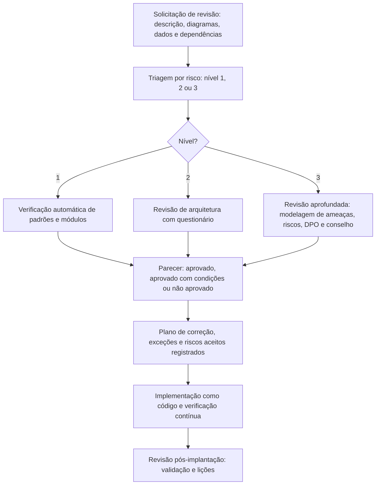

# Revisão de Arquitetura e Registro de Decisões

> **Objetivo pedagógico:** conduzir revisões de arquitetura de segurança de forma proporcional ao risco (triagem por camadas, questionário de revisão, parecer e plano de correção), registrar as decisões de arquitetura e as exceções (ADR), verificar a conformidade com a arquitetura por regras automatizadas, estabelecer um conselho de arquitetura de segurança com prazos de resposta e definir os critérios de aceitação de uma solução para entrar em produção.

## 1. Objetivos da revisão de arquitetura

| Objetivo | Descrição |
|---|---|
| Prevenir | Identificar falhas de desenho antes da implantação, quando corrigi-las é mais barato |
| Padronizar | Garantir o uso de padrões, de arquiteturas de referência e de linhas de base |
| Informar riscos | Tornar explícitos os riscos residuais e as decisões de aceitação |
| Capacitar | Transferir conhecimento de segurança para as equipes de produto |
| Documentar | Manter registro das decisões e das suposições |

A revisão deve ser **habilitadora**: com critérios claros, prazos curtos e orientação prática, e não um obstáculo burocrático.

## 2. Triagem por risco: nível da revisão

| Nível | Critérios de enquadramento | Tipo de revisão | Prazo de resposta (exemplo) |
|---|---|---|---|
| 1 Padrão | Usa padrões e módulos aprovados; sem dados confidenciais ou restritos; sem exposição pública nova | Verificação automática e autoatendimento; revisão amostral | 1 dia útil |
| 2 Moderada | Dados confidenciais ou dados pessoais; exposição pública; integração com terceiros; desvios menores | Revisão por arquiteto de segurança com questionário | 5 dias úteis |
| 3 Aprofundada | Dados restritos ou sensíveis; sistemas críticos; novos fornecedores ou serviços; desvios relevantes; requisitos regulatórios específicos | Revisão com modelagem de ameaças, revisão de riscos, DPO e, se necessário, conselho | 10 dias úteis |



## 3. Insumos da revisão

| Insumo | Conteúdo |
|---|---|
| Descrição da solução | Objetivos, usuários, dados, volumes e criticidade |
| Diagramas | Contexto, componentes, fluxo de dados e fronteiras de confiança |
| Classificação de dados | Tipos de dados, dados pessoais e sensíveis |
| Dependências | Provedores, serviços, parceiros e integrações |
| Requisitos regulatórios e contratuais | Normas e cláusulas aplicáveis |
| Modelo de ameaças (nível 3) | Ameaças, controles e riscos (pasta 14) |
| Infraestrutura como código | Quando disponível, para verificação automática |
| Registros de decisões anteriores | Desvios e exceções relacionados |

## 4. Questionário de revisão de arquitetura de segurança

| # | Tema | Pergunta | Resposta e evidência |
|---|---|---|---|
| 1 | Dados | Que dados a solução processa? Qual a classificação? Há dados pessoais ou sensíveis? | |
| 2 | Dados | Onde os dados ficam (regiões)? Há cópias, backups e ambientes de teste com dados reais? | |
| 3 | Dados | Há criptografia em repouso e em trânsito? Quem controla as chaves? | |
| 4 | Identidade | Como pessoas autenticam? Há MFA resistente a phishing para acessos privilegiados? | |
| 5 | Identidade | Como as cargas de trabalho se autenticam? Há credenciais de longa duração? | |
| 6 | Acesso | Os acessos seguem o privilégio mínimo? Há acesso temporário para operações sensíveis? | |
| 7 | Rede | Quais componentes são expostos à internet? Como são protegidos (WAF, limites de taxa e autenticação)? | |
| 8 | Rede | Os serviços gerenciados são acessados por pontos privados? Há segmentação e negação por padrão? | |
| 9 | Isolamento | Em que conta, assinatura ou projeto a solução reside? Qual o raio de impacto de uma credencial comprometida? | |
| 10 | Aplicação | Há validação de entradas, controle de autorização e proteção de APIs? | |
| 11 | Segredos | Onde ficam os segredos? Há varredura e rotação? | |
| 12 | Cadeia de suprimentos | De onde vêm as imagens, as bibliotecas e os componentes? São verificados? | |
| 13 | Registro | Quais registros são gerados? São centralizados, retidos e protegidos? Há alertas? | |
| 14 | Resposta | Quem responde a incidentes? Há playbooks e contatos? Há acesso a registros do provedor? | |
| 15 | Resiliência | Qual a criticidade, o RTO e o RPO? Qual a estratégia de recuperação e quando foi testada? | |
| 16 | Backups | Os backups são imutáveis e isolados? A restauração foi testada? | |
| 17 | Dependências | Quais são os pontos únicos de falha e as dependências críticas de terceiros? | |
| 18 | Fornecedores | Os fornecedores foram avaliados? Há plano de saída? | |
| 19 | Conformidade | Que normas e contratos se aplicam? Como se evidencia a conformidade? | |
| 20 | Privacidade | Há RIPD, quando exigido? Há minimização, retenção e eliminação? | |
| 21 | Configuração | A infraestrutura é definida por código e passa por verificação de políticas? | |
| 22 | Mudanças | Como as mudanças são revisadas, testadas e revertidas? | |
| 23 | Vulnerabilidades | Como vulnerabilidades e patches são geridos? | |
| 24 | Custos e abuso | Há orçamentos, limites e alertas de custo? | |
| 25 | Desvios | Quais desvios dos padrões existem? Há exceções aprovadas, com prazo? | |

## 5. Parecer e critérios de aceitação

| Resultado | Condição |
|---|---|
| Aprovado | Atende aos padrões e aos requisitos; riscos residuais dentro da tolerância |
| Aprovado com condições | Lacunas não críticas, com plano e prazos; condições a verificar antes ou logo após a implantação |
| Não aprovado | Lacunas críticas (por exemplo, dados restritos expostos, ausência de identidade forte para acesso privilegiado, ausência de registros ou de backups) sem tratamento; novo envio após correção |
| Exceção formal | Desvio justificado, com controles compensatórios, aprovação do dono do risco e prazo (pasta 03) |

Os **critérios mínimos para entrada em produção** (portões de segurança) devem ser explícitos: por exemplo, verificação de postura sem achados críticos, MFA forte nos acessos privilegiados, registros centralizados ativos, backups e restauração testados (conforme a camada), classificação e proprietário registrados e plano de resposta definido.

## 6. Registro de decisões de arquitetura (ADR)

Um ADR registra **uma decisão de arquitetura**, o contexto, as alternativas e as consequências. Deve ser curto, versionado e armazenado junto ao código ou à documentação da solução.

### 6.1 Modelo de ADR

| Campo | Conteúdo |
|---|---|
| Título e número | `ADR-0007: Acesso ao banco por ponto de extremidade privado` |
| Data e status | Proposto, aceito, substituído ou rejeitado |
| Contexto | Necessidade, restrições, requisitos de segurança e riscos |
| Alternativas consideradas | Opções com vantagens e desvantagens |
| Decisão | A opção escolhida e o motivo |
| Consequências | Efeitos positivos, negativos, riscos residuais e ações |
| Verificação | Como será verificada (política, teste ou métrica) |
| Referências | Padrões, normas, diagramas e tickets |
| Decisor e consultados | Quem decidiu e quem foi ouvido |

### 6.2 Exemplo de ADR

```
# ADR-0007: Acesso ao banco de dados por ponto de extremidade privado

Status: Aceito (2026-11-10)
Decisores: Arquiteta de soluções; Arquiteto de segurança

## Contexto
O serviço de extratos usa um banco de dados gerenciado com dados confidenciais (dados pessoais de clientes).
Por padrão, o serviço oferece endereço público. O requisito de segurança é não expor o banco à internet.

## Alternativas
1. Endereço público com lista de permissões de IP: simples, mas expõe o banco e depende da manutenção da lista.
2. Ponto de extremidade privado na sub-rede de dados: sem exposição pública; exige configuração de DNS privado.
3. Banco em máquinas virtuais autogerenciadas: controle total, mas aumenta a carga operacional e de patches.

## Decisão
Adotar a alternativa 2 (ponto de extremidade privado) e desabilitar o acesso público.

## Consequências
+ Elimina a exposição à internet; reduz o risco R-NUV-003.
+ Facilita a segmentação e os registros de fluxo.
- Exige DNS privado e ajustes de conectividade para ferramentas de administração (acesso por sessão gerenciada).
- Custo adicional por ponto de extremidade.

## Verificação
Política da organização nega bancos com acesso público; relatório de postura mensal.
```

### 6.3 Registro de exceções à arquitetura

| ID | Padrão ou requisito | Solução | Justificativa | Risco e controles compensatórios | Aprovador | Expiração |
|---|---|---|---|---|---|---|
| EXA-001 | | | | | | |

## 7. Verificação automática da conformidade com a arquitetura

| Técnica | Descrição |
|---|---|
| Políticas como código | Regras que impedem ou alertam desvios (pasta 03) |
| Verificação de infraestrutura como código no pipeline | Análise estática dos modelos (por exemplo, com ferramentas de políticas e de varredura) antes da implantação |
| Verificação contínua de postura | Comparação do estado real com as linhas de base (pasta 17) |
| Testes de arquitetura (*fitness functions*) | Testes automatizados que verificam propriedades arquiteturais (por exemplo, "nenhum banco tem endereço público") |
| Verificação de permissões efetivas | Análise de acessos para identificar permissões amplas |
| Relatórios para o conselho | Percentual de soluções conformes aos padrões e desvios abertos |

```bash
# Exemplo (Terraform): gerar o plano em JSON para análise automatizada por políticas (OPA ou outras ferramentas)
terraform plan -out=plano.tfplan
terraform show -json plano.tfplan > plano.json
# Em seguida, avalie plano.json com as políticas da organização (por exemplo, com o Open Policy Agent)
```

## 8. Conselho de arquitetura de segurança

| Elemento | Descrição |
|---|---|
| Composição | Arquitetos de segurança e de soluções, plataforma, GRC, privacidade e representantes de produtos |
| Função | Tratar revisões de nível 3, desvios relevantes e evolução de padrões |
| Cadência | Semanal ou quinzenal, com horário de atendimento (*office hours*) para dúvidas |
| Prazos | Respostas dentro dos prazos da seção 2 |
| Registro | Decisões e exceções documentadas |
| Indicadores | Tempo de resposta, percentual de soluções com padrões, desvios abertos e achados pós-implantação |

## 9. Exemplo prático: revisão de uma plataforma de análise de dados

| Item | Resultado |
|---|---|
| Triagem | Nível 3: dados pessoais de clientes e novo serviço de análise gerenciado |
| Achados | (1) Armazenamento de objetos com política ampla de leitura; (2) funções com permissões curinga; (3) ausência de registros de acesso a dados; (4) exportações sem controle; (5) backups na mesma conta |
| Parecer | Aprovado com condições |
| Condições | Políticas de leitura por prefixo e por função; permissões por recurso; eventos de dados habilitados; fluxo de exportação com aprovação do DPO; cópias imutáveis em conta separada; prazo de 30 dias, com verificação antes da produção |
| ADR | Três decisões registradas (isolamento de dados em conta dedicada, chaves exclusivas e acesso por pontos privados) |
| Exceção | Uma exceção temporária de 60 dias para um conector legado, com monitoramento reforçado |
| Verificação | Relatório de postura sem achados críticos e teste de restauração antes da liberação |

## 10. Casos de uso corporativos

- Processo de revisão de arquitetura proporcional ao risco, com autoatendimento para casos padrão.
- Biblioteca de ADRs como memória institucional de decisões de segurança.
- Painel de conformidade com a arquitetura para o comitê de governança.

## 11. Normas e frameworks relevantes

- ISO/IEC/IEEE 42010:2022 (descrição de arquiteturas); NIST SP 800-160 Vol. 1 Rev. 1 (revisões de projeto)
- NIST SP 800-218 (SSDF, práticas de desenvolvimento seguro); OWASP ASVS; OWASP SAMM
- CSA CCM v4 (AIS e CCC); ISO/IEC 27002:2022 (8.25 a 8.29, desenvolvimento seguro e testes de segurança)
- NIST CSF 2.0 (ID.RA e PR.PS)

## 12. Checklist operacional: revisão de arquitetura

- [ ] Processo de revisão definido, com níveis por risco e prazos de resposta
- [ ] Questionário padrão e insumos obrigatórios publicados
- [ ] Critérios mínimos de entrada em produção explícitos
- [ ] Pareceres registrados (aprovado, com condições ou não aprovado), com plano e prazos
- [ ] ADRs para decisões relevantes, versionados junto à solução
- [ ] Registro de exceções à arquitetura, com expiração e controles compensatórios
- [ ] Verificação automática (políticas, IaC e postura) integrada ao pipeline
- [ ] Conselho de arquitetura com cadência e indicadores
- [ ] Revisão pós-implantação das condições impostas
- [ ] Revisão anual do processo e do questionário

## 13. Referências

- Nygard, M. Documenting Architecture Decisions. Cognitect, 2011.
- Dodge, J. et al. NIST SP 800-218: Secure Software Development Framework (SSDF) Version 1.1. 2022.
- Ford, N.; Parsons, R.; Kua, P. Building Evolutionary Architectures. O'Reilly, 2017 (funções de aptidão).
- OWASP. Software Assurance Maturity Model (SAMM) v2.
- ISO/IEC/IEEE 42010:2022.
- Pastas 03, 14, 17 e 21 deste repositório.
