# 06 Gestão de Identidade e de Acesso em Nuvem

## Objetivo

Projetar, operar e proteger a identidade e o acesso em ambientes de nuvem, onde a identidade é o principal plano de controle: compreender os fundamentos e os modelos de controle de acesso, implementar autenticação forte (MFA resistente a phishing) e acesso condicional, aplicar o privilégio mínimo na autorização, proteger o acesso privilegiado com elevação temporária e contas de emergência, gerir identidades de cargas de trabalho e segredos com federação, governar o ciclo de vida e a revisão de acessos, e detectar e responder ao abuso de identidades.

## Trilha de estudo recomendada

```mermaid
flowchart LR
    A["1. Fundamentos de IAM"] --> B["2. Autenticação forte e acesso condicional"]
    B --> C["3. Autorização e privilégio mínimo"]
    C --> D["4. Acesso privilegiado e emergência"]
    D --> E["5. Cargas de trabalho, segredos e federação"]
    E --> F["6. Governança e revisão de acessos"]
    F --> G["7. Monitoramento, detecção e resposta"]
    G --> H["8. Casos e erros comuns"]
```

## Conteúdo da pasta

| Ordem | Arquivo | Objetivo |
|---|---|---|
| 1 | [fundamentos-de-identidade-e-acesso-em-nuvem.md](fundamentos-de-identidade-e-acesso-em-nuvem.md) | Conceitos, tipos de identidade, protocolos, modelos de acesso e referenciais |
| 2 | [autenticacao-forte-mfa-e-acesso-condicional.md](autenticacao-forte-mfa-e-acesso-condicional.md) | Autenticação, MFA resistente a phishing, ataques e acesso condicional |
| 3 | [autorizacao-privilegio-minimo-e-gestao-de-permissoes.md](autorizacao-privilegio-minimo-e-gestao-de-permissoes.md) | RBAC, ABAC, avaliação de políticas nos três provedores e redução de permissões |
| 4 | [acesso-privilegiado-acesso-temporario-e-contas-de-emergencia.md](acesso-privilegiado-acesso-temporario-e-contas-de-emergencia.md) | PAM, elevação temporária, conta raiz e contas de emergência |
| 5 | [identidades-de-cargas-de-trabalho-segredos-e-federacao.md](identidades-de-cargas-de-trabalho-segredos-e-federacao.md) | Identidades de máquinas, federação de pipelines, segredos e ciclo de vida |
| 6 | [governanca-de-identidades-ciclo-de-vida-e-revisao-de-acessos.md](governanca-de-identidades-ciclo-de-vida-e-revisao-de-acessos.md) | Entrada, mudança e saída, solicitações, revisões e segregação de funções |
| 7 | [monitoramento-de-identidade-deteccao-resposta-modelos-e-checklist.md](monitoramento-de-identidade-deteccao-resposta-modelos-e-checklist.md) | Detecções, consultas, resposta, modelos e checklist |
| 8 | [casos-de-uso-e-erros-comuns-em-identidade-e-acesso.md](casos-de-uso-e-erros-comuns-em-identidade-e-acesso.md) | Casos fictícios, erros comuns, exercícios e perguntas de revisão |

## Princípios da pasta

- A identidade é o novo perímetro: quem controla as credenciais controla a infraestrutura
- MFA resistente a phishing para todo acesso privilegiado e para o plano de controle
- Privilégio mínimo, temporário e verificável: sem privilégios permanentes desnecessários
- Sem credenciais de longa duração para pessoas e para cargas: federação e credenciais temporárias
- Toda identidade, humana ou não humana, tem proprietário, ciclo de vida e revisão
- Registrar, monitorar e responder: a identidade é o principal vetor de ataque em nuvem

## Relação com outras pastas

- 01 a 05: fundamentos, responsabilidade, governança, riscos e arquitetura (desenho de identidade)
- 07: zero trust (verificação contínua)
- 09 e 10: dados, criptografia e chaves
- 12 e 13: controles e monitoramento
- 17 e 18: postura e proteção de cargas de trabalho
- 21: DevSecOps (identidades de pipelines e segredos)
- 22 e 23: resposta a incidentes e forense de nuvem
- 24 a 26: identidade em Azure, AWS e Google Cloud

## Referências

- NIST. SP 800-63 (Digital Identity Guidelines), partes A, B e C; NIST SP 800-210; NIST SP 800-207
- CISA. Implementing Phishing-Resistant MFA (2022)
- CSA. Cloud Controls Matrix v4, domínio IAM; CIS Foundations Benchmarks
- ISO/IEC 27002:2022, controles 5.15 a 5.18 e 8.2 a 8.5
- MITRE ATT&CK for Cloud, técnicas de contas válidas e de manipulação de contas
