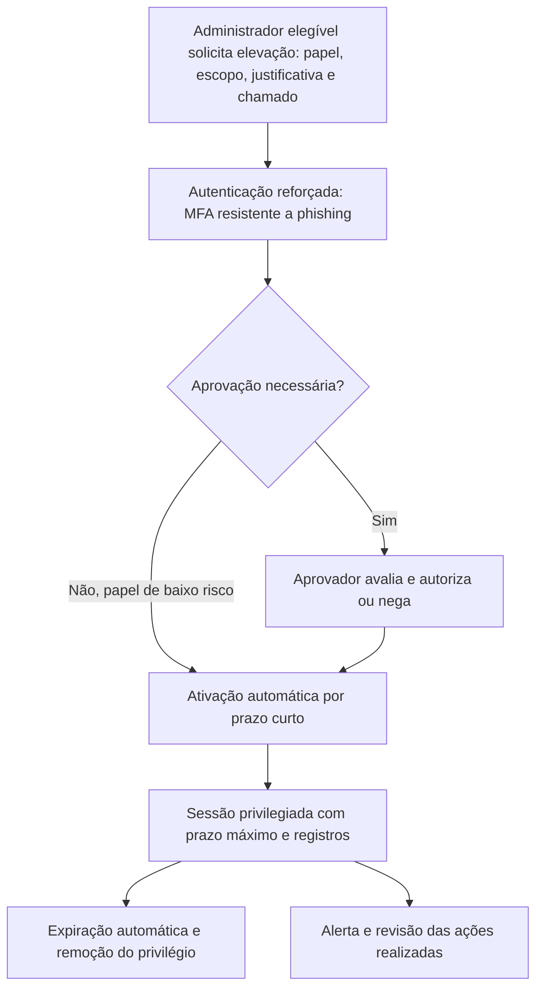

# Acesso Privilegiado, Acesso Temporário e Contas de Emergência

> **Objetivo pedagógico:** proteger o acesso privilegiado em nuvem: inventariar os tipos de privilégio (conta raiz, administrador global, administradores de organização, contas de serviço privilegiadas), aplicar o princípio de zero privilégios permanentes com elevação sob demanda (JIT), projetar fluxos de aprovação e de sessões auditadas, proteger a conta raiz e as contas de emergência (*break-glass*), usar estações de administração seguras e verificar a situação atual por meio de consultas de somente leitura.

## 1. Tipos de acesso privilegiado em nuvem

| Tipo | Exemplos | Risco |
|---|---|---|
| Conta raiz ou proprietário da conta | Usuário raiz de uma conta AWS; proprietário de assinatura | Controle total e irrestrito; não limitável por políticas internas |
| Administradores da organização e do locatário | Administrador global do Microsoft Entra ID; administrador da organização no Google Cloud; gestão da organização na AWS | Controle de identidades, de políticas e de contas |
| Administradores de segurança e de registros | Administradores de trilhas, de SIEM e de postura | Possibilidade de desabilitar registros e detecção |
| Administradores de identidade e de acesso | Administradores de papéis, de privilégios e de autenticação | Concessão de acessos e redefinição de fatores |
| Administradores de dados e de chaves | Gestores de chaves e de armazenamentos | Acesso e destruição de dados |
| Administradores de aplicações e de plataformas | Administradores de clusters, de bancos e de pipelines | Execução e implantação de código |
| Contas de serviço privilegiadas | Funções de automação com permissões amplas | Chaves vazadas e abuso |
| Terceiros e fornecedores privilegiados | Prestadores com acesso administrativo | Cadeia de suprimentos |

## 2. Princípios de acesso privilegiado

| Princípio | Aplicação |
|---|---|
| Zero privilégios permanentes (*zero standing privilege*) | Ninguém mantém privilégios administrativos o tempo todo; a elevação é sob demanda |
| Acesso temporário (*just-in-time*) | Privilégios concedidos por prazo curto, com justificativa e aprovação |
| Contas separadas para administração | Administradores usam contas distintas das de uso diário, sem e-mail e sem navegação geral |
| Autenticação mais forte | MFA resistente a phishing obrigatória e reautenticação para elevar |
| Estações seguras | Administração a partir de dispositivos gerenciados e endurecidos (estações de acesso privilegiado) |
| Sessões auditadas | Registro de ações privilegiadas; gravação de sessões quando aplicável |
| Mínimo de contas privilegiadas | Poucos administradores permanentes (apenas contas de emergência) |
| Separação de funções | Papéis privilegiados distintos por área |
| Aprovação e vínculo a chamados | Cada elevação associada a uma solicitação |
| Monitoramento e alertas | Alerta para toda elevação, atribuição de papel e uso de conta raiz |

## 3. Elevação sob demanda (JIT)



| Elemento | Prática |
|---|---|
| Elegibilidade | Administradores são elegíveis a papéis, mas não os têm ativos |
| Prazo máximo | Curto (por exemplo, 1 a 8 horas, conforme o risco) |
| Aprovação | Obrigatória para papéis de alto risco (administrador global, administrador de segurança e administrador de dados) |
| Justificativa e chamado | Obrigatórios, para rastreabilidade |
| Notificações | Alertas à segurança em ativações de papéis críticos |
| Revisões | Revisão periódica das elegibilidades |
| Emergência | Procedimento controlado de elevação urgente com revisão posterior |

### Ferramentas por provedor (categorias)

| Provedor | Mecanismos de elevação temporária |
|---|---|
| Microsoft Entra ID e Azure | Gestão de identidades privilegiadas (PIM) para papéis do Entra ID e do RBAC do Azure, com ativação por tempo, aprovação e justificativa (requer licenciamento específico) |
| AWS | Conjuntos de permissões do IAM Identity Center com duração de sessão limitada; fluxos de solicitação e aprovação por soluções de acesso temporário (existem soluções abertas e de terceiros) |
| Google Cloud | Condições do IAM com prazo; concessões temporárias de acesso privilegiado (Privileged Access Manager, quando disponível) |
| Multinuvem | Soluções de PAM e de CIEM de terceiros |

## 4. Proteção da conta raiz e do proprietário

A conta raiz (ou o proprietário da conta) tem poder irrestrito e deve ser **ativo de segurança de maior sensibilidade**.

| Controle | Descrição |
|---|---|
| MFA resistente a phishing | Dispositivo FIDO2 físico, guardado em cofre, com cópia de reserva |
| Sem chaves de acesso | A conta raiz não deve ter chaves de acesso programáticas |
| Uso apenas para tarefas que exigem a conta raiz | Todas as demais por identidades comuns |
| E-mail e telefone corporativos controlados | Caixa de e-mail dedicada, protegida e monitorada; sem contas pessoais |
| Alertas de uso | Alerta imediato em qualquer login ou uso da conta raiz |
| Gestão centralizada | Em organizações multiconta, preferir os recursos de gestão centralizada de acesso raiz e remover credenciais raiz das contas-membro, quando oferecido pelo provedor |
| Registro do procedimento | Procedimento documentado de acesso, com dois responsáveis |
| Revisão periódica | Verificação semestral de credenciais, de contatos e de dispositivos |

## 5. Contas de emergência (*break-glass*)

As contas de emergência garantem o acesso quando o provedor de identidade, o MFA ou a federação **falharem**, ou quando uma política de acesso bloquear todos os administradores por engano.

| Elemento | Prática |
|---|---|
| Quantidade | Pelo menos duas contas, com proprietários distintos |
| Origem | Contas nativas do provedor de nuvem (não federadas), independentes do provedor de identidade corporativo |
| Autenticação | Credenciais longas e fortes e/ou chaves de segurança FIDO2 físicas, guardadas separadamente em cofre físico, com acesso controlado |
| Permissões | Privilégio máximo, mas **uso excepcional** |
| Monitoramento | Alerta imediato (e-mail, mensagem e SIEM) em **qualquer** tentativa de entrada |
| Exclusões de política | Se excluídas do acesso condicional, devem ter proteção equivalente e monitoramento reforçado; revisar as recomendações vigentes do provedor |
| Testes | Teste periódico (por exemplo, semestral) em janela controlada, com registro |
| Rotação | Troca das credenciais após cada uso e em períodos definidos |
| Procedimento | Passos documentados, com critérios de acionamento e revisão pós-uso |
| Registros | Revisão de todas as ações realizadas após o uso |

## 6. Estações e sessões de administração seguras

| Elemento | Descrição |
|---|---|
| Estações de acesso privilegiado (PAW) | Dispositivos dedicados, endurecidos e gerenciados para tarefas administrativas, sem navegação geral e sem e-mail |
| Acesso por intermediários | Acesso a servidores por serviços gerenciados de sessão (por exemplo, serviços de bastião e de acesso por túnel autenticado), sem portas de administração expostas |
| Sem credenciais compartilhadas | Cada sessão vinculada a uma identidade individual |
| Registro de sessões | Registro de comandos e, quando aplicável, gravação de sessões |
| Restrições de rede | Acesso administrativo apenas de redes e de dispositivos permitidos |
| Cofres de credenciais | Credenciais privilegiadas de sistemas legados em cofre, com rotação e verificação de uso |
| Isolamento | Administração de produção separada da de desenvolvimento |

## 7. Verificações de somente leitura

```bash
# AWS: conta raiz tem MFA? Há chaves de acesso da conta raiz? (valores: 1 = sim, 0 = não)
aws iam get-account-summary --query "SummaryMap.[AccountMFAEnabled,AccountAccessKeysPresent]"

# AWS: usuários e funções com política de administrador anexada
aws iam list-entities-for-policy --policy-arn arn:aws:iam::aws:policy/AdministratorAccess \
  --query "{usuarios:PolicyUsers[].UserName, funcoes:PolicyRoles[].RoleName, grupos:PolicyGroups[].GroupName}"

# Azure: atribuições de papéis de alto privilégio na assinatura
az role assignment list --all --query "[?roleDefinitionName=='Owner'].{principal:principalName, escopo:scope}" --output table

# Microsoft Entra ID: papéis de diretório ativados (requer permissões de leitura no Microsoft Graph)
az rest --method get --url "https://graph.microsoft.com/v1.0/directoryRoles" --query "value[].displayName" --output tsv

# Google Cloud: principais com o papel Owner em um projeto
gcloud projects get-iam-policy ID-DO-PROJETO \
  --flatten="bindings[].members" --filter="bindings.role:roles/owner" --format="value(bindings.members)"
```

Registre as saídas como evidência e compare com a lista autorizada de administradores.

## 8. Indicadores

| Indicador | Meta |
|---|---|
| Administradores com privilégio permanente (exceto contas de emergência) | Zero ou próximo de zero |
| Contas privilegiadas com MFA resistente a phishing | 100% |
| Número de administradores globais ou de proprietários | O mínimo necessário (por exemplo, menos de cinco, mais as contas de emergência) |
| Contas de emergência testadas nos últimos 6 meses | 100% |
| Elevações sem justificativa ou sem chamado | Zero |
| Tempo médio de duração das sessões elevadas | Dentro do máximo definido |
| Usos da conta raiz no período | Zero, ou justificado |

## 9. Exemplo prático: implantação de acesso sob demanda em uma organização com 30 administradores

| Etapa | Ação | Resultado |
|---|---|---|
| Diagnóstico | 30 usuários com administrador permanente na nuvem e no diretório; a conta raiz sem MFA forte | Risco crítico |
| Raiz | MFA com chave física guardada em cofre; remoção das chaves de acesso; alerta de uso | Conta raiz protegida |
| Emergência | Duas contas de emergência nativas, com chaves FIDO2 físicas em cofres separados; alerta em qualquer entrada; teste semestral | Continuidade do acesso |
| Elevação sob demanda | Administradores tornam-se elegíveis, e a ativação exige MFA resistente a phishing, justificativa e chamado; aprovação para administrador global e de segurança | Privilégios permanentes eliminados |
| Estações | Administração a partir de estações gerenciadas; acesso a servidores por sessão gerenciada; portas de administração fechadas | Redução da superfície |
| Resultado | Administradores permanentes: de 30 para 2 contas de emergência; 100% das elevações registradas; incidente de credencial de administrador no ano seguinte contido em 20 minutos, sem privilégios ativos | |

## 10. Casos de uso corporativos

- Programa de acesso privilegiado com elevação sob demanda para toda a nuvem.
- Proteção reforçada da conta raiz e do administrador global.
- Procedimento e testes das contas de emergência como parte da continuidade.

## 11. Normas e frameworks relevantes

- NIST SP 800-53 Rev. 5 (AC-2, AC-5, AC-6 e AC-17); NIST SP 800-63B (AAL3); NIST SP 800-207
- ISO/IEC 27002:2022 (8.2, direitos de acesso privilegiado); CSA CCM v4 (IAM); CIS Foundations Benchmarks (conta raiz e administradores)
- MITRE ATT&CK: T1078.004 (contas válidas de nuvem), T1098 (manipulação de contas), T1548 (abuso de elevação)
- CISA. Orientações de proteção de contas privilegiadas e de acesso de emergência (documentação vigente)

## 12. Checklist operacional: acesso privilegiado

- [ ] Inventário de contas e de papéis privilegiados, com proprietários
- [ ] Conta raiz ou proprietário protegidos: MFA físico, sem chaves, e-mail dedicado e alertas de uso
- [ ] Duas ou mais contas de emergência independentes, protegidas, monitoradas e testadas
- [ ] Zero privilégios permanentes: elevação sob demanda com aprovação, justificativa e prazo
- [ ] MFA resistente a phishing para todas as elevações e contas privilegiadas
- [ ] Contas administrativas separadas das de uso diário
- [ ] Estações de administração gerenciadas; acesso a servidores por sessões gerenciadas, sem portas expostas
- [ ] Alertas de ativação de papéis críticos, de uso da conta raiz e de alterações de privilégios
- [ ] Revisão trimestral das elegibilidades e das atribuições privilegiadas
- [ ] Procedimentos documentados e testados

## 13. Referências

- NIST. SP 800-53 Rev. 5; SP 800-63B.
- Microsoft. Gerenciar contas de acesso de emergência no Microsoft Entra ID; Privileged Identity Management (documentação vigente).
- Amazon Web Services. Best practices for protecting the root user e centralized root access management (documentação vigente).
- Google Cloud. IAM best practices e Privileged Access Manager (documentação vigente).
- CISA. Cloud Security Technical Reference Architecture, seção de identidade e acesso. 2022.
