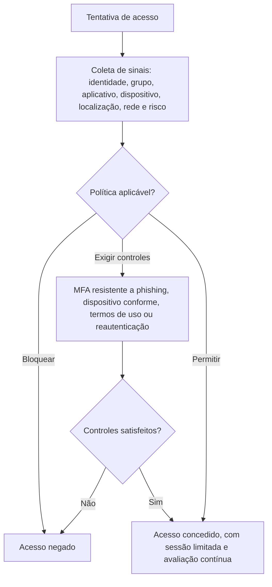

# Autenticação Forte, MFA e Acesso Condicional

> **Objetivo pedagógico:** implementar autenticação forte em nuvem: aplicar as orientações modernas sobre senhas, escolher métodos de MFA por nível de resistência a phishing (FIDO2 e passkeys, cartões inteligentes e certificados), compreender os ataques que contornam fatores fracos (phishing com proxy reverso, fadiga de MFA, troca de chip, roubo de token e de sessão), projetar políticas de acesso condicional baseadas em risco, dispositivo e contexto, proteger a recuperação de contas e bloquear protocolos legados.

## 1. Níveis de garantia de autenticação (NIST SP 800-63B)

| Nível | Requisito resumido | Uso típico |
|---|---|---|
| AAL1 | Um fator (por exemplo, senha) com controles de proteção | Baixo risco |
| AAL2 | Dois fatores distintos; resistência a determinados ataques | Acesso a dados pessoais e a sistemas corporativos |
| AAL3 | Dois fatores, um deles um autenticador criptográfico de hardware, e resistência à falsificação do verificador (resistência a phishing) | Acesso privilegiado e a dados de alto risco |

Orientação prática: **acesso ao plano de controle de nuvem e contas privilegiadas devem mirar o nível AAL3 ou equivalente** (autenticadores resistentes a phishing, preferencialmente ligados a hardware).

## 2. Senhas: boas práticas atuais

| Prática | Descrição |
|---|---|
| Priorizar o comprimento | Frases longas e únicas valem mais do que regras de complexidade |
| Sem regras de composição arbitrárias | Evitar exigências de símbolos e de maiúsculas que levam a padrões previsíveis |
| Sem troca periódica obrigatória | Troca apenas diante de suspeita ou de evidência de comprometimento |
| Triagem de senhas vazadas e comuns | Bloquear senhas presentes em listas de vazamentos e senhas óbvias |
| Gerenciadores de senhas | Estimular o uso para senhas únicas por serviço |
| Proteção contra força bruta | Limitação de tentativas, bloqueios inteligentes e detecção de pulverização de senhas |
| Armazenamento seguro | Algoritmos de derivação adequados, com sal (responsabilidade do IdP) |
| Reduzir a dependência | A meta é a autenticação sem senha (*passwordless*) |

Confirme os parâmetros mínimos na versão vigente do NIST SP 800-63B (a revisão 4 atualiza requisitos de comprimento).

## 3. Métodos de MFA e sua resistência

| Método | Resistência a phishing | Observações |
|---|---|---|
| SMS e voz | Baixa | Vulnerável a troca de chip (SIM swap), interceptação e phishing; evitar para privilegiados |
| E-mail (código) | Baixa | Depende da segurança do e-mail |
| Aplicativo autenticador com código (TOTP) | Baixa a média | Código pode ser repassado em phishing em tempo real |
| Notificação push simples (aprovar ou negar) | Baixa | Vulnerável à fadiga de MFA (bombardeio de notificações) |
| Notificação push com correspondência de número e contexto | Média | Reduz a aprovação acidental; ainda vulnerável a proxy reverso em alguns cenários |
| Chaves de segurança FIDO2/WebAuthn (hardware) | **Alta** | Ligadas à origem do site; não podem ser repassadas a páginas falsas |
| Passkeys sincronizadas ou ligadas ao dispositivo | **Alta** (resistentes a phishing), com diferenças de proteção entre sincronizadas e ligadas ao dispositivo | Avaliar o risco da conta de sincronização; para privilegiados, preferir chaves ligadas a hardware |
| Cartões inteligentes e certificados (PIV ou equivalentes) | **Alta** | Comuns em ambientes governamentais e regulados |
| Biometria local no dispositivo (por exemplo, para desbloquear a chave) | Alta quando combinada a chave criptográfica do dispositivo | Dado biométrico é sensível (LGPD, art. 11); tratamento local reduz o risco |

A CISA orienta que organizações priorizem autenticadores **resistentes a phishing** (FIDO2/WebAuthn e PKI), especialmente para usuários de alto risco e para acesso privilegiado.

## 4. Ataques que contornam fatores fracos

| Ataque | Descrição | Defesa principal |
|---|---|---|
| Phishing de credenciais | Páginas falsas capturam usuário e senha | MFA resistente a phishing; treinamento; detecção de domínios semelhantes |
| *Adversary-in-the-middle* (proxy reverso) | Proxy captura credenciais e o cookie de sessão após o MFA | Autenticadores FIDO2; proteção de tokens; acesso condicional por dispositivo |
| Fadiga de MFA (*push bombing*) | Excesso de notificações até o usuário aprovar | Correspondência de número; limites de tentativas; alertas; resistente a phishing |
| Troca de chip (SIM swap) | Transferência do número do telefone para o atacante | Evitar SMS e voz; proteções da operadora |
| Roubo de token ou de cookie de sessão | Malware ou proxy obtém a sessão válida | Tokens ligados ao dispositivo; sessões curtas; avaliação contínua de acesso; proteção de endpoints |
| Engenharia social no suporte (reset de conta) | Atacante convence o suporte a redefinir MFA | Verificação forte de identidade; aprovação do gestor; alertas de alterações |
| Pulverização de senhas e preenchimento de credenciais | Tentativas em larga escala com senhas comuns ou vazadas | Bloqueio de senhas vazadas; detecção; MFA; limites |
| Abuso de consentimento OAuth | Aplicativo malicioso obtém permissões | Controle de consentimento; revisão de aplicativos |
| Protocolos legados (autenticação básica, IMAP e POP) | Não suportam MFA | Bloquear autenticação legada |
| Contornos por exclusões de políticas | Contas ou locais excluídos do MFA | Reduzir exclusões; monitorar |

## 5. Acesso condicional (autenticação contextual)

O acesso condicional avalia **sinais** antes de conceder acesso e exige controles proporcionais ao risco.



| Sinal | Uso em políticas |
|---|---|
| Identidade e grupos | Políticas mais rígidas para administradores e para grupos de alto risco |
| Aplicativo ou recurso | Exigências maiores para o console de nuvem e para sistemas críticos |
| Dispositivo | Gerenciado, conforme e com proteções ativas |
| Localização e rede | Bloqueio de países não esperados; redes confiáveis |
| Risco de entrada e de usuário | Sinais de risco (viagem impossível, credenciais vazadas, anonimizadores) |
| Tipo de cliente | Bloquear protocolos legados |
| Horário e comportamento | Padrões atípicos |

### 5.1 Políticas essenciais (linha de base)

| # | Política | Descrição |
|---|---|---|
| 1 | MFA resistente a phishing para administradores | Obrigatória para funções privilegiadas e para o plano de controle |
| 2 | MFA para todos os usuários | Por padrão, com métodos fortes |
| 3 | Bloquear autenticação legada | Impedir protocolos que não suportam MFA |
| 4 | Exigir dispositivo gerenciado e conforme para acessos sensíveis | Reduz o risco de dispositivos comprometidos |
| 5 | Bloqueio por risco | Exigir reautenticação ou bloquear em risco alto |
| 6 | Restrições geográficas | Bloquear países sem justificativa de negócio, com exceções controladas |
| 7 | Acesso de convidados e de terceiros | MFA e escopo restrito; sessões mais curtas |
| 8 | Registro de métodos de autenticação | Exigir registro seguro (a partir de dispositivo e de rede confiáveis) |
| 9 | Sessões e reautenticação | Duração limitada para acessos privilegiados; reautenticação para ações sensíveis |
| 10 | Proteção de token | Vincular tokens ao dispositivo, quando disponível |

Ao implantar políticas, use o modo de **somente relatório** (ou equivalente) para medir o impacto antes de impor, **sempre mantendo contas de emergência** com autenticação forte e monitoramento (arquivo 4).

### 5.2 Exemplo: exigir MFA para ações sensíveis na AWS (política de negação condicional)

```json
{
  "Version": "2012-10-17",
  "Statement": [
    {
      "Sid": "NegarAcoesSensiveisSemMFA",
      "Effect": "Deny",
      "Action": [
        "ec2:StopInstances",
        "ec2:TerminateInstances",
        "iam:CreateAccessKey",
        "iam:DeleteUser",
        "s3:DeleteBucket"
      ],
      "Resource": "*",
      "Condition": {
        "BoolIfExists": { "aws:MultiFactorAuthPresent": "false" }
      }
    }
  ]
}
```

A condição `BoolIfExists` nega a ação quando a sessão não foi autenticada com MFA (ou quando o indicador está ausente). Em ambientes com SSO, a MFA costuma ser aplicada no provedor de identidade; use este tipo de política como camada adicional e teste o efeito em sessões federadas antes de aplicar em produção.

### 5.3 Equivalentes em outros provedores (visão geral)

| Provedor | Mecanismos de acesso condicional |
|---|---|
| Microsoft Entra ID | Políticas de acesso condicional, resistência a phishing por força de autenticação, proteção de identidade e avaliação contínua de acesso |
| Google Cloud e Google Workspace | Acesso sensível ao contexto (Access Context Manager e níveis de acesso), verificação em duas etapas com chaves de segurança, programa de proteção avançada |
| AWS | Políticas com condições (MFA, rede e tempo), federação com o IdP corporativo e políticas de sessão |

## 6. Recuperação de contas e suporte

A recuperação de contas é um **alvo frequente** de engenharia social.

| Controle | Descrição |
|---|---|
| Verificação de identidade robusta | Procedimentos que não dependam de dados facilmente obtidos |
| Aprovação do gestor para redefinir MFA de usuários privilegiados | Segundo fator humano |
| Prazos e notificações | Alertas ao usuário e à segurança quando métodos de autenticação forem alterados |
| Métodos de recuperação seguros | Chaves de recuperação armazenadas com segurança; evitar perguntas de segurança |
| Registro de novos métodos | Exigir autenticação forte já existente para registrar novos fatores |
| Treinamento do suporte | Simulações de engenharia social |
| Revisão após redefinições | Revisão de sessões e de dispositivos após a redefinição |

## 7. Exemplo prático: do MFA por notificação ao MFA resistente a phishing

| Etapa | Ação | Resultado |
|---|---|---|
| Diagnóstico | 100% dos usuários com MFA, mas 92% usando notificações simples; 3 incidentes de fadiga de MFA no ano | Identificada a necessidade de métodos mais fortes |
| Fase 1 | Ativar correspondência de número e contexto de localização e do aplicativo nas notificações | Redução imediata das aprovações acidentais |
| Fase 2 | Distribuir chaves FIDO2 aos 120 administradores e aos usuários financeiros; exigir força de autenticação resistente a phishing para o console de nuvem | Acesso privilegiado sem fatores repassáveis |
| Fase 3 | Habilitar passkeys para os demais usuários em dispositivos gerenciados; bloquear SMS e voz | Eliminação de fatores fracos |
| Fase 4 | Bloquear autenticação legada; tokens ligados a dispositivo para acessos sensíveis | Redução de roubo de sessão |
| Resultado | Tentativas de phishing com proxy reverso passaram a falhar; 0 incidentes de fadiga de MFA nos 12 meses seguintes | |

## 8. Casos de uso corporativos

- Programa de migração para autenticação resistente a phishing, em fases por risco.
- Definição da linha de base de acesso condicional para a organização.
- Proteção reforçada de contas de alto risco (administradores, financeiro e executivos).

## 9. Normas e frameworks relevantes

- NIST SP 800-63B (autenticação e gestão do ciclo de vida de autenticadores); NIST SP 800-53 Rev. 5 (IA-2, IA-5 e IA-8); NIST SP 800-207
- CISA. Implementing Phishing-Resistant MFA; FIDO Alliance e W3C (WebAuthn)
- ISO/IEC 27002:2022 (5.17 e 8.5); CSA CCM v4 (IAM); CIS Controls v8.1 (controles 5 e 6)
- MITRE ATT&CK: T1110 (força bruta), T1556 (modificação do processo de autenticação), T1621 (geração de solicitações de MFA), T1539 (roubo de cookie de sessão), T1566 (phishing)
- LGPD, arts. 11 e 46 (dados biométricos e segurança)

## 10. Checklist operacional: autenticação forte

- [ ] MFA resistente a phishing obrigatória para contas administrativas e para o acesso ao plano de controle
- [ ] MFA para todos os usuários, com métodos fortes; SMS e voz bloqueados para privilegiados
- [ ] Correspondência de número e contexto ativadas onde ainda houver notificações
- [ ] Autenticação legada bloqueada
- [ ] Triagem de senhas vazadas e proteção contra força bruta e pulverização
- [ ] Políticas de acesso condicional da linha de base implantadas e monitoradas, com contas de emergência protegidas
- [ ] Registro de métodos de autenticação em condições seguras
- [ ] Recuperação de contas com verificação robusta e alertas de alteração de métodos
- [ ] Proteção de tokens e sessões curtas para acessos privilegiados
- [ ] Exclusões de políticas revisadas e monitoradas

## 11. Referências

- Grassi, P. et al. NIST SP 800-63B: Digital Identity Guidelines: Authentication and Lifecycle Management.
- CISA. Implementing Phishing-Resistant MFA (fact sheet). 2022.
- FIDO Alliance. FIDO2 e passkeys (documentação); W3C. Web Authentication (WebAuthn) Level 2.
- Documentação de acesso condicional do Microsoft Entra ID; do Google Cloud (Access Context Manager) e de políticas com condições da AWS.
- MITRE. ATT&CK for Cloud e Enterprise.
