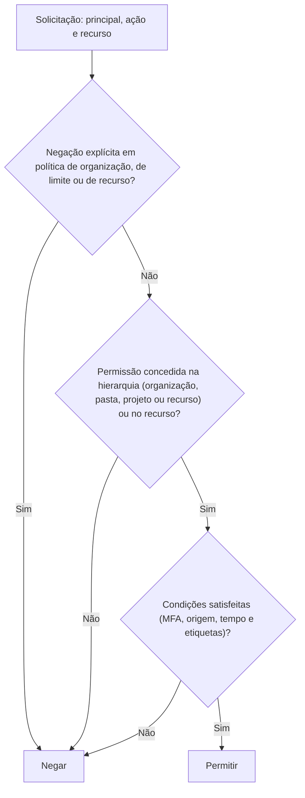

# Autorização, Privilégio Mínimo e Gestão de Permissões

> **Objetivo pedagógico:** projetar a autorização em nuvem com privilégio mínimo: modelar papéis por função de trabalho, usar atributos e etiquetas para decisões granulares, compreender a avaliação de políticas em AWS, Azure e Google Cloud (permissões, negações, limites e hierarquias), reconhecer permissões perigosas e caminhos de escalonamento de privilégio, usar ferramentas de análise de acesso para reduzir permissões não usadas e aplicar segregação de funções.

## 1. Privilégio mínimo na prática

| Dimensão | Pergunta | Aplicação |
|---|---|---|
| Quem | Quem realmente precisa deste acesso? | Papéis por função, e não por pessoa |
| O quê | Que ações são necessárias? | Ações específicas, evitando curingas |
| Onde | Em que recursos? | Recursos específicos, e não "todos" |
| Quando | Por quanto tempo? | Acesso temporário para operações sensíveis |
| Sob que condições | De onde, com que dispositivo e com que autenticação? | Condições de origem, de MFA e de etiquetas |
| Com que justificativa | Qual o motivo de negócio? | Solicitações com aprovação e vínculo a chamados |

Processo recomendado: **começar restrito**, conceder o necessário, observar o uso real e **reduzir** as permissões não usadas periodicamente.

## 2. Desenho de papéis

| Prática | Descrição |
|---|---|
| Papéis por função de trabalho | Por exemplo: leitor de registros de produção, operador de implantação de uma aplicação, administrador de rede, auditor |
| Papéis por escopo | Papéis atribuídos ao nível correto (aplicação, conta e ambiente), e não à organização inteira |
| Evitar a explosão de papéis | Combinar RBAC com atributos (departamento, ambiente e etiquetas) |
| Separar papéis de leitura, de gravação e de administração | Reduz o dano de comprometimento |
| Evitar papéis administrativos amplos de uso diário | Reservar para elevação temporária |
| Papéis de serviço separados dos de pessoas | Funções diferentes e permissões diferentes |
| Documentar propósito, proprietário e revisão | Catálogo de papéis |
| Segregação de funções | Evitar combinações que permitam fraude ou abuso (por exemplo, criar e aprovar pagamentos; administrar chaves e dados) |

### 2.1 Controle de acesso baseado em atributos (ABAC) com etiquetas

O ABAC permite regras como "um usuário pode gerenciar apenas os recursos com a mesma etiqueta de projeto que a sua", reduzindo a necessidade de muitas políticas.

```json
{
  "Version": "2012-10-17",
  "Statement": [
    {
      "Sid": "OperarSomenteRecursosDoMesmoProjeto",
      "Effect": "Allow",
      "Action": ["ec2:StartInstances", "ec2:StopInstances", "ec2:RebootInstances"],
      "Resource": "arn:aws:ec2:*:*:instance/*",
      "Condition": {
        "StringEquals": {
          "aws:ResourceTag/projeto": "${aws:PrincipalTag/projeto}"
        }
      }
    }
  ]
}
```

Atenção: o ABAC depende da **integridade das etiquetas**. Restrinja quem pode alterar as etiquetas de controle de acesso, para impedir que alguém se conceda acesso mudando uma etiqueta.

## 3. Avaliação de permissões nos provedores

### 3.1 AWS

| Mecanismo | Função |
|---|---|
| Políticas baseadas em identidade (usuários, grupos e funções) | Concedem permissões à identidade |
| Políticas baseadas em recurso (por exemplo, buckets e chaves) | Concedem permissões a principais, inclusive de outras contas |
| Limites de permissão | Teto de permissões para uma identidade |
| Políticas de controle de serviços (SCPs) | Teto de permissões para contas de uma organização |
| Políticas de sessão | Restringem as permissões de uma sessão temporária |
| Negações explícitas | Prevalecem sobre qualquer permissão |

Lógica simplificada: a ação é permitida se **não houver negação explícita** e **houver uma permissão aplicável**, dentro dos tetos impostos por SCPs, limites e políticas de sessão. Políticas de recurso podem conceder acesso dentro da mesma conta independentemente de políticas de identidade, conforme as regras do serviço. Consulte a documentação de lógica de avaliação vigente.

### 3.2 Azure

| Mecanismo | Função |
|---|---|
| RBAC do Azure | Atribuições de papéis a principais em escopos hierárquicos: grupo de gerenciamento, assinatura, grupo de recursos e recurso |
| Papéis internos e personalizados | Owner, Contributor, Reader e centenas de papéis específicos |
| Condições (ABAC) em atribuições de papéis | Restrições por atributos (por exemplo, etiquetas de blobs) |
| Atribuições de negação | Negam ações mesmo com atribuição de papel (usadas em cenários gerenciados) |
| Azure Policy | Controle de configuração e de conformidade de recursos (complementar ao RBAC) |
| Papéis do Microsoft Entra ID | Permissões administrativas do diretório (separadas do RBAC de recursos) |
| Elevação temporária (PIM) | Ativação de papéis sob demanda, com aprovação e prazo |

As permissões de recursos (RBAC do Azure) e as do diretório (papéis do Entra ID) são **planos distintos**; revise ambos.

### 3.3 Google Cloud

| Mecanismo | Função |
|---|---|
| Políticas de permissão (allow) do IAM | Vinculam principais a papéis em organização, pastas, projetos e recursos, com herança descendente |
| Papéis básicos (Owner, Editor e Viewer) | Muito amplos: evitar em produção |
| Papéis predefinidos e personalizados | Permissões mais granulares |
| Condições do IAM | Restrições por tempo, recurso e atributos |
| Políticas de negação (deny) | Negam permissões independentemente das concessões |
| Políticas de organização | Restrições de configuração (por exemplo, impedir chaves de contas de serviço) |
| Recomendações do IAM (IAM Recommender) | Sugerem a remoção de permissões não usadas |



## 4. Permissões perigosas e escalonamento de privilégio

Algumas permissões, mesmo parecendo restritas, permitem **escalar privilégios** ou contornar controles.

| Tipo de permissão | Risco |
|---|---|
| Criar ou alterar políticas e papéis (por exemplo, anexar políticas a si mesmo) | A identidade pode conceder a si mesma qualquer permissão |
| Passar funções a serviços (por exemplo, `iam:PassRole` na AWS) | Permite associar a um serviço uma função mais privilegiada e usá-la |
| Assumir funções de maior privilégio | Escalonamento lateral e vertical |
| Criar credenciais para outras identidades (chaves de acesso e de contas de serviço) | Persistência e abuso |
| Modificar políticas de confiança | Permitir que terceiros ou atacantes assumam funções |
| Alterar registros de auditoria ou desativar detecção | Evasão de defesas |
| Gerenciar chaves de criptografia e políticas de chaves | Acesso a dados protegidos |
| Executar código com identidade privilegiada (funções, instâncias e scripts de inicialização) | Execução em nome de uma identidade mais privilegiada |
| Acesso a segredos e a tokens | Obtenção de credenciais |
| Alterar etiquetas usadas em ABAC | Concessão indevida de acesso |

Controles: **negar explicitamente** essas ações para identidades comuns (por políticas organizacionais), **limitar** quem pode criar e alterar papéis (limites de permissão), **alertar** sobre alterações e **revisar** periodicamente os caminhos de escalonamento (arquivo 7).

## 5. Ferramentas de análise e redução de permissões

| Ferramenta (categoria) | Função |
|---|---|
| Analisadores de acesso dos provedores (por exemplo, o IAM Access Analyzer da AWS) | Identificam acesso externo, acesso não utilizado e validam políticas; podem gerar políticas a partir de registros de atividade |
| Recomendadores de papéis (por exemplo, o IAM Recommender do Google Cloud) | Sugerem a substituição de papéis amplos por papéis menores, com base no uso |
| Revisões de acesso e de uso (por exemplo, relatórios de acesso do Azure e do Entra ID) | Mostram permissões atribuídas e uso recente |
| Gestão de direitos em nuvem (CIEM), nativa ou de terceiros | Descoberta e redução de permissões excessivas entre nuvens; verifique a disponibilidade e a licença das soluções |
| Análise de caminhos de ataque | Mapeiam escalonamento e movimento lateral por permissões |
| Verificação de políticas em código | Validação de políticas antes da implantação (por exemplo, política como código e linting) |

### 5.1 Consultas de somente leitura para identificar permissões amplas

```bash
# AWS: exportar as políticas gerenciadas pelo cliente e listar as que concedem todas as ações em todos os recursos
aws iam get-account-authorization-details --filter LocalManagedPolicy --output json > iam_politicas.json
jq -r '.Policies[] | .PolicyName as $n
  | (.PolicyVersionList[] | select(.IsDefaultVersion) | .Document.Statement)
  | (if type=="array" then .[] else . end)
  | select(.Effect=="Allow" and (.Action=="*" or .Action==["*"]) and (.Resource=="*" or .Resource==["*"]))
  | $n' iam_politicas.json | sort -u

# Azure: atribuições com papéis de alto privilégio (Owner e User Access Administrator) em qualquer escopo
az role assignment list --all \
  --query "[?roleDefinitionName=='Owner' || roleDefinitionName=='User Access Administrator'].{principal:principalName, papel:roleDefinitionName, escopo:scope}" --output table

# Google Cloud: principais com papéis básicos (Owner e Editor) em um projeto
gcloud projects get-iam-policy ID-DO-PROJETO \
  --flatten="bindings[].members" \
  --filter="bindings.role:(roles/owner OR roles/editor)" \
  --format="table(bindings.role,bindings.members)"
```

## 6. Segregação de funções (SoD)

| Combinação de funções incompatíveis (exemplos) | Risco | Controle |
|---|---|---|
| Quem implanta em produção e quem aprova a mudança | Mudanças não autorizadas | Aprovação independente no pipeline |
| Quem administra identidades e quem audita | Alteração de evidências | Papéis separados; registros imutáveis |
| Quem administra chaves e quem acessa dados | Acesso indevido a dados protegidos | Separação de funções de chaves e de dados |
| Quem administra o plano de controle e quem acessa o plano de dados | Acesso padrão a dados por administradores | Acesso aos dados por solicitação e aprovação |
| Quem cria contas e quem concede privilégios altos | Criação de acessos ocultos | Aprovação por segundo responsável |
| Quem opera os registros e quem pode apagá-los | Encobrimento | Retenção imutável e acesso restrito |

Mantenha uma **matriz de segregação de funções** e verifique-a nas revisões de acesso (arquivo 6).

## 7. Exemplo prático: redução de um papel administrativo amplo

| Etapa | Ação | Resultado |
|---|---|---|
| Situação | O papel "Administrador de aplicações" tinha acesso total à conta e 45 usuários | Raio de impacto elevado |
| Análise | O analisador de acessos mostrou que 82% das permissões nunca foram usadas em 90 dias | Oportunidade de redução |
| Redesenho | Dividido em três papéis: "Operador de implantação", "Operador de banco de dados (somente administração)" e "Leitor de registros e de métricas" | Funções por trabalho real |
| Elevação | Ações destrutivas e acesso a segredos passam a exigir elevação temporária com aprovação | Privilégios permanentes reduzidos |
| Limites | Limite de permissão impede a criação de papéis com mais permissões do que o teto do desenvolvedor | Contenção de escalonamento |
| Resultado | Usuários com permissões administrativas permanentes caíram de 45 para 6; achados críticos de acesso caíram 70% | |

## 8. Casos de uso corporativos

- Desenho do catálogo de papéis de nuvem por função e por ambiente.
- Programas de redução de permissões com base no uso real.
- Prevenção de escalonamento de privilégio por políticas organizacionais e limites.

## 9. Normas e frameworks relevantes

- NIST SP 800-53 Rev. 5 (AC-2, AC-3, AC-5 segregação de funções e AC-6 privilégio mínimo); NIST SP 800-162 (ABAC); NIST SP 800-210
- ISO/IEC 27002:2022 (5.3 segregação de funções, 5.15 e 5.18); CSA CCM v4 (IAM); CIS Foundations Benchmarks (seções de IAM)
- MITRE ATT&CK: T1098 (manipulação de contas), T1078.004, T1548 (abuso de mecanismos de elevação)
- LGPD, art. 46 (medidas de segurança e controle de acesso)

## 10. Checklist operacional: autorização e privilégio mínimo

- [ ] Catálogo de papéis por função, com proprietário, propósito e revisão
- [ ] Sem permissões com curinga (todas as ações em todos os recursos) em identidades de uso regular
- [ ] Papéis básicos amplos evitados em produção (Owner, Editor, Administrator)
- [ ] Limites de permissão, políticas organizacionais e negações para permissões perigosas
- [ ] Alterações de políticas, de papéis e de confiança monitoradas e alertadas
- [ ] Análise periódica de permissões não usadas, com redução (trimestral)
- [ ] ABAC com integridade das etiquetas protegida
- [ ] Matriz de segregação de funções definida e verificada
- [ ] Acesso a dados separado do acesso ao plano de controle
- [ ] Revisão anual do modelo de autorização

## 11. Referências

- Hu, V. et al. NIST SP 800-162: Guide to Attribute Based Access Control (ABAC) Definition and Considerations. 2014.
- Hu, V. et al. NIST SP 800-210. 2020.
- Amazon Web Services. Policy evaluation logic; IAM Access Analyzer (documentação vigente).
- Microsoft. Azure RBAC e papéis do Microsoft Entra ID (documentação vigente).
- Google Cloud. IAM overview, deny policies e IAM Recommender (documentação vigente).
- Rhino Security Labs. AWS IAM Privilege Escalation: Methods and Mitigation. 2018 e atualizações.
