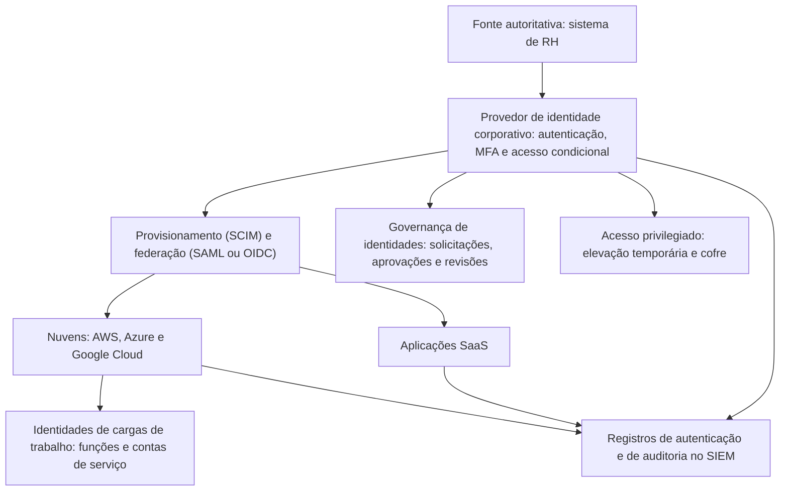
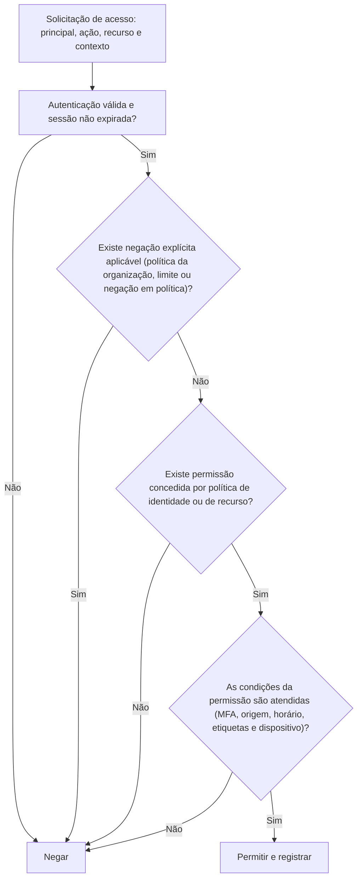

# Fundamentos de Identidade e Acesso em Nuvem

> **Objetivo pedagógico:** compreender os conceitos centrais de gestão de identidade e de acesso (identidade, autenticação, autorização e responsabilização), distinguir os tipos de identidade (pessoas, cargas de trabalho, dispositivos e terceiros), conhecer os protocolos de federação (SAML 2.0, OpenID Connect, OAuth 2.0 e SCIM), os modelos de controle de acesso (RBAC, ABAC, ReBAC e acesso temporário), as disciplinas relacionadas (IGA, PAM e CIEM) e os referenciais aplicáveis, e entender por que a identidade é o principal plano de controle e o principal alvo de ataques em nuvem.

## 1. Por que a identidade é central em nuvem

Em nuvem, toda ação sobre a infraestrutura passa por **APIs autenticadas e autorizadas**. Quem possui credenciais válidas pode criar, alterar e excluir recursos e acessar dados, de qualquer lugar. Por isso:

| Fato | Consequência |
|---|---|
| O perímetro de rede não controla o plano de gestão | A identidade substitui a rede como fronteira de confiança |
| Credenciais comprometidas são uma das causas mais frequentes de incidentes | Autenticação forte e monitoramento de identidade são prioridades |
| Permissões excessivas ampliam o dano | Privilégio mínimo e revisão contínua |
| Cargas de trabalho têm identidades próprias | Identidades não humanas superam em número as humanas e exigem governança |
| Federação conecta ambientes | O provedor de identidade é um ponto crítico de confiança |

## 2. Conceitos fundamentais

| Conceito | Definição |
|---|---|
| Identidade | Representação digital de uma pessoa, de uma carga de trabalho, de um dispositivo ou de um serviço |
| Atributo | Propriedade de uma identidade (cargo, departamento, localização, nível de risco) |
| Autenticação (AuthN) | Verificação de que a identidade é quem afirma ser |
| Autorização (AuthZ) | Decisão sobre o que a identidade autenticada pode fazer |
| Responsabilização (accountability) | Registro de quem fez o quê, quando e de onde |
| Credencial | Prova usada na autenticação (senha, chave, certificado, token, passkey) |
| Sessão e token | Estado de autenticação com prazo; tokens de acesso e de atualização |
| Principal | Entidade que pode receber permissões (usuário, grupo, função ou conta de serviço) |
| Papel (role) | Conjunto de permissões atribuível |
| Política (policy) | Regras que concedem ou negam permissões |
| Escopo | Nível em que a permissão se aplica (organização, conta, recurso) |
| Provedor de identidade (IdP) | Sistema que autentica e emite asserções ou tokens |
| Provedor de serviço (SP) ou parte confiante | Sistema que confia no IdP |
| Federação | Confiança entre domínios para que a identidade de um seja aceita em outro |
| SSO (single sign-on) | Autenticação única para vários serviços |

## 3. Tipos de identidade

| Tipo | Descrição | Riscos típicos | Controles principais |
|---|---|---|---|
| Pessoas (colaboradores) | Usuários internos, de dia a dia e administradores | Phishing, reutilização de senhas, privilégios excessivos | MFA resistente a phishing, acesso condicional, revisão de acessos |
| Terceiros e convidados | Parceiros, fornecedores e prestadores | Acessos esquecidos, falta de controle | Contas com expiração, escopo mínimo, revisão |
| Clientes (CIAM) | Usuários finais de aplicações | Tomada de contas, fraude | Autenticação adaptativa, detecção de bots, privacidade |
| Cargas de trabalho (máquinas) | Funções, contas de serviço, identidades gerenciadas, aplicações | Chaves vazadas, permissões amplas, falta de proprietário | Credenciais temporárias, federação, rotação, inventário |
| Dispositivos | Estações, servidores, dispositivos móveis | Dispositivos comprometidos | Gestão e conformidade do dispositivo |
| Agentes automatizados e de IA | Automações e agentes que agem em nome de pessoas ou de sistemas | Permissões excessivas; abuso | Identidade própria, escopo mínimo, aprovação humana para ações sensíveis |

As identidades **não humanas** costumam ser **muito mais numerosas** do que as humanas e frequentemente têm credenciais de longa duração e permissões amplas, tornando-se alvos preferenciais.

## 4. Protocolos e padrões

| Protocolo | Finalidade | Uso típico em nuvem |
|---|---|---|
| SAML 2.0 | Federação baseada em asserções XML, para SSO | Acesso de usuários ao console e a SaaS pelo IdP corporativo |
| OpenID Connect (OIDC) | Camada de identidade sobre o OAuth 2.0, com tokens JWT | SSO moderno; federação de cargas e de pipelines |
| OAuth 2.0 | Delegação de autorização por tokens com escopos | Acesso de aplicações a APIs; consentimento de aplicativos |
| SCIM | Provisionamento e desprovisionamento automático de identidades | Sincronizar usuários e grupos do IdP para SaaS e nuvens |
| Kerberos e LDAP | Autenticação e diretório em ambientes locais e híbridos | Integração com diretórios corporativos |
| FIDO2 e WebAuthn | Autenticação sem senha resistente a phishing | MFA forte e passkeys |
| mTLS e certificados | Autenticação mútua de serviços | Comunicação entre cargas |
| SPIFFE | Identidades padronizadas para cargas de trabalho | Malhas de serviços e ambientes heterogêneos |

## 5. Componentes de uma arquitetura de IAM

## 6. Disciplinas e siglas

| Sigla | Significado | Escopo |
|---|---|---|
| IAM | Gestão de identidade e de acesso | Conjunto geral |
| IGA | Governança e administração de identidades | Ciclo de vida, solicitações, certificação e segregação de funções |
| PAM | Gestão de acesso privilegiado | Contas e sessões privilegiadas, cofres e elevação temporária |
| CIEM | Gestão de direitos de infraestrutura em nuvem | Descoberta e redução de permissões excessivas em nuvem |
| ITDR | Detecção e resposta a ameaças de identidade | Monitoramento e resposta ao abuso de identidades |
| CIAM | IAM de clientes | Identidade de usuários finais de aplicações |
| MFA | Autenticação multifator | Mais de um fator de verificação |

## 7. Modelos de controle de acesso

| Modelo | Descrição | Vantagens | Limitações |
|---|---|---|---|
| ACL (lista de controle de acesso) | Lista de quem acessa cada recurso | Simples para poucos recursos | Difícil de escalar e de auditar |
| RBAC (controle de acesso baseado em papéis) | Permissões agrupadas em papéis atribuídos a usuários | Compreensível; auditável | Explosão de papéis; granularidade limitada |
| ABAC (controle de acesso baseado em atributos) | Decisões com base em atributos do usuário, do recurso e do contexto | Granular e escalável; contextual | Complexidade de desenho e de teste |
| ReBAC (baseado em relacionamentos) | Decisões baseadas em relações entre entidades | Adequado a compartilhamento e a grafos | Complexidade de implementação |
| PBAC (baseado em políticas) | Políticas explícitas avaliadas por um motor | Flexível e centralizável | Governança de políticas |
| Acesso temporário (JIT) | Permissões concedidas por tempo limitado | Reduz privilégios permanentes | Exige fluxo de solicitação e aprovação |
| Acesso condicional (contextual) | Decisão considera dispositivo, localização e risco | Reduz o risco de credenciais roubadas | Depende de sinais de qualidade |

## 8. Lógica geral de decisão de acesso

Princípio comum aos provedores: **negação explícita prevalece**; sem permissão explícita, o acesso é negado por padrão. Os detalhes da avaliação variam (arquivo 3).

## 9. Referenciais

| Referencial | Contribuição |
|---|---|
| NIST SP 800-63 (partes A, B e C) | Níveis de garantia de identidade (IAL), de autenticação (AAL) e de federação (FAL) |
| NIST SP 800-210 | Controle de acesso para sistemas em nuvem |
| NIST SP 800-207 | Zero trust: verificação contínua de identidade e de contexto |
| NIST SP 800-53 Rev. 5 (famílias AC e IA) | Controles de acesso e de identificação e autenticação |
| CSA CCM v4, domínio IAM | Controles de identidade e de acesso em nuvem |
| ISO/IEC 27002:2022 (5.15 a 5.18 e 8.2 a 8.5) | Controle de acesso, gestão de identidades, informações de autenticação, direitos de acesso e autenticação segura |
| CIS Foundations Benchmarks e CIS Controls v8.1 (controles 5 e 6) | Linhas de base de contas e de gestão de controle de acesso |
| NCSC, princípios 9 a 12 | Gestão de usuários, identidade e autenticação, interfaces externas e administração |
| OWASP ASVS (autenticação, gestão de sessão e controle de acesso) | Requisitos para aplicações |
| MITRE ATT&CK for Cloud | Técnicas de abuso de identidades (T1078.004, T1098, T1136.003, T1528, T1550) |

## 10. Exemplo prático: o mesmo acesso em três camadas de decisão

Cenário: um engenheiro precisa ler registros de uma aplicação em produção.

| Camada | Decisão |
|---|---|
| Autenticação | SSO pelo provedor corporativo com MFA resistente a phishing e dispositivo gerenciado |
| Autorização | Papel de leitura de registros, limitado à conta e à aplicação, sem acesso a dados |
| Acesso temporário | Acesso concedido por 4 horas, com justificativa e vínculo a um chamado |
| Contexto | Bloqueio fora do país e de dispositivos não conformes |
| Responsabilização | Registro da sessão e dos recursos acessados; alerta se acessar dados fora do escopo |

## 11. Casos de uso corporativos

- Definição do modelo de IAM da organização (fonte de identidade, federação e papéis).
- Avaliação do estado de identidade em nuvem (credenciais, privilégios e identidades não humanas).
- Treinamento de arquitetos e de equipes de produto sobre identidade como plano de controle.

## 12. Normas e frameworks relevantes

- NIST SP 800-63-3 e a revisão 4 (conferir a versão vigente); NIST SP 800-53 Rev. 5 (AC e IA); NIST SP 800-210; NIST SP 800-207
- ISO/IEC 27002:2022; ISO/IEC 29115 (garantia de autenticação de entidades); ISO/IEC 24760 (estrutura de gestão de identidades)
- CSA CCM v4 (IAM); CIS Controls v8.1; OWASP ASVS; MITRE ATT&CK for Cloud
- LGPD, arts. 6º e 46 (segurança e minimização de dados de identidade)

## 13. Checklist operacional: base de identidade e acesso

- [ ] Fonte autoritativa de identidades (RH) e provedor de identidade corporativo definidos
- [ ] Federação (SAML ou OIDC) com as nuvens e os SaaS principais; provisionamento por SCIM
- [ ] Inventário de identidades humanas e não humanas, com proprietários
- [ ] Modelo de controle de acesso definido (RBAC com atributos e acesso temporário)
- [ ] MFA resistente a phishing definida para acessos privilegiados
- [ ] Registros de autenticação e de auditoria centralizados
- [ ] Papéis de IAM (administrador de identidade, de acesso privilegiado e de auditoria) separados
- [ ] Revisão anual do modelo de IAM

## 14. Referências

- Grassi, P. et al. NIST SP 800-63-3 (e revisão 4): Digital Identity Guidelines; SP 800-63A, 63B e 63C.
- Hu, V. et al. NIST SP 800-210: General Access Control Guidance for Cloud Systems. 2020.
- Rose, S. et al. NIST SP 800-207: Zero Trust Architecture. 2020.
- ISO/IEC 24760-1:2019. IT Security and Privacy: A framework for identity management.
- Cloud Security Alliance. CCM v4, domínio IAM. 2021.
- MITRE. ATT&CK for Cloud. https://attack.mitre.org
