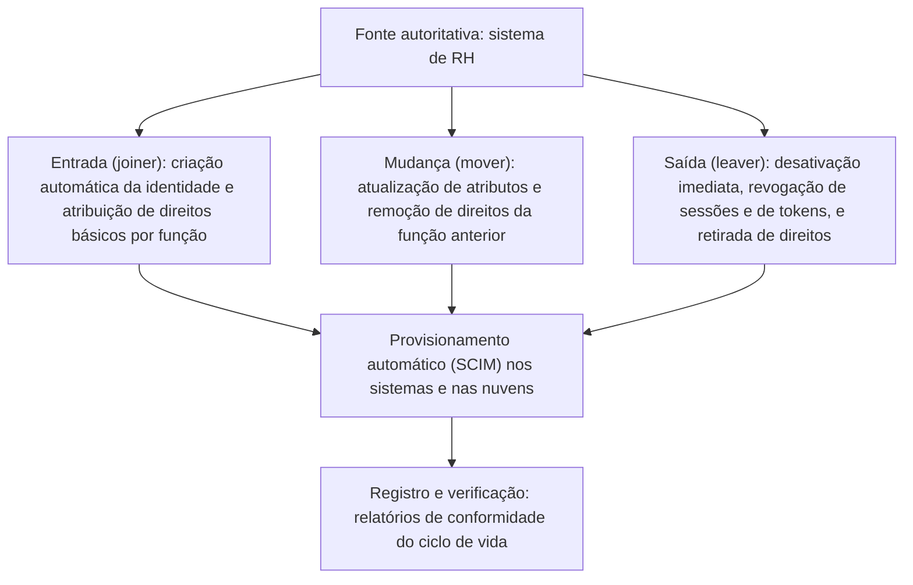

# Governança de Identidades, Ciclo de Vida e Revisão de Acessos

> **Objetivo pedagógico:** governar o ciclo de vida das identidades (entrada, mudança e saída), usar o RH como fonte autoritativa e o provisionamento automático (SCIM), conduzir solicitações de acesso com aprovação e catálogo de direitos, realizar revisões periódicas de acesso (certificações) proporcionais ao risco, tratar convidados e terceiros, aplicar segregação de funções, detectar contas órfãs e inativas, medir a governança com indicadores e atender aos requisitos de privacidade e de conformidade.

## 1. Ciclo de vida das identidades (entrada, mudança e saída)



| Evento | Ações obrigatórias | Prazo (exemplo) |
|---|---|---|
| Entrada | Criar identidade; atribuir grupos pela função; entregar autenticadores fortes; exigir treinamento | Antes do primeiro dia |
| Mudança de função | Atualizar atributos; **remover** direitos da função anterior; atribuir os da nova; aprovação para direitos adicionais | Em até 2 dias úteis |
| Saída (desligamento) | Desativar a conta; revogar sessões e tokens; remover acessos e dispositivos; transferir propriedade de recursos e de dados; desativar chaves e segredos associados | Imediato (no momento do desligamento) |
| Afastamentos | Suspender acessos conforme a política | Conforme a política |
| Terceiros | Expiração automática; revisão periódica | Conforme o contrato |

Um dos erros mais comuns é **acumular direitos nas mudanças de função** (*privilege creep*): sempre remova os direitos antigos.

## 2. Fonte autoritativa e provisionamento automático

| Elemento | Prática |
|---|---|
| Sistema de RH como fonte | Atributos oficiais (nome, função, departamento, gestor, situação) alimentam o provedor de identidade |
| Provisionamento por SCIM | Sincronização automática de usuários e grupos do provedor de identidade para nuvens e SaaS |
| Grupos por função e por atributos | Direitos básicos derivados de grupos dinâmicos |
| Eliminação de contas locais | Preferir SSO e federação; contas locais apenas de emergência |
| Reconciliação | Detectar contas que existem nos sistemas, mas não no provedor de identidade |
| Qualidade de dados | Corrigir inconsistências de RH; responsáveis definidos |

## 3. Solicitações de acesso e catálogo de direitos

| Elemento | Descrição |
|---|---|
| Catálogo de direitos | Lista de papéis e de grupos solicitáveis, com descrição, risco, proprietário e requisitos |
| Solicitação | Pedido com justificativa e prazo, preferencialmente pelo catálogo |
| Aprovação | Gestor para direitos comuns; proprietário do recurso e segurança para direitos sensíveis; duplo aprovador para privilégios altos |
| Validação de segregação de funções | Verificação automática de conflitos antes da concessão |
| Prazo | Acessos temporários com expiração; renovação com nova justificativa |
| Registro | Histórico de solicitações, aprovações e concessões |
| Pacotes de acesso por função | Conjuntos de direitos pré-aprovados para funções comuns |

## 4. Revisões de acesso (certificações)

| Tipo de revisão | Escopo | Frequência (referência) | Revisor |
|---|---|---|---|
| Acessos privilegiados | Papéis administrativos e elegibilidades | Trimestral | Proprietário do recurso e segurança |
| Acessos a dados restritos | Grupos com acesso a dados sensíveis | Trimestral | Proprietário de dados |
| Acessos de uso geral | Grupos e papéis comuns | Semestral ou anual | Gestor |
| Terceiros e convidados | Identidades externas | Trimestral | Patrocinador interno |
| Identidades não humanas | Contas de serviço e funções | Trimestral para privilegiadas | Proprietário da aplicação |
| Aplicações e consentimentos | Aplicativos com acesso a dados | Trimestral | Segurança e proprietário |

### Boas práticas de revisão

| Prática | Descrição |
|---|---|
| Dados úteis ao revisor | Mostrar o uso recente (último acesso), o risco do direito e a recomendação |
| Padrão de revogação | Em ausência de resposta, remover (ou escalonar) em vez de manter |
| Revisão por exceção | Foco em direitos de alto risco e em acessos sem uso |
| Prazo e escalonamento | Prazos curtos, lembretes e escalonamento ao gestor do revisor |
| Evidências | Guardar resultados, decisões e remoções realizadas |
| Revisão de revisores | Evitar que o revisor aprove os próprios acessos |
| Correção | Remoção efetiva dos acessos revogados, verificada |

## 5. Segregação de funções

| Passo | Descrição |
|---|---|
| Definir a matriz | Pares de direitos incompatíveis (por exemplo, administrar chaves e acessar dados; criar e aprovar pagamentos) |
| Prevenir | Bloquear a concessão em solicitações |
| Detectar | Varrer periodicamente combinações existentes |
| Exceções | Quando inevitáveis, controles compensatórios, aprovação e prazo |
| Revisar | Incluir a análise de conflitos nas certificações |

## 6. Contas órfãs, inativas e convidadas

| Tema | Detecção | Ação |
|---|---|---|
| Contas de pessoas desligadas ainda ativas | Reconciliação com o RH | Desativar imediatamente; investigar uso após o desligamento |
| Contas inativas | Sem entrada há mais de 90 dias (ajustar por risco) | Desativar após notificação; excluir após o prazo de retenção |
| Contas de convidados e de terceiros sem patrocinador ou vencidas | Relatórios de identidades externas | Revisar, renovar ou remover |
| Contas de serviço sem proprietário | Inventário | Atribuir ou desativar |
| Acessos duplicados e contas privilegiadas sem uso | Análise de uso | Remover |

### Exemplo de análise com dados exportados

`revisao_acessos.csv` (fictício):

```
usuario,tipo,ultimo_login,papel,privilegiado,patrocinador
ana.silva,colaborador,2026-11-10,Operador-Producao,nao,
carlos.lima,colaborador,2026-06-02,Administrador-Dados,sim,
parceiro.x,convidado,2026-09-01,Leitor-Relatorios,nao,
joao.souza,colaborador,2026-11-12,Administrador-Seguranca,sim,
fornecedor.y,convidado,2026-03-15,Operador-Producao,nao,
```

```sql
-- DuckDB: contas privilegiadas sem login há mais de 90 dias e convidados sem patrocinador (data de referência: 2026-11-15)
SELECT usuario, tipo, papel, ultimo_login,
       date_diff('day', CAST(ultimo_login AS DATE), DATE '2026-11-15') AS dias_sem_login,
       CASE
         WHEN privilegiado = 'sim' AND date_diff('day', CAST(ultimo_login AS DATE), DATE '2026-11-15') > 90 THEN 'privilegiada inativa'
         WHEN tipo = 'convidado' AND (patrocinador IS NULL OR patrocinador = '') THEN 'convidado sem patrocinador'
         WHEN date_diff('day', CAST(ultimo_login AS DATE), DATE '2026-11-15') > 90 THEN 'inativa'
       END AS achado
FROM read_csv_auto('revisao_acessos.csv')
WHERE (privilegiado = 'sim' AND date_diff('day', CAST(ultimo_login AS DATE), DATE '2026-11-15') > 90)
   OR (tipo = 'convidado' AND (patrocinador IS NULL OR patrocinador = ''))
   OR date_diff('day', CAST(ultimo_login AS DATE), DATE '2026-11-15') > 90
ORDER BY dias_sem_login DESC;
```

## 7. Indicadores de governança de identidades

| Indicador | Meta típica |
|---|---|
| Tempo de desativação após o desligamento | Imediato (até 1 hora) |
| Contas de pessoas desligadas ativas | Zero |
| Revisões de acesso concluídas no prazo | Acima de 95% |
| Acessos revogados nas revisões e efetivamente removidos | 100% |
| Contas privilegiadas inativas | Zero |
| Convidados sem patrocinador ou vencidos | Zero |
| Conflitos de segregação de funções abertos | Zero (ou com exceção aprovada) |
| Identidades não humanas sem proprietário | Zero |
| Provisionamento automático (percentual de aplicações integradas ao SCIM) | Crescente, com meta por criticidade |

## 8. Privacidade e conformidade

| Tema | Orientação |
|---|---|
| Minimização | Coletar e manter apenas os dados de identidade necessários (LGPD, art. 6º) |
| Registros de acesso | Podem conter dados pessoais; definir retenção, finalidade e acesso restrito |
| Monitoramento de colaboradores | Política comunicada, finalidade legítima e proporcionalidade |
| Dados biométricos de autenticação | Dados sensíveis (LGPD, art. 11); preferir tratamento local no dispositivo |
| Retenção após desligamento | Prazos para registros e para dados de contas, conforme obrigações legais |
| Evidências para auditoria | Revisões, aprovações e remoções documentadas (ISO/IEC 27001 e normas setoriais) |
| Regulação setorial | Normas de segurança cibernética de instituições financeiras exigem controles de acesso e rastreabilidade (por exemplo, Resolução CMN nº 4.893/2021); confirme com o Jurídico |

## 9. Exemplo prático: programa de revisão de acessos

| Etapa | Ação | Resultado |
|---|---|---|
| Diagnóstico | 2.300 usuários; 18% das contas privilegiadas inativas há mais de 90 dias; 64 convidados sem patrocinador; 11 contas de pessoas desligadas ainda ativas | Achados críticos |
| Correção imediata | Desativação das 11 contas; remoção dos privilégios inativos; patrocinadores para convidados | Redução do risco |
| Automação | Integração do RH com o provedor de identidade por SCIM; desativação automática no desligamento | Tempo de desativação de 3 dias para 15 minutos |
| Revisões | Trimestral para privilegiados; semestral para os demais; padrão de revogação sem resposta | Taxa de conclusão de 97% |
| Segregação de funções | Matriz com 12 regras; 3 conflitos resolvidos e 1 exceção aprovada | Prevenção na solicitação |
| Resultado | Contas privilegiadas inativas: zero; convidados sem patrocinador: zero; evidências prontas para a auditoria da ISO/IEC 27001 | |

## 10. Casos de uso corporativos

- Automatização do ciclo de entrada, mudança e saída com o sistema de RH como fonte.
- Programa de certificação de acessos com foco em privilégios e em dados restritos.
- Governança de acessos de terceiros e de identidades não humanas.

## 11. Normas e frameworks relevantes

- ISO/IEC 27002:2022 (5.15 a 5.18, 6.5 e 8.2); ISO/IEC 27001:2022 (A.5.18 revisão de direitos de acesso, conforme a numeração dos controles)
- NIST SP 800-53 Rev. 5 (AC-2, gestão de contas; PS-4 e PS-5, desligamento e transferência de pessoal); NIST SP 800-63; NIST SP 800-207
- CSA CCM v4 (IAM e HRS); CIS Controls v8.1 (controles 5 e 6); COBIT 2019
- LGPD, arts. 6º, 11 e 46; Resolução CMN 4.893/2021 (setor financeiro)

## 12. Checklist operacional: governança de identidades

- [ ] Sistema de RH como fonte autoritativa; provisionamento automático por SCIM
- [ ] Processos de entrada, mudança e saída documentados e automatizados, com remoção de direitos antigos nas mudanças
- [ ] Desativação imediata no desligamento, com revogação de sessões, de tokens e de chaves
- [ ] Catálogo de direitos, solicitações com aprovação e validação de segregação de funções
- [ ] Revisões de acesso periódicas por tipo, com padrão de revogação e evidências
- [ ] Gestão de convidados e de terceiros: patrocinador, expiração e revisão
- [ ] Detecção e tratamento de contas órfãs, inativas e privilegiadas sem uso
- [ ] Matriz de segregação de funções ativa e verificada
- [ ] Indicadores acompanhados e reportados
- [ ] Retenção e privacidade dos dados de identidade definidas

## 13. Referências

- ISO/IEC 24760. IT Security and Privacy: A framework for identity management.
- NIST. SP 800-53 Rev. 5; SP 800-63.
- Gartner. Identity Governance and Administration (visão geral de mercado e conceitos, edições vigentes).
- Documentação de provisionamento SCIM e de revisões de acesso do Microsoft Entra ID, do AWS IAM Identity Center e do Google Cloud Identity.
- Documentação do DuckDB.
