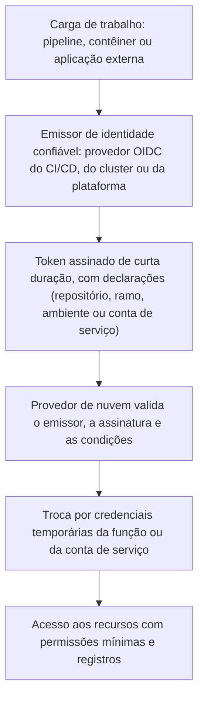

# Identidades de Cargas de Trabalho, Segredos e Federação

> **Objetivo pedagógico:** governar as identidades não humanas (funções, identidades gerenciadas, contas de serviço, aplicações e pipelines): usar credenciais temporárias e federação de identidade em vez de chaves de longa duração, aplicar identidades de cargas em máquinas virtuais, contêineres, funções e Kubernetes, federar pipelines de CI/CD e cargas de outros ambientes, gerir segredos com cofres, rotação e credenciais dinâmicas, inventariar e dar ciclo de vida às identidades não humanas e verificar o estado atual por consultas de somente leitura.

## 1. O problema das identidades não humanas

| Característica | Consequência |
|---|---|
| Numerosas (dezenas de vezes mais que as humanas) | Difícil de inventariar e de revisar |
| Credenciais de longa duração (chaves e senhas) | Vazamentos em código, em imagens, em logs e em pipelines |
| Permissões amplas por conveniência | Grande raio de impacto |
| Sem proprietário claro | Contas órfãs e esquecidas |
| Sem MFA possível | Dependem de outras proteções (credenciais temporárias, condições e rede) |
| Muitas vezes pouco monitoradas | Abusos tardiamente detectados |

Princípio: **toda carga de trabalho obtém credenciais temporárias, por identidade própria, com permissões mínimas, e nenhuma chave de longa duração é armazenada**.

## 2. Padrões de identidade de cargas por ambiente

| Ambiente | AWS | Azure | Google Cloud |
|---|---|---|---|
| Máquinas virtuais | Perfil de instância com função do IAM | Identidade gerenciada atribuída ao sistema ou ao usuário | Conta de serviço associada à instância |
| Contêineres gerenciados | Função de tarefa | Identidade gerenciada | Conta de serviço da carga |
| Kubernetes | Funções do IAM para contas de serviço (IRSA) ou identidade de pods | Identidade de carga de trabalho para AKS (federação com o emissor do cluster) | Workload Identity do GKE |
| Funções sem servidor | Função de execução | Identidade gerenciada da função | Conta de serviço da função |
| Pipelines de CI/CD | Federação OIDC com função assumida | Credenciais federadas para aplicações | Federação de identidade de cargas (Workload Identity Federation) |
| Cargas fora da nuvem ou em outra nuvem | Federação ou funções para identidades externas | Federação de identidade de cargas | Workload Identity Federation |

## 3. Federação de identidade de cargas



| Elemento | Prática |
|---|---|
| Condições na confiança | Restringir por emissor, público, repositório, ramo, ambiente e identificador da carga |
| Funções por ambiente | Funções distintas para desenvolvimento, homologação e produção; aprovação manual para produção |
| Duração das credenciais | Curta (minutos a horas) |
| Permissões | Somente o necessário à tarefa (implantar uma aplicação, ler um segredo) |
| Registros | Auditoria das trocas de token e das ações |
| Proteção do emissor | O emissor de identidade (por exemplo, o sistema de CI/CD) passa a ser ativo crítico: proteger e monitorar |

Exemplo de política de confiança para pipelines: arquivo 4 da pasta 05 (federação por OIDC com condições de repositório e de ramo).

## 4. Chaves de longa duração: eliminar ou controlar

| Situação | Orientação |
|---|---|
| Existem chaves de acesso de usuários IAM ou de contas de serviço | Inventariar; substituir por federação e credenciais temporárias; desativar as não usadas |
| Chave inevitável (por exemplo, sistema legado sem suporte a federação) | Justificar como exceção; permissões mínimas; rotação frequente; armazenamento em cofre; monitoramento de uso e alertas; prazo para eliminação |
| Impedir novas chaves | Políticas organizacionais que bloqueiam a criação de chaves de contas de serviço (por exemplo, restrição específica no Google Cloud) e políticas que negam a criação de chaves de acesso em usuários |
| Detecção de exposição | Varredura de segredos em repositórios, em imagens e em registros; serviços de verificação dos provedores |
| Resposta | Desativar, rotacionar, investigar o uso e revisar (pasta 22) |

```yaml
# Google Cloud: política da organização que impede a criação de chaves de contas de serviço
name: organizations/123456789012/policies/iam.disableServiceAccountKeyCreation
spec:
  rules:
  - enforce: true
```

```bash
# Aplicar a política (substitua o identificador da organização; teste antes em uma pasta de teste)
gcloud org-policies set-policy politica_sem_chaves_sa.yaml
```

## 5. Gestão de segredos

| Tema | Padrão |
|---|---|
| Cofre | Serviço de gestão de segredos (por exemplo, AWS Secrets Manager, Azure Key Vault, Google Secret Manager ou HashiCorp Vault), com controle de acesso por identidade e registro de acessos |
| Entrega às cargas | Obtenção em tempo de execução, por identidade da carga; evitar segredos em arquivos de configuração, em imagens e em variáveis de ambiente em texto claro |
| Rotação | Rotação automática de senhas, de chaves e de certificados; prazos definidos |
| Credenciais dinâmicas | Credenciais geradas sob demanda, com expiração (por exemplo, para bancos de dados) |
| Segregação | Segredos por aplicação e por ambiente; acesso mínimo |
| Cache e vida curta | Cache de segredos com validade limitada |
| Auditoria | Registro e alerta de acessos anômalos |
| Certificados | Gestão automatizada do ciclo de vida (emissão, renovação e revogação) |
| Padrões abertos | SPIFFE/SPIRE para identidades de cargas em ambientes heterogêneos e malhas de serviços |

## 6. Ciclo de vida das identidades não humanas

| Fase | Atividades |
|---|---|
| Criação | Solicitação com finalidade, proprietário, permissões e prazo de revisão; criação por código |
| Operação | Credenciais temporárias; permissões mínimas; monitoramento de uso |
| Revisão | Revisão periódica de proprietário, de permissões e de uso (trimestral para privilegiadas) |
| Rotação | Rotação de segredos e de certificados |
| Desativação | Remoção quando a carga é descontinuada ou o proprietário sai; verificação de que não há uso |
| Inventário | Catálogo único de identidades não humanas, com proprietário e última utilização |

| Indicador | Definição |
|---|---|
| Identidades não humanas sem proprietário | Contagem |
| Chaves de longa duração ativas | Contagem e idade |
| Identidades sem uso nos últimos 90 dias | Candidatas à desativação |
| Identidades com permissões amplas | Contagem |
| Segredos sem rotação no prazo | Contagem |
| Percentual de cargas e de pipelines com credenciais temporárias | Meta de 100% |

## 7. Consultas de somente leitura

```bash
# AWS: relatório de credenciais (idade e último uso de senhas e de chaves de acesso de todos os usuários)
aws iam generate-credential-report >/dev/null
aws iam get-credential-report --query Content --output text | base64 -d > relatorio_credenciais.csv
# Usuários com chaves de acesso ativas e a data do último uso
awk -F, 'NR>1 && $9=="true" {print $1, "chave1 ativa; ultimo uso:", $11}' relatorio_credenciais.csv

# AWS: chaves de acesso de um usuário específico e último uso
aws iam list-access-keys --user-name usuario-exemplo
aws iam get-access-key-last-used --access-key-id AKIAEXEMPLO000000000

# Azure: aplicações e entidades de serviço do diretório (ajuste os filtros; requer permissões de leitura)
az ad sp list --all --query "[].{nome:displayName, id:appId, tipo:servicePrincipalType}" --output table | head -n 30

# Google Cloud: contas de serviço e chaves gerenciadas por usuários (as chaves gerenciadas pelo usuário são as de longa duração)
gcloud iam service-accounts list --project=ID-DO-PROJETO --format="table(email,disabled)"
gcloud iam service-accounts keys list --iam-account=conta-exemplo@ID-DO-PROJETO.iam.gserviceaccount.com --managed-by=user
```

Os campos do relatório de credenciais da AWS têm posições definidas; confirme as colunas na documentação antes de usar os índices no `awk`.

## 8. Exemplo prático: eliminando chaves de um pipeline e de uma aplicação

| Situação inicial | Ação | Resultado |
|---|---|---|
| O pipeline usa uma chave de acesso de administrador armazenada no sistema de CI/CD | Federação OIDC com função por ambiente e permissões mínimas; aprovação manual para produção | Sem chave armazenada; credenciais de 1 hora |
| Uma aplicação em contêineres usa chaves em variáveis de ambiente para acessar o armazenamento | Identidade de carga de trabalho para o cluster; política de acesso por identidade ao armazenamento | Sem chave na aplicação |
| Senha de banco de dados em arquivo de configuração | Cofre de segredos com rotação automática e credenciais dinâmicas | Senha rotacionada a cada 30 dias, sem exposição |
| 41 contas de serviço com chaves de longa duração | 28 migradas para identidades de carga; 9 desativadas por falta de uso; 4 mantidas como exceção, com rotação mensal e alertas | Chaves de longa duração reduzidas em 90% |
| Prevenção | Política que impede a criação de novas chaves de contas de serviço | Novas chaves bloqueadas por padrão |
| Detecção | Varredura de segredos no repositório e nos pipelines; alerta de uso de chave por origem desconhecida | Exposições detectadas em minutos |

## 9. Casos de uso corporativos

- Programa de eliminação de chaves de longa duração em pipelines e em aplicações.
- Inventário e governança de identidades não humanas com proprietários e ciclo de vida.
- Padronização do acesso a segredos por identidade, com rotação e auditoria.

## 10. Normas e frameworks relevantes

- NIST SP 800-53 Rev. 5 (IA-5, gestão de autenticadores; SC-12 e SC-28); NIST SP 800-57 (gestão de chaves); NIST SP 800-204 (série, identidade de serviços em microsserviços)
- ISO/IEC 27002:2022 (5.17, informações de autenticação; 8.24); CSA CCM v4 (IAM e CEK); CIS Foundations Benchmarks
- OWASP ASVS (gestão de segredos) e OWASP Non-Human Identities Top 10; SPIFFE (CNCF)
- MITRE ATT&CK: T1552 (credenciais não protegidas), T1528 (roubo de token de aplicação), T1078.004

## 11. Checklist operacional: identidades não humanas e segredos

- [ ] Inventário único de identidades não humanas, com proprietário e finalidade
- [ ] Cargas usando identidades gerenciadas, funções e credenciais temporárias
- [ ] Pipelines federados por OIDC, com condições por repositório, ramo e ambiente; sem chaves armazenadas
- [ ] Chaves de longa duração inventariadas, justificadas como exceção, rotacionadas e monitoradas
- [ ] Política que impede a criação de novas chaves de contas de serviço e de usuários
- [ ] Segredos em cofre, com rotação, credenciais dinâmicas e auditoria de acesso
- [ ] Varredura de segredos em repositórios, em imagens e em registros
- [ ] Revisão trimestral de identidades privilegiadas e desativação de identidades sem uso
- [ ] Procedimento de resposta a exposição de credenciais (desativar, rotacionar e investigar)

## 12. Referências

- Barker, E. NIST SP 800-57 Part 1 Rev. 5. 2020.
- OWASP. Non-Human Identities Top 10; Application Security Verification Standard 4.0.
- Amazon Web Services. IAM roles, IRSA e AWS Secrets Manager; Microsoft. Managed identities e Azure Key Vault; Google Cloud. Workload Identity Federation e Secret Manager (documentação vigente).
- CNCF. SPIFFE e SPIRE (documentação).
- Pasta 05 deste repositório (desenho de identidade) e pasta 21 (DevSecOps).
