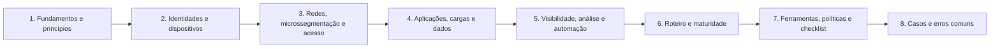

# 07 Zero Trust em Nuvem

## Objetivo

Aplicar o modelo Zero Trust à nuvem de forma prática e verificável: compreender os princípios e a arquitetura lógica do NIST SP 800-207, projetar verificação contínua para identidades e dispositivos, eliminar a confiança implícita na rede com microssegmentação e acesso por aplicação, proteger aplicações, cargas de trabalho e dados com autorização por requisição, construir a capacidade transversal de visibilidade, análise e automação, e conduzir a implementação por um roteiro priorizado com o modelo de maturidade da CISA.

## Trilha de estudo recomendada

## Conteúdo da pasta

| Ordem | Arquivo | Objetivo |
|---|---|---|
| 1 | [fundamentos-de-zero-trust-e-principios.md](fundamentos-de-zero-trust-e-principios.md) | Origem, princípios, arquitetura lógica do NIST, pilares e mitos |
| 2 | [zero-trust-para-identidades-e-dispositivos.md](zero-trust-para-identidades-e-dispositivos.md) | Verificação contínua, confiança de dispositivo e motor de decisão de acesso |
| 3 | [zero-trust-para-redes-microssegmentacao-e-acesso-a-aplicacoes.md](zero-trust-para-redes-microssegmentacao-e-acesso-a-aplicacoes.md) | ZTNA, microssegmentação, conectividade privada e malha de serviços |
| 4 | [zero-trust-para-aplicacoes-cargas-de-trabalho-e-dados.md](zero-trust-para-aplicacoes-cargas-de-trabalho-e-dados.md) | Autorização por requisição, cadeia de suprimentos e proteção de dados |
| 5 | [visibilidade-analise-automacao-e-orquestracao.md](visibilidade-analise-automacao-e-orquestracao.md) | Telemetria, análise de risco, resposta automatizada e governança |
| 6 | [roteiro-de-implementacao-e-modelo-de-maturidade.md](roteiro-de-implementacao-e-modelo-de-maturidade.md) | Superfícies de proteção, fases, maturidade da CISA e métricas |
| 7 | [ferramentas-politicas-modelos-e-checklist-de-zero-trust.md](ferramentas-politicas-modelos-e-checklist-de-zero-trust.md) | Verificações nos provedores, catálogo de políticas, modelos e checklist |
| 8 | [casos-de-uso-e-erros-comuns-em-zero-trust.md](casos-de-uso-e-erros-comuns-em-zero-trust.md) | Casos fictícios, erros comuns, exercícios e perguntas de revisão |

## Princípios da pasta

- Nunca confiar implicitamente: verificar explicitamente cada requisição, com identidade, dispositivo e contexto
- Privilégio mínimo, por sessão e por recurso, com decisão dinâmica
- Assumir violação: segmentar, registrar, detectar e conter
- A localização na rede não concede confiança
- Zero Trust é uma estratégia e uma jornada, e não um produto
- Medir a maturidade por pilar e priorizar ganhos de maior redução de risco

## Relação com outras pastas

- 01 a 05: fundamentos, responsabilidade, governança, riscos e arquitetura
- 06: identidade e acesso (base do Zero Trust)
- 08: segurança de rede em nuvem (detalhes de rede)
- 09 e 10: proteção de dados e criptografia
- 13: monitoramento e registros
- 17 e 18: postura e proteção de cargas de trabalho
- 19 a 21: contêineres, Kubernetes e DevSecOps
- 22 e 23: resposta a incidentes e forense

## Referências

- Rose, S. et al. NIST SP 800-207: Zero Trust Architecture. 2020
- CISA. Zero Trust Maturity Model, versão 2.0 (2023)
- Ward, R.; Beyer, B. BeyondCorp: A New Approach to Enterprise Security. ;login:, 2014
- Kindervag, J. No More Chewy Centers: Introducing The Zero Trust Model of Information Security. Forrester, 2010
- OMB. Memorando M-22-09: Moving the U.S. Government Toward Zero Trust Cybersecurity Principles (2022)
- NSA. Embracing a Zero Trust Security Model (2021)
