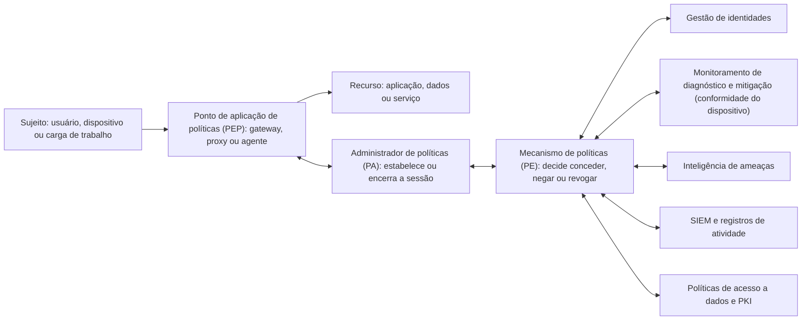

# Fundamentos de Zero Trust e Princípios

> **Objetivo pedagógico:** compreender o que é Zero Trust e por que surgiu (o fim do perímetro de rede como fronteira de confiança), conhecer os sete princípios do NIST SP 800-207 e os componentes lógicos da arquitetura (mecanismo de políticas, administrador de políticas e ponto de aplicação), as variações de implantação, os pilares dos modelos da CISA e do Departamento de Defesa dos EUA, os princípios práticos usados por fornecedores e os mitos mais comuns, relacionando-os à nuvem.

## 1. O problema: confiança implícita

No modelo tradicional de **perímetro** ("castelo e fosso"), quem está dentro da rede corporativa é tratado como confiável. Esse modelo falha porque:

| Fato | Consequência |
|---|---|
| Usuários, dispositivos e cargas estão fora do perímetro (nuvem, trabalho remoto, SaaS) | Não existe "dentro" bem definido |
| Credenciais são roubadas e dispositivos são comprometidos | Atacantes entram como usuários legítimos |
| Uma vez dentro, a movimentação lateral é fácil em redes planas | Um único ponto de entrada compromete muito |
| Serviços de nuvem são acessados por APIs e pela internet | A rede interna não controla o plano de gestão |
| Parceiros, terceiros e agentes automatizados precisam de acesso | O acesso por conexão de rede é amplo demais |

O **Zero Trust** substitui a confiança por localização por **verificação contínua e explícita**, a cada acesso, com privilégio mínimo e suposição de violação.

## 2. Origens

| Marco | Contribuição |
|---|---|
| Kindervag (Forrester), 2010 | Formulou o modelo "Zero Trust": "nunca confie, sempre verifique", com foco em segmentar e inspecionar todo tráfego |
| Google BeyondCorp (a partir de 2011; artigo de 2014) | Eliminou a dependência de VPN: o acesso a aplicações internas é decidido por identidade do usuário e estado do dispositivo |
| NSA, "Embracing a Zero Trust Security Model" (2021) | Orientação para adoção e para mitigação de riscos |
| NIST SP 800-207 (2020) | Definição, princípios e arquitetura lógica de referência |
| OMB M-22-09 (2022) | Estratégia federal dos EUA com metas por pilar |
| CISA Zero Trust Maturity Model (2021, versão 2.0 em 2023) | Modelo de maturidade em cinco pilares |
| DoD Zero Trust Strategy (2022) | Sete pilares e metas de adoção |

## 3. Os sete princípios do NIST SP 800-207

| # | Princípio | Significado prático |
|---|---|---|
| 1 | Todas as fontes de dados e serviços de computação são recursos | Dispositivos pessoais, SaaS, cargas e dados são recursos a proteger |
| 2 | Toda comunicação é protegida, independentemente da localização na rede | Criptografia e autenticação também no tráfego interno |
| 3 | O acesso a recursos individuais é concedido por sessão | Cada sessão é avaliada; sem confiança herdada de uma sessão anterior |
| 4 | O acesso é determinado por política dinâmica | Considera identidade, estado do dispositivo, aplicação, comportamento e ambiente |
| 5 | A organização monitora e mede a integridade e a postura de todos os ativos | Nenhum ativo é intrinsecamente confiável |
| 6 | A autenticação e a autorização são dinâmicas e rigorosamente aplicadas antes do acesso | Sem acesso antes da verificação |
| 7 | A organização coleta o máximo de informação sobre o estado dos ativos, da rede e das comunicações e a usa para melhorar a postura | Telemetria alimenta as políticas |

## 4. Arquitetura lógica do NIST

| Componente | Função |
|---|---|
| Mecanismo de políticas (Policy Engine, PE) | Decide se concede acesso a um recurso, com base na política e em sinais de várias fontes |
| Administrador de políticas (Policy Administrator, PA) | Executa a decisão: estabelece ou encerra o caminho de comunicação, emitindo credenciais ou tokens de sessão |
| Ponto de aplicação de políticas (Policy Enforcement Point, PEP) | Habilita, monitora e encerra conexões entre o sujeito e o recurso |
| Ponto de decisão de políticas (PDP) | PE e PA em conjunto |
| Plano de controle e plano de dados | O controle decide; os dados transportam o tráfego de aplicação, passando pelo PEP |
| Fontes de dados | Gestão de identidades, conformidade de dispositivos, inteligência de ameaças, registros e SIEM, políticas de dados e infraestrutura de chaves públicas |

### 4.1 Variações de implantação (NIST)

| Variação | Descrição |
|---|---|
| Baseada em agente ou em gateway no dispositivo | Um agente no dispositivo coordena com o PEP do recurso |
| Baseada em enclave | O PEP protege um enclave de recursos (por exemplo, um conjunto de servidores) |
| Baseada em portal de recursos | Um portal único é o PEP; o dispositivo não precisa de agente |
| Isolamento de aplicações no dispositivo | As aplicações corporativas rodam em ambientes isolados no dispositivo |

## 5. Pilares do Zero Trust

| Pilar (CISA ZTMM 2.0) | Foco | Pastas relacionadas |
|---|---|---|
| Identidade | Autenticação forte, autorização dinâmica e governança de identidades | 06; arquivo 2 |
| Dispositivos | Inventário, conformidade, integridade e confiança do dispositivo | arquivo 2 |
| Redes | Segmentação, criptografia, acesso por aplicação e eliminação da confiança por localização | 08; arquivo 3 |
| Aplicações e cargas de trabalho | Autorização por requisição, integridade e segurança do ciclo de desenvolvimento | 18 a 21; arquivo 4 |
| Dados | Classificação, proteção, criptografia e controle de acesso | 09 e 10; arquivo 4 |
| Transversais: visibilidade e análise | Telemetria, análise de risco e detecção | 13; arquivo 5 |
| Transversais: automação e orquestração | Resposta automatizada e políticas como código | arquivo 5 |
| Transversais: governança | Políticas, papéis, métricas e conformidade | 03; arquivo 6 |

O modelo do Departamento de Defesa dos EUA usa sete pilares (usuário, dispositivo, aplicação e carga de trabalho, dados, rede e ambiente, automação e orquestração, visibilidade e análise), equivalentes aos acima.

## 6. Princípios práticos usados na indústria

| Princípio | Descrição |
|---|---|
| Verificar explicitamente | Autenticar e autorizar com base em todos os sinais disponíveis (identidade, local, dispositivo, serviço, carga de trabalho, classificação de dados e anomalias) |
| Usar o privilégio mínimo | Acesso mínimo, por tempo limitado (acesso sob demanda e suficiente), com políticas adaptativas por risco |
| Assumir violação | Minimizar o raio de impacto, segmentar, criptografar de ponta a ponta, usar análise para detectar e responder |

## 7. Zero Trust em nuvem: particularidades

| Aspecto | Observação |
|---|---|
| A nuvem já é "sem perímetro" | O plano de controle é acessado pela internet por identidades: o Zero Trust é a forma natural de proteger |
| Identidade como pilar principal | As APIs são o principal ponto de controle |
| Responsabilidade compartilhada | O provedor oferece os mecanismos (acesso condicional, redes privadas e identidades de carga); o cliente configura e verifica |
| Efemeridade e automação | Políticas devem ser aplicadas por código e escalar com os recursos |
| Multicloud e SaaS | Políticas consistentes entre ambientes exigem identidade e telemetria centralizadas |
| Acesso de cargas e de serviços | Autenticação e autorização entre serviços (identidades de carga e mTLS) |

## 8. Mitos e equívocos

| Mito | Realidade |
|---|---|
| "Zero Trust é um produto que se compra" | É uma estratégia e uma arquitetura; produtos apoiam, mas não a substituem |
| "Zero Trust significa não confiar em ninguém e bloquear tudo" | É conceder acesso **mínimo, verificado e contextual**, o que pode melhorar a experiência quando bem feito |
| "Basta trocar a VPN por ZTNA" | O acesso por aplicação é uma parte; identidade, dispositivos, dados e telemetria também são necessários |
| "Zero Trust elimina o perímetro e a rede" | A rede continua importante (segmentação, criptografia e controle de saída), mas deixa de ser a base da confiança |
| "É um projeto com data de término" | É uma jornada contínua, com maturidade evolutiva |
| "Exige trocar toda a infraestrutura" | Pode ser adotado de forma incremental, a partir de superfícies de proteção prioritárias |
| "É só para grandes organizações" | Os princípios (MFA forte, privilégio mínimo e segmentação) aplicam-se a qualquer porte |

## 9. Exemplo prático: o mesmo acesso, sem e com Zero Trust

Cenário: um analista financeiro acessa um sistema de relatórios hospedado em nuvem.

| Aspecto | Modelo de perímetro | Zero Trust |
|---|---|---|
| Entrada | VPN para toda a rede interna, com senha e código | Acesso direto à aplicação pelo proxy com identidade, MFA resistente a phishing e dispositivo conforme |
| Alcance | Toda a rede: servidores e bancos acessíveis | Somente a aplicação autorizada, e apenas as funções do papel |
| Verificação | Uma vez, na conexão | Por sessão e contínua (risco, dispositivo e comportamento) |
| Dispositivo comprometido | Acesso permitido se a senha estiver correta | Acesso negado ou limitado se o dispositivo não estiver conforme |
| Movimentação lateral | Possível por rede plana | Bloqueada por microssegmentação e por autorização por serviço |
| Registro | Conexão VPN | Cada acesso, com contexto da decisão |

## 10. Casos de uso corporativos

- Definição da estratégia de Zero Trust da organização, alinhada à adoção de nuvem.
- Substituição de VPN de acesso amplo por acesso por aplicação.
- Fundamentação de investimentos em identidade, dispositivos e segmentação.

## 11. Normas e frameworks relevantes

- NIST SP 800-207; NIST SP 800-207A (Zero Trust em ambientes de nuvem nativos de aplicação); NIST SP 1800-35 (implementações práticas, edição vigente)
- CISA Zero Trust Maturity Model 2.0; DoD Zero Trust Strategy e Reference Architecture; OMB M-22-09; NSA Embracing a Zero Trust Security Model
- CSA. Zero Trust Advancement Center (documentação); ISO/IEC 27002:2022 (controles de acesso e de rede); NIST CSF 2.0 (PR.AA e PR.IR)
- NCSC (Reino Unido). Zero trust architecture design principles

## 12. Checklist operacional: base de Zero Trust

- [ ] Estratégia de Zero Trust aprovada pela direção, com patrocinador e responsáveis por pilar
- [ ] Princípios (verificar explicitamente, privilégio mínimo e assumir violação) adotados em padrões de arquitetura
- [ ] Inventário de recursos, de usuários, de dispositivos e de fluxos críticos
- [ ] Arquitetura lógica definida (mecanismo, administrador e pontos de aplicação) por superfície de proteção
- [ ] Linha de base de maturidade por pilar avaliada (arquivo 6)
- [ ] Mitos esclarecidos junto às partes interessadas (não é um produto)
- [ ] Indicadores e calendário de revisão definidos

## 13. Referências

- Rose, S. et al. NIST SP 800-207: Zero Trust Architecture. 2020; NIST SP 800-207A. 2023.
- CISA. Zero Trust Maturity Model, versão 2.0. 2023.
- Ward, R.; Beyer, B. BeyondCorp: A New Approach to Enterprise Security. ;login:, v. 39, n. 6, 2014.
- Kindervag, J. No More Chewy Centers: Introducing The Zero Trust Model Of Information Security. Forrester Research, 2010.
- U.S. Department of Defense. Zero Trust Strategy. 2022.
- Office of Management and Budget. M-22-09. 2022; NSA. Embracing a Zero Trust Security Model. 2021.
