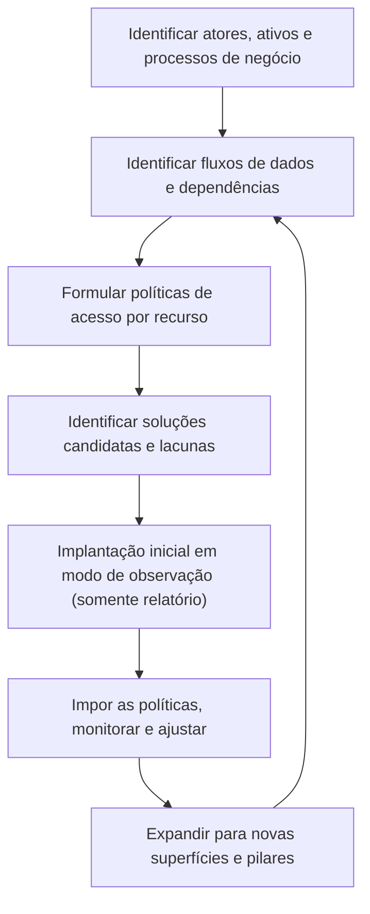

# Roteiro de Implementação e Modelo de Maturidade

> **Objetivo pedagógico:** planejar a jornada de adoção de Zero Trust de forma incremental e priorizada: aplicar a abordagem de superfícies de proteção em cinco passos, seguir as etapas de migração do NIST SP 800-207, usar o modelo de maturidade da CISA (tradicional, inicial, avançado e ideal) para avaliar cada pilar, priorizar ganhos rápidos de maior redução de risco, organizar fases em horizontes de tempo, definir indicadores de progresso e evitar armadilhas comuns.

## 1. Abordagem por superfícies de proteção

Em vez de tentar proteger tudo de uma vez, o Zero Trust começa por **superfícies de proteção**: os dados, ativos, aplicações e serviços **mais críticos** (DAAS, na formulação de Kindervag).

| Passo | Descrição | Entregável |
|---|---|---|
| 1. Definir a superfície de proteção | Identificar os dados, ativos, aplicações e serviços mais críticos | Lista priorizada de superfícies |
| 2. Mapear os fluxos de transações | Entender como usuários, serviços e dados interagem com a superfície | Diagramas de fluxo e de dependências |
| 3. Construir a arquitetura de Zero Trust | Projetar os pontos de aplicação e os controles por superfície | Arquitetura-alvo |
| 4. Criar a política de Zero Trust | Definir quem acessa o quê, quando, como e por quê (política dos "cinco Ws") | Política de acesso por superfície |
| 5. Monitorar e manter | Coletar telemetria, testar, ajustar e expandir | Painéis, relatórios e melhoria contínua |

## 2. Etapas de migração (NIST SP 800-207)

Uma implantação típica opera inicialmente em **modo de observação** para avaliar o impacto das políticas, antes de **impor** controles de bloqueio, e só então expande.

## 3. Modelo de maturidade da CISA (ZTMM 2.0)

O modelo avalia cada pilar em quatro estágios:

| Estágio | Descrição |
|---|---|
| Tradicional | Configuração manual, políticas estáticas, correlação limitada, confiança implícita em partes do ambiente |
| Inicial | Automação inicial, atribuição de atributos, algumas respostas a eventos e visibilidade parcial |
| Avançado | Automação ampla, políticas coordenadas entre pilares, visibilidade centralizada, respostas orientadas por risco |
| Ideal | Totalmente automatizado, decisões dinâmicas e just-in-time, visibilidade e análise completas, adaptação contínua |

### 3.1 Exemplos de estágios por pilar em nuvem (interpretação para este repositório)

| Pilar | Tradicional | Inicial | Avançado | Ideal |
|---|---|---|---|---|
| Identidade | Senhas e MFA parcial; privilégios permanentes | MFA para todos; acesso condicional básico | MFA resistente a phishing; elevação sob demanda; avaliação de risco | Autenticação contínua, sem senha, privilégios just-in-time e decisões dinâmicas |
| Dispositivos | Inventário parcial; sem verificação de conformidade | Gestão (UEM) e conformidade como condição de acesso em recursos principais | Conformidade e EDR integrados ao acesso; identidade de dispositivo | Postura em tempo real, atestação e ajuste dinâmico do acesso |
| Redes | Perímetro e VPN ampla; rede plana | Segmentação por ambiente; acesso por aplicação em parte | Microssegmentação; ZTNA amplo; pontos privados; mTLS | Rede definida por software com microperímetros dinâmicos e criptografia total |
| Aplicações e cargas | Autorização no perímetro; segredos em arquivos | Autenticação por token; identidades de carga; varredura | Autorização por requisição; imagens assinadas; admissão por política | Autorização contínua e dinâmica; proveniência verificada em tempo de execução |
| Dados | Classificação manual limitada; criptografia parcial | Classificação e criptografia em dados principais; DLP básica | Acesso por atributos; chaves por domínio; registros de acesso e DLP integrada | Proteção dinâmica orientada por risco; criptografia e acesso ajustados em tempo real |
| Visibilidade e análise | Registros dispersos | Registros centralizados; regras básicas | Correlação entre pilares; análise de comportamento; pontuação de risco | Análise em tempo real com aprendizado e adaptação contínua |
| Automação e orquestração | Respostas manuais | Automação pontual (tíquetes e notificações) | Respostas automatizadas coordenadas com salvaguardas | Orquestração completa e autocorreção |
| Governança | Políticas por silos | Política de Zero Trust e donos por pilar | Políticas integradas, métricas e auditorias contínuas | Governança dinâmica, adaptativa e orientada por dados |

### 3.2 Avaliação de maturidade (modelo)

| Pilar | Estágio atual | Evidências | Lacunas | Estágio-alvo e prazo | Ações priorizadas |
|---|---|---|---|---|---|
| Identidade | | | | | |
| Dispositivos | | | | | |
| Redes | | | | | |
| Aplicações e cargas | | | | | |
| Dados | | | | | |
| Visibilidade e análise | | | | | |
| Automação e orquestração | | | | | |
| Governança | | | | | |

Avalie com **evidências** (configurações, relatórios e testes), e não por declarações. Reavalie ao menos uma vez por ano.

## 4. Priorização: ganhos rápidos de maior redução de risco

| Prioridade | Ação | Pilar | Esforço | Redução de risco |
|---|---|---|---|---|
| 1 | MFA resistente a phishing para administradores e para o plano de controle | Identidade | Médio | Muito alta |
| 2 | Bloquear autenticação legada e habilitar acesso condicional de linha de base | Identidade | Baixo a médio | Alta |
| 3 | Fechar portas de administração expostas e usar sessões autenticadas | Redes | Baixo | Alta |
| 4 | Registros de identidade e de plano de controle centralizados, com detecções prioritárias | Visibilidade | Médio | Alta |
| 5 | Conformidade de dispositivo como condição de acesso a recursos sensíveis | Dispositivos | Médio | Alta |
| 6 | Eliminar credenciais de longa duração em pipelines e cargas | Aplicações | Médio | Alta |
| 7 | Acesso por aplicação (ZTNA) para as aplicações mais críticas | Redes | Médio a alto | Alta |
| 8 | Microssegmentação de ambientes de dados e de produção | Redes | Alto | Alta |
| 9 | Classificação de dados e acesso por atributos para dados restritos | Dados | Alto | Alta |
| 10 | Automação de resposta com salvaguardas | Automação | Médio a alto | Média a alta |

## 5. Roteiro por horizonte de tempo

| Horizonte | Foco | Entregáveis |
|---|---|---|
| 0 a 90 dias: fundamentos e ganhos rápidos | Identidade forte, linha de base e visibilidade | Estratégia e patrocínio; inventário; MFA resistente a phishing para privilegiados; acesso condicional; bloqueio de autenticação legada; contas de emergência; registros centralizados; fechamento de portas expostas; seleção das superfícies de proteção prioritárias |
| 3 a 12 meses: superfícies críticas | Aplicar o modelo às superfícies prioritárias | Conformidade de dispositivos como condição; acesso por aplicação para sistemas críticos; microssegmentação inicial; federação de pipelines; classificação de dados das superfícies; detecções e primeiras respostas automatizadas |
| 12 a 36 meses: expansão e otimização | Cobertura ampla e automação | Extensão a todas as aplicações e dados; autorização por requisição em APIs; malha de serviços onde justificado; acesso por atributos; análise de comportamento; orquestração; revisão de maturidade |
| Contínuo | Melhoria e governança | Indicadores, auditorias, exercícios, revisão de políticas, adaptação a novas ameaças |

## 6. Indicadores de progresso

| Indicador | Meta |
|---|---|
| Contas privilegiadas com MFA resistente a phishing | 100% |
| Autenticação legada bloqueada | 100% |
| Aplicações críticas acessadas por ZTNA (e não por VPN ampla) | Crescente até 100% das críticas |
| Dispositivos com conformidade verificada como condição de acesso | Acima de 95% dos que acessam recursos sensíveis |
| Cargas e pipelines sem credenciais de longa duração | 100% das novas; plano para as existentes |
| Serviços críticos com microssegmentação e mTLS | Crescente |
| Dados restritos classificados, com acesso por atributos e registros de acesso | 100% |
| Cobertura de telemetria nos pilares | 100% das fontes críticas |
| Tempo mediano de detecção e de contenção | Em redução |
| Percentual de pilares no estágio-alvo | Conforme o plano |

## 7. Armadilhas comuns

| Armadilha | Consequência | Prevenção |
|---|---|---|
| Tratar Zero Trust como a compra de um produto | Investimento sem redução de risco | Estratégia, pilares e arquitetura antes da ferramenta |
| Começar por tudo ao mesmo tempo | Esgotamento e falta de resultados | Superfícies de proteção priorizadas |
| Impor políticas sem fase de observação | Interrupções e rejeição das áreas | Modo de relatório, comunicação e piloto |
| Ignorar a experiência do usuário | Contornos e *shadow IT* | Simplicidade, autenticação sem senha, acesso transparente |
| Esquecer contas de emergência e exceções | Bloqueios totais ou exceções permanentes | Contas de emergência e gestão de exceções |
| Foco apenas em rede ou apenas em identidade | Lacunas em outros pilares | Avaliação por pilar e plano integrado |
| Não medir | Sem prova de progresso | Indicadores e avaliação de maturidade |
| Telemetria insuficiente | Decisões cegas | Visibilidade desde o início |
| Falta de patrocínio e de governança | Projeto sem autoridade | Patrocinador, donos por pilar e comitê |

## 8. Exemplo prático: plano de 12 meses de uma instituição financeira

| Trimestre | Entregas | Resultado esperado |
|---|---|---|
| T1 | Estratégia aprovada; superfícies de proteção: sistemas de pagamentos e base de clientes; MFA resistente a phishing para 100% dos privilegiados; bloqueio de autenticação legada; registros de identidade centralizados | Identidade: de Tradicional a Inicial; redução imediata de risco |
| T2 | Conformidade de dispositivos para acesso aos sistemas de pagamentos; acesso por aplicação (ZTNA) para 6 aplicações críticas; fechamento de portas de administração | Dispositivos e redes: Inicial |
| T3 | Microssegmentação do ambiente de pagamentos; federação dos pipelines; classificação e acesso por atributos na base de clientes; primeiras detecções correlacionadas | Aplicações e dados: Inicial; visibilidade: Inicial a Avançado |
| T4 | Respostas automatizadas com salvaguardas; autorização por requisição nas APIs de pagamentos; autoavaliação de maturidade e plano para o ano seguinte | Automação: Inicial; revisão geral |
| Resultado | Superfícies críticas com identidade forte, acesso por aplicação, segmentação e telemetria; tempo mediano de contenção de incidentes de identidade reduzido de 6 horas para 40 minutos | |

## 9. Casos de uso corporativos

- Planejamento plurianual de Zero Trust com metas de maturidade por pilar.
- Priorização de investimentos com base em redução de risco e em esforço.
- Relatórios à direção sobre o progresso e a eficácia do programa.

## 10. Normas e frameworks relevantes

- NIST SP 800-207 (migração para Zero Trust); CISA Zero Trust Maturity Model 2.0; DoD Zero Trust Strategy e Roadmap; OMB M-22-09
- NSA. Zero Trust Implementation Guidelines (série, edições vigentes); CSA. Zero Trust Advancement Center
- NIST CSF 2.0 (perfis atual e alvo); ISO/IEC 27001:2022 (melhoria contínua)
- NCSC. Zero trust architecture design principles

## 11. Checklist operacional: roteiro de Zero Trust

- [ ] Estratégia aprovada, com patrocinador, responsáveis por pilar e orçamento
- [ ] Superfícies de proteção priorizadas, com fluxos mapeados
- [ ] Avaliação de maturidade por pilar com evidências e linha de base
- [ ] Ganhos rápidos executados (MFA resistente a phishing, acesso condicional, portas expostas e registros)
- [ ] Políticas implantadas em modo de observação antes da imposição, com comunicação às áreas
- [ ] Roteiro por horizontes de tempo aprovado, com marcos e indicadores
- [ ] Contas de emergência e gestão de exceções definidas
- [ ] Indicadores reportados trimestralmente à direção
- [ ] Reavaliação anual de maturidade e ajuste do roteiro

## 12. Referências

- Rose, S. et al. NIST SP 800-207, seção 7: Migrating to Zero Trust. 2020.
- CISA. Zero Trust Maturity Model, versão 2.0. 2023.
- Kindervag, J. Five-step model for deploying Zero Trust (Palo Alto Networks, material de referência).
- NSA. Zero Trust Implementation Guidelines. 2024 e 2025.
- U.S. Department of Defense. Zero Trust Strategy. 2022; Zero Trust Capability Execution Roadmap.
- Cloud Security Alliance. Zero Trust Advancement Center (documentação).
