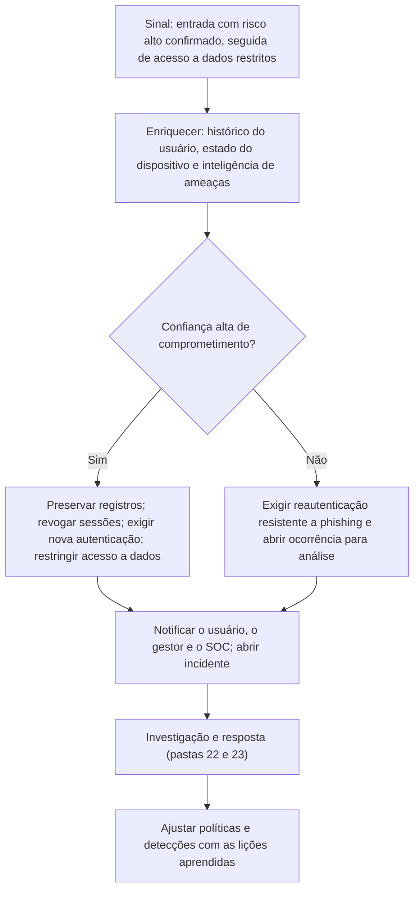

# Visibilidade, Análise, Automação e Orquestração

> **Objetivo pedagógico:** construir as capacidades transversais que fazem o Zero Trust funcionar na prática: visibilidade (telemetria de todos os pilares), análise (pontuação de risco, análise de comportamento e detecção), automação e orquestração (resposta automatizada, políticas como código e fluxos de remediação) e governança (políticas, papéis e métricas), conectando os sinais ao mecanismo de decisão de acesso e fechando o ciclo de melhoria.

## 1. Por que são capacidades transversais

O Zero Trust depende de **decisões dinâmicas baseadas em sinais**. Sem telemetria confiável, sem análise e sem automação, as políticas ficam estáticas, e a resposta, lenta.

| Capacidade | Contribuição |
|---|---|
| Visibilidade | Fornece os dados que alimentam as decisões e a detecção |
| Análise | Transforma dados em risco e em alertas |
| Automação e orquestração | Executa respostas e aplica políticas em escala e em velocidade |
| Governança | Define o que se decide, quem decide, e como se mede |

## 2. Fontes de telemetria por pilar

| Pilar | Fontes | Exemplos de sinais |
|---|---|---|
| Identidade | Registros de entrada e de auditoria; eventos de MFA e de risco | Viagem impossível, falhas de MFA, mudanças de métodos, credenciais vazadas |
| Dispositivos | UEM, EDR e registros do sistema | Conformidade, vulnerabilidades, detecções de malware, perda de integridade |
| Redes | Registros de fluxo, de DNS, de firewall, de proxy e do intermediário de acesso | Comunicação anômala, destinos novos, varreduras e volumes de saída |
| Aplicações e cargas | Registros de aplicações, de gateways de API, de orquestradores e de malha de serviços | Falhas de autorização, uso anômalo de tokens, comportamento de contêineres |
| Dados | Registros de acesso a dados, DLP e auditoria de bancos | Acessos em massa, exportações, consultas incomuns |
| Plano de controle da nuvem | Registros de auditoria (CloudTrail, log de atividade e Cloud Audit Logs) | Criação de credenciais, alterações de políticas, desativação de registros |
| SaaS | Registros de auditoria das aplicações | Compartilhamentos externos, consentimentos, exportações |
| Inteligência de ameaças | Indicadores e relatórios | Domínios, IPs e técnicas conhecidas |

Requisitos: **centralização** em um SIEM ou plataforma de dados de segurança, **normalização** de campos, **horários sincronizados**, **retenção adequada** e **proteção contra alteração** (pasta 13).

## 3. Análise e pontuação de risco

| Técnica | Descrição | Uso |
|---|---|---|
| Regras de detecção | Condições conhecidas (por exemplo, uso da conta raiz) | Alertas determinísticos |
| Análise de comportamento (UEBA) | Linhas de base de usuários e de entidades; detecção de desvios | Acesso incomum, volumes atípicos |
| Pontuação de risco de usuário e de entrada | Combina sinais (credenciais vazadas, anonimizadores e anomalias) | Alimenta o acesso condicional |
| Pontuação de risco de dispositivo | Conformidade, vulnerabilidades e alertas de EDR | Define o nível de confiança do dispositivo |
| Correlação entre pilares | Eventos de identidade, de dispositivo, de rede e de dados | Detecção de cadeias de ataque |
| Inteligência de ameaças | Enriquecimento com indicadores | Priorização |
| Mapeamento ao ATT&CK | Cobertura de técnicas | Gestão da lacuna de detecção |

```kusto
// Exemplo (KQL): correlacionar entrada de risco alto com acesso a armazenamento de dados sensíveis na mesma hora
// (tabelas ilustrativas; adapte ao seu esquema de dados)
let entradas_risco = SigninLogs
    | where TimeGenerated > ago(1d) and RiskLevelDuringSignIn in ("high", "medium")
    | project UserPrincipalName, IPAddress, TempoEntrada = TimeGenerated;
let acessos_dados = StorageBlobLogs
    | where TimeGenerated > ago(1d) and OperationName == "GetBlob"
    | project UserPrincipalName = tostring(AuthenticationType), CallerIpAddress, TempoAcesso = TimeGenerated, Uri;
entradas_risco
| join kind=inner (acessos_dados) on $left.IPAddress == $right.CallerIpAddress
| where TempoAcesso between (TempoEntrada .. TempoEntrada + 1h)
| project UserPrincipalName, IPAddress, TempoEntrada, TempoAcesso, Uri
```

O exemplo ilustra a **correlação entre pilares**; os nomes de tabelas e de campos variam conforme a fonte e a configuração dos registros.

## 4. Automação e orquestração

### 4.1 O que automatizar

| Tipo de automação | Exemplos |
|---|---|
| Resposta a eventos de identidade | Revogar sessões, exigir nova autenticação e desativar a conta em risco alto confirmado |
| Resposta a eventos de dispositivos | Isolar o dispositivo, restringir o acesso e abrir ocorrência quando o EDR detectar comprometimento |
| Resposta de rede e de dados | Bloquear destino malicioso, restringir exportação e revogar compartilhamentos externos |
| Correção de postura | Reverter configurações não conformes (com cautela) ou abrir tíquete para o proprietário |
| Ciclo de vida de identidades | Desativação automática no desligamento; expiração de acessos temporários |
| Políticas como código | Aplicação e verificação de políticas de acesso, de rede e de dados por código |
| Enriquecimento e triagem | Consulta a inteligência de ameaças e a inventário antes do atendimento por analistas |
| Evidências de conformidade | Coleta automática de provas |

### 4.2 Princípios de automação segura

| Princípio | Descrição |
|---|---|
| Automatizar o que informa; exigir aprovação para o que altera de forma ampla | Ações de grande impacto passam por aprovação humana |
| Preservar evidências antes de agir | Exportar o estado e os registros (pasta 23) |
| Limites e salvaguardas | Número máximo de contas ou de recursos por execução; listas de exclusão (contas críticas e de emergência) |
| Reversibilidade | Plano de reversão |
| Registro e rastreabilidade | Toda ação automática registrada com identificador e horário |
| Testes | Em ambiente de teste e com simulações |
| Privilégios mínimos para a automação | Contas de automação com permissões restritas e monitoradas |
| Falha segura | Em caso de erro, pausar e escalar |

### 4.3 Exemplo de fluxo automatizado



## 5. Governança do Zero Trust

| Elemento | Descrição |
|---|---|
| Política de Zero Trust | Princípios, escopo, pilares e responsabilidades aprovados pela direção |
| Dono por pilar | Um responsável por pilar, com metas e indicadores |
| Catálogo de políticas de acesso | Políticas por sensibilidade, com justificativas, exceções e revisão (arquivo 7) |
| Gestão de exceções | Exceções com prazo, controles compensatórios e aprovação (pasta 03) |
| Gestão de mudanças | Políticas de acesso e de rede revisadas por pares; modo de relatório antes da imposição |
| Métricas e reporte | Indicadores de adoção e de eficácia (arquivo 6) |
| Revisão periódica | Revisão das políticas, dos sinais e da maturidade |
| Auditoria | Evidências automáticas de funcionamento |

## 6. Indicadores de visibilidade, análise e automação

| Indicador | Definição | Meta |
|---|---|---|
| Cobertura de telemetria | Fontes críticas integradas ao SIEM | 100% |
| Cobertura de dispositivos com EDR e UEM | Dispositivos gerenciados e monitorados | Acima de 95% |
| Tempo de detecção e de contenção (medianas) | Do início provável à detecção e à contenção | Reduzir continuamente |
| Percentual de alertas com enriquecimento automático | Triagem assistida | Crescente |
| Respostas automatizadas bem-sucedidas | Ações automáticas concluídas sem erro | Acima de 95% |
| Tempo de revogação de sessão após evento crítico | Da detecção à revogação | Minutos |
| Falsos positivos de ações automáticas | Ações indevidas | Mínimo, com revisão |
| Cobertura ATT&CK com detecção testada | Técnicas priorizadas | Crescente |

## 7. Exemplo prático: do alerta à contenção em 7 minutos

| Tempo | Evento |
|---|---|
| 00:00 | Entrada de risco alto de uma conta financeira, a partir de IP anonimizado e novo dispositivo |
| 00:01 | O acesso condicional exige reautenticação resistente a phishing; a tentativa falha |
| 00:03 | O mesmo IP tenta acessar a API de extratos com um token roubado de outro dispositivo; a avaliação contínua rejeita o token (vinculação ao dispositivo) |
| 00:04 | O SIEM correlaciona os sinais e aciona o fluxo automatizado: registros preservados e sessões revogadas |
| 00:05 | A conta é restringida; notificações enviadas ao usuário, ao gestor e ao SOC |
| 00:07 | Incidente aberto com linha do tempo e evidências anexadas |
| Resultado | Nenhum dado acessado; o SOC confirma o roubo de credenciais e redefine os fatores; as detecções são ajustadas com os indicadores observados |

## 8. Casos de uso corporativos

- Plataforma de telemetria e de análise integrada aos mecanismos de decisão de acesso.
- Automação de resposta a eventos de identidade, de dispositivos e de dados, com salvaguardas.
- Painel de governança de Zero Trust com indicadores por pilar.

## 9. Normas e frameworks relevantes

- NIST SP 800-207 (princípios 5 e 7; fontes de dados do mecanismo de políticas); NIST SP 800-92 (gestão de logs); NIST SP 800-61 Rev. 3; NIST CSF 2.0 (DE e RS)
- CISA ZTMM 2.0 (capacidades transversais de visibilidade e análise, automação e orquestração e governança); NSA. Advancing Zero Trust Maturity Throughout the Automation and Orchestration Pillar (2024); NSA. Visibility and Analytics Pillar (2024)
- CSA CCM v4 (LOG, SEF e TVM); ISO/IEC 27002:2022 (8.15 e 8.16); CIS Controls v8.1 (controles 8 e 13)
- MITRE ATT&CK (cobertura de detecção)

## 10. Checklist operacional: capacidades transversais

- [ ] Telemetria dos pilares (identidade, dispositivos, redes, aplicações, dados e plano de controle) centralizada, normalizada e retida
- [ ] Horários sincronizados e proteção dos registros contra alteração
- [ ] Pontuação de risco de usuário e de dispositivo integrada às políticas de acesso
- [ ] Detecções por regras e por comportamento, mapeadas ao ATT&CK e testadas
- [ ] Respostas automatizadas com salvaguardas, aprovação para ações amplas e preservação de evidências
- [ ] Políticas de acesso, de rede e de dados definidas e verificadas como código
- [ ] Donos por pilar, catálogo de políticas e gestão de exceções
- [ ] Indicadores de cobertura, de tempo de resposta e de eficácia reportados
- [ ] Revisão periódica de políticas, de sinais e de automações

## 11. Referências

- Kent, K.; Souppaya, M. NIST SP 800-92: Guide to Computer Security Log Management. 2006.
- NSA. Advancing Zero Trust Maturity Throughout the Visibility and Analytics Pillar; Throughout the Automation and Orchestration Pillar. 2024.
- CISA. Zero Trust Maturity Model 2.0. 2023.
- MITRE. ATT&CK; Documentação de SIEM e de SOAR (por exemplo, Microsoft Sentinel).
- Pastas 13, 22 e 23 deste repositório.
