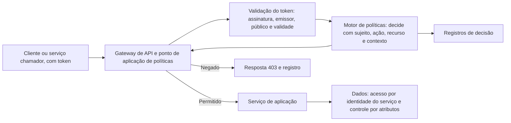
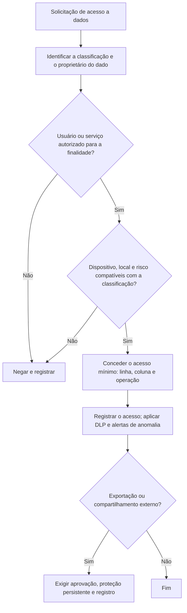

# Zero Trust para Aplicações, Cargas de Trabalho e Dados

> **Objetivo pedagógico:** aplicar o Zero Trust aos pilares de aplicações e cargas de trabalho e de dados: autorizar cada requisição (e não apenas a conexão), usar identidades e tokens de cargas de trabalho, externalizar a decisão de autorização em um motor de políticas, estabelecer confiança na cadeia de suprimentos de software (imagens assinadas e proveniência), proteger o ambiente de execução, classificar e proteger os dados com controles centrados nos dados (criptografia, acesso por atributos, prevenção de perda de dados e registros de acesso) e ilustrar a autorização por requisição com uma política em Rego.

## 1. Pilar de aplicações e de cargas de trabalho

### 1.1 Do acesso à rede à autorização por requisição

No modelo tradicional, quem alcança a aplicação pela rede costuma ser tratado como autorizado. No Zero Trust, **cada requisição** a uma aplicação ou a uma API é autenticada e autorizada.

| Capacidade | Descrição |
|---|---|
| Autenticação de usuários e de serviços em cada requisição | Tokens (OAuth 2.0 e OpenID Connect) com validação de assinatura, de emissor, de público e de validade |
| Autorização por requisição | A decisão considera o sujeito, a ação, o recurso e o contexto (escopos, funções, atributos e risco) |
| Princípio do privilégio mínimo em APIs | Escopos mínimos e autorização por objeto (evitar falhas de controle de acesso em nível de objeto) |
| Autorização externalizada | Decisão em um motor de políticas, e não espalhada pelo código |
| Identidade de cargas de trabalho | Cada serviço tem identidade própria, com credenciais de curta duração (pasta 06, arquivo 5) |
| Autenticação mútua entre serviços | mTLS e identidades criptográficas (arquivo 3) |
| Validação de entradas e proteção de APIs | Controles de aplicação (OWASP ASVS e API Security Top 10) |
| Segredos fora do código | Cofre e injeção por identidade |

### 1.2 Arquitetura de autorização



### 1.3 Exemplo: política de autorização em Rego (Open Policy Agent)

```rego
package autorizacao.extratos

import rego.v1

# Negar por padrão
default permitir := false

# Permitir leitura de extratos apenas ao titular da conta, com o escopo adequado e em horário e dispositivo aceitáveis
permitir if {
    input.metodo == "GET"
    input.caminho = ["extratos", conta]
    "extratos:ler" in input.token.escopos
    input.token.conta == conta
    input.contexto.dispositivo_conforme == true
}

# Permitir o acesso de suporte somente com aprovação registrada e prazo válido
permitir if {
    input.metodo == "GET"
    input.caminho = ["extratos", _]
    "suporte:leitura-extratos" in input.token.escopos
    input.contexto.aprovacao_ativa == true
}
```

O exemplo é **ilustrativo** e usa a sintaxe da versão atual da linguagem Rego: ajuste à versão do motor adotado. Mostra o princípio: a regra é negada por padrão, cada permissão depende de condições explícitas, e a política é testável e versionada como código.

### 1.4 Confiança na cadeia de suprimentos

| Controle | Descrição |
|---|---|
| Origem verificada de imagens e de dependências | Uso de repositórios confiáveis e controlados |
| Assinatura de artefatos | Imagens de contêiner e pacotes assinados (por exemplo, com ferramentas de assinatura de artefatos como o Sigstore e o cosign) |
| Proveniência | Registro verificável de como e onde o artefato foi construído (atestações de build; níveis do SLSA) |
| Lista de materiais de software (SBOM) | Inventário de componentes para gestão de vulnerabilidades |
| Admissão por política | O cluster só executa imagens assinadas e conformes (políticas de admissão) |
| Varredura contínua | Vulnerabilidades em imagens e em dependências (pastas 15, 18 e 19) |
| Pipelines protegidos | Identidades e permissões mínimas no CI/CD (pasta 21) |

### 1.5 Ambiente de execução

| Controle | Descrição |
|---|---|
| Imagens mínimas e imutáveis | Reduzem a superfície; substituídas em vez de alteradas |
| Isolamento e permissões mínimas | Contêineres sem privilégios, sistemas de arquivos de somente leitura e perfis de segurança |
| Verificação de integridade em tempo de execução | Detecção de alterações e de comportamento anômalo (pasta 18) |
| Proteção de segredos em memória e em transporte | Cofres e criptografia |
| Isolamento entre locatários e entre cargas | Contas, redes e identidades separadas (pasta 05) |

## 2. Pilar de dados

No Zero Trust, **os dados são o objetivo da proteção**; os demais pilares existem para protegê-los.

### 2.1 Capacidades

| Capacidade | Descrição |
|---|---|
| Descoberta e classificação | Saber onde estão os dados e qual a sensibilidade (inventário, catálogos, classificação automática e rótulos) |
| Políticas de acesso baseadas em atributos | Acesso por classificação, função, finalidade, dispositivo e contexto; controle em nível de linha e de coluna |
| Criptografia em repouso e em trânsito | Em todas as camadas; chaves sob controle adequado (pasta 10) |
| Criptografia de uso e de ponta a ponta | Para dados altamente sensíveis, quando justificado (por exemplo, computação confidencial) |
| Prevenção de perda de dados (DLP) | Detecção e bloqueio de movimentos indevidos de dados sensíveis |
| Direitos digitais e proteção persistente | Proteção que acompanha o arquivo (rótulos com criptografia) |
| Registros de acesso a dados | Registro de quem acessou o quê, com alertas de anomalias |
| Minimização e retenção | Coletar o necessário e eliminar ao fim da finalidade (LGPD) |
| Controle de exportações e de compartilhamentos | Aprovação e registro de cópias e de acessos externos |
| Backups protegidos | Imutáveis e isolados (pasta 05, arquivo 5) |

### 2.2 Decisão de acesso a dados



### 2.3 Controles por classificação

| Classificação | Controles de Zero Trust centrados em dados |
|---|---|
| Interna | Acesso autenticado; criptografia padrão; registros básicos |
| Confidencial | Acesso por função e por finalidade; criptografia com chaves do cliente; registros de acesso a dados; DLP |
| Restrita | Acesso nominal e temporário; dispositivo e autenticação de nível alto; chaves exclusivas e separadas; monitoramento reforçado; exportação sob aprovação; sem cópias fora da zona |

Os detalhes de proteção de dados e de criptografia estão nas pastas 09 e 10.

## 3. Exemplo prático: autorização por requisição em uma API de extratos

| Elemento | Decisão |
|---|---|
| Autenticação | Tokens de curta duração emitidos pelo provedor de identidade; o gateway valida emissor, público, assinatura e validade |
| Autorização | O motor de políticas recebe o token, o método, o caminho e o contexto, e decide por requisição |
| Princípio do privilégio mínimo | O escopo `extratos:ler` só permite ler os extratos da própria conta do titular; consultas de outros clientes são negadas |
| Serviço de suporte | Acesso a extratos de clientes somente com aprovação registrada, prazo e motivo; todas as consultas auditadas |
| Entre serviços | A API usa identidade de carga e mTLS para falar com o banco; o banco aceita apenas a identidade da API, por ponto privado |
| Dados | Campos sensíveis (CPF e dados bancários) criptografados com chave exclusiva; mascaramento nos registros; DLP nas exportações |
| Cadeia de suprimentos | Imagem da API assinada e com SBOM; admissão apenas de imagens assinadas |
| Resultado | Em um teste de segurança, a tentativa de acessar extratos de outra conta com um token válido falhou (autorização por objeto), e a consulta foi registrada e alertada |

## 4. Casos de uso corporativos

- Padronização de autorização por requisição com motor de políticas para APIs e microsserviços.
- Programa de confiança na cadeia de suprimentos de software (assinatura, proveniência e admissão).
- Controles centrados em dados com acesso por atributos, DLP e registros de acesso.

## 5. Normas e frameworks relevantes

- NIST SP 800-207 e 800-207A (autorização em nuvem nativa de aplicação); NIST SP 800-204 e 204B (ABAC em microsserviços); NIST SP 800-218 (SSDF)
- OWASP ASVS e OWASP API Security Top 10; SLSA (Supply-chain Levels for Software Artifacts); Sigstore; SPIFFE
- CISA ZTMM 2.0 (pilares de aplicações e de dados); CSA CCM v4 (AIS, DSP e CEK); ISO/IEC 27002:2022 (5.12, 5.15 e 8.24 a 8.28)
- LGPD, arts. 6º, 11 e 46

## 6. Checklist operacional: aplicações, cargas e dados em Zero Trust

- [ ] Autenticação e autorização por requisição em APIs e em serviços, com tokens validados
- [ ] Autorização externalizada em motor de políticas, com negação por padrão, testada e versionada
- [ ] Escopos mínimos e autorização por objeto em APIs
- [ ] Identidade de cargas e autenticação mútua entre serviços
- [ ] Imagens e artefatos assinados, com proveniência e SBOM; admissão por política
- [ ] Ambiente de execução endurecido (imagens mínimas, sem privilégios e imutáveis)
- [ ] Dados descobertos, classificados e rotulados; controles por classificação
- [ ] Acesso a dados por atributos, com registro e alertas de anomalia
- [ ] Criptografia em repouso e em trânsito, com controle das chaves por classificação
- [ ] DLP e aprovação de exportações e de compartilhamentos externos

## 7. Referências

- Chandramouli, R.; Butcher, Z. NIST SP 800-207A. 2023; Chandramouli, R. NIST SP 800-204B: Attribute-based Access Control for Microservices-based Applications Using a Service Mesh. 2021.
- OWASP. API Security Top 10 (2023) e Application Security Verification Standard 4.0.
- Open Policy Agent. Documentação da linguagem Rego. https://www.openpolicyagent.org
- SLSA. Supply-chain Levels for Software Artifacts (especificação); Sigstore (documentação).
- Dodge, J. et al. NIST SP 800-218: Secure Software Development Framework. 2022.
- Pastas 05, 09, 10, 18, 19 e 21 deste repositório.
